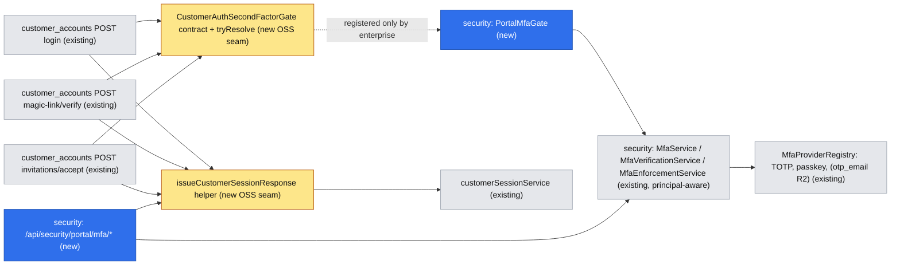
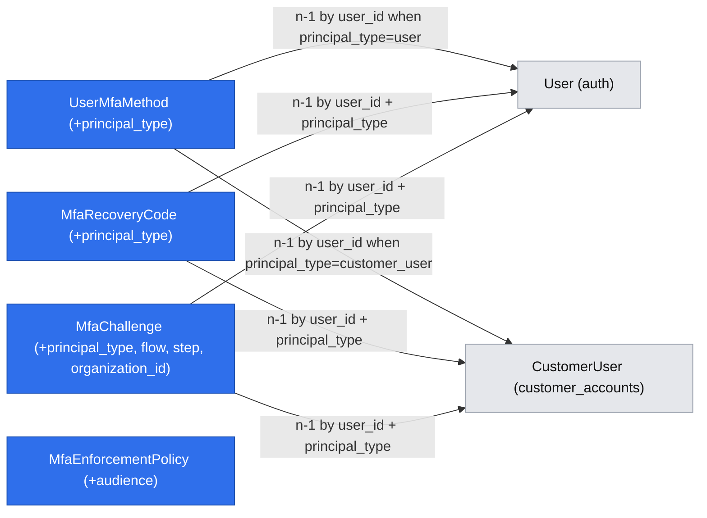

# Customer Portal Multi-Factor Authentication (Enterprise)

| Field | Value |
|-------|-------|
| Status | Draft (design-only) |
| Scope | Enterprise (`packages/enterprise/src/modules/security`) + minimal additive OSS seams in `packages/core/src/modules/customer_accounts` and `packages/core/src/modules/portal` |
| Tracking issue | #7345 |
| Related | [SPEC-ENT-001](implemented/SPEC-ENT-001-2026-02-17-security-module-enterprise-mfa.md) (backoffice MFA), [SPEC-ENT-007](implemented/SPEC-ENT-007-2026-03-06-auth-login-interceptors-extension.md) (login interceptor gate), [SPEC-ENT-008](implemented/SPEC-ENT-008-2026-03-08-mfa-challenge-ui-component-registry.md) (challenge UI registry), [SPEC-ENT-009](implemented/SPEC-ENT-009-2026-03-08-mfa-enrollment-redirect-popup.md) (enrolment notice), [Passkey assertion](2026-08-14-passkey-mfa-require-webauthn-assertion.md), [Passkey attestation](2026-10-01-passkey-enrollment-require-webauthn-attestation.md), [Emergency bypass](2026-10-18-mfa-emergency-bypass-notification.md), #7344 (password strength parity) |

## 📝 TLDR

Customer-portal users (`customer_users`) can today sign in with a password, a magic link or an accepted invitation and nothing can require a second factor; the enterprise `security` module's MFA covers backoffice `users` only. **Proposed (future behaviour):** when the enterprise `security` module is enabled, portal users can enrol TOTP, passkeys and recovery codes from a portal **Security** page; a tenant (optionally an organization) can **enforce** portal MFA from the existing enforcement admin; every portal session-minting path (password login, magic-link verify, invitation accept) returns `mfa_required` and mints the session only after a verified challenge; backoffice admins can **reset** a customer user's MFA. The OSS edition keeps its exact current behaviour because the portal routes consult an optional DI gate that only the enterprise module registers. Release 1 is fully offline-testable (TOTP codes computed locally, recovery codes, passkeys via a CDP virtual authenticator); email OTP is designed but ships in Release 2 with tests against the captured system-email channel.

## 📝 Resolved assumptions (autonomous defaults)

These were Open Questions resolved by `om-auto-write-spec` under autonomous defaults. Any of them can be overridden before merge.

| # | Question | Applied default | Rationale | Confirm? |
|---|----------|-----------------|-----------|----------|
| Q1 | Data model: principal discriminator on the existing MFA tables (a) or separate `customer_user_mfa_*` tables (b)? | **(a)** additive `principal_type` column (`'user'` default, `'customer_user'`) on `user_mfa_methods`, `mfa_recovery_codes`, `mfa_challenges`; additive `audience` column (`'backoffice'` default, `'portal'`) on `mfa_enforcement_policies`. Services take an explicit `MfaPrincipal`. | Providers, challenge state machine, attempt counting, recovery-code hashing and policy resolution are reused verbatim; (b) duplicates three entities and four services and drifts. No cross-module ORM relation either way (`user_id` is a bare uuid). | ⚠ NEEDS HUMAN CONFIRMATION — schema shape of security tables is costly to reverse |
| Q2 | Can customer companies (portal admins) enforce MFA on their own users in v1? | **No.** Only backoffice admins with `security.portal_mfa.manage` set portal policies. | Issue default; least new surface (no portal-side policy UI or portal ACL). | reversible |
| Q3 | OSS seam: post-hoc API interceptor (as SPEC-ENT-007 does for `auth/login`) or a pre-session DI gate? | **Pre-session DI gate** `customerAuthSecondFactorGate`, resolved soft-optionally by the portal routes **before** `customerSessionService.createSession`. | Portal routes set cookies and persist a `customer_user_sessions` row before any after-interceptor runs; an interceptor would have to revoke a live session and strip `Set-Cookie`, which is a bypass-by-bug surface. A gate that runs first never mints a session. | reversible (OSS contract is additive) |
| Q4 | Portal UI: component-replacement handle on the portal login form wrapped by `MfaChallengePanel`, or redirect to a security-owned portal page? | **Redirect.** The gate response carries a sanitized same-origin `redirect`; the OSS login / magic-link / invite pages follow it when `mfa_required === true`. Challenge, forced-enrolment and Security pages live in the `security` module under `frontend/[orgSlug]/portal/...`. | One generic OSS change (follow `redirect`) instead of a new replacement handle per auth page; reloading the challenge page survives because state lives in an httpOnly cookie. | reversible |
| Q5 | Email OTP in the first release? | **No — Release 2 (Phase 6).** Release 1 = TOTP + recovery codes + passkeys. Email OTP tests will use the captured system-email fixture (`communicationChannelsFixtures.waitForCapturedSystemEmail`), never a real mail server. | Offline-testability constraint; ASVS 6.3.6 (email is not an L3 factor). | reversible |
| Q6 | Split into several specs (enforcement / enrolment / challenge / admin reset)? | **One spec, phased.** | The pieces are not independently valuable: a challenge without enrolment is unreachable, enforcement without a challenge is a bypass, admin reset without either is meaningless. Phases still ship independently and safely. | reversible |
| Q7 | Does an admin MFA reset revoke the customer user's portal sessions? | **Yes** (`customerSessionService.revokeAllUserSessions`, resolved soft-optionally). | A reset is usually a compromise or lost-device response; leaving live sessions defeats it. | reversible |
| Q8 | Do failed MFA attempts count towards the portal account lockout (`failedLoginAttempts`)? | **No.** Challenge-level attempt cap (existing `securityConfig.mfa.maxAttempts`) + per-IP and per-challenge rate limit; the challenge is invalidated when exhausted. | Avoids letting an attacker who knows only the password lock out the real user; mirrors backoffice behaviour. | reversible |
| Q9 | Does reset-confirm need a gate? | **No gate, regression test instead.** `POST /api/customer_accounts/password/reset-confirm` already mints no session (it revokes all sessions and returns `{ ok: true }`); the spec adds a test that reset never clears MFA and that the follow-up login is challenged. A gate call is added only if that route ever starts minting a session. | Verified in code (`api/password/reset-confirm.ts`); zero OSS change needed for ASVS 6.4.3. | reversible |

## 📝 Problem Statement

- `packages/enterprise/src/modules/security` implements MFA, enforcement and sudo for backoffice `users` only. `UserMfaMethod`, `MfaRecoveryCode`, `MfaChallenge` key on `user_id` with no principal type; `MfaService`, `MfaVerificationService`, `MfaEnforcementService` and `MfaAdminService` resolve the principal through `@open-mercato/core/modules/auth` `User`.
- Portal session issuance happens in three OSS routes, each calling `customerSessionService.createSession` and setting `customer_auth_token` + `customer_session_token` directly: `api/login.ts`, `api/magic-link/verify.ts`, `api/invitations/accept.ts`. Nothing can interpose a second factor; a factor added after the fact would be bypassable through magic link (ASVS 6.4.3).
- Operators exposing orders, contracts, invoices or financial data to customers cannot meet ASVS 6.3.3 (MFA, L2) on the portal or 6.3.4 (consistent strength across pathways).

## 📝 User Stories

| ID | Story | Acceptance criteria |
|----|-------|---------------------|
| US-P1 | As a **portal user with MFA enrolled**, I want to confirm my sign-in with my authenticator app so that a stolen password alone cannot open my account. | Password / magic-link / invitation sign-in never sets session cookies before the factor is verified; the challenge page defaults to my last-used method; wrong code shows attempts remaining; after the cap the challenge expires and I return to sign-in; `Cmd/Ctrl+Enter` submits, `Escape` goes back. |
| US-P2 | As a **portal user who lost my phone**, I want to use a recovery code so that I can still sign in. | "Use a recovery code instead" is available whenever codes remain; a code works once; remaining count drops; when none remain the link is hidden and I'm told to contact support. |
| US-P3 | As a **portal user**, I want to set up an authenticator app or passkey from my account's Security page so that I can protect my account voluntarily. | QR + manual key shown; confirm with a 6-digit code; on the first method I see 10 recovery codes once and must tick "I saved these codes"; I can add a passkey; I can remove a method only after re-authenticating; removing the last method under enforcement is blocked with an explanation. |
| US-P4 | As a **portal user in an organization that enforces MFA**, I want to be guided to set it up so that I'm never locked out. | Before the deadline: I can sign in and see a warning banner with the date; after the deadline (or with no deadline): sign-in leads to a setup stepper and I get my session only after completing it; the stepper works even if my role lacks the self-service Security page feature. |
| US-A1 | As a **backoffice security admin**, I want to enforce MFA for customer-portal users of a tenant or organization, with an optional deadline and allowed methods, so that the portal meets ASVS L2. | Enforcement form has an Audience field (Backoffice / Customer portal); list shows and filters by audience; portal policies never affect backoffice users and vice versa; organization policy overrides tenant policy; optimistic lock conflicts surface via the conflict bar. |
| US-A2 | As a **backoffice admin supporting a customer**, I want to see a customer user's MFA status and reset it so that a user who lost all factors can regain access. | Customer-user detail shows a "Multi-factor authentication" section (status badge, methods with last used, recovery codes remaining); Reset requires a reason and a sudo challenge; reset removes methods and codes and signs the user out everywhere; hidden without `security.portal_mfa.reset`; another tenant's user returns not found. |
| US-O1 | As an **OSS operator without the enterprise edition**, I want portal sign-in to behave exactly as today. | No `mfa_required` field, same cookies, no new pages or nav items; enforced by an OSS-suite integration test. |

## 📝 Proposed Solution

1. **OSS seam (additive, inert without enterprise):** `customer_accounts` defines a typed `CustomerAuthSecondFactorGate` contract and a shared `issueCustomerSessionResponse` helper. The three session-minting routes call `tryResolve(container, 'customerAuthSecondFactorGate')` after primary authentication succeeded and **before** creating a session. No gate registered → identical behaviour to today.
2. **Enterprise gate:** `security` registers the gate. It decides, per customer user: *pass* (no factor, not enforced or within grace), *challenge* (enrolled), or *enrol* (enforced, not enrolled, past deadline). For *challenge*/*enrol* it returns `200 { ok: true, mfa_required: true, ... , redirect }` and a short-lived httpOnly `customer_mfa_pending` cookie; no session row is created and stale customer session cookies are cleared.
3. **Principal-aware MFA core:** the existing services take an explicit `MfaPrincipal = { type: 'user' | 'customer_user'; id: string }`; a `CustomerMfaPrincipalResolver` (security-owned, resolving `customerUserService` soft-optionally) builds `MfaProviderUser` from a `CustomerUser`. Providers are untouched.
4. **Portal API** under `/api/security/portal/mfa/*` for challenge (prepare / verify / recovery), enrolment (providers, setup, confirm, remove, regenerate recovery codes) — the verify route completes the session via the OSS helper.
5. **Portal UI** (security module, portal frontend): challenge page, forced-enrolment page, Security page in the portal account nav, enrolment notice during the grace period. Existing MFA components are reused with an injectable API base.
6. **Admin:** the enforcement admin gets an **Audience** field (Backoffice / Customer portal); the customer-user detail page gets a **Multi-factor authentication** section (status + Reset MFA, sudo-protected) through a new injection spot.

**Alternatives rejected:** after-interceptor on `customer_accounts/login` (session already minted — see Q3); separate `customer_user_mfa_*` tables (duplication — see Q1); a new `customer_accounts`-owned MFA implementation (would put commercial behaviour into OSS, violating `packages/enterprise/AGENTS.md`).

**Market check.** Keycloak, Auth0 and Ory Kratos all model the second factor as a *pending authentication step* that never hands out the real session until satisfied (Kratos `aal1` → `aal2`, Auth0 `mfa_required` + `mfa_token`, Keycloak required actions). All three support forced enrolment as part of login (Keycloak "Configure OTP" required action, Kratos `required_aal: highest_available`). We copy both properties. We skip "remember this device" (Auth0, Keycloak cookie) and adaptive/risk-based MFA for v1 — they add policy and device-trust storage with no ASVS L2 requirement behind them.

## 📝 Architecture



**Takeaway:** the only OSS coupling is a contract the OSS module owns and consults; the dependency arrow points from `security` to `customer_accounts` (soft-optional), never the reverse. `customer_accounts` MUST NOT import `security` (enforced by `packages/core/src/__tests__/module-decoupling.test.ts` and the new OSS boot test).

### OSS seam contract (`packages/core/src/modules/customer_accounts/lib/secondFactorGate.ts`)

```ts
export type CustomerAuthFlow = 'password' | 'magic_link' | 'invitation'

export type CustomerSecondFactorGateInput = {
  user: CustomerUser
  tenantId: string
  organizationId: string | null
  flow: CustomerAuthFlow
  orgSlug: string | null
  request: Request
}

export type CustomerSecondFactorGateCookie = { name: string; value: string; maxAgeSeconds: number; path: string }

export type CustomerSecondFactorGateDecision =
  | { action: 'pass' }
  | { action: 'intercept'; status: 200; body: Record<string, unknown>; cookies: CustomerSecondFactorGateCookie[] }

export type CustomerAuthSecondFactorGate = {
  evaluate(input: CustomerSecondFactorGateInput): Promise<CustomerSecondFactorGateDecision>
}

export const CUSTOMER_AUTH_SECOND_FACTOR_GATE_DI_KEY = 'customerAuthSecondFactorGate'
export function resolveCustomerSecondFactorGate(container: AwilixContainer): CustomerAuthSecondFactorGate | null
export function applySecondFactorGateDecision(decision, res): NextResponse | null
```

- `resolveCustomerSecondFactorGate` is the module-local `tryResolve` (`packages/core/AGENTS.md` → Cross-Module Coupling).
- **Fail closed when present:** if a gate is registered and `evaluate` throws, the route returns `503 { ok: false, error }` (generic, translated) and mints nothing. Absent gate ⇒ `pass`.
- On `intercept`, the route also clears `customer_auth_token` and `customer_session_token` (`maxAge: 0`) so an older session cookie in the same browser cannot be refreshed past the outstanding factor (same rationale as `auth/api/login.ts` clearing `session_token`).
- Cookie names emitted by the gate must start with `customer_mfa_`; the helper rejects others (defence against a buggy gate overwriting auth cookies).

### `issueCustomerSessionResponse` (`customer_accounts/lib/sessionIssuance.ts`)

Extracted from the three routes: resolves effective features, calls `createSession`, emits `customer_accounts.login.success`, builds the JSON body and sets both cookies with today's options. The three routes are refactored to call it — a pure extraction in OSS (no gate ⇒ identical event order, body and cookies, pinned by route tests). With the enterprise gate intercepting, `customer_accounts.login.success` is emitted later, at MFA completion, because that is when the helper runs; this is intended (the login is not successful until the factor is verified) and is recorded in `UPGRADE_NOTES.md`; the enterprise verify route calls the same helper so cookie names / TTLs / flags stay single-sourced.

### Enterprise components (security module)

| Component | Path | Role |
|-----------|------|------|
| `MfaPrincipal` type + `principalFilter()` | `lib/mfa-principal.ts` | `{ type: 'user' \| 'customer_user'; id }`; every service query spreads `principalFilter(principal)` |
| `CustomerMfaPrincipalResolver` | `services/CustomerMfaPrincipalResolver.ts` | Soft-resolves `customerUserService`; loads `CustomerUser` tenant-scoped (`findOneWithDecryption`), returns `MfaProviderUser` or `null` |
| `PortalMfaGate` | `services/PortalMfaGate.ts` | Implements `CustomerAuthSecondFactorGate`; registered in `di.ts` as `customerAuthSecondFactorGate` |
| `PortalMfaPendingToken` | `lib/portal-mfa-pending.ts` | Sign / verify `customer_mfa_pending` (`signAudienceJwt('customer_mfa_pending', …)`, TTL 10 min = `challengeTtlMs`) |
| Portal API routes | `api/portal/mfa/**`, `api/portal/users/[id]/mfa/**` | See API Contracts |
| Portal pages | `frontend/[orgSlug]/portal/mfa/challenge`, `.../mfa/setup`, `.../security` | See UI/UX |
| `MfaApiBaseProvider` | `components/mfa-api-context.tsx` | React context; defaults to `/api/security/mfa`, portal pages provide `/api/security/portal/mfa`. `MfaChallengePanel`, `GenericProviderSetup`, `*ProviderDetails`, `useMfaStatus` read it instead of hard-coded paths |
| Admin widget | `widgets/injection/portal-user-mfa-section/widget.ts(x)` | Injected into `customer_accounts.portal-user.detail:sections` |

Backoffice call sites keep passing no principal → `{ type: 'user', id }` overloads preserve every existing signature (see Migration & Backward Compatibility).

### Gate decision table (`PortalMfaGate.evaluate`)

| Enrolled active methods (allowed by policy) | Effective portal policy | Deadline | Decision |
|---|---|---|---|
| emergency bypass on (`readSecurityModuleConfig().mfa.emergencyBypass`) — **evaluated first** | any | — | `pass` + existing bypass warning + `requestMfaEmergencyBypassNotification` (parity with backoffice) |
| ≥ 1 | any | — | `intercept` → **challenge** (`step: 'challenge'`) |
| 0 | none / `isEnforced: false` | — | `pass` |
| 0 | enforced | in future | `pass`; JWT unaffected; portal shows enrolment notice (from `GET /api/security/portal/mfa/status`) |
| 0 | enforced | none or past | `intercept` → **enrol** (`step: 'enroll'`) |

Policy resolution reuses `MfaEnforcementService.resolveEffectivePolicy` with an `audience` argument: organization policy → tenant policy → platform policy, all filtered by `audience = 'portal'`. Backoffice policies never apply to portal users and vice versa.

### Login sequence (password flow; magic link / invitation identical apart from `flow`)

1. Browser `POST /api/customer_accounts/login` → existing primary checks (rate limit, lockout, bcrypt, email verified, `resetFailedAttemptsUnlessLocked`, `updateLastLoginAt`) unchanged.
2. Route resolves gate → `PortalMfaGate.evaluate` → `MfaVerificationService.createChallenge(principal, { flow, step: 'challenge', organizationId })` → response `200 { ok: true, mfa_required: true, mfa_step: 'challenge', challenge_id, available_methods, redirect: '/{orgSlug}/portal/mfa/challenge' }`, `Set-Cookie: customer_mfa_pending=<jwt>; HttpOnly; SameSite=Lax; Path=/api/security/portal/mfa; Max-Age=600`, auth cookies cleared.
3. Portal login page sees `mfa_required` → `router.replace(redirect)`.
4. Challenge page `GET /api/security/portal/mfa/challenge` → methods; user picks TOTP → `POST .../verify` → service verifies, marks challenge verified (single use), clears pending cookie, calls `issueCustomerSessionResponse` → `200 { ok: true, user, resolvedFeatures, redirect: '/{orgSlug}/portal/dashboard' }` + both customer cookies; emits `security.mfa.verified` (`principalType: 'customer_user'`) and `customer_accounts.login.success` (via the helper).

## 📝 Data Model

All changes are additive columns with defaults that keep every existing row's meaning. Migration lives in `packages/enterprise/src/modules/security/migrations/` with the updated `.snapshot-open-mercato.json`.

| Table | Change | Notes |
|-------|--------|-------|
| `user_mfa_methods` | `principal_type text not null default 'user'` (check `in ('user','customer_user')`); replace index `idx_user_mfa_methods_user_type (user_id,type,is_active)` with `(principal_type,user_id,type,is_active)` | `user_id` keeps its name and holds a `customer_users.id` when `principal_type='customer_user'`; no FK (cross-module) |
| `mfa_recovery_codes` | `principal_type text not null default 'user'`; index `(principal_type,user_id,is_used)` | bcrypt hashes unchanged |
| `mfa_challenges` | `principal_type text not null default 'user'`; `flow text null` (`password`/`magic_link`/`invitation`); `organization_id uuid null`; `step text not null default 'challenge'` (`challenge`/`enroll`) | `organization_id` lets portal completion re-check tenant/org of the customer user |
| `mfa_enforcement_policies` | `audience text not null default 'backoffice'` (`backoffice`/`portal`); index `(audience,scope,tenant_id)` replaces `idx_mfa_enforcement_scope` | uniqueness rule "one active policy per scope+tenant+org" becomes "per audience+scope+tenant+org" (service-level check, as today) |

- **Tenant scoping:** every portal query filters by `tenant_id` from the verified pending token / customer JWT **and** `principal_type='customer_user'`; organization is matched against the `CustomerUser.organizationId` re-loaded at completion time.
- **Encryption:** `secret` and `provider_metadata` keep the security module's existing storage and handling unchanged for both principals (no new sensitive columns). If a separate hardening of TOTP secret at-rest encryption lands for backoffice, portal rows inherit it automatically because they share the table. Customer emails used for `MfaProviderUser.email` are read via `findOneWithDecryption` in the resolver and never persisted by security.
- **Retention:** expired `mfa_challenges` rows follow the existing cleanup. Hard-deleting a customer user (GDPR erasure, see `2026-07-08-gdpr-data-erasure.md`) must also delete `customer_user` principal rows → security subscribes to `customer_accounts.user.deleted` and soft-deletes methods + deletes recovery codes for that principal.



All edges are bare-UUID references (no ORM relations), consistent with the module-isolation rule.

## 📝 API Contracts

### OSS routes (customer_accounts) — additive response branch

`POST /api/customer_accounts/login`, `POST /api/customer_accounts/magic-link/verify`, `POST /api/customer_accounts/invitations/accept` gain, **only when the enterprise gate intercepts**:

```json
{
  "ok": true,
  "mfa_required": true,
  "mfa_step": "challenge",
  "challenge_id": "uuid",
  "available_methods": [{ "type": "totp", "label": "Authenticator app", "icon": "smartphone" }],
  "redirect": "/acme/portal/mfa/challenge"
}
```

`mfa_step` is `"challenge"` or `"enroll"` (for `enroll`, `available_methods` lists the providers allowed by policy and `challenge_id` is the enrolment session id). No `user`, no `resolvedFeatures`, no customer auth cookies. OpenAPI docs of the three routes add this as a `oneOf` 200 branch.

### Enterprise portal routes (security) — `/api/security/portal/mfa/*`

**Brute-force bound across challenges:** besides the per-challenge cap, every failed verify/recovery attempt increments a per-principal limiter (`checkAuthRateLimit` key `portal-mfa:{tenantId}:{customerUserId}`, default 10 failures / 15 min, env-tunable via `OM_SECURITY_PORTAL_MFA_FAILURE_LIMIT` / `OM_SECURITY_PORTAL_MFA_FAILURE_WINDOW_SECONDS`). A successful password login does **not** reset it (only a verified second factor does), so restarting the login cannot buy fresh guesses. When exhausted, `/verify` and `/recovery` return 429 and the gate still intercepts (no session).

Auth modes: **pending** = valid `customer_mfa_pending` cookie (its `step` noted); **customer** = `requireCustomerAuth` (customer JWT); all POST/PUT/DELETE reject cross-site browser requests (`isCrossSiteBrowserRequest`) and are rate-limited per IP + per principal (`checkAuthRateLimit`). Every route exports `openApi`; inputs validated with zod in `data/validators.ts`. When `customer_accounts` services cannot be resolved the routes return `404`.

| Method | Path | Auth | Body → Response |
|--------|------|------|-----------------|
| GET | `/portal/mfa/challenge` | pending | → `{ challengeId, step, flow, availableMethods, allowRecoveryCode }` |
| POST | `/portal/mfa/prepare` | pending (`step=challenge`) | `{ challengeId, methodType }` → `{ ok, clientData }` (passkey assertion options; TOTP none) |
| POST | `/portal/mfa/verify` | pending (`step=challenge`) | `{ challengeId, methodType, payload }` → session issued via `issueCustomerSessionResponse`; `{ ok: true, user, resolvedFeatures, redirect }`; 401 `{ ok:false, error, attemptsRemaining }` on failure; 410 when challenge exhausted/expired |
| POST | `/portal/mfa/recovery` | pending (`step=challenge`) | `{ challengeId, code }` → same as verify; code consumed; emits `security.recovery.used` |
| GET | `/portal/mfa/providers` | customer or pending (`step=enroll`) | → providers allowed for portal audience and policy |
| GET | `/portal/mfa/methods` | customer | → `{ methods: [{ id, type, label, createdAt, lastUsedAt }], recoveryCodesRemaining }` |
| GET | `/portal/mfa/status` | customer | → `{ enrolled, enforced, deadline, compliant }` (drives grace notice) |
| POST | `/portal/mfa/provider/[providername]` | customer + `portal.security.mfa.manage` (+ `reauth` when the principal already has an active method), or pending (`step=enroll`) | setup → `{ setupId, clientData }` (TOTP: `otpauthUrl`, `qrDataUrl`, `secret`) |
| PUT | `/portal/mfa/provider/[providername]` | same as POST (the setup id is bound to the principal that started it) | `{ setupId, payload }` → `{ ok, recoveryCodes? }` (codes returned on first method only). On the **first** method all *other* portal sessions of the user are revoked (pre-MFA sessions must not outlive enrolment). In the `enroll` step it also issues the session (`redirect` to dashboard) |
| DELETE | `/portal/mfa/methods/[id]` | customer + `portal.security.mfa.manage` | → `{ ok }`; `409` when removing the last method while enforced; requires `currentPassword` or a fresh TOTP/passkey assertion in body (`reauth`) |
| POST | `/portal/mfa/recovery-codes/regenerate` | customer + `portal.security.mfa.manage` | `{ reauth }` → `{ recoveryCodes }` |

### Enterprise admin routes (security, backoffice)

| Method | Path | Guard | Notes |
|--------|------|-------|-------|
| GET | `/api/security/portal/users/[id]/mfa/status` | `requireFeatures: ['security.portal_mfa.reset']` | `{ enrolled, methods: [{type,label,lastUsedAt}], recoveryCodesRemaining, enforced, compliant }`; 404 when the customer user is outside the actor's tenant/org (no existence leak) |
| POST | `/api/security/portal/users/[id]/mfa/reset` | `security.portal_mfa.reset` + `requireSudo(req, 'security.admin.portal_mfa.reset')` | `{ reason }` → command `security.admin.portal_mfa.reset`; soft-deletes methods, deletes recovery codes, invalidates open challenges, revokes portal sessions; emits `security.mfa.reset` with `principalType: 'customer_user'` |
| POST/PUT | `/api/security/enforcement`, `/api/security/enforcement/[id]` | existing `security.admin.manage` **or** `security.portal_mfa.manage` when `audience='portal'`; the existing `assertCreatePolicyScope` / `assertUpdatePolicyScope` rules apply unchanged (non-superadmins cannot create `platform` scope or target another tenant/org) | body gains optional `audience` (default `'backoffice'`); list/detail return `audience` and keep `updatedAt` (optimistic lock unchanged) |
| GET | `/api/security/enforcement/compliance?audience=portal` | `security.portal_mfa.manage` | portal compliance counts per tenant/org |

### ACL (`security/acl.ts`, additive)

| Feature | Purpose | Default roles |
|---------|---------|---------------|
| `security.portal_mfa.manage` | Create/edit portal-audience enforcement policies, view portal compliance | `superadmin`, `admin` (already covered by `security.*`) |
| `security.portal_mfa.reset` | View customer-user MFA status, reset it | `superadmin`, `admin` |
| `portal.security.mfa.manage` (customer feature) | Access the portal Security page; enrol/remove methods | `defaultCustomerRoleFeatures`: `portal_admin`, `buyer`, `viewer`; existing tenants via `yarn mercato customer_accounts sync-customer-role-acls` |

Forced enrolment under a `step=enroll` pending token does **not** require `portal.security.mfa.manage` — a policy must never lock a user out because their role lacks the self-service feature.

### Events (no new IDs; additive payload field)

`security.mfa.enrolled`, `security.mfa.method.removed`, `security.mfa.verified`, `security.mfa.reset`, `security.recovery.used`, `security.recovery.regenerated`, `security.enforcement.created|updated` gain `principalType: 'user' | 'customer_user'` (absent ⇒ `'user'`) and enforcement events gain `audience`. **Existing subscribers** (`subscribers/notification.ts`, `mfa-reset-notification.ts`, `enforcement-deadline-notification.ts`, `enforcement-updated-notification.ts`) MUST early-return for `principalType === 'customer_user'` / `audience === 'portal'` in Release 1 — they target backoffice users and would otherwise look up a customer id in `users`. `subscribers/audit.ts` records the field. Customer-facing emails ("MFA was reset on your account") are Release 2.

### Commands

| Command | Undo | Notes |
|---------|------|-------|
| `security.admin.portal_mfa.reset` | not undoable (same as `security.admin.mfa.reset`); audit-logged with reason | wraps `MfaAdminService.resetPrincipalMfa(principal, …)` |
| `security.mfa.method.remove` (existing) | unchanged | portal route passes `customer_user` principal |
| `security.mfa.recovery.regenerate` (existing) | unchanged | idem |

## 📝 UI/UX

Proposal prototype (low-fi, clickable, commentable, illustrative — **not** an accepted design): [`.ai/prototypes/customer-portal-mfa/index.html`](../../prototypes/customer-portal-mfa/index.html) — 18 screens covering stories US-P1…US-A2.

### Portal (customer-facing; security module pages, portal shell)

1. **Login → challenge** (`/{orgSlug}/portal/mfa/challenge`, `page.meta.ts`: `requireCustomerAuth: false`). Reuses `MfaChallengePanel` inside `MfaApiBaseProvider base="/api/security/portal/mfa"`. Default method = last used; method switcher; "Use a recovery code instead" link; attempts remaining shown after a failure; expired/exhausted challenge → `ErrorMessage` with "Back to sign in". Passkey button triggers `navigator.credentials.get` immediately on click. `Cmd/Ctrl+Enter` submits, `Escape` returns to login.
2. **Forced enrolment** (`/{orgSlug}/portal/mfa/setup`, public meta, pending `step=enroll`): stepper *Choose method → Scan QR / register passkey → Confirm code → Save recovery codes → Continue*. Recovery codes step requires an "I have saved these codes" checkbox before Continue (which lands on the dashboard with a fresh session).
3. **Security page** (`/{orgSlug}/portal/security`, `requireCustomerAuth: true`, `requireCustomerFeatures: ['portal.security.mfa.manage']`, `nav: { group: 'account', order: 20, labelKey: 'security.portal.nav.security' }`): method list (`MfaMethodCard`), "Add authenticator app", "Add passkey", recovery codes remaining + "Regenerate" (re-auth dialog), remove method (re-auth dialog; disabled with tooltip when it is the last method under enforcement).
4. **Grace notice:** `Alert` (status `warning` token) injected at `portal:dashboard:sections` (and rendered inline at the top of the Security page) when `status.enforced && !status.enrolled && deadline > now`: "Your organization requires two-step verification from {date}. Set it up now." → Security page.

### Backoffice (admin)

5. **Enforcement policies** (`/backend/security/enforcement`): list gets an **Audience** column + filter; `EnforcementPolicyForm` gets an **Audience** select (Backoffice users / Customer portal users) as the first field. Allowed-methods options for portal list only providers declaring the `portal` audience.
6. **Customer user detail** (`/backend/customer_accounts/users/[id]`): new section "Multi-factor authentication" (widget injected at the new spot) with `MfaComplianceBadge`, enrolled methods (type, label, last used), recovery codes remaining, and **Reset MFA** (destructive `Button`, opens dialog with required reason → sudo challenge → `flash` success). Hidden without `security.portal_mfa.reset`.

All strings via i18n keys under `security.portal.*` and `security.admin.portalMfa.*` in the security module's locale files (en + existing locales). DS rules: status tokens only, no arbitrary sizes, lucide icons, `aria-label` on icon-only buttons.

### Frontend Architecture Contract (summary)

- New client components: `PortalMfaChallengePage`, `PortalMfaSetupPage`, `PortalSecurityPage` (each `"use client"`: WebAuthn/clipboard/form state), admin `PortalUserMfaSection` widget. Server `page.tsx` wrappers stay server components rendering the client component.
- No new providers in the portal shell; `MfaApiBaseProvider` is page-local. `qrcode` stays server-side (QR data URL generated by the TOTP provider), so the portal bundle gains no QR library.
- Budget: portal challenge route ≤ 60 kB gz client JS beyond the shell; verified with `yarn build:app` route stats in Phase 3.

## 📝 Edge Cases & Failure Scenarios

| Scenario | Behaviour |
|----------|-----------|
| Enterprise security disabled (OSS default) | Gate not registered → routes unchanged; Security page and pending routes don't exist. Verified by TC-PORTAL-MFA-OSS-001. |
| Security enabled, `customer_accounts` disabled | Gate never called; portal MFA routes return 404; admin widget not rendered (spot absent). |
| Gate throws (DB down) | 503 generic error, no session minted (fail closed). |
| Pending cookie missing / expired / tampered / wrong audience | 401 `{ ok:false, error }` → challenge page shows "Your sign-in expired" + back to login. |
| Backoffice `mfa_pending` JWT sent to portal routes, or portal pending token sent to `/api/security/mfa/*` | Rejected: distinct JWT audiences (`customer_mfa_pending` vs staff JWT) and `principal_type` filters (TC-SEC-PORTAL-016). |
| Challenge replay after success | 410; challenge `verifiedAt` set atomically (`UPDATE … WHERE verified_at IS NULL`). |
| Attempts exhausted | Challenge invalidated; user must restart login (password re-check + rate limit apply again). |
| Customer user deactivated / locked / deleted between primary auth and verify | Verify re-loads the user via `customerUserService` and re-runs `isActive` + `checkLockout` + tenant active check → 401 generic; no session. |
| Policy changes from "not enforced" to enforced while users are signed in | Existing sessions remain until expiry (≤ 30 days); next sign-in hits the gate. Documented in admin form hint. |
| Admin resets MFA while user is mid-challenge | Open challenges invalidated; verify → 410. |
| Last method removal under enforcement | 409 with translated message. |
| Passkey on custom portal domain | Today `resolveSecurityModuleConfigForRequest` prefers `OM_SECURITY_WEBAUTHN_RP_ID` over the request host. Phase 5 adds portal-audience resolution: rpId = request host when it is the app host or an **active** `customer_accounts` domain mapping of the tenant, else the explicit env value; backoffice resolution is unchanged; a passkey enrolled on domain A won't assert on domain B — Security page shows the domain next to each passkey label; user can add one per domain. Virtual-authenticator tests run on `localhost` only. |
| Recovery codes exhausted | `recoveryCodesRemaining: 0` → Security page warning; challenge hides the recovery link. |
| Clock skew on TOTP | Existing provider window (±1 step). |
| Invitation accept under enforcement | New user has no methods → `enroll` step before the first session. |
| Magic-link token is single-use | Token is consumed before the gate (unchanged order) — the pending cookie, not the link, carries the rest of the flow. Losing the challenge means requesting a new link. |

## 📝 Risks & Impact Review

| Risk | Severity | Area | Mitigation | Residual |
|------|----------|------|------------|----------|
| Missed `principal_type` filter lets a backoffice route read/modify a customer principal's methods (or vice versa) | High | security services | Explicit `MfaPrincipal` parameter, `principalFilter()` helper used everywhere, unit test that inspects every `em.find/findOne/count/nativeUpdate` on the four entities in `services/` for the filter, TC-SEC-PORTAL-016 | Low |
| Gate bypass via a session-minting path not wired (future route) | High | customer_accounts | All current paths enumerated (login, magic-link verify, invitation accept; reset-confirm mints none); `issueCustomerSessionResponse` is the only sanctioned issuer; a unit test scans **all** non-test `packages/*/src/**` files for `customerSessionService.createSession(` calls outside `customer_accounts/lib/sessionIssuance.ts`, and `createSession` gets an `@internal — use issueCustomerSessionResponse` JSDoc | Low |
| Backoffice MFA regression from the service refactor | High | security | Overloads keep old signatures; full TC-SEC-001…015 + unit suites must stay green per phase | Low |
| Subscribers notify the wrong person (customer id treated as staff id) | Medium | notifications | Early-return guard + unit tests per subscriber | Low |
| Lockout of an entire customer base on enforcement with no deadline | Medium | operations | Forced-enrolment flow instead of rejection; form recommends a deadline; emergency bypass env remains the break-glass | Low |
| OSS response-shape change surprises API clients | Medium | public API | Only with enterprise + enrolled/enforced user; `BACKWARD_COMPATIBILITY.md` + `UPGRADE_NOTES.md` entries; clients that ignore the branch simply don't get cookies | Low |
| Passkey rpId mismatch on custom domains | Medium | UX | Per-host rpId + label; documented | Medium (inherent to WebAuthn) |
| Migration on large `user_mfa_methods` | Low | DB | Column add with constant default is metadata-only on PG ≥ 11; index rebuild `CONCURRENTLY` not used by MikroORM — acceptable (tables are small) | Low |

## 📝 Migration & Backward Compatibility

- **OSS contract surfaces (ADDITIVE):** new DI key `customerAuthSecondFactorGate`; new exported types/helpers in `customer_accounts/lib/secondFactorGate.ts` and `lib/sessionIssuance.ts`; new widget spot `customer_accounts.portal-user.detail:sections`; additive 200-response branch on three routes; portal login / magic-link / invitation pages follow `redirect` when `mfa_required` is present. Record in `BACKWARD_COMPATIBILITY.md` (API response shapes) and `UPGRADE_NOTES.md`.
- **Enterprise surfaces (ADDITIVE):** DB columns with defaults; ACL features `security.portal_mfa.manage`, `security.portal_mfa.reset`, `portal.security.mfa.manage`; event payload fields; `MfaProviderSetup.audiences?: Array<'backoffice' | 'portal'>` (absent ⇒ `['backoffice','portal']` except `otp_email`, which declares `['backoffice']` until Release 2); `audience` on enforcement API.
- **Service signatures (STABLE):** `MfaService.getUserMethods(userId)` etc. keep their single-id overloads (= `user` principal); new overloads accept `MfaPrincipal`. No removals, no renames, so no deprecation bridge is needed.
- **Rollback:** disable `OM_ENABLE_ENTERPRISE_MODULES_SECURITY` → gate disappears, portal reverts to single-factor. Down-migration drops the added columns after deleting `principal_type='customer_user'` rows.

## 📋 Phasing

Release 1 (Phases 0–5) is entirely offline-testable. Release 2 (Phase 6) adds email OTP.

| Phase | Outcome | Ships safely because |
|-------|---------|----------------------|
| 0 — OSS seams | Gate contract, session-issuance helper, three routes wired, pages follow `redirect`, admin detail injection spot, OSS boot test | No gate registered anywhere ⇒ no behaviour change |
| 1 — Principal-aware MFA core | Migration, `MfaPrincipal`, audience-aware policy resolution (service only), subscriber guards, GDPR cleanup subscriber | Only the `user` principal is used; the enforcement validator still **rejects** `audience='portal'`; backoffice suite proves parity |
| 2 — Portal enrolment API + gate (unregistered) | Enrolment routes (TOTP + recovery codes), pending-token lib, `PortalMfaGate` implemented and unit-tested but **not registered in DI** | Users may enrol via the API, but sign-in is not gated yet, so nobody is redirected to a page that does not exist |
| 3 — Portal challenge + UI, gate switched on | Challenge routes, challenge / setup / Security pages, grace notice, `MfaApiBaseProvider`, gate registered as `customerAuthSecondFactorGate` | API, pages and gate land together; enforcement is still impossible (portal audience rejected), so only voluntarily enrolled users are challenged |
| 4 — Admin enforcement + reset | Validator accepts `audience='portal'`, Audience UI, portal compliance, reset command/route/widget | Forced-enrolment pages already exist (Phase 3) |
| 5 — Passkeys on the portal | Passkey provider enabled for the portal audience, portal rpId resolution | Independent provider toggle |
| 6 — Release 2: email OTP + customer emails | `otp_email` portal audience, "MFA reset/enrolled" customer emails | Opt-in per policy `allowedMethods` |

## 📋 Implementation Plan

Each step leaves the app working and names its verification.

### Phase 0 — OSS seams (`packages/core`)
1. Add `customer_accounts/lib/secondFactorGate.ts` (types, DI key, `resolveCustomerSecondFactorGate`, `applySecondFactorGateDecision` with `customer_mfa_` cookie guard). Unit tests: absent gate ⇒ null; throwing resolver ⇒ null; decision applied sets/clears cookies.
2. Extract `lib/sessionIssuance.ts` → `issueCustomerSessionResponse`; refactor `api/login.ts`, `api/magic-link/verify.ts`, `api/invitations/accept.ts` to use it. Existing route tests (`login.route.test.ts`, `invitations-accept.route.test.ts`) must pass unchanged; add `magic-link/__tests__/verify.route.test.ts` (none exists today) pinning current cookies and body before the refactor.
3. Wire the gate before session creation in the three routes (fail-closed 503 when a registered gate throws; `flow` set per route). Unit tests with a fake gate: `pass`, `intercept` (no `createSession` call, auth cookies cleared, pending cookie set), throw ⇒ 503.
4. Extend OpenAPI docs of the three routes with the `mfa_required` branch.
5. Portal login, magic-link and invite pages (`portal/frontend/[orgSlug]/portal/{login,magic-link,invite}`): when `result.mfa_required === true` and `redirect` is a same-origin path, `router.replace(redirect)`. Component tests.
6. Add `<InjectionSpot spotId="customer_accounts.portal-user.detail:sections" context={{ customerUserId, tenantId, organizationId }} />` to `PortalUserDetailPageClient.tsx` below the existing sections.
7. Add unit test (core) asserting no non-test file under `packages/*/src/**` calls `customerSessionService.createSession(` except `customer_accounts/lib/sessionIssuance.ts`; extend `module-decoupling.test.ts` to assert `customer_accounts` has no import of `@open-mercato/enterprise`.
8. Add OSS integration test `customer_accounts/__integration__/TC-PORTAL-MFA-OSS-001.spec.ts`. Update `BACKWARD_COMPATIBILITY.md`, `UPGRADE_NOTES.md`; run `yarn template:sync:fix` only if `apps/mercato/src/**` changed (not expected).

### Phase 1 — Principal-aware core (`packages/enterprise/.../security`)
9. Entities + constants (`PrincipalType`, `EnforcementAudience`, `MfaChallengeStep`); `yarn db:generate`, keep only the security migration + snapshot (do **not** run `yarn db:migrate`).
10. `lib/mfa-principal.ts`; add principal overloads to `MfaService`, `MfaVerificationService` (`createChallenge(principal, { flow, step, organizationId })`), `MfaEnforcementService` (`resolveEffectivePolicy(tenantId, orgId, audience)`, `checkPrincipalCompliance`), `MfaAdminService.resetPrincipalMfa`. Unit tests per overload + the filter-inspection test.
11. ACL features in `acl.ts` + `setup.ts` (`defaultRoleFeatures`, `defaultCustomerRoleFeatures`). The enforcement validator keeps rejecting `audience='portal'` (unit test pins this until Phase 4).
12. Subscriber guards (`principalType` / `audience`) + `customer_accounts.user.deleted` cleanup subscriber. Unit tests.
13. Gate: full backoffice integration suite TC-SEC-001…015 green.

### Phase 2 — Portal enrolment API + gate implementation (not registered)
14. `CustomerMfaPrincipalResolver` (soft `tryResolve` of `customerUserService`, `customerSessionService`, `customerRbacService`).
15. `lib/portal-mfa-pending.ts` (sign/verify, audience `customer_mfa_pending`, claims `{ sub, tenantId, orgId, challengeId, step, flow, orgSlug }`). Unit tests incl. wrong audience / expiry / tamper.
16. `PortalMfaGate` with the full decision table (emergency bypass first) and the per-principal failure limiter — unit tests for every row. **Not** registered in `di.ts` yet.
17. Enrolment routes `api/portal/mfa/{providers,methods,status,provider/[providername],methods/[id],recovery-codes/regenerate}` (customer mode only in this phase) with zod validators, cross-site check, rate limits, re-auth, first-method session revocation, `openApi`.
18. Integration test TC-SEC-PORTAL-001 (enrolment, re-auth, feature gate, session revocation).

### Phase 3 — Portal challenge + UI; gate switched on
19. Challenge routes `api/portal/mfa/{challenge,prepare,verify,recovery}` and pending-token support (`step=enroll`) on the enrolment routes.
20. `MfaApiBaseProvider`; refactor `MfaChallengePanel`, `GenericProviderSetup`, `*ProviderDetails`, `useMfaStatus` to read it (default unchanged; backoffice tests green).
21. Pages `frontend/[orgSlug]/portal/mfa/challenge`, `.../mfa/setup`, `.../security` (+ `page.meta.ts` each), grace-notice widget on `portal:dashboard:sections`; i18n keys; `yarn generate`.
22. Register `customerAuthSecondFactorGate` in `security/di.ts`.
23. Integration tests TC-SEC-PORTAL-002…007, 013, 014, 016.

### Phase 4 — Admin enforcement + reset
24. Enforcement validator/API accept `audience='portal'`; `EnforcementPolicyForm` Audience field, list column/filter, portal compliance endpoint.
25. Command `security.admin.portal_mfa.reset`, routes `api/portal/users/[id]/mfa/{status,reset}`, sudo target `security.admin.portal_mfa.reset` in `security.sudo.ts`.
26. Admin widget `portal-user-mfa-section` injected at `customer_accounts.portal-user.detail:sections`.
27. Integration tests TC-SEC-PORTAL-008…011, 015, 017; extend 014 with the last-method-under-enforcement block.

### Phase 5 — Passkeys on the portal
28. Passkey provider declares `audiences: ['backoffice','portal']`; add portal-audience rpId resolution (request host if app host or active domain mapping, else `OM_SECURITY_WEBAUTHN_RP_ID`) with unit tests; label suffix with host.
29. Integration test TC-SEC-PORTAL-012 (CDP virtual authenticator, Chromium project only).

### Phase 6 — Release 2: email OTP + customer emails
30. `otp_email` declares `portal`; OTP delivery uses customer email via resolver; customer emails `mfa-reset`/`mfa-enrolled` (portal variants).
31. Integration test TC-SEC-PORTAL-018 using `seedSystemEmailChannel` + `waitForCapturedSystemEmail` (no external SMTP).

### Validation per phase
`yarn generate`, `yarn build:packages`, `yarn typecheck`, `yarn test`, `yarn i18n:check-sync`, plus the phase's integration specs. No `yarn db:migrate` in automation (ask first).

## 🧪 Integration Test Coverage (all local, no network)

Runner: `yarn test:integration` (Playwright, headless Chromium) against the local app with `OM_ENABLE_ENTERPRISE_MODULES=true OM_ENABLE_ENTERPRISE_MODULES_SECURITY=true` (security specs, `integrationMeta.dependsOnModules: ['security','customer_accounts','portal']`) and with defaults (OSS spec). Fixtures: `customerAccountsFixtures` (`createCustomerUserFixture`, `portalLogin`, `portalCookieHeaders`), `securityFixtures.generateTotpCode` (local HMAC, no authenticator app needed), `createPasskeyAuthenticator` (CDP `WebAuthn.addVirtualAuthenticator`), `dbFixtures.withClient` to seed a magic-link/invitation token row from a known raw token hashed with `hashToken`. Every test creates and deletes its own tenant-scoped fixtures and policies.

| ID | Path(s) | Asserts |
|----|---------|---------|
| TC-PORTAL-MFA-OSS-001 (customer_accounts, OSS suite) | `POST /api/customer_accounts/login`, `/magic-link/verify` | Security disabled: 200 with `user`, both cookies set, no `mfa_required`, no `customer_mfa_pending` cookie |
| TC-SEC-PORTAL-001 | `/portal/mfa/provider/totp` POST+PUT, `/portal/mfa/methods` | TOTP enrol with generated code; 10 recovery codes returned once; method listed; another portal session of the same user is revoked on first enrolment; adding a second method without `reauth` → 403; customer role without `portal.security.mfa.manage` → 403 |
| TC-SEC-PORTAL-002 | `/api/customer_accounts/login` | Enrolled user → `mfa_required`, `mfa_step: 'challenge'`, no auth cookies, pending cookie present; `/api/customer_accounts/portal/profile` → 401 with only the pending cookie |
| TC-SEC-PORTAL-003 | `/portal/mfa/challenge`, `/portal/mfa/verify` | Valid TOTP → session cookies, profile 200; replay → 410 |
| TC-SEC-PORTAL-004 | `/portal/mfa/verify` | Wrong code × max attempts → challenge exhausted (410); `attemptsRemaining` decrements; account `failedLoginAttempts` unchanged; restarting login and failing again hits the per-principal limiter (429) even after a correct password |
| TC-SEC-PORTAL-005 | `/portal/mfa/recovery` | Recovery code completes login; same code rejected second time; remaining count decremented |
| TC-SEC-PORTAL-006 | `/api/customer_accounts/magic-link/verify` | Seeded magic-link token for enrolled user → `mfa_required`, no session; completion via TOTP |
| TC-SEC-PORTAL-007 | `/password/reset-request`, `/password/reset-confirm`, `/login` | Reset (token seeded) mints no session and keeps MFA methods; next login challenged |
| TC-SEC-PORTAL-008 | `/api/customer_accounts/invitations/accept` | Tenant portal policy enforced, no deadline → `mfa_step: 'enroll'`; enrol via pending token → session issued |
| TC-SEC-PORTAL-009 | `/api/security/enforcement` (`audience: portal`), login | Past deadline unenrolled → `enroll`; future deadline → session + `status.enforced && !enrolled`; backoffice-audience policy does not affect portal login and portal policy does not affect backoffice login |
| TC-SEC-PORTAL-010 | enforcement org vs tenant | Organization portal policy overrides tenant policy (allowed methods restricted to `passkey` ⇒ TOTP-only user is treated as not enrolled) |
| TC-SEC-PORTAL-011 | `/api/security/portal/users/[id]/mfa/{status,reset}` | Without feature 403; without sudo blocked; with both: methods gone, portal sessions revoked (old cookie → 401), next login not challenged; other-tenant admin → 404 |
| TC-SEC-PORTAL-012 | passkey setup/prepare/verify | Virtual authenticator enrol + login on `localhost`; unsigned assertion rejected |
| TC-SEC-PORTAL-013 (UI) | `/{orgSlug}/portal/login` → `/mfa/challenge` | TOTP entry lands on dashboard; "Use a recovery code" path works |
| TC-SEC-PORTAL-014 (UI) | `/{orgSlug}/portal/security` | Add authenticator (secret read from the page's manual-entry field), recovery codes shown, regenerate with re-auth, remove a method with re-auth (Phase 4 adds: last method blocked under enforcement) |
| TC-SEC-PORTAL-015 (UI) | `/backend/security/enforcement/create`, `/backend/customer_accounts/users/[id]` | Create portal-audience policy; Reset MFA dialog with reason + sudo; badge updates |
| TC-SEC-PORTAL-016 | cross-audience | Backoffice `mfa_pending` token rejected by portal routes; portal pending cookie rejected by `/api/security/mfa/*`; customer method id not deletable via `/api/security/mfa/methods/[id]` |
| TC-SEC-PORTAL-017 (UI) | `/{orgSlug}/portal/mfa/setup` | Forced-enrolment stepper requires saved-codes confirmation before continuing |
| TC-SEC-PORTAL-018 (Release 2) | otp_email portal | Code read from captured system email (`waitForCapturedSystemEmail`); no external SMTP |

Unit tests (Jest, offline): gate decision table (emergency bypass first); per-principal failure limiter not reset by a password success; enforcement validator rejects `audience='portal'` before Phase 4; pending-token sign/verify/audience; principal filter inspection; `applySecondFactorGateDecision` cookie guard; three OSS routes with fake gate; subscriber guards; `createSession` call-site guard; `MfaApiBaseProvider` default path.

## 📋 Final Compliance Report

| Rule (source) | Status |
|---------------|--------|
| No cross-module ORM relations (root AGENTS.md) | ✅ bare uuid `user_id` + `principal_type` |
| Optional peer resolved soft-optionally; upstream never imports consumer (`packages/core/AGENTS.md` → Cross-Module Coupling) | ✅ gate contract owned by `customer_accounts`, registered by `security`; tests enforce |
| Commercial behaviour stays in enterprise (`packages/enterprise/AGENTS.md`) | ✅ OSS gets only a generic gate + helper |
| Tenant/org scoping (root AGENTS.md, customer_accounts AGENTS.md #6) | ✅ pending token + re-load at completion |
| Minimal auth error messages (customer_accounts AGENTS.md #2) | ✅ generic 401/410 bodies |
| Rate limiting on public auth endpoints (customer_accounts AGENTS.md #3) | ✅ pending routes rate-limited |
| zod + `openApi` on every route | ✅ |
| `findWithDecryption` for customer reads | ✅ resolver |
| Optimistic locking on editable entities | ✅ enforcement policies keep `updated_at`; MFA methods are not form-edited |
| i18n, DS tokens, dialog keyboard rules | ✅ UI/UX section |
| Integration tests ship with each phase, self-contained | ✅ table above |
| BC: additive only, documented | ✅ Migration & Backward Compatibility |

## 📋 Changelog

- **2026-11-13** — Initial draft from #7345 (`om-auto-write-spec`, autonomous defaults Q1–Q9).
- **2026-11-13** — Fresh-context review applied: gate registration moved to Phase 3 with the pages; portal audience rejected until Phase 4; enrolment requires the feature + re-auth and revokes other sessions on the first method; per-principal MFA failure limiter; repo-wide `createSession` guard; emergency bypass evaluated first; portal rpId resolution; `purpose` renamed to `step`.
