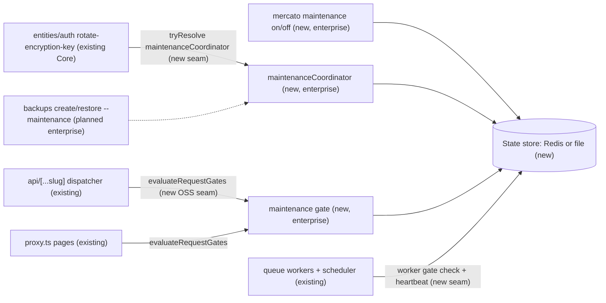
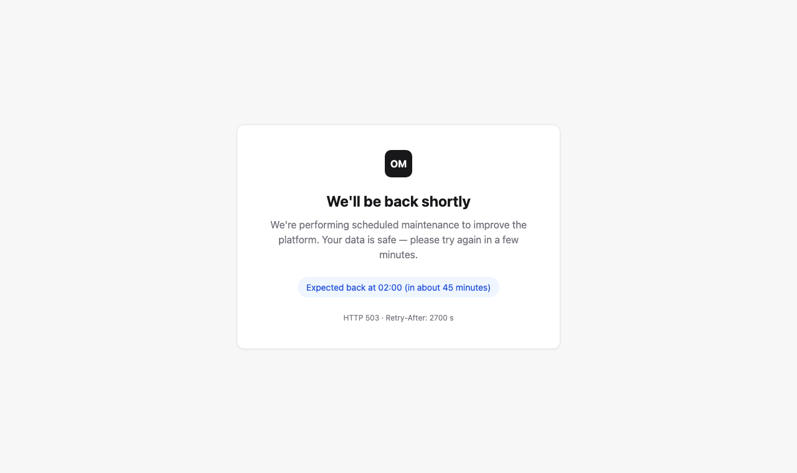
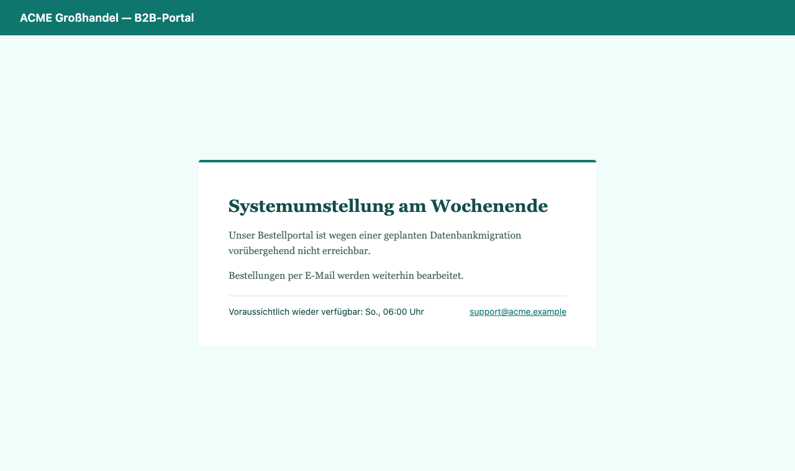
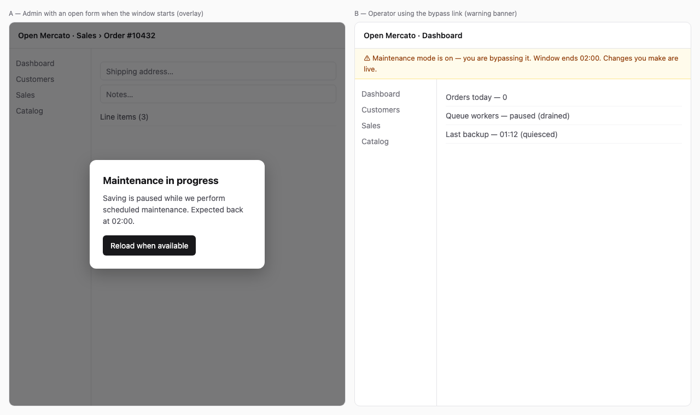

# Maintenance Mode (Enterprise)

## 📝 TLDR

**Proposal, not implementation. Enterprise Edition only.** Instance operators get a maintenance mode they can switch on and off from the CLI. While it is on:

- every module API request gets `503 Service Unavailable` with `Retry-After` and a stable JSON error code;
- every backend, portal and storefront page gets a self-contained, customizable `503` maintenance page;
- queue workers and the scheduler stop picking up new work and report when they are idle.

Today Open Mercato has no such mode. The encryption-maintenance commands ask operators to *attest* that they stopped every writer (`--confirm-offline-maintenance`); the backup specs only *print a reminder*. This proposal turns that attestation into an enforced, observable state.

Encryption key rotation **must** run inside a drained maintenance window on any instance with the Enterprise maintenance module. Backup creation and restore **may** opt into one with `--maintenance`.

The mode lives in a new enterprise module, `maintenance`. Open Mercato Core gains only two generic, additive, no-op-by-default seams: a request-gate registry and a `maintenanceCoordinator` DI contract. OSS behavior does not change.

Status: design for review. ⚠ Q2, Q3 and Q9 need human confirmation before implementation.

## Resolved assumptions (autonomous defaults)

| # | Question | Applied default | Rationale | Confirm? |
|---|---|---|---|---|
| Q1 | One spec, or separate specs for the mode, the rotation integration and the backup integration? | One spec, phased. Phase 1 (the mode) ships alone. Phases 3 and 4 are thin consumers of the Phase 1 coordinator contract. | The integrations cannot work without the mode. Splitting them would spread one contract across three documents. | reversible |
| Q2 | "Enterprise only", but nothing today lets a module short-circuit every API request or page request. How does the gate get in? | Add a **generic, additive OSS seam**: a request-gate registry in `@open-mercato/shared`, called by the API dispatcher and `proxy.ts`. No gate is registered in OSS, so it is a zero-cost no-op. All maintenance behavior, state, CLI, page and integrations stay in `packages/enterprise`. | No existing extension point works. Interceptors and mutation guards cover only CRUD routes. Lifecycle events cannot short-circuit a request. `beforeAuth` is per-route. Patching an app file from an enterprise package is not allowed. | ⚠ NEEDS HUMAN CONFIRMATION — new public contract surface in OSS. |
| Q3 | How can a Core command (key rotation) make an Enterprise feature mandatory? | Core rotation commands soft-resolve the optional `maintenanceCoordinator` DI service. **Absent (OSS):** behavior is unchanged. **Present (Enterprise):** the command refuses to mutate unless it holds a drained maintenance window. | This is the only way to get "obligatory for rotation" without moving rotation out of Core or changing OSS. It matches the soft-optional `tryResolve` coupling rule. | ⚠ NEEDS HUMAN CONFIRMATION — changes existing rotation-script behavior on Enterprise installs (`BACKWARD_COMPATIBILITY.md` CLI surface). |
| Q4 | Where does the on/off state live? | Outside the application database: in the instance's Redis when one is configured, otherwise a JSON state directory on the local host. An env var force-on is also available. | A restore replaces the database, so a flag stored there would be lost or rolled back mid-restore. The gate must also work while the database is unreachable. `module_configs` has a 60 s cache TTL, which is too slow for a gate. | reversible |
| Q5 | Instance-wide or per-tenant? | Instance-wide only in v1. | Writers (web replicas, workers) are shared across tenants. A drained window is only meaningful instance-wide. Per-tenant mode is a later additive extension. | reversible |
| Q6 | Control surface? | CLI only in v1. There is no HTTP endpoint or admin UI that turns the mode on or off. A public, read-only status endpoint is provided. | A remote kill switch is an attack surface. An HTTP toggle also cannot turn the mode off once the API itself returns 503. | reversible |
| Q7 | Can admins get through during maintenance? | Opt-in Laravel-style bypass secret (`on --allow-bypass`). The token is printed once and only its hash is stored. Bypass is always refused while a key-rotation hold is active. | Operators need to smoke-test after a restore or migration. Rotation needs zero writers. | reversible |
| Q8 | Partial modes (read-only API, announce-only banner)? | Deferred. v1 supports full maintenance only. | Smallest scope that meets the brief ("all API endpoints"). Read-only mode needs a per-route side-effect classification that does not exist today. | reversible |
| Q9 | What does the gate do when the state store is unreachable? | Live traffic: keep the **last known** state (sticky). A process that boots with no known state fails **open** and logs an error. Rotation and backup preflight: fail **closed**. | A Redis outage should not take the whole storefront down. A sticky "on" protects windows that are already running. Fail-open at boot is a deliberate availability-over-integrity trade-off. The drain report closes this gap for rotation, because a process that cannot reach the store never acknowledges and the drain never completes. | ⚠ NEEDS HUMAN CONFIRMATION — availability vs. integrity trade-off. |
| Q10 | Separate enable flag? | No separate flag. The module turns on with `OM_ENABLE_ENTERPRISE_MODULES`, like `record_locks` and `system_status_overlays`. | Rotation enforcement must not silently disappear because one extra flag was left off. With no window active, the gate is a cached in-memory read. | reversible |
| Q11 | What state does rotation leave behind? | The mode stays **on** after rotation, whether it succeeds or fails. `--exit-maintenance` turns it off only after verified success. | Reopening writes on half-rotated data is the worst outcome. The operator verifies first. | reversible |

## 📝 Problem Statement

- **Key rotation is unsafe online.** The implemented [encryption maintenance hardening](../2026-09-30-encryption-key-rotation-hardening.md) spec says safe online policy retirement is unsupported. It requires operators to stop every writer and restart replicas, then attest to that with `--confirm-offline-maintenance <tenantUuid>`. Nothing checks the attestation. A forgotten worker or replica can write ciphertext under a policy that is being retired.
- **Backups cannot prove quiescence cheaply.** The [CLI backup/restore](2026-11-06-cli-backup-restore.md) spec has a `--quiesced` consistency that only passes when no writer advances the transaction horizon. The [automated backups](2026-07-08-automated-database-backups.md) restore only "prints a maintenance-mode reminder".
- **Users see raw failures during planned work.** During migrations, restores or cutovers, users get connection errors, 500s or a half-working UI. API clients and webhook senders get errors they cannot tell apart from bugs, so they do not back off correctly. The only 503 today is `proxy.ts` (unresolved custom domain) and the dispatcher's auth-infrastructure fallback.

## 📝 Proposed Solution

An enterprise `maintenance` module with five parts:

1. **State store.** A versioned maintenance state document plus per-process heartbeat records. Redis or file backend.
2. **Gates.** The module registers a gate in the new OSS request-gate registry.
   - The API dispatcher calls it before route matching → JSON 503.
   - `proxy.ts` calls it for page requests → HTML 503 maintenance page.
3. **Drain protocol.** Web processes, queue workers and the scheduler acknowledge each maintenance epoch and report in-flight work. "Drained" means every live process has acknowledged the current epoch and has nothing in flight.
4. **CLI.** `mercato maintenance on|off|status|drain`. Bootstrap-free: no database connection is needed.
5. **Coordinator service.** `maintenanceCoordinator`, registered in DI. Key rotation (mandatory) and backups (optional) consume it to enter the mode, wait for the drain and hold the window for the duration of their operation.

### Market research

| Product | What it does | Taken | Skipped |
|---|---|---|---|
| Laravel `artisan down` | File flag. `--secret` bypass cookie, `--retry`, `--refresh`, `--render` a pre-rendered view, 503 for every route. | Bypass secret, `Retry-After`, pre-rendered self-contained page, state outside the DB. | `--redirect`, so the page stays on the same URL. |
| Magento `maintenance:enable` | `var/.maintenance.flag`, IP allowlist, custom `503.phtml`. | Custom template override, CLI-only toggle. | IP allowlist: replicas behind proxies make client IPs unreliable, so v1 uses the bypass token instead. |
| Drupal `maintenance_mode` | State plus the "access site in maintenance mode" permission, with a themed page. | Message customization. | Permission-based bypass. It needs a database session, which may be unavailable or mid-restore. |
| Kubernetes / LB practice | Readiness probe failing removes the pod. | Keep `/api/healthz` healthy, so the load balancer keeps routing to pods that serve the maintenance page. | Failing readiness: it would replace the page with an LB-generic error. |

None of these drain background workers or offer a hold. Here the drain and the hold exist because rotation needs proof that writers stopped, not just a page.

### Alternatives rejected

- **Flag in `module_configs`.** Lost on restore, unreachable while the database is down, and has a 60 s cache TTL.
- **Next.js-only gate in `proxy.ts`.** Its matcher excludes `/api/*` by design.
- **Mutation guard `targetEntity: '*'`.** Covers CRUD writes only. Custom routes, reads and raw SQL writers are not covered.
- **Replacing `--confirm-offline-maintenance`.** Kept as is, so OSS and Core contracts are unchanged. Enterprise adds an enforced check on top of the attestation.

## 📝 Architecture



Takeaway: the only Core changes are the request-gate call sites, a worker pre-claim gate hook, and a soft-optional coordinator lookup in the rotation commands. Everything stateful is in the enterprise module, outside the database.

### OSS seams (additive, no-op by default)

1. **Request-gate registry.** `@open-mercato/shared/lib/runtime/request-gate`
   ```ts
   type RequestGateContext = {
     surface: 'api' | 'page'
     method: string
     pathname: string
     headers: Headers
     cookies: { get(name: string): string | undefined }
   }
   type RequestGateDecision = { response: Response } | null
   type RequestGate = {
     id: string
     priority?: number
     evaluate(ctx: RequestGateContext): Promise<RequestGateDecision> | RequestGateDecision
   }
   registerRequestGate(gate: RequestGate): void
   evaluateRequestGates(ctx: RequestGateContext): Promise<Response | null>
   ```
   - It is stored on `globalThis`, like the route-manifest registries (#9319), so proxy and route bundles share it.
   - Enterprise registers its gate from `di.ts` `register()` at bootstrap.
   - **API call site:** `handleRequest` runs the gate immediately after `requestReceived` and before `findApiRouteManifestMatch`. A short-circuit emits `requestCompleted` with the gate status. `OPTIONS` (CORS preflight) is never gated.
   - **Page call site:** `proxy.ts` calls the gate first, before custom-domain resolution.
   - **Phase 0 spike:** confirm that the Next 16 proxy shares the bootstrap module graph with route handlers. If it does not, the proxy falls back to the existing self-call pattern: `GET /api/maintenance/status` with a 2 s in-memory cache, exactly as the domain-resolve cache works today.
2. **Worker pre-claim hook.** `@open-mercato/queue` `worker/runner.ts` gets an optional `workerGate` from the same registry family: `shouldPause(): boolean`, plus `onPaused`/`onResumed` callbacks. With no gate the runner is unchanged. The scheduler tick consults the same gate.
3. **Coordinator contract.** The interface `MaintenanceCoordinator` and the DI key `maintenanceCoordinator` live in `@open-mercato/shared/lib/maintenance/types.ts`. Core imports only the type and soft-resolves the service.

### Enterprise module `packages/enterprise/src/modules/maintenance/`

| File | Purpose |
|---|---|
| `index.ts` | Metadata, `license: 'Proprietary'`. |
| `di.ts` | Registers `maintenanceStateStore`, `maintenanceCoordinator`, the request gate, the worker gate and the process heartbeat. |
| `lib/store/{redis,file}.ts` | State backends with compare-and-set on `epoch`. |
| `lib/gate.ts` | Decision logic, bypass verification, sticky last-known cache (TTL `OM_MAINTENANCE_POLL_MS`, default 2000). |
| `lib/page/` | Built-in template, template loader, escaping renderer, locale strings. |
| `lib/drain.ts` | Heartbeat writer, in-flight counter, drain evaluator. |
| `cli.ts` | `on`, `off`, `status`, `drain`. Builds the store from env. Never calls `createRequestContainer`. |
| `api/get/maintenance/status.ts` | Public read-only status. |
| `events.ts` | `maintenance.window.started`, `maintenance.window.ended`, `maintenance.hold.acquired`, `maintenance.hold.released`. Emitted best-effort, because the event bus may be degraded. |
| `widgets/` | Admin topbar banner shown to bypass sessions. |
| `i18n/*.json` | Page and CLI strings. |

## 📝 Data Model

No database tables and no migrations. This is deliberate (Q4). State is versioned JSON.

```ts
type MaintenanceStateV1 = {
  version: 1
  active: boolean
  epoch: number                       // incremented on every on/off; CAS key
  windowId: string | null             // uuid per activation
  startedAt: string | null
  startedBy: { source: 'cli' | 'coordinator' | 'env'; osUser?: string; host: string; operation?: string } | null
  reason: string | null               // operator note, not shown publicly
  until: string | null                // ISO; drives Retry-After and page ETA
  retryAfterSeconds: number           // default 300, clamp 30..86400
  page: { title?: string; message?: string }  // per-window overrides, plain text, max 200 / 2000 chars
  bypass: { enabled: boolean; tokenSha256: string | null; expiresAt: string | null }
  holds: Array<{ id: string; operation: string; pid: number; host: string; acquiredAt: string; heartbeatAt: string; forbidsBypass: boolean }>
  history: Array<{ windowId: string; startedAt: string; endedAt: string; startedBy: string; operations: string[] }>  // last 50
}

type MaintenanceProcessRecord = {
  processId: string
  kind: 'web' | 'worker' | 'scheduler'
  host: string
  pid: number
  ackedEpoch: number
  inflight: number                    // non-bypass gated requests or active jobs
  heartbeatAt: string                 // TTL = 3 × OM_MAINTENANCE_HEARTBEAT_MS (default 5000)
}
```

**Backends.** Selected by `OM_MAINTENANCE_STORE=auto|redis|file`.

- `auto` uses Redis when the instance has a Redis connection configured for cache or queue, otherwise `file`.
- **Redis keys:** `om:maintenance:state` and `om:maintenance:proc:<id>` (each with a TTL).
- **File backend:** `OM_MAINTENANCE_STATE_DIR`, default `<app>/.mercato/maintenance/`. Writes are atomic (temp file + rename). Single host only. `status` warns if replicas are detected.
- `OM_MAINTENANCE_FORCE=1` forces the mode on regardless of the store, for when the store itself is broken. `off` cannot override it, and `status` reports `source: env`.

**Sensitive data.** The bypass token is 32 random bytes, base64url. Only its SHA-256 is stored, and it is compared in constant time. `reason` and the OS user stay internal: they are never returned by the public endpoint or rendered on the page. No tenant data is stored.

## 📝 API Contracts

### Gated responses

Every gated request gets these headers: `Retry-After: <seconds>`, `Cache-Control: no-store`, `X-Maintenance-Mode: 1`.

`Retry-After` is the time remaining until `until` (minimum 30 s) when `until` is set, otherwise `retryAfterSeconds`.

**API body** (all methods except `OPTIONS`):

```json
{ "error": "Service temporarily unavailable for maintenance.", "code": "MAINTENANCE_MODE", "retryAfter": 300, "until": "2026-11-14T02:00:00Z" }
```

`error` is localized by `Accept-Language`. `code` is stable and part of the contract.

**Pages:** `text/html` 503 from the page renderer.

**Not gated:**

- `OPTIONS` requests;
- `GET /api/maintenance/status`;
- `/api/healthz`, a standalone route outside the dispatcher that stays healthy so load balancers keep routing;
- `_next/*` and static assets, which the proxy matcher already excludes;
- requests carrying a valid bypass (below).

### `GET /api/maintenance/status` (public, no auth)

- **Response:** `200 { active: boolean, until: string|null, retryAfter: number|null, message: string|null }`.
- No window id, reason, holds or process data.
- Exported with `openApi`.
- Rate-limited with the dispatcher's existing limiter.

### Bypass

- `on --allow-bypass [--bypass-ttl 2h]` prints a URL once: `/maintenance-bypass?token=<token>`.
- The proxy validates the token, sets the `om_maintenance_bypass` cookie (HttpOnly, Secure, SameSite=Lax, expires with the TTL), and redirects to `/backend`.
- API clients may send `X-Maintenance-Bypass: <token>` instead.
- **Bypassed requests:** are logged, are not counted as drain-blocking in-flight work, and show the admin banner.
- **Bypass is rejected when:**
  - any hold with `forbidsBypass: true` is active (all key-rotation holds);
  - the token has expired;
  - the window has changed, because the token is bound to `windowId`.

### CLI

| Command | Behavior | Exit codes |
|---|---|---|
| `mercato maintenance on [--title] [--message] [--until <iso> \| --duration 45m] [--retry-after <s>] [--reason] [--allow-bypass [--bypass-ttl]] [--wait-drain [--drain-timeout 120s]] [--json]` | CAS-activates (or updates the page fields of an already-active window without a new epoch). Prints the window id and the bypass URL once. `--wait-drain` blocks until the drain completes or times out. | 0 ok · 3 drain timeout (mode stays on) · 4 store unreachable · 2 invalid args |
| `mercato maintenance off [--force-release-stale-holds]` | Refuses while a live hold exists. Stale holds (no heartbeat for 3 × TTL) are released only with the flag. Refuses when `OM_MAINTENANCE_FORCE=1` is set. | 0 · 5 held · 4 |
| `mercato maintenance status [--json]` | State, source, holds, and a per-process ack/in-flight table with stale processes flagged. | 0 |
| `mercato maintenance drain [--timeout 120s] [--json]` | Waits for the drain on an active window. The report lists every process that has not acknowledged. | 0 · 3 · 6 not active |

`--json` output is a versioned object, `{ "version": 1, ... }`. Secrets never appear in output except the one-time bypass URL. `--json` puts that URL in a separate `bypassUrl` field so automation can redact it.

### Coordinator (DI `maintenanceCoordinator`)

```ts
interface MaintenanceCoordinator {
  getState(): Promise<MaintenanceStateView>
  enter(input: { operation: string; reason?: string; page?: { title?: string; message?: string }; until?: string }): Promise<{ windowId: string; enteredByCaller: boolean }>
  acquireHold(input: { operation: string; forbidsBypass: boolean; requireDrained: boolean; drainTimeoutMs: number }): Promise<MaintenanceHold>
  exit(input: { windowId: string; operation: string }): Promise<void>   // refuses if other holds are live
}
interface MaintenanceHold { id: string; windowId: string; drainReport: DrainReport; release(): Promise<void> }
```

`acquireHold` throws typed errors: `MaintenanceNotActiveError`, `MaintenanceDrainTimeoutError` (carries the report), `MaintenanceStoreUnavailableError`. Holds heartbeat from the holder process, and `release()` runs in a `finally` block.

### Key rotation integration (mandatory)

**Covered entry points.** Every mutating encryption-maintenance command. The Phase 0 audit lists them exhaustively; currently:

- `mercato entities rotate-encryption-key`
- `mercato auth rotate-encryption-key`
- `mercato entities decrypt-database`
- `mercato entities backfill-system-encryption`

`--dry-run` and read-only paths are exempt.

**When `maintenanceCoordinator` resolves:**

1. **Before the first mutation** (before any key provisioning, cache invalidation or write), the command calls `acquireHold({ operation: 'encryption.<command>', forbidsBypass: true, requireDrained: true })`.
2. **If no window is active:** the command refuses with a red `ERROR` and exit 7, and makes no writes. The message tells the operator to run `mercato maintenance on --wait-drain` first, or to rerun with the new additive `--enter-maintenance` flag. With that flag, the command enters the window itself with an operator-facing page message, then acquires the hold.
3. **If the drain times out:** exit 3, no writes. The report lists every process that has not acknowledged.
4. **If the store is unreachable:** exit 4, no writes (fail closed, Q9).
5. **When the hold is acquired:** the existing `--confirm-offline-maintenance` checks still apply unchanged.
6. **On finish:** the hold is released, success or failure. The mode **stays on** (Q11). `--exit-maintenance` exits only after the command reports verified success. Once the [key-rotation data verification](2026-11-06-cli-backup-restore.md) companion ships, its verifier must pass too.
7. There is **no** flag that skips the maintenance requirement on Enterprise. `--acknowledge-unprotected-key-rotation` from the backup spec applies only when Enterprise protection is unavailable. It does not bypass this gate.

**When it does not resolve (OSS, or enterprise modules disabled):** behavior is identical to today.

### Backup / restore integration (optional)

These apply to the planned `backups` module ([CLI spec](2026-11-06-cli-backup-restore.md), [automated spec](2026-07-08-automated-database-backups.md)). Neither has shipped, so this spec defines the contract that `backups` consumes. The `backups` implementation PR adds the flags.

- **`backups create --maintenance`:** enters the window (or joins an active one) and acquires a hold with `forbidsBypass: false, requireDrained: true`. The manifest records `maintenanceWindowId`, and the engine attempts `quiesced` consistency. Without the flag, behavior is unchanged. If a window is already active, the manifest still records its id.
- **`backups restore --maintenance`:** holds the window across restore and verification, and across the operator's cutover to the restored database. The state lives outside the database, so the cutover does not erase it. A window entered by the command stays on unless `--exit-maintenance` is passed.
- **Scheduled (automated) backups never enter maintenance.** They join a window only if it is already active.
- **If the coordinator is absent** (maintenance module disabled), `--maintenance` fails with exit 2 and a clear message. It never silently runs unprotected.

## 📝 UI/UX

### Maintenance page

The page is a self-contained HTML document:

- inline CSS and no external requests;
- no React, no database and no session, so it renders during a restore;
- optional `<meta http-equiv="refresh">` set to `Retry-After`, capped at 300 s.

**Layout:** centered card with a logo, title, message, an expected end time when `until` is set (rendered in the browser's locale by a tiny inline script, with an ISO fallback inside `<noscript>`), and an optional support link.

**Customization layers, highest priority first:**

1. Per-window CLI `--title` and `--message`. Plain text, HTML-escaped, newlines become paragraphs.
2. Instance template `OM_MAINTENANCE_PAGE_TEMPLATE=<path to .html>`, loaded once at boot and validated for the required placeholders. Placeholders: `{{title}}`, `{{message}}`, `{{until}}`, `{{untilIso}}`, `{{retryAfter}}`, `{{supportUrl}}`, `{{logoUrl}}`, `{{lang}}`. All values are HTML-escaped and there is no raw-HTML placeholder. If the template is invalid, the built-in page is used and an error is logged.
3. Instance env `OM_MAINTENANCE_LOGO_URL` and `OM_MAINTENANCE_SUPPORT_URL`.
4. Built-in defaults from `maintenance/i18n/<locale>.json`. The locale is chosen from `Accept-Language`, limited to the app's supported locales.

**Design system.** The built-in template follows the design system: colors come from the generated DS token values inlined at build time, with no hard-coded status colors. It has the text scale, `role="main"`, `lang`, sufficient contrast, and passes `prefers-color-scheme`.

**Pages already open.** Pages opened before the window started see `apiCall` failures with `code: MAINTENANCE_MODE`. A global injected enterprise widget (the `system_status_overlays` pattern) polls `/api/maintenance/status` every 30 s, and immediately after any 503. When the mode is active it shows a blocking overlay with the same message and a "Reload" action. This avoids losing unsaved form state silently: the user sees why saves fail. Generic `apiCall` 503 handling is not changed.

**Bypass session.** A persistent warning banner, "Maintenance mode is on — you are bypassing it", with the window's end time, in the backend topbar. It is built from the `Alert` primitive with the status-warning tokens.

### Proposed mockups

Illustrative proposals, not accepted designs:

- 
- 
- 

## 📝 Edge Cases & Failure Scenarios

| Scenario | Behavior |
|---|---|
| Two operators run `on`/`off` concurrently | CAS on `epoch`. The loser retries once against the fresh state, then reports the conflict. |
| `off` while rotation runs | Refused (exit 5) and the holder is listed. |
| Rotation process killed | The hold heartbeat stops. The mode stays on. `off` needs `--force-release-stale-holds` after 3 × TTL. The operator investigates partial rotation per the hardening runbook. |
| Replica never upgraded (no heartbeat) | The drain cannot see it. `status` and the drain report list the replicas that *are* known. The runbook requires checking the expected replica count. `--expect-processes web=N,worker=M` makes the drain fail unless that many are present. |
| Long-running HTTP request in flight | It counts as in-flight until it completes. The drain waits up to the timeout, then exits 3 and names the process. |
| Active queue job | The worker finishes its current job (BullMQ pause with `doNotWaitActive=false`), then acknowledges. Jobs are not killed. |
| Webhook senders / API integrators | Get 503 + `Retry-After` and retry under Standard Webhooks semantics. Outbound webhook delivery is queue-backed, so it is paused. |
| Other CLI commands writing directly to the database during the window | Not blockable in-process. This is documented. Holder-aware commands (rotation, backups) are the only enforced writers. |
| Redis restarts mid-window | State is lost if Redis is not persistent. Gates keep the sticky last-known state, and rotation holds fail their next heartbeat and abort before the next batch. The runbook requires Redis persistence or `OM_MAINTENANCE_STORE=file` on single-host installs. |
| Clock skew between hosts | `until` and heartbeat staleness use the store's clock (Redis `TIME`, or the file-host clock), not the caller's. |
| Bypass token leaked | Bound to the window, with a TTL. `on --rotate-bypass` reissues it. The token is never logged. |
| Custom template has a typo | Rejected at boot. The built-in page is served and an error is logged. A broken template can never produce a 200 or an empty response. |

## 📝 Risks & Impact Review

| Risk | Severity / area | Mitigation | Residual |
|---|---|---|---|
| New OSS request-gate seam becomes a general-purpose hook misused for auth or business logic | Medium / platform contracts | Documented as availability gates only. They run before auth and receive no auth context. | Third parties may still register gates. That is an additive surface frozen once released. |
| Enterprise rotation scripts break (they now need maintenance) | High / operators | `UPGRADE_NOTES.md` entry, a clear error message with the exact fix, and `--enter-maintenance` for one-line migration. The compatibility decision goes through `BACKWARD_COMPATIBILITY.md` (Q3 ⚠). | Unattended scripts fail closed until updated, which is intended. |
| Fail-open at boot with the store down lets a fresh replica serve writes during a window | Medium / integrity | A fresh replica cannot acknowledge without the store, so rotation's drain never completes. Pages and API on that replica may still serve. | Accepted for non-rotation windows (Q9 ⚠). |
| Gate latency on every request | Low / performance | In-process cache with a 2 s TTL. A store read happens at most once per poll interval per process. Zero cost when no gate is registered. | Up to `OM_MAINTENANCE_POLL_MS` lag before replicas start or stop gating. The drain protocol (epoch ack), not the lag, is the safety mechanism. |
| Maintenance overlay hides unsaved work | Low / UX | The overlay explains the situation and only offers reload. Form state is not cleared by the overlay itself. | Unsaved edits made during the window are lost on reload, as today. |
| Proxy cannot share the in-process registry | Medium / implementation | Phase 0 spike. Fallback: self-call of the status endpoint with a 2 s cache (existing pattern). | One extra internal request per 2 s per process. |

### Migration & backward compatibility

- **Additive OSS surfaces:**
  - `@open-mercato/shared/lib/runtime/request-gate`
  - `@open-mercato/shared/lib/maintenance/types`
  - DI key `maintenanceCoordinator`
  - the queue worker gate hook
- **New enterprise surfaces:**
  - CLI `mercato maintenance *`
  - route `GET /api/maintenance/status`
  - the stable error code `MAINTENANCE_MODE`
  - the `X-Maintenance-*` headers and the `om_maintenance_bypass` cookie
  - events `maintenance.window.*` and `maintenance.hold.*`
  - env vars `OM_MAINTENANCE_*`
- **Behavior change:** rotation commands on Enterprise installs require a window (Q3). New flags `--enter-maintenance` and `--exit-maintenance` are added. No existing flag is removed or renamed.
- **No schema changes.** Rollback means removing the module. A leftover file or Redis key is inert without the gate.
- **Template sync:** the `proxy.ts` and `.env.example` edits must be mirrored into the create-app template (`yarn template:sync:fix`).

## 📋 Phasing

1. **Phase 0 — spikes and audit.**
   - Proxy/registry sharing in Next 16.
   - Exhaustive list of mutating encryption entry points.
   - BullMQ pause semantics per strategy (`local` and `async`).
2. **Phase 1 — OSS seams.** Request-gate registry, dispatcher and proxy call sites, worker/scheduler gate hook, coordinator type. All no-op. Ships alone.
3. **Phase 2 — Enterprise maintenance module.** Store, gate, page, CLI, status endpoint, bypass, drain, overlay widget. Usable as standalone maintenance mode.
4. **Phase 3 — Key rotation integration (mandatory).** Coordinator usage in the Core rotation commands.
5. **Phase 4 — Backup integration (optional).** Delivered with, or after, the `backups` module implementation PR.

## 📋 Implementation Plan

### Phase 0

1. Spike: register a gate from enterprise `di.ts` and assert that `proxy.ts` sees it in `yarn dev` and in `yarn build:app && start`. Record the result in this spec and pick the call path.
2. Audit `packages/*/src/modules/*/cli.ts` for commands that provision keys, invalidate key caches or rewrite ciphertext. Freeze the list in this spec.

### Phase 1 (OSS, no behavior change)

1. Add `lib/runtime/request-gate.ts` (registry on `globalThis`, priority ordering, error isolation: a throwing gate is logged and skipped) with unit tests.
2. Call `evaluateRequestGates` in `api/[...slug]/route.ts` before manifest matching, skipping `OPTIONS`. Test: no gate gives identical responses; a stub gate short-circuits with lifecycle events.
3. Call it in `apps/mercato/src/proxy.ts` (and the create-app template), using the path chosen in Phase 0. Test with a stub gate.
4. Add the worker/scheduler gate hook in `@open-mercato/queue` `worker/runner.ts` and the scheduler tick. Unit-test pause, resume and in-flight accounting with a stub.
5. Add `lib/maintenance/types.ts` (interface, error classes, DI key constant).

### Phase 2 (Enterprise module)

1. Scaffold `packages/enterprise/src/modules/maintenance`, enabled with `OM_ENABLE_ENTERPRISE_MODULES` in `apps/mercato/src/modules.ts`, then run `yarn generate`.
2. State store: file and Redis backends with CAS and atomic writes. Unit tests for concurrency, corrupted file and version mismatch (unknown major → treat as active, fail safe, and report).
3. Gate: decisions, `Retry-After` math, sticky cache, bypass verification. Unit tests.
4. Page renderer, built-in template and template loader with escaping. Snapshot and XSS tests (`<script>` in `--message` must render inert).
5. CLI `on/off/status/drain` with the exit-code matrix. Unit tests run against the file backend.
6. Heartbeat and drain for web (in-flight counter in the gate wrapper), workers and scheduler. Tests cover the drain report and the stale and expected-process cases.
7. `GET /api/maintenance/status` with `openApi`. Admin overlay and bypass banner widgets. i18n for all locales.
8. Integration tests: see Coverage.

### Phase 3 (Key rotation, mandatory)

1. Add a shared helper `withMaintenanceHold(container, operation, opts, fn)` in `@open-mercato/shared` that soft-resolves the coordinator.
2. Wrap each audited rotation entry point before its first mutation. Add `--enter-maintenance` and `--exit-maintenance`.
3. Unit tests: OSS path unchanged (no coordinator); Enterprise refusal with zero writes; drain timeout; store down; success leaves the mode on; failure leaves the mode on and releases the hold; bypass refused during the hold.
4. `UPGRADE_NOTES.md`, the rotation docs, and an update to the hardening spec's runbook reference.

### Phase 4 (Backups, optional)

1. In the `backups` implementation PR: `create`/`restore --maintenance`, `maintenanceWindowId` in the manifest, and a coordinator-absent error.
2. Integration test: backup under a held window records the window and reaches `quiesced` consistency.

### Coverage (integration, self-contained fixtures)

| ID | Path | Asserts |
|---|---|---|
| M01 | `on` → `GET /api/customers/people`, `POST /api/sales/orders`, an `/api/auth` route | 503, `Retry-After`, `code: MAINTENANCE_MODE`, `no-store` |
| M02 | `on` → `/backend`, a portal page, a storefront page | 503 HTML, custom title/message rendered and escaped |
| M03 | `GET /api/maintenance/status` and `/api/healthz` during a window | 200; status body is minimal |
| M04 | `OPTIONS` preflight during a window | Not gated |
| M05 | Bypass cookie and header | Pass-through; banner visible; refused while a rotation hold is active; refused after the window changes |
| M06 | `off` | Traffic resumes within the poll interval; history entry written |
| M07 | Queue job enqueued during the window | Not processed until `off`; drain reports idle |
| M08 | Rotation on Enterprise without a window | Exit 7, zero writes |
| M09 | Rotation with `--enter-maintenance` | Drain, hold, rotate; mode on afterwards |
| M10 | `off` during a rotation hold | Exit 5 |
| M11 | OSS build (enterprise disabled) | Dispatcher, proxy and rotation behave exactly as before |

## Final Compliance Report — 2026-11-13

### AGENTS.md Files Reviewed

- `AGENTS.md` (root)
- `.ai/specs/AGENTS.md`
- `packages/core/AGENTS.md` (API routes, cross-module coupling, access control, events, widgets)
- `packages/queue/AGENTS.md`
- `packages/cache/AGENTS.md`
- `packages/ui/AGENTS.md`
- `packages/create-app/AGENTS.md` (template sync)
- `BACKWARD_COMPATIBILITY.md`

### Compliance Matrix

| Rule source | Rule | Status | Notes |
|---|---|---|---|
| root | Enterprise scope only in `.ai/specs/enterprise/` | Compliant | All behavior is in `packages/enterprise`. OSS gets no-op seams only (Q2 ⚠). |
| root | No direct ORM relationships between modules | Compliant | No entities. |
| root | Tenant scoping / no cross-tenant exposure | Compliant | Instance-level state holds no tenant data. The public status endpoint exposes nothing tenant-specific. |
| root | Never add code under `apps/mercato/src/` | Compliant with note | Only the existing `proxy.ts` and `modules.ts` gain call sites (app wiring, like domain routing), mirrored to the template. |
| core → Cross-Module Coupling | Optional peers via soft-optional resolve | Compliant | Rotation and backups `tryResolve` the coordinator. |
| core → API Routes | Routes export `openApi` | Compliant | Status route. |
| core → Events | `module.entity.action`, singular, past tense | Compliant | `maintenance.window.started`, etc. |
| cache AGENTS | Cache via DI, no raw Redis | Deviation, justified | The state store must work without bootstrap and survive DB restore. It uses the instance Redis connection config, not the cache service, because cache semantics (eviction, TTL, per-strategy locality) are wrong for a source of truth. |
| queue AGENTS | No custom queues; worker contract | Compliant | Adds a gate hook to the existing runner. No new queue. |
| root UI rules | i18n, DS tokens, no hard-coded status colors | Compliant | Page strings come from locale files. Template colors are DS token values. |
| root | Dialogs `Cmd/Ctrl+Enter` / `Escape` | N/A | No dialogs. The overlay is non-dismissable by design while the mode is active. |
| BACKWARD_COMPATIBILITY | Contract changes disclosed | Compliant with gate | Additive OSS surfaces. The Enterprise rotation behavior change needs approval (Q3 ⚠). |
| specs AGENTS | Integration coverage listed | Compliant | M01–M11. |

### Internal Consistency Check

The CLI, the coordinator, the gate and the integrations all use the same `windowId`, `epoch` and hold model. Store unavailability is handled consistently: sticky last-known state for traffic, fail closed for operations. No stale references to unanswered questions remain.

## Changelog

- 2026-11-13: Initial spec. Autonomous defaults Q1–Q11; ⚠ Q2, Q3, Q9.
