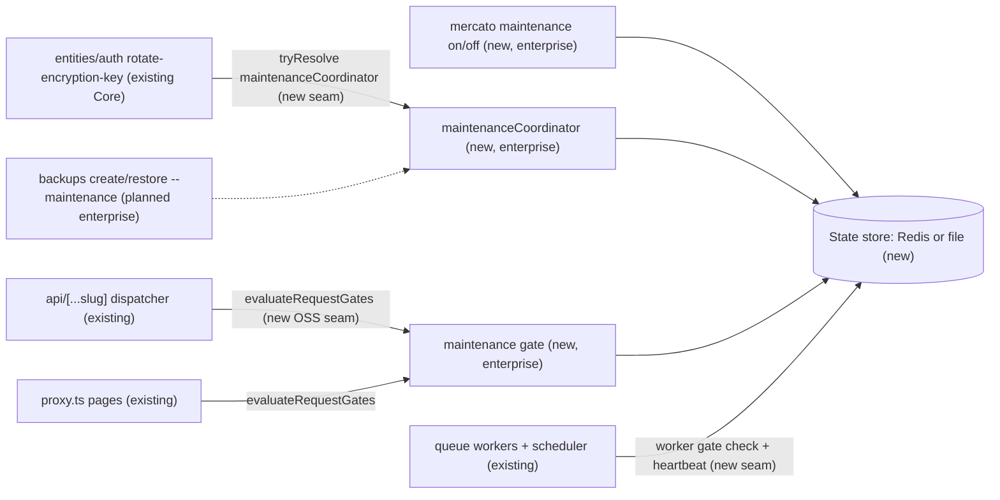
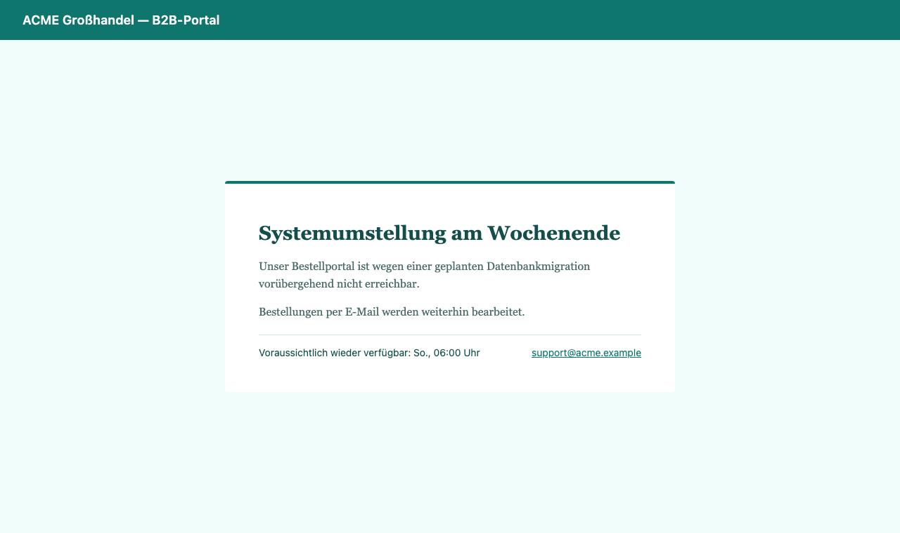
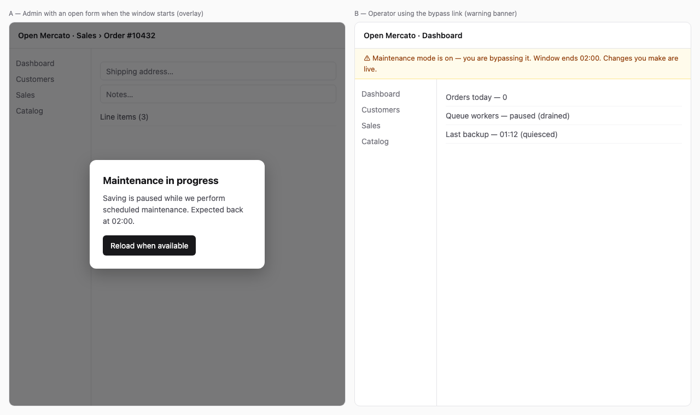

# Maintenance Mode (Enterprise)

## 📝 TLDR

**Proposal, not implementation. Enterprise Edition only.** Instance operators get a maintenance mode they can switch on and off from the CLI. While it is on:

- every module API request gets `503 Service Unavailable` with `Retry-After` and a stable JSON error code;
- every backend, portal and storefront page gets a self-contained, customizable `503` maintenance page;
- queue workers and the scheduler stop picking up new work and report when they are idle.

Today Open Mercato has no such mode. Encryption policy retirement (`entities decrypt-database --deactivate-maps`) only asks operators to *attest* that every writer is stopped (`--confirm-offline-maintenance`). The `rotate-encryption-key` commands check nothing. The backup specs only *print a reminder*. This proposal turns that attestation into an enforced, observable state.

Encryption key rotation **must** run inside a drained maintenance window on any instance with the Enterprise maintenance module. Backup creation and restore **may** opt into one with `--maintenance`.

The mode lives in a new enterprise module, `maintenance`. Open Mercato Core gains only two generic, additive, no-op-by-default seams: a request-gate registry and a `maintenanceCoordinator` DI contract. OSS behavior does not change.

Status: implemented (Phases 0–3, #10539). Q2, Q3 and Q9 were confirmed when the maintainer merged the spec and requested implementation.

## Resolved assumptions (autonomous defaults)

| # | Question | Applied default | Rationale | Confirm? |
|---|---|---|---|---|
| Q1 | One spec, or separate specs for the mode, the rotation integration and the backup integration? | One spec, phased. Phases 1–2 (seams + mode) ship alone. Phases 3 and 4 are thin consumers of the coordinator contract. If Q2 is confirmed, the Phase 1 OSS seams may be extracted into a sibling OSS spec in `.ai/specs/`. Phase 4 stays a contract here and is implemented by the `backups` module PR. | The integrations cannot work without the mode. Splitting them would spread one contract across three documents. | reversible |
| Q2 | "Enterprise only", but nothing today lets a module short-circuit every API request or page request. How does the gate get in? | Add a **generic, additive OSS seam**: a request-gate registry in `@open-mercato/shared`, called by the API dispatcher and `proxy.ts`. No gate is registered in OSS, so it is a zero-cost no-op. All maintenance behavior, state, CLI, page and integrations stay in `packages/enterprise`. | No existing extension point works. Interceptors and mutation guards cover only CRUD routes. Lifecycle events cannot short-circuit a request. `beforeAuth` is per-route. Patching an app file from an enterprise package is not allowed. | ⚠ NEEDS HUMAN CONFIRMATION — new public contract surface in OSS. |
| Q3 | How can a Core command (key rotation) make an Enterprise feature mandatory? | Core rotation commands soft-resolve the optional `maintenanceCoordinator` DI service. **Absent (OSS):** behavior is unchanged. **Present (Enterprise):** the command refuses to mutate unless it holds a drained maintenance window. | This is the only way to get "obligatory for rotation" without moving rotation out of Core or changing OSS. It matches the soft-optional `tryResolve` coupling rule. | ⚠ NEEDS HUMAN CONFIRMATION — changes existing rotation-script behavior on Enterprise installs (`BACKWARD_COMPATIBILITY.md` CLI surface). |
| Q4 | Where does the on/off state live? | Outside the application database: in the instance's Redis when one is configured, otherwise a JSON state directory on the local host. An env var force-on is also available. | A restore replaces the database, so a flag stored there would be lost or rolled back mid-restore. The gate must also work while the database is unreachable. `module_configs` has a 60 s cache TTL, which is too slow for a gate. | reversible |
| Q5 | Instance-wide or per-tenant? | Instance-wide only in v1. | Writers (web replicas, workers) are shared across tenants. A drained window is only meaningful instance-wide. Per-tenant mode is a later additive extension. | reversible |
| Q6 | Control surface? | CLI only in v1. There is no HTTP endpoint or admin UI that turns the mode on or off. A public, read-only status endpoint is provided. | A remote kill switch is an attack surface. An HTTP toggle also cannot turn the mode off once the API itself returns 503. | reversible |
| Q7 | Can admins get through during maintenance? | Opt-in Laravel-style bypass secret (`on --allow-bypass`). The token is printed once and only its hash is stored. Bypass is always refused while a key-rotation hold is active. | Operators need to smoke-test after a restore or migration. Rotation needs zero writers. | reversible |
| Q8 | Partial modes (read-only API, announce-only banner)? | Deferred. v1 supports full maintenance only. | Smallest scope that meets the brief ("all API endpoints"). Read-only mode needs a per-route side-effect classification that does not exist today. | reversible |
| Q9 | What does the gate do when the state store is unreachable? | Live traffic: keep the **last known** state (sticky). A missing state key while this process knows of an active epoch also counts as unreachable. A process that boots with no known state fails **open** and logs an error. Rotation and backup preflight: fail **closed**. Drained holds also require an expected-process inventory, so a replica that never heartbeats blocks the drain instead of escaping it. | A Redis outage should not take the whole storefront down. A sticky "on" protects windows that are already running. Fail-open at boot is a deliberate availability-over-integrity trade-off. Protected operations also require a deployment fence that excludes new writers during store loss. | ⚠ NEEDS HUMAN CONFIRMATION — availability vs. integrity trade-off. |
| Q10 | Separate enable flag? | No separate flag. The module turns on with `OM_ENABLE_ENTERPRISE_MODULES`, like `record_locks` and `system_status_overlays`. | Rotation enforcement must not silently disappear because one extra flag was left off. With no window active, the gate is a cached in-memory read. | reversible |
| Q11 | What state does rotation leave behind? | The mode stays **on** after rotation, whether it succeeds or fails. `--exit-maintenance` turns it off only after verified success. | Reopening writes on half-rotated data is the worst outcome. The operator verifies first. | reversible |

## 📝 Problem Statement

- **Key rotation is unsafe online.** The implemented [encryption maintenance hardening](../2026-09-30-encryption-key-rotation-hardening.md) spec says safe online policy retirement is unsupported and requires operators to stop every writer and restart replicas. Only `decrypt-database --deactivate-maps` asks for an attestation (`--confirm-offline-maintenance <tenantUuid>`, `entities/cli.ts:852`). The `rotate-encryption-key` commands ask for none. Nothing verifies either case. A forgotten worker or replica can write ciphertext under a policy that is being retired.
- **Backups cannot prove quiescence cheaply.** The [CLI backup/restore](2026-11-06-cli-backup-restore.md) spec has a `--quiesced` consistency that only passes when no writer advances the transaction horizon. The [automated backups](2026-07-08-automated-database-backups.md) restore only "prints a maintenance-mode reminder".
- **Users see raw failures during planned work.** During migrations, restores or cutovers, users get connection errors, 500s or a half-working UI. API clients and webhook senders get errors they cannot tell apart from bugs, so they do not back off correctly. The only 503 today is `proxy.ts` (unresolved custom domain) and the dispatcher's auth-infrastructure fallback.

## 📝 Proposed Solution

An enterprise `maintenance` module with five parts:

1. **State store.** A versioned maintenance state document plus per-process heartbeat records. Redis or file backend.
2. **Gates.** The module registers a gate in the new OSS request-gate registry.
   - The API dispatcher calls it before route matching → JSON 503.
   - `proxy.ts` calls it for page requests → HTML 503 maintenance page.
3. **Drain protocol.** Web processes, queue workers and the scheduler acknowledge the current gate revision and report in-flight work. A drained hold requires current evidence for every expected writer.
4. **CLI.** `mercato maintenance on|off|status|drain`. Bootstrap-free: no database connection is needed.
5. **Coordinator service.** `maintenanceCoordinator`, registered in DI. Key rotation (mandatory) and backups (optional) consume it to enter the mode, wait for the drain and hold the window for the duration of their operation.

### Market research

| Product | What it does | Taken | Skipped |
|---|---|---|---|
| Laravel `artisan down` | File flag. `--secret` bypass cookie, `--retry`, `--refresh`, `--render` a pre-rendered view, 503 for every route. | Bypass secret, `Retry-After`, pre-rendered self-contained page, state outside the DB. | `--redirect`, so the page stays on the same URL. |
| Magento `maintenance:enable` | `var/.maintenance.flag`, IP allowlist, custom `503.phtml`. | Custom template override, CLI-only toggle. | IP allowlist: replicas behind proxies make client IPs unreliable, so v1 uses the bypass token instead. |
| Drupal `maintenance_mode` | State plus the "access site in maintenance mode" permission, with a themed page. | Message customization. | Permission-based bypass. It needs a database session, which may be unavailable or mid-restore. |
| Kubernetes / LB practice | Readiness probe failing removes the pod. | Keep `/api/healthz` healthy, so the load balancer keeps routing to pods that serve the maintenance page. | Failing readiness: it would replace the page with an LB-generic error. |

None of these drain background workers or offer a hold. Here the drain and the hold exist because rotation needs proof that writers stopped, not just a page.

### Alternatives rejected

- **Flag in `module_configs`.** Lost on restore, unreachable while the database is down, and has a 60 s cache TTL.
- **Next.js-only gate in `proxy.ts`.** Its matcher excludes `/api/*` by design.
- **Mutation guard `targetEntity: '*'`.** Covers CRUD writes only. Custom routes, reads and raw SQL writers are not covered.
- **Replacing `--confirm-offline-maintenance`.** Kept as is, so OSS and Core contracts are unchanged. Enterprise adds an enforced check on top of the attestation.

## 📝 Architecture



Takeaway: the only Core changes are the request-gate call sites, a worker pre-claim gate hook, and a soft-optional coordinator lookup in the rotation commands. Everything stateful is in the enterprise module, outside the database.

### OSS seams (additive, no-op by default)

1. **Request-gate registry.** `@open-mercato/shared/lib/runtime/request-gate`
   ```ts
   type RequestGateContext = {
     surface: 'api' | 'page'
     method: string
     pathname: string
     headers: Headers
     cookies: { get(name: string): string | undefined }
   }
   type RequestGateDecision = { response: Response } | null
   type RequestGate = {
     id: string
     priority?: number
     evaluate(ctx: RequestGateContext): Promise<RequestGateDecision> | RequestGateDecision
   }
   registerRequestGate(gate: RequestGate): void
   evaluateRequestGates(ctx: RequestGateContext): Promise<Response | null>
   ```
   - It is stored on `globalThis`, like the route-manifest registries (#9319), so proxy and route bundles share it.
   - Enterprise registers its gate from `di.ts` `register()` at bootstrap.
   - **API call site:** `handleRequest` runs the gate immediately after `requestReceived` and before `findApiRouteManifestMatch`. A short-circuit emits `requestCompleted` with the gate status. The dispatcher exports no `OPTIONS` handler, so Next.js answers preflight requests itself. The gate does not change that.
   - **Standalone API routes** outside the dispatcher: `apps/mercato/src/app/api/auth/*` (login writes sessions) calls the gate too. `api/healthz`, `api/docs/*` and `api/dev-runtime/*` are not gated.
   - **Page call site:** `proxy.ts` calls the gate first, before custom-domain resolution. Server-action and RSC POSTs target page paths, so they are gated as well. The proxy's own self-call to `/api/customer_accounts/domain-resolve` (needed for bypass sessions on custom domains) is exempt through an internal-call marker, verified in Phase 0.
   - **Phase 0 spike:** confirm that the Next 16 proxy shares the bootstrap module graph with route handlers. If it does not, the proxy falls back to the existing self-call pattern: `GET /api/maintenance/status` with a 2 s in-memory cache, exactly as the domain-resolve cache works today.
2. **Worker pre-claim hook.** `@open-mercato/queue` `worker/runner.ts` gets an optional `workerGate` from the same registry family: `shouldPause(): boolean`, plus `onPaused`/`onResumed` callbacks. With no gate the runner is unchanged. The scheduler tick consults the same gate.
3. **Coordinator contract.** The interface `MaintenanceCoordinator` and the DI key `maintenanceCoordinator` live in `@open-mercato/shared/lib/maintenance/types.ts`. Core imports only the type and soft-resolves the service.

### Enterprise module `packages/enterprise/src/modules/maintenance/`

| File | Purpose |
|---|---|
| `index.ts` | Metadata, `license: 'Proprietary'`. |
| `di.ts` | Registers `maintenanceStateStore`, `maintenanceCoordinator`, the request gate, the worker gate and the process heartbeat. |
| `lib/store/{redis,file}.ts` | State backends with compare-and-set on the state revision. |
| `lib/gate.ts` | Decision logic, bypass verification, sticky last-known cache (TTL `OM_MAINTENANCE_POLL_MS`, default 2000). |
| `lib/page/` | Built-in template, template loader, escaping renderer, locale strings. |
| `lib/drain.ts` | Heartbeat writer, in-flight counter, drain evaluator. |
| `cli.ts` | `on`, `off`, `status`, `drain`. Builds the store from env. Never calls `createRequestContainer`. |
| `api/get/maintenance/status.ts` | Public read-only status. |
| `events.ts` | `maintenance.window.started`, `maintenance.window.ended`, `maintenance.hold.acquired`, `maintenance.hold.released`. Emitted best-effort, because the event bus may be degraded. |
| `widgets/` | Admin topbar banner shown to bypass sessions. |
| `i18n/*.json` | Page and CLI strings. |

## 📝 Data Model

No database tables and no migrations. This is deliberate (Q4). State is versioned JSON.

```ts
type MaintenanceStateV1 = {
  version: 1
  active: boolean
  epoch: number                       // incremented on every on/off
  revision: number                    // CAS version, incremented on every state mutation
  gateRevision: number                // incremented whenever admission policy changes or a drained hold is reserved
  reopenBarrier: { operationId: string; generation: string | null } | null
  windowId: string | null             // uuid per activation
  startedAt: string | null
  startedBy: { source: 'cli' | 'coordinator' | 'env'; osUser?: string; host: string; operation?: string } | null
  reason: string | null               // operator note, not shown publicly
  until: string | null                // ISO; drives Retry-After and page ETA
  retryAfterSeconds: number           // default 300, clamp 30..86400
  page: { title?: string; message?: string }  // per-window overrides, plain text, max 200 / 2000 chars
  bypass: { enabled: boolean; tokenSha256: string | null; expiresAt: string | null }
  expectedProcesses: { web: number; worker: number; scheduler: number } | null  // from --expect-processes or OM_MAINTENANCE_EXPECTED_PROCESSES
  hold: { id: string; operation: string; pid: number; host: string; heartbeatAt: string; forbidsBypass: boolean; gateRevision: number } | null
  history: Array<{ windowId: string; startedAt: string; endedAt: string; startedBy: string; operations: string[] }>  // last 50
}

type MaintenanceProcessRecord = {
  processId: string
  kind: 'web' | 'worker' | 'scheduler'
  host: string
  pid: number
  ackedGateRevision: number
  loadedGeneration: string | null
  inflight: number                    // all admitted work, including bypass
  heartbeatAt: string                 // TTL = 3 × OM_MAINTENANCE_HEARTBEAT_MS (default 5000)
}
```

**Backends.** Selected by `OM_MAINTENANCE_STORE=auto|redis|file`.

- `auto` uses Redis when the instance has a Redis connection configured for cache or queue, otherwise `file`.
- **Redis keys:** `om:maintenance:state` and `om:maintenance:proc:<id>` (only process records expire).
- **File backend:** `OM_MAINTENANCE_STATE_DIR`, default `<app>/.mercato/maintenance/`. Writes are atomic (temp file + rename). Single host only. `status` warns if replicas are detected.
- `OM_MAINTENANCE_FORCE=1` forces the mode on regardless of the store, for when the store itself is broken. `off` cannot override it, and `status` reports `source: env`.

**Sensitive data.** The bypass token is 32 random bytes, base64url. Only its SHA-256 is stored, and it is compared in constant time. `reason` and the OS user stay internal: they are never returned by the public endpoint or rendered on the page. No tenant data is stored.

## 📝 API Contracts

### Gated responses

Every gated request gets these headers: `Retry-After: <seconds>`, `Cache-Control: no-store`, `X-Maintenance-Mode: 1`.

`Retry-After` is the time remaining until `until` (minimum 30 s) when `until` is set, otherwise `retryAfterSeconds`.

**API body** (all methods except `OPTIONS`):

```json
{ "error": "Service temporarily unavailable for maintenance.", "code": "MAINTENANCE_MODE", "retryAfter": 300, "until": "2026-11-14T02:00:00Z" }
```

`error` is localized by `Accept-Language`. `code` is stable and part of the contract.

**Pages:** `text/html` 503 from the page renderer.

**Not gated:**

- `OPTIONS` preflight requests, answered by Next.js;
- `GET /api/maintenance/status`;
- `/api/healthz`, `/api/docs/*` and `/api/dev-runtime/*`, standalone routes outside the dispatcher (`healthz` stays healthy so load balancers keep routing);
- `_next/*` and static assets, which the proxy matcher already excludes;
- requests carrying a valid bypass (below).

### `GET /api/maintenance/status` (public, no auth)

- **Response:** `200 { active: boolean, until: string|null, retryAfter: number|null, message: string|null }`.
- No window id, reason, holds or process data.
- Exported with `openApi`.
- Rate-limited with the dispatcher's existing limiter.

### Bypass

- `on --allow-bypass [--bypass-ttl 2h]` prints the token once, separately from the path `/maintenance-bypass`. The token never appears in a query string, so it cannot leak into access logs or `Referer` headers.
- `/maintenance-bypass` serves a plain HTML form (no script) that POSTs the token. The proxy validates it, sets the `om_maintenance_bypass` cookie (HttpOnly, Secure, SameSite=Lax, expires with the TTL), and redirects to `/backend`. Failed attempts are rate-limited.
- API clients may send `X-Maintenance-Bypass: <token>` instead.
- **Bypassed requests:** are logged and show the admin banner. Count them from admission through completion, including requests admitted before maintenance or before a restrictive hold. A snapshot taken while bypass can admit writes cannot establish quiescence.
- **Bypass is rejected when:**
  - a reopen barrier is pending or a hold with `forbidsBypass: true` is reserved (all key-rotation holds);
  - the token has expired;
  - the window has changed, because the token is bound to `windowId`.

### CLI

| Command | Behavior | Exit codes |
|---|---|---|
| `mercato maintenance on [--title] [--message] [--until <iso> \| --duration 45m] [--retry-after <s>] [--reason] [--allow-bypass [--bypass-ttl]] [--wait-drain [--drain-timeout 120s]] [--json]` | CAS-activates (or updates the page fields of an already-active window without a new epoch). Prints the window id and the bypass URL once. `--wait-drain` blocks until the drain completes or times out. | 0 ok · 3 drain timeout (mode stays on) · 4 store unreachable · 2 invalid args |
| `mercato maintenance off [--force-release-stale-holds]` | Refuses while a hold or reopen barrier exists. The flag starts stale-owner recovery and never clears an unresolved reopen barrier. Refuses when `OM_MAINTENANCE_FORCE=1` is set. | 0 · 5 held · 4 |
| `mercato maintenance status [--json]` | State, source, holds, and a per-process ack/in-flight table with stale processes flagged. | 0 |
| `mercato maintenance drain [--timeout 120s] [--expect-processes web=N,worker=M,scheduler=K] [--json]` | Waits for the drain on an active window. The report lists outstanding acknowledgments and missing processes. This standalone drain is observational and grants no exclusive hold. | 0 · 3 · 6 not active |

`--json` output is a versioned object, `{ "version": 1, ... }`. Secrets never appear in output except the one-time bypass URL. `--json` puts that URL in a separate `bypassUrl` field so automation can redact it.

### Coordinator (DI `maintenanceCoordinator`)

```ts
interface MaintenanceCoordinator {
  getState(): Promise<MaintenanceStateView>
  enter(input: { operation: string; reason?: string; page?: { title?: string; message?: string }; until?: string }): Promise<{ windowId: string; enteredByCaller: boolean }>
  acquireHold(input: { operation: string; forbidsBypass: boolean; requireDrained: boolean; drainTimeoutMs: number }): Promise<MaintenanceHold>
  exit(input: { windowId: string; operation: string }): Promise<void>   // refuses while a hold or reopen barrier exists
}
interface MaintenanceHold { id: string; windowId: string; drainReport: DrainReport; assertLive(): Promise<void>; release(): Promise<void> }
```

`acquireHold` throws typed errors: `MaintenanceNotActiveError`, `MaintenanceDrainTimeoutError` (carries the report), `MaintenanceStoreUnavailableError`, `MaintenanceInventoryMissingError`, `MaintenanceStoreNotDurableError`, `MaintenanceOperationBusyError` and `MaintenanceWriterFenceUnavailableError`.

**Exclusive hold and drain**

1. Atomically reserve the single operation slot using the state revision. A competing acquisition returns `MaintenanceOperationBusyError` before any work, including while the first owner is draining. Bind the owner token to the window and use it for all heartbeat, release and recovery transitions. A failed acquisition releases only its own reservation by CAS. The window stays active.
2. In the same reservation transaction, advance the gate revision and enforce the requested bypass policy. A quiesced backup, restore, or encryption operation must forbid bypass. Freeze admission of new writer instances for the duration of the hold, including replacements during store loss. Phase 0 must identify how the deployment enforces this fence. If it cannot be verified, the protected operation fails closed.
3. Each process serializes admission and counter updates with adoption of the gate revision. It acknowledges the revision only after installing the policy and publishes the revision and counters together in an ordered heartbeat. Count requests and jobs from admission through final completion of write-capable work, including Server Actions, page rendering, and bypass requests. Where a runtime cannot observe completion, require verified shutdown and continued exclusion of that writer before granting the hold. Elapsed time, heartbeat expiry, and a route classification at the proxy are insufficient evidence.
4. Require evidence for every writer in the deployment inventory and any additional discovered writer. Acknowledgments must match the reserved revision and report zero in-flight work. Missing, stale, or unaccounted writers block acquisition unless verified stopped and fenced. Fence external jobs and direct database writers operationally or refuse the protected operation. Retain the fences until the operation and any reopen barrier are cleared.

The owner heartbeats and calls `assertLive()` before every batch. The check verifies the window, ownership and gate revision against the authoritative store. Failure stops new batches. A stale heartbeat never transfers ownership or proves that a batch stopped. Recovery verifies that the old owner and its writes have stopped before releasing its reservation. After mutation began, recovery must also resolve any pending reopen barrier. Store loss blocks recovery and reopening until the operator re-establishes authoritative state and write exclusion.

**Reopening after policy retirement**

Before the first retirement mutation, persist a reopen barrier in the authoritative store under the hold's owner token. A null generation means verification is pending. On verified success, record the resulting policy generation. Keep writes fenced while restarting all affected replicas as required by the encryption hardening runbook. Before allowing writes, verify that every expected writer is either fenced and stopped or is a replacement that acknowledges the recorded generation after loading its policy and key state. Replacement processes may start behind the fence solely for verification. If retirement fails, keep the barrier in place until runbook recovery verifies a consistent generation and the same restart check succeeds. Both `maintenance off` and `--exit-maintenance` enforce this barrier. Complete reopening with a CAS that checks the verified generation, unchanged writer inventory, and absence of a hold before deactivating the window and releasing the deployment fence. Releasing a hold or using the stale-owner recovery flag cannot clear it. Apply the same barrier to restores that can replace encryption policy or key state.

### Key rotation integration (mandatory)

**Covered entry points.** Every mutating encryption-maintenance command. The Phase 0 audit lists them exhaustively; currently:

- `mercato entities rotate-encryption-key`
- `mercato auth rotate-encryption-key`
- `mercato entities decrypt-database`
- `mercato entities backfill-system-encryption`
- `mercato entities seed-encryption` (provisions key maps; the Phase 0 audit confirms whether it is in scope)

`--dry-run` and read-only paths are exempt.

**When `maintenanceCoordinator` resolves:**

1. **Before the first mutation** (before any key provisioning, cache invalidation or write), the command calls `acquireHold({ operation: 'encryption.<command>', forbidsBypass: true, requireDrained: true })`.
2. **If no window is active:** the command refuses with a red `ERROR` and exit 7, and makes no writes. The message tells the operator to run `mercato maintenance on --wait-drain` first, or to rerun with the new additive `--enter-maintenance` flag. With that flag, the command enters the window itself with an operator-facing page message, then acquires the hold.
3. **If the drain times out:** exit 3, no writes. The report lists every process that has not acknowledged.
4. **If the store is unreachable:** exit 4, no writes (fail closed, Q9).
5. **If the store is not durable:** the command refuses (exit 4). For Redis this means neither AOF nor RDB persistence is enabled; the `file` backend counts as durable. Without durability, a Redis restart could silently reopen the window mid-rotation.
6. **During rotation:** the command calls `hold.assertLive()` before every batch and aborts cleanly if the window was lost.
7. **When the hold is acquired:** the existing `--confirm-offline-maintenance` requirement on `decrypt-database --deactivate-maps` still applies unchanged.
8. **On finish:** the hold is released, success or failure. The mode **stays on** (Q11). `--exit-maintenance` requires verified success and completion of any reopen barrier. Once the [key-rotation data verification](2026-11-06-cli-backup-restore.md) companion ships, its verifier must pass too.
9. There is **no** flag that skips the maintenance requirement on Enterprise. `--acknowledge-unprotected-key-rotation` from the backup spec applies only when Enterprise protection is unavailable. It does not bypass this gate.

**When it does not resolve (OSS, or enterprise modules disabled):** behavior is identical to today.

### Backup / restore integration (optional)

These apply to the planned `backups` module ([CLI spec](2026-11-06-cli-backup-restore.md), [automated spec](2026-07-08-automated-database-backups.md)). Neither has shipped, so this spec defines the contract that `backups` consumes. The `backups` implementation PR adds the flags.

- **`backups create --maintenance`:** enters the window (or joins an active one) and acquires a hold with `forbidsBypass: true, requireDrained: true`. The manifest records `maintenanceWindowId`, and the engine attempts `quiesced` consistency. Without the flag, behavior is unchanged. If a window is already active, the manifest still records its id.
- **`backups restore --maintenance`:** holds the window across restore and verification, and across the operator's cutover to the restored database. Restore takes the exclusive drained hold with bypass disabled. The state lives outside the database, so the cutover does not erase it. A window entered by the command stays on unless `--exit-maintenance` is passed.
- **Scheduled (automated) backups never enter maintenance.** They join a window only if it is already active.
- **If the coordinator is absent** (maintenance module disabled), `--maintenance` fails with exit 2 and a clear message. It never silently runs unprotected.

## 📝 UI/UX

### Maintenance page

The page is a self-contained HTML document:

- inline CSS and no external requests;
- no React, no database and no session, so it renders during a restore;
- no script at all, so the nonce-based production CSP (`script-src-attr 'none'`) needs no exception;
- optional `<meta http-equiv="refresh">` set to `Retry-After`, capped at 300 s.

**Layout:** centered card with a logo, title, message, an expected end time when `until` is set (rendered on the server in the negotiated locale and `OM_MAINTENANCE_TIMEZONE`, default UTC, with the ISO value in a `<time datetime>` attribute), and an optional support link.

**Customization layers, highest priority first:**

1. Per-window CLI `--title` and `--message`. Plain text, HTML-escaped, newlines become paragraphs.
2. Instance template `OM_MAINTENANCE_PAGE_TEMPLATE=<path to .html>`, loaded once at boot and validated for the required placeholders. Placeholders: `{{title}}`, `{{message}}`, `{{until}}`, `{{untilIso}}`, `{{retryAfter}}`, `{{supportUrl}}`, `{{logoUrl}}`, `{{lang}}`. All values are HTML-escaped and there is no raw-HTML placeholder. `{{supportUrl}}` and `{{logoUrl}}` accept only `https:` or `http:` URLs (or a same-origin path); anything else is dropped. Templates containing `<script>`, inline event handlers, or placeholders inside `style` or `href="javascript:` are rejected. If the template is invalid, the built-in page is used and an error is logged.
3. Instance env `OM_MAINTENANCE_LOGO_URL` and `OM_MAINTENANCE_SUPPORT_URL`.
4. Built-in defaults from `maintenance/i18n/<locale>.json`. The locale is chosen from `Accept-Language`, limited to the app's supported locales.

**Design system.** The built-in template follows the design system: colors come from the generated DS token values inlined at build time, with no hard-coded status colors. It has the text scale, `role="main"`, `lang`, sufficient contrast, and passes `prefers-color-scheme`.

**Pages already open.** Pages opened before the window started see `apiCall` failures with `code: MAINTENANCE_MODE`. A global injected enterprise widget (the `system_status_overlays` pattern) polls `/api/maintenance/status` every 30 s, and immediately after any 503. When the mode is active it shows a blocking overlay with the same message and a "Reload" action. This avoids losing unsaved form state silently: the user sees why saves fail. Generic `apiCall` 503 handling is not changed.

**Bypass session.** A persistent warning banner, "Maintenance mode is on — you are bypassing it", with the window's end time, in the backend topbar. It is built from the `Alert` primitive with the status-warning tokens.

### Proposed mockups

Illustrative proposals, not accepted designs:

- 
- 
- 

## 📝 Edge Cases & Failure Scenarios

| Scenario | Behavior |
|---|---|
| Two operators run `on`/`off` concurrently | CAS on the state revision. The loser retries once against the fresh state, then reports the conflict. |
| `off` while rotation runs | Refused (exit 5) and the holder is listed. |
| Rotation process killed | The hold heartbeat stops. The mode stays on. Stale-owner recovery requires proof the owner has stopped and resolution of any partial rotation under the hardening runbook. |
| Replica never upgraded (no heartbeat) | The drain cannot see it. `status` and the drain report list the replicas that *are* known. The runbook requires checking the expected replica count. `--expect-processes web=N,worker=M` makes the drain fail unless that many are present. |
| Long-running HTTP request in flight | It counts as in-flight until it completes. The drain waits up to the timeout, then exits 3 and names the process. |
| Active queue job | The worker finishes its current job (BullMQ pause with `doNotWaitActive=false`), then acknowledges. Jobs are not killed. |
| Webhook senders / API integrators | Get 503 + `Retry-After` and retry under Standard Webhooks semantics. Outbound webhook delivery is queue-backed, so it is paused. |
| Other CLI commands writing directly to the database during the window | Not blockable in-process. This is documented. Holder-aware commands (rotation, backups) are the only enforced writers. |
| Redis restarts mid-window | A missing state key while a process knows of an active epoch is treated as unreachable, so gates stay on. `assertLive()` aborts rotation before the next batch. Rotation refuses to start on a non-durable Redis. |
| Replica booted fail-open, never heartbeats | The expected-process inventory makes the drain fail (exit 3) and name the missing role. |
| Request started with a bypass just before a rotation hold | The reservation advances the gate revision. Every writer must adopt it and report zero in-flight work, including earlier bypass requests. |
| Clock skew between hosts | `until` and heartbeat staleness use the store's clock (Redis `TIME`, or the file-host clock), not the caller's. |
| Bypass token leaked | Bound to the window, with a TTL. `on --rotate-bypass` reissues it. The token is only ever POSTed, never placed in a URL, so it does not appear in access logs. |
| Custom template has a typo | Rejected at boot. The built-in page is served and an error is logged. A broken template can never produce a 200 or an empty response. |

## 📝 Risks & Impact Review

| Risk | Severity / area | Mitigation | Residual |
|---|---|---|---|
| New OSS request-gate seam becomes a general-purpose hook misused for auth or business logic | Medium / platform contracts | Documented as availability gates only. They run before auth and receive no auth context. | Third parties may still register gates. That is an additive surface frozen once released. |
| Enterprise rotation scripts break (they now need maintenance) | High / operators | `UPGRADE_NOTES.md` entry, a clear error message with the exact fix, and `--enter-maintenance` for one-line migration. The compatibility decision goes through `BACKWARD_COMPATIBILITY.md` (Q3 ⚠). | Unattended scripts fail closed until updated, which is intended. |
| Fail-open at boot with the store down lets a fresh replica serve writes during a window | Medium / integrity | A fresh replica cannot acknowledge without the store, so rotation's drain never completes. Pages and API on that replica may still serve. | Accepted for non-rotation windows (Q9 ⚠). |
| Gate latency on every request | Low / performance | In-process cache with a 2 s TTL. A store read happens at most once per poll interval per process. Zero cost when no gate is registered. | Up to `OM_MAINTENANCE_POLL_MS` lag before replicas start or stop gating. The drain protocol (gate revision acknowledgments), not the lag, is the safety mechanism. |
| Maintenance overlay hides unsaved work | Low / UX | The overlay explains the situation and only offers reload. Form state is not cleared by the overlay itself. | Unsaved edits made during the window are lost on reload, as today. |
| Proxy cannot share the in-process registry | Medium / implementation | Phase 0 spike. Fallback: self-call of the status endpoint with a 2 s cache (existing pattern). | One extra internal request per 2 s per process. |

### Migration & backward compatibility

- **Additive OSS surfaces:**
  - `@open-mercato/shared/lib/runtime/request-gate`
  - `@open-mercato/shared/lib/maintenance/types`
  - DI key `maintenanceCoordinator`
  - the queue worker gate hook
- **New enterprise surfaces:**
  - CLI `mercato maintenance *`
  - route `GET /api/maintenance/status`
  - the stable error code `MAINTENANCE_MODE`
  - the `X-Maintenance-*` headers and the `om_maintenance_bypass` cookie
  - events `maintenance.window.*` and `maintenance.hold.*`
  - env vars `OM_MAINTENANCE_*`
- **Behavior change:** rotation commands on Enterprise installs require a window (Q3). New flags `--enter-maintenance` and `--exit-maintenance` are added. No existing flag is removed or renamed.
- **No schema changes.** Rollback means removing the module. A leftover file or Redis key is inert without the gate.
- **Template sync:** the `proxy.ts` and `.env.example` edits must be mirrored into the create-app template (`yarn template:sync:fix`).

## 📋 Phasing

1. **Phase 0 — spikes and audit.**
   - Proxy/registry sharing in Next 16.
   - Exhaustive list of mutating encryption entry points.
   - Verify completion coverage for page renders and Server Actions, or demonstrate a deployment shutdown and writer admission fence. Verify how restarted processes attest to the loaded policy generation.
   - BullMQ pause semantics per strategy (`local` and `async`).
2. **Phase 1 — OSS seams.** Request-gate registry, dispatcher and proxy call sites, worker/scheduler gate hook, coordinator type. All no-op. Ships alone.
3. **Phase 2 — Enterprise maintenance module.** Store, gate, page, CLI, status endpoint, bypass, drain, overlay widget. Usable as standalone maintenance mode.
4. **Phase 3 — Key rotation integration (mandatory).** Coordinator usage in the Core rotation commands.
5. **Phase 4 — Backup integration (optional).** Delivered with, or after, the `backups` module implementation PR.

## 📋 Implementation Plan

### Phase 0

1. Spike: register a gate from enterprise `di.ts` and assert that `proxy.ts` sees it in `yarn dev` and in `yarn build:app && start`. Record the result in this spec and pick the call path.
2. Audit `packages/*/src/modules/*/cli.ts` for commands that provision keys, invalidate key caches or rewrite ciphertext. Freeze the list in this spec.

#### Phase 0 results (2026-11-24)

- **Proxy path: shared registry.** The Next 16 proxy is pinned to the Node runtime and runs in the same process as the route handlers. The registry is keyed on `globalThis` (`__openMercatoRequestGates__`), so a gate registered by enterprise `di.ts` during bootstrap is visible to `proxy.ts` without a self-call.
  - A freshly started process serves pages fail-open until its first bootstrap. This is the boot fail-open trade-off from Q9.
  - Such a process has not installed the gate, so it never heartbeats. The drained-hold inventory therefore blocks on it rather than treating it as drained.
- **Completion accounting.** The registry exposes `admitRequest()`. API requests through the dispatcher and `api/auth/login` count as in flight from admission until the handler settles.
  - The proxy cannot observe page or Server Action completion. Pages are therefore evaluated with `evaluateRequestGates()` only.
  - A drained hold relies on the process inventory and on writer fencing, as § Exclusive hold and drain requires.
- **Worker pause.** Rather than calling strategy-specific pause APIs, the runner wraps the job handler (`withWorkerGate`). A claimed job waits before it executes, so BullMQ keeps renewing its lock, and executing jobs count as in flight. This behaves the same with the `local` and `async` strategies. The local scheduler skips its poll tick while paused. The BullMQ scheduler only enqueues into gated queues.
- **Encryption entry points (frozen list):**

  | Command | First mutation |
  |---|---|
  | `entities rotate-encryption-key` | Custom-entity document rewrite, then DEK provisioning and row updates |
  | `entities decrypt-database` | `BEGIN` and row updates; map retirement with `--deactivate-maps` |
  | `entities backfill-system-encryption` | System DEK provisioning and row updates |
  | `entities seed-encryption` | `upsertEncryptionMaps` — **out of scope** (see below) |
  | `auth rotate-encryption-key` | DEK provisioning and `auth:user` row updates |

  `entities rehash-lookups` (hash columns only), `seeds encrypt|decrypt` (files only) and `ai_assistant mcp:ensure-api-key --rotate` are out of scope.
  `entities seed-encryption` is out of scope as well. It only upserts additive key maps: it rewrites no ciphertext and retires no policy. `mercato init` also runs it programmatically, so requiring a window there would break initialization on every Enterprise install.
- **Writer fence.** The gate is the fence. A replacement process loads the active state at boot and is gated, its workers pause, and it heartbeats into the inventory.
  - Store loss makes `assertLive()` fail, which stops the protected operation before its next batch.
  - The single-host `file` backend refuses drained holds once writers on another host heartbeat.
  - Redis must report AOF or RDB persistence. Managed Redis can set `OM_MAINTENANCE_REDIS_ASSUME_DURABLE=1` instead.
- **Policy generation.** A process's loaded generation is its start time. A reopen barrier records the verified-success time of the retirement. `maintenance off` reopens only when every live writer started after that time and the inventory is complete, which proves every writer restarted.

### Phase 1 (OSS, no behavior change)

1. Add `lib/runtime/request-gate.ts` (registry on `globalThis`, priority ordering, error isolation: a throwing gate is logged and skipped) with unit tests.
2. Call `evaluateRequestGates` in `api/[...slug]/route.ts` before manifest matching, skipping `OPTIONS`. Test: no gate gives identical responses; a stub gate short-circuits with lifecycle events.
3. Call it in `apps/mercato/src/proxy.ts` (and the create-app template), using the path chosen in Phase 0. Test with a stub gate.
4. Add the worker/scheduler gate hook in `@open-mercato/queue` `worker/runner.ts` and the scheduler tick. Unit-test pause, resume and in-flight accounting with a stub.
5. Add `lib/maintenance/types.ts` (interface, error classes, DI key constant).

### Phase 2 (Enterprise module)

1. Scaffold `packages/enterprise/src/modules/maintenance`, enabled with `OM_ENABLE_ENTERPRISE_MODULES` in `apps/mercato/src/modules.ts`, then run `yarn generate`.
2. State store: file and Redis backends with CAS and atomic writes. Unit tests for concurrency, corrupted file and version mismatch (unknown major → treat as active, fail safe, and report).
3. Gate: decisions, `Retry-After` math, sticky cache, bypass verification. Unit tests.
4. Page renderer, built-in template and template loader with escaping. Snapshot and XSS tests (`<script>` in `--message` must render inert).
5. CLI `on/off/status/drain` with the exit-code matrix. Unit tests run against the file backend.
6. Heartbeat and drain for web, workers and scheduler, including admission accounting, exclusive acquisition, stale-owner recovery and the deployment fence.
7. `GET /api/maintenance/status` with `openApi`. Admin overlay and bypass banner widgets. i18n for all locales.
8. Integration tests: see Coverage.

### Phase 3 (Key rotation, mandatory)

1. Add a shared helper `withMaintenanceHold(container, operation, opts, fn)` in `@open-mercato/shared` that soft-resolves the coordinator.
2. Wrap each audited rotation entry point before its first mutation. Add `--enter-maintenance` and `--exit-maintenance`.
3. Unit tests: OSS path unchanged (no coordinator); Enterprise refusal with zero writes; drain timeout; store down; success leaves the mode on; failure leaves the mode on and releases the hold; bypass refused during the hold.
4. `UPGRADE_NOTES.md`, the rotation docs, and an update to the hardening spec's runbook reference.

### Phase 4 (Backups, optional)

1. In the `backups` implementation PR: `create`/`restore --maintenance`, `maintenanceWindowId` in the manifest, and a coordinator-absent error.
2. Integration test: backup under a held window records the window and reaches `quiesced` consistency.

### Coverage (integration, self-contained fixtures)

| ID | Path | Asserts |
|---|---|---|
| M01 | `on` → `GET /api/customers/people`, `POST /api/sales/orders`, an `/api/auth` route | 503, `Retry-After`, `code: MAINTENANCE_MODE`, `no-store` |
| M02 | `on` → `/backend`, a portal page, a storefront page | 503 HTML, custom title/message rendered and escaped |
| M03 | `GET /api/maintenance/status` and `/api/healthz` during a window | 200; status body is minimal |
| M04 | `OPTIONS` preflight and `POST /api/auth/login` during a window | Preflight is answered by Next.js as today; login gets 503 |
| M05 | Bypass cookie and header | Pass-through; banner visible; refused while a rotation hold is active; refused after the window changes |
| M06 | `off` | Traffic resumes within the poll interval; history entry written |
| M07 | Queue job enqueued during the window | Not processed until `off`; drain reports idle |
| M08 | Rotation on Enterprise without a window | Exit 7, zero writes |
| M09 | Rotation with `--enter-maintenance` | Drain, hold, rotate; mode on afterwards |
| M10 | `off` during a rotation hold | Exit 5 |
| M12 | Drain with `--expect-processes` above the live count | Exit 3; missing role named |
| M13 | Template with `javascript:` support URL or `<script>` | URL dropped / template rejected; built-in page served |
| M14 | Hold a Server Action across maintenance activation and drain timeout | Rotation makes zero writes until the action completes or its writer is verified stopped and fenced |
| M15 | Keep a replica on the bypass-enabled revision while acquiring a restrictive hold | Old acknowledgments cannot satisfy the hold. Bypass work must finish before the fresh acknowledgment reports zero |
| M16 | Race two rotations, then race restore against rotation | Exactly one reservation succeeds. An expired heartbeat alone never lets another owner proceed |
| M17 | Retire a policy and leave one replica on the old policy generation | Both exit paths refuse until verified restarts acknowledge the resulting generation. A failed operation leaves a pending barrier |
| M11 | OSS build (enterprise disabled) | Dispatcher, proxy and rotation behave exactly as before |

## Final Compliance Report — 2026-11-13

### AGENTS.md Files Reviewed

- `AGENTS.md` (root)
- `.ai/specs/AGENTS.md`
- `packages/core/AGENTS.md` (API routes, cross-module coupling, access control, events, widgets)
- `packages/queue/AGENTS.md`
- `packages/cache/AGENTS.md`
- `packages/ui/AGENTS.md`
- `packages/create-app/AGENTS.md` (template sync)
- `BACKWARD_COMPATIBILITY.md`

### Compliance Matrix

| Rule source | Rule | Status | Notes |
|---|---|---|---|
| root | Enterprise scope only in `.ai/specs/enterprise/` | Compliant | All behavior is in `packages/enterprise`. OSS gets no-op seams only (Q2 ⚠). |
| root | No direct ORM relationships between modules | Compliant | No entities. |
| root | Tenant scoping / no cross-tenant exposure | Compliant | Instance-level state holds no tenant data. The public status endpoint exposes nothing tenant-specific. |
| root | Never add code under `apps/mercato/src/` | Compliant with note | Only the existing `proxy.ts` and `modules.ts` gain call sites (app wiring, like domain routing), mirrored to the template. |
| core → Cross-Module Coupling | Optional peers via soft-optional resolve | Compliant | Rotation and backups `tryResolve` the coordinator. |
| core → API Routes | Routes export `openApi` | Compliant | Status route. |
| core → Events | `module.entity.action`, singular, past tense | Compliant | `maintenance.window.started`, etc. |
| cache AGENTS | Cache via DI, no raw Redis | Deviation, justified | The state store must work without bootstrap and survive DB restore. It uses the instance Redis connection config, not the cache service, because cache semantics (eviction, TTL, per-strategy locality) are wrong for a source of truth. |
| queue AGENTS | No custom queues; worker contract | Compliant | Adds a gate hook to the existing runner. No new queue. |
| root UI rules | i18n, DS tokens, no hard-coded status colors | Compliant | Page strings come from locale files. Template colors are DS token values. |
| root | Dialogs `Cmd/Ctrl+Enter` / `Escape` | N/A | No dialogs. The overlay is non-dismissable by design while the mode is active. |
| BACKWARD_COMPATIBILITY | Contract changes disclosed | Compliant with gate | Additive OSS surfaces. The Enterprise rotation behavior change needs approval (Q3 ⚠). |
| specs AGENTS | Integration coverage listed | Compliant | M01–M11. |

### Internal Consistency Check

The CLI, the coordinator, the gate and the integrations all use the same `windowId`, `epoch` and hold model. Store unavailability is handled consistently: sticky last-known state for traffic, fail closed for operations. Q2, Q3 and Q9 remain open before implementation.

## Changelog

- 2026-11-24: Implemented Phases 0–3 (#10539); Phase 4 ships with the `backups` module. The maintainer merged the spec PR and requested implementation, which confirms Q2, Q3 and Q9. Deviations from the original text:
  - **Request gates track completion.** The gate seam adds `admitRequest()`, so a gate can count requests through to completion, and an optional `request` on page contexts, so the bypass form POST can be read.
  - **Gate pages set their own CSP.** The proxy keeps a gate response's own Content-Security-Policy. The maintenance page pins its inline styles by hash instead of using the app nonce.
  - **Worker pause point.** Jobs wait inside the handler wrapper rather than through BullMQ `pause()`.
  - **Overlay polling.** The admin overlay polls every 30 s and on focus. Generic `apiCall` 503 handling stays unchanged, so the overlay does not react to each 503.
  - **Scope.** `seed-encryption` is out of scope.
  - **Status route path.** The status route lives at `api/status/route.ts`.

- 2026-11-13: Initial spec. Autonomous defaults Q1–Q11; ⚠ Q2, Q3, Q9.
- 2026-11-13: Applied the independent review:
  - Redis-loss and unknown-replica drain gaps (mandatory inventory, durability check, `assertLive`);
  - hold-before-drain ordering for bypass;
  - gating of standalone `api/auth`;
  - page and Server Action completion accounting, with verified shutdown and writer fencing where completion is unobservable;
  - corrected the `--confirm-offline-maintenance` scope;
  - added `seed-encryption` to the audit;
  - script-free page for CSP;
  - URL-placeholder validation;
  - POST-only bypass token;
  - OPTIONS handled by Next.js;
  - domain-resolve self-call exemption.
