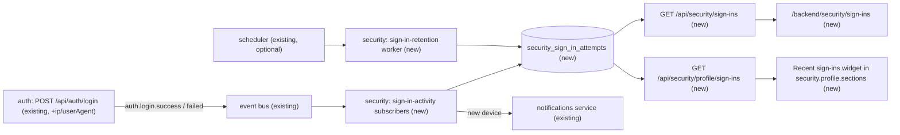
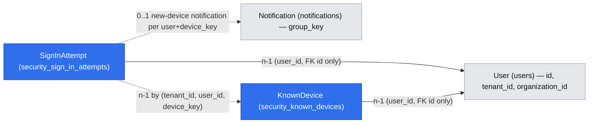

# Sign-in activity

## 📝 TLDR

Security administrators and individual users of Open Mercato Enterprise will be able to see who signed in, when, from which IP address and on which browser/OS, including failed attempts. Today `auth.login.success` and `auth.login.failed` carry no client information and nothing persists failed sign-ins. Proposed (future behavior): a small additive OSS seam adds optional `ip` and `userAgent` to both event payloads, and the enterprise `security` module persists every attempt, exposes an admin **Sign-in activity** list with a detail drawer, a **Recent sign-ins** section on the user's own security profile page, and an optional in-app notification when a user signs in from a new device.

Refs #8106. Extends `implemented/SPEC-ENT-001-2026-02-17-security-module-enterprise-mfa.md`.

## 📝 Problem Statement

Issue #8106 (reported against `@open-mercato/core` 0.9.0, unchanged on `main`):

- `auth.login.failed` is emitted with `{ email, reason }` only and `auth.login.success` with `{ id, email, tenantId, organizationId }` (`packages/core/src/modules/auth/api/login.ts`). An audit requirement such as "who, when and from where" needs custom code.
- Failed attempts are not stored anywhere. The `reason` values (`invalid_password`, `invalid_credentials`, `account_deactivated`, `tenant_unavailable`) are already computed precisely so that the audit stream can tell credential stuffing from a disabled account, but no consumer persists them.
- Users have no way to notice a sign-in they did not make.

The command side already exposes request metadata through `CommandInterceptorContext.request`; only the login route is missing it.

## Resolved assumptions (autonomous defaults)

| # | Question | Applied default | Why | Confirm? |
|---|----------|-----------------|-----|----------|
| Q1 | Split the OSS seam and the enterprise feature into separate specs? | No — one spec, two phases. Phase 1 (OSS seam) ships and is useful on its own; the enterprise phases depend on it. | The OSS seam is ~10 lines and has no consumer without the enterprise phases; a separate spec would be overhead. Phases are independently mergeable. | reversible |
| Q2 | Where does the enterprise part live? | Inside the existing enterprise `security` module, not a new module. | Reuses its ACL namespace, `security.profile.sections` injection spot, notification category `auth`, Security admin menu group and integration fixtures. A new module would duplicate all of these and add a `modules.ts` enablement step for no isolation gain; operators who do not want the data use the kill switch (Q7). | reversible |
| Q3 | How is the client IP derived? | `getClientIp(req, rateLimiterService.trustProxyDepth)` from `@open-mercato/shared/lib/ratelimit/helpers`, with `rateLimiterService` resolved from the request container — exactly what `auth/lib/rateLimitCheck.ts` does (backed by `RATE_LIMIT_TRUST_PROXY_DEPTH`). Depth `0` (default) yields `ip: null`. | Never trusts spoofable `X-Forwarded-For` unless the operator configured proxies; one source of truth for "client IP". | reversible |
| Q4 | How is the user agent parsed? | Tiny local regex parser in `security/lib/user-agent.ts` (browser family + major version, OS family, device type). No new dependency. | `bowser` is in `yarn.lock` only transitively (AWS SDK); depending on it directly would add a production dependency (Ask-First). The UI needs families, not exhaustive detection. Fully offline. | reversible |
| Q5 | Failed attempts where no user resolves (unknown email, multi-tenant email) — which tenant? | Not persisted. The subscriber skips events without a resolved `tenantId`; the existing rate limiter and structured logs remain the record of anonymous credential stuffing. The caller-supplied `tenantId` form field is never used for scoping. | Rows without a tenant cannot be encrypted (no tenant DEK) and would hold attacker-typed raw input (sometimes a password pasted into the email field). A caller-supplied tenant id is unauthenticated, so using it would let anyone write into any tenant's log. Smallest, safest scope; failures against real accounts — the audit case in #8106 — are fully covered. | reversible (follow-up could store hash-only aggregate counters) |
| Q6 | Does `auth.login.failed` gain `userId` / `tenantId` / `organizationId` when a user resolved? | Yes, optional, only when the user record was found. | Required to scope failed rows to a tenant; additive per BACKWARD_COMPATIBILITY §5. The HTTP response stays identical, so no enumeration oracle is added. | reversible |
| Q7 | Retention and switches? | `OM_SECURITY_SIGN_IN_ACTIVITY` (default `true`), `OM_SECURITY_SIGN_IN_RETENTION_DAYS` (default `90`, min `1`, max `730`), `OM_SECURITY_SIGN_IN_NOTIFY_NEW_DEVICE` (default `true`). Platform-level env, no per-tenant settings UI. | Matches existing `OM_SECURITY_*` env style; per-tenant settings can be added later without schema change. 90 days mirrors common SaaS defaults (Auth0, GitHub security log). | reversible |
| Q8 | What counts as a "new device"? | A successful sign-in whose `device_key` (browser family + OS family + device type) is not yet in `security_known_devices` for that user, inserted atomically (`INSERT … ON CONFLICT DO NOTHING`), and the user already has at least one known device. IP changes alone do not notify. | IP-only alerts are noisy (mobile networks, VPNs) and GeoIP is excluded. Skipping the very first sign-in avoids a pointless alert on onboarding. | reversible |
| Q9 | Should SSO and customer-portal sign-ins be recorded? | Not in this spec. "Success" means the primary password credential was accepted (MFA state per Q12). SSO and portal logins do not emit `auth.login.*` today. | Smallest working scope; each is a follow-up that only needs the same event fields emitted from its flow. | reversible |
| Q10 | "This wasn't me" action? | Not in v1. The drawer and notification link to `/backend/profile/security` (change password, MFA). | Session revocation needs a separate design (sessions are owned by `auth`). | reversible |
| Q11 | Record the `requiredRoles` 403 and rate-limited 429 responses? | 403: yes — `login.ts` emits `auth.login.failed` with a new reason `role_denied` (password was correct, area not allowed). 429: no — throttled requests emit nothing, by design, so a flood cannot amplify into DB writes. | `role_denied` is an additive reason value on an existing event; 429 logging would turn the rate limiter into a write amplifier. | reversible |
| Q12 | How do MFA-protected sign-ins look? | Success rows carry `mfa_status`: `not_required` when the user has no active MFA method, otherwise `pending`; a subscriber on the existing `security.mfa.verified` event flips the user's latest `pending` row (within 15 minutes) to `verified`. The new-device notification still fires on password success. | The MFA interceptor runs after the route (`security/api/interceptors.ts`), so the success event precedes MFA. A correct password from an unknown device is exactly what the user should hear about. | reversible |

## 📝 User Stories

- **US-A1** — As a security administrator, I want to list sign-in attempts in my tenant filtered by user, result, date range and IP, so I can investigate suspicious access. AC: default view = last 7 days, newest first; failed rows show an error badge and translated reason; empty and no-results states with a "Clear filters" action; users without `security.sign_ins.view` see no menu entry and get 403 from the API; organization-restricted admins see only their organizations.
- **US-A2** — As a security administrator, I want to open one attempt in a drawer, so I can see the raw user agent, MFA state, previous successful sign-in and jump to the user's security page. AC: Escape closes; the link is hidden for unknown users; an out-of-scope id shows the not-found state.
- **US-U1** — As a signed-in user, I want a "Recent sign-ins" section on my security profile, so I can spot sign-ins I did not make. AC: last 10 attempts in 30 days; failures and "New device" are visible; empty state for first sign-in; the hint links to change password and MFA settings.
- **US-U2** — As a user, I want an in-app notification when my password is used from a new device, so I can react quickly. AC: not on the very first sign-in; at most one per device; "Review" opens my security profile; no email is sent.

## 📝 Proposed Solution

1. **OSS seam (core `auth`)** — `login.ts` computes `ip` once per request and reads `user-agent` (truncated to 512 chars), then passes them, plus an `occurredAt` ISO timestamp, on every `auth.login.success` and `auth.login.failed` emission. Failed emissions also carry `userId`, `tenantId`, `organizationId` when a user resolved. All new fields are optional and nullable. No response, status code, timing or rate-limit change.
2. **Enterprise persistence** — persistent subscribers in `security/subscribers/` write one `SignInAttempt` row per tenant-resolved event, parse the UA locally, upsert `KnownDevice` atomically to compute `is_new_device`, and track `mfa_status`.
3. **Admin list** — `/backend/security/sign-ins`: DataTable with filters (user, result, date range, IP), failed rows marked with status tokens, row click opens a detail drawer.
4. **Profile section** — a widget injected into the existing `security.profile.sections` spot on `/backend/profile/security`: the user's last 10 sign-ins (30 days), with failed attempts and a "New device" badge.
5. **New-device notification** — in-app only `security.sign_in.new_device`, created by the persistence subscriber, deduplicated by group key per user + device.
6. **Retention** — a daily queue worker deletes rows older than the retention window, registered with the scheduler when present.

### Alternatives considered

- **Persist into the generic audit log (`audit_logs`) instead of a new table.** Rejected: audit logs are command/action-centric, have no IP/UA columns to filter on, and failed sign-ins have no actor. A dedicated, indexed, append-only table keeps filters cheap and retention independent.
- **Persist in OSS core.** Rejected: issue #8106 is labelled `enterprise`; OSS only gets the payload seam, which is also useful to third-party subscribers.
- **GeoIP / external UA API.** Excluded by requirement (offline-testable, no third-party data processor).

### Market check

Keycloak stores `LOGIN` / `LOGIN_ERROR` events with `ipAddress`, client and error code, with configurable expiration; Auth0 logs `s` / `f` events with `ip`, `user_agent` and plan-bound retention; Google and GitHub send "new sign-in" alerts keyed on device, not IP. This spec takes the same shape (typed result + reason, IP, UA, retention, device-keyed alerts) and skips geolocation and risk scoring, which those products build on external data.

## 📝 Architecture



Takeaway: the only change outside `packages/enterprise` is the event payload in `auth/api/login.ts` and the `auth.login.*` payload type; everything else is enterprise-owned and decoupled through events and an existing injection spot.

- Coupling: events only (no imports from `security` into `auth`). `security` reads user display names through the existing `auth` user lookup by id (FK id, no ORM relation).
- MFA interceptor (`security.auth.login.mfa-challenge`) is unaffected; the success event is emitted before it runs, as today.
- Subscribers are `persistent: true` so a DB hiccup retries via the queue and login latency is unchanged (emission is already fire-and-forget).

## 📝 Data Model

### OSS: event payloads (additive)

```ts
type AuthLoginSuccessPayload = {
  id: string
  email: string
  tenantId: string | null
  organizationId: string | null
  ip?: string | null
  userAgent?: string | null
  occurredAt?: string
}

type AuthLoginFailedPayload = {
  email: string
  reason: 'invalid_password' | 'invalid_credentials' | 'account_deactivated' | 'tenant_unavailable' | 'role_denied'
  ip?: string | null
  userAgent?: string | null
  userId?: string | null
  tenantId?: string | null
  organizationId?: string | null
  occurredAt?: string
}
```

`occurredAt` is the ISO timestamp taken in the route at emission time.

### Enterprise: `SignInAttempt` → table `security_sign_in_attempts`

| Column | Type | Notes |
|---|---|---|
| `id` | uuid PK | |
| `tenant_id` | uuid | always set (unresolved failures are not persisted, Q5) |
| `organization_id` | uuid, nullable | user's organization when known |
| `user_id` | uuid, nullable | FK id to `users.id`, no ORM relation |
| `email` | text | **encrypted**, `hashField: email_hash` |
| `email_hash` | text | deterministic lookup hash (`hashForLookup`) |
| `result` | text | `success` \| `failure` |
| `reason` | text, nullable | one of the five failure reasons; null on success |
| `ip_address` | text, nullable | **encrypted**, `hashField: ip_hash` |
| `ip_hash` | text, nullable | exact-match IP filter |
| `user_agent` | text, nullable | **encrypted**, max 512 chars |
| `browser_name` | text, nullable | e.g. `Chrome`, `Firefox`, `Safari`, `Edge`, `Opera`, `Samsung Internet` |
| `browser_major` | text, nullable | major version only |
| `os_name` | text, nullable | `Windows`, `macOS`, `iOS`, `iPadOS`, `Android`, `Linux`, `ChromeOS` |
| `device_type` | text | `desktop` \| `mobile` \| `tablet` \| `bot` \| `unknown` |
| `device_key` | text | `${browser_name}|${os_name}|${device_type}` (lowercase) |
| `is_new_device` | boolean | computed on success rows only; false on failures |
| `mfa_status` | text, nullable | success rows: `not_required` \| `pending` \| `verified`; null on failures |
| `occurred_at` | timestamptz | payload `occurredAt`; subscriber falls back to processing time when absent (older core) |
| `created_at` | timestamptz | |

Indexes: `(tenant_id, occurred_at desc)`, `(tenant_id, user_id, occurred_at desc)`, `(tenant_id, ip_hash)`, `(occurred_at)` for retention.

### Enterprise: `KnownDevice` → table `security_known_devices`

| Column | Type | Notes |
|---|---|---|
| `id` | uuid PK | |
| `tenant_id` | uuid | |
| `user_id` | uuid | FK id only |
| `device_key` | text | same value as on `SignInAttempt` |
| `first_seen_at` / `last_seen_at` | timestamptz | `last_seen_at` bumped on each success |

Unique `(tenant_id, user_id, device_key)`. The subscriber inserts with `ON CONFLICT DO NOTHING RETURNING id`; a returned id plus an existing other row for the user = new device. This is race-free under concurrent or out-of-order queue delivery. Retention deletes devices with `last_seen_at` older than the window, so a device unused for 90 days alerts again.

- **System-written, append-only** (the only update is the `mfa_status` flip by the MFA subscriber). No `updated_at`, no `deleted_at`, no edit/delete form or mutating API, so optimistic locking does not apply (AGENTS.md rule targets user-editable entities). Retention hard-deletes.
- Encryption map registered in `security/encryption.ts` (new file, same shape as `auth/encryption.ts`), read through `findWithDecryption`. Every row has a tenant, so the tenant DEK always applies.
- `email_hash` / `ip_hash` use `hashForLookup`, which is a keyed `v2:` HMAC with the installation pepper (`LOOKUP_HASH_PEPPER` → encryption keys). This is **pseudonymisation**, not anonymisation: the IPv4 space is small, so anyone holding both the DB and the pepper can reverse an `ip_hash`. Without any configured key the helper falls back to an unkeyed digest — the enterprise docs must state that a pepper is required for meaningful protection.
- Entity id `security:sign_in_attempt`. Not indexed for fulltext search.



## 📝 API Contracts

All routes GET-only, zod-validated query, `pageSize ≤ 100`, OpenAPI specs in `security/api/openapi.ts`.

### `GET /api/security/sign-ins` — admin list

- Guard: `requireAuth`, `requireFeatures: ['security.sign_ins.view']`.
- Query: `page`, `pageSize` (default 25, max 100), `userId?` (uuid), `email?` (exact, matched via `email_hash`), `result?` (`success|failure`), `from?` / `to?` (ISO datetime, `from ≤ to`, max span 366 days), `ip?` (exact, validated as IPv4/IPv6, matched via `ip_hash`), `sort` (`occurredAt` desc default).
- Scoping: `tenant_id = auth.tenantId` and `organization_id` within the caller's allowed organizations (or null-org rows of the tenant). No cross-tenant or unscoped mode.
- Response: `{ items: SignInAttemptDto[], total, page, pageSize, totalPages }` where `SignInAttemptDto = { id, occurredAt, result, reason, userId, email, userName, ipAddress, userAgent, browserName, browserMajor, osName, deviceType, isNewDevice, mfaStatus }`.

### `GET /api/security/sign-ins/[id]` — admin detail

Same guard and scoping; 404 when out of scope. Returns one `SignInAttemptDto` plus `previousSuccessAt` (the user's previous successful sign-in, for the drawer).

### `GET /api/security/profile/sign-ins` — own recent sign-ins

- Guard: `requireAuth`, `requireFeatures: ['security.profile.view']`.
- Always filtered to `user_id = auth.sub` and `tenant_id = auth.tenantId`; no user/ip filter accepted. Query: `limit` (default 10, max 50), `days` (default 30, max retention).
- Response: `{ items: Array<Omit<SignInAttemptDto, 'userId' | 'email' | 'userName'>> }`.

### ACL (additive, `security/acl.ts`)

- `security.sign_ins.view` — "View sign-in activity", `dependsOn: ['security.profile.view', 'auth.users.list']`. Granted to `admin` in `setup.ts` `defaultRoleFeatures`; superadmin via wildcard.

### Events, notifications, workers

- No new event IDs. Consumes `auth.login.success`, `auth.login.failed` and the existing `security.mfa.verified` (`{ userId, challengeId, methodType }`).
- Notification type `security.sign_in.new_device`: `channels: ['in_app']`, `severity: 'warning'`, icon `monitor-smartphone`, `linkHref: '/backend/profile/security'`, `groupKey: sign_in_new_device:{userId}:{device_key}`, `expiresAfterHours: 168`. Body interpolates browser, OS, IP (or "unknown IP") and time.
- Worker `security:sign-in-retention` on queue `security-sign-in-retention`, deletes in batches of 5,000 until no rows older than `now - retentionDays`. Retention is a pure time-based delete, so it runs as **one global system schedule** (not per tenant/org), registered through the soft-optional `schedulerService` with a stable UUID derived from `security:sign-in-retention` (the `stableScheduleUuid` approach in `agent_orchestrator/setup.ts`), so repeated registration upserts the same row. Daily cron `15 3 * * *`. Also prunes `security_known_devices`.

## 📝 UI/UX

Proposed-UI prototype (illustrative, low-fi, clickable; a proposal, not accepted): [`.ai/prototypes/sign-in-activity/index.html`](../../prototypes/sign-in-activity/index.html). Screenshots: [`assets/sign-in-activity/`](assets/sign-in-activity/).

### Admin — Security › Sign-in activity (`/backend/security/sign-ins`)

- Menu entry under the existing Security settings group, feature `security.sign_ins.view`.
- `DataTable` (table id `security.sign_ins.list`, registered as an extension host in `extension-points.ts`) columns: Time (relative + absolute tooltip), User (name + email; "Unknown account" for unresolved), Result (`Badge` success / error status tokens), Reason (translated), MFA (not required / pending / verified), IP, Browser · OS, New device badge.
- Filters: User (async select over `/api/auth/users`), Result (all / success / failure), Date range (presets 24h, 7d, 30d, custom), IP (exact text). Filters reflect into the URL so the drawer's "All sign-ins for this user" link is a filtered view.
- Row click → detail drawer (`Sheet`): all fields, raw user agent in monospace, previous successful sign-in, link "Open user security" (`/backend/security/users/[id]`) when a user is known. `Escape` closes.
- Empty state, `LoadingMessage` / `ErrorMessage` per `ui:backend`. No row actions, no bulk actions.

### Own profile — Recent sign-ins (`/backend/profile/security`)

- Widget injected into `security.profile.sections` (`widgets/injection/profile-recent-sign-ins`), so the page file is not modified.
- Compact list of the last 10 attempts in 30 days: device icon, "Chrome 131 on macOS", IP, relative time, result badge; failed attempts show the translated reason; "New device" badge on flagged rows. Footer hint: "Don't recognise a sign-in? Change your password and review MFA" linking to the password form anchor and `/backend/profile/security/mfa`.
- When the feature is disabled (`OM_SECURITY_SIGN_IN_ACTIVITY=false`) the widget renders nothing.

### New-device notification

Standard in-app notification renderer: title "New sign-in to your account", body "Firefox 132 on Windows from 203.0.113.7 at 14:02". Action "Review" → `/backend/profile/security`.

i18n keys under `security.signIns.*` and `security.notifications.signInNewDevice.*` in en/pl/de/es/ko. Status colors via DS status tokens only.

## 📝 Edge Cases & Failure Scenarios

- **Proxy not configured** (`RATE_LIMIT_TRUST_PROXY_DEPTH=0`): `ip` is null; UI shows "Unknown IP"; new-device logic does not use IP, so it still works.
- **Spoofed `X-Forwarded-For`**: ignored unless depth > 0; with depth N only the Nth-from-last hop is trusted (existing helper semantics).
- **Missing / garbage / huge UA**: stored truncated to 512 chars; parser returns `unknown` families; `device_key = unknown|unknown|unknown` (a new-device alert fires at most once for it per user via the group key).
- **Credential-stuffing flood**: one row per attempt, bounded by the existing IP + compound login rate limits; subscriber is persistent so bursts queue instead of slowing login. Retention bounds growth.
- **Subscriber failure** (DB down): queue retries; login is never blocked (event emission already `void … .catch()`).
- **Unresolved email failures**: not persisted (Q5); `POST /api/auth/login` behavior is unchanged.
- **Rate-limited (429) requests**: not recorded (Q11).
- **Concurrent sign-ins from one new device**: the unique `KnownDevice` key lets exactly one subscriber run win the insert, so at most one alert fires.
- **MFA never completed**: row stays `mfa_status = pending`; UI shows "MFA not completed" so an abandoned or attacker sign-in is distinguishable.
- **User deleted later**: rows keep `user_id` and encrypted email; list shows "Deleted user". Retention eventually removes them. GDPR erasure (`2026-07-08-gdpr-data-erasure.md`) should register this entity for erasure by `user_id` — noted as a follow-up hook, no coupling added here.
- **Org visibility**: an admin limited to org A cannot see rows of users in org B in the same tenant.
- **Feature disabled**: subscribers no-op; existing rows stay readable until retention removes them.
- **Clock / ordering**: `occurred_at` comes from the payload's `occurredAt` (set in the route), not from subscriber processing time, so queue delay does not reorder history.

## 📝 Risks & Impact Review

| Concrete failure scenario | Severity | Affected area | Mitigation | Residual risk |
|---|---|---|---|---|
| IP addresses and UAs are personal data stored for 90 days | Medium | GDPR posture of deployments | Field-level encryption (tenant DEK), keyed lookup hashes, retention worker, kill switch, documented in enterprise docs | Operators must set retention to match their policy |
| Third-party subscriber relied on the exact key set of `auth.login.failed` | Low | Custom modules | Additive optional fields only (BACKWARD_COMPATIBILITY §5 "MAY add new optional fields") | Strict-schema consumers using `.strict()` would reject; none in repo |
| Anonymous credential stuffing (unknown emails) is not visible in the UI | Low | Admin investigations | Rate limiter + structured logs still record it; Q5 follow-up can add hash-only counters | Admins see only attacks on real accounts |
| `ip_hash` reversible by someone with DB access and the lookup pepper | Medium | Pseudonymisation strength | Keyed HMAC, encrypted raw IP, docs require `LOOKUP_HASH_PEPPER` | Without a configured pepper the digest is unkeyed |
| Table growth under sustained attack | Low | Database size | Rate limits + daily retention + indexes on `occurred_at` | Short-term growth between retention runs |
| Local UA parser misclassifies a browser | Low | Display and new-device alerts | Table-driven unit tests; worst case is one extra notification per user per misclassified family | None material |

## 📝 Migration & Backward Compatibility

- OSS: event IDs unchanged; payloads gain optional fields only. No route, response, schema or DI change in `auth`.
- Enterprise: one new table + migration and snapshot in `security/migrations`; new ACL feature, notification type, worker, routes and page are additive. No existing contract changes. Rollback = disable via env, then drop the table in a follow-up migration if desired.
- New env vars must be mirrored to `apps/mercato/.env.example` and the create-app template (`yarn template:sync:fix`).

## 📋 Phasing

- **Phase 1 — OSS seam** (core `auth`, independently shippable): `ip`, `userAgent`, `occurredAt` (+ resolved ids on failure) on `auth.login.*`.
- **Phase 2 — Persistence + retention** (enterprise `security`): entity, migration, encryption map, UA parser, subscribers, retention worker.
- **Phase 3 — Admin Sign-in activity page + API**.
- **Phase 4 — Profile Recent sign-ins + new-device notification**.

## 📋 Implementation Plan

### Phase 1 — OSS seam

1. Add a `resolveLoginClientMeta(req, container)` helper in `packages/core/src/modules/auth/lib/` returning `{ ip, userAgent, occurredAt }` via `getClientIp(req, rateLimiterService.trustProxyDepth)` (service resolved from the container, `null` ip when unavailable) and a 512-char truncated `user-agent`. Unit test: depth 0 → null ip; depth 1 with `X-Forwarded-For` → client ip; long UA truncated.
2. Pass the meta into all three `emitAuthEvent` calls in `auth/api/login.ts`; add `userId/tenantId/organizationId` to failures when `user` resolved; emit `auth.login.failed` with `reason: 'role_denied'` before the `requiredRoles` 403. Unit test asserts emitted payloads for success, `invalid_password`, `invalid_credentials`, `account_deactivated`, `role_denied`; response bodies and status codes unchanged.
3. Document the new optional fields in `apps/docs` events reference and `auth` AGENTS.md events list.

### Phase 2 — Persistence

4. `security/lib/user-agent.ts` parser + table-driven unit tests (Chrome/Edge/Firefox/Safari/Opera/Samsung, Windows/macOS/iOS/iPadOS/Android/Linux/ChromeOS, bots, empty).
5. `SignInAttempt` and `KnownDevice` entities, `security/encryption.ts` map, `yarn db:generate` → keep only this table's migration + snapshot. `yarn generate`.
6. `security/lib/sign-in-activity-config.ts` reading the three env vars with `parseBooleanWithDefault` and clamped ints; mirror into `.env.example` + template.
7. `subscribers/sign-in-activity-success.ts`, `sign-in-activity-failed.ts` and `sign-in-activity-mfa-verified.ts` (`persistent: true`), shared `SignInActivityService` registered in `di.ts`. Unit tests: scoping, unresolved failure skipped, atomic new-device upsert (two concurrent calls → one new), `mfa_status` transitions, disabled switch no-op.
8. Retention worker + single global stable-UUID schedule (soft-optional scheduler); unit test batch deletion, known-device pruning, window clamp and idempotent registration.

### Phase 3 — Admin page

9. ACL feature `security.sign_ins.view` + `defaultRoleFeatures` for admin; `yarn generate`.
10. `GET /api/security/sign-ins` and `/[id]` with zod query, scoping and OpenAPI. Unit tests for filter → hash mapping and scope clauses.
11. `/backend/security/sign-ins` page, filters, drawer, menu entry, `security.sign_ins.list` extension host, i18n (5 locales).
12. Integration tests TC-SEC-016, TC-SEC-017, TC-SEC-019 (admin part).

### Phase 4 — Profile + notification

13. `GET /api/security/profile/sign-ins` + unit tests.
14. `profile-recent-sign-ins` injection widget into `security.profile.sections`; i18n.
15. Notification type `security.sign_in.new_device` + creation inside `recordSignInAttempt` with group key; unit test dedupe.
16. Integration tests TC-SEC-018 and TC-SEC-019 (profile part); update enterprise README spec table.

## 🧪 Integration Coverage

All tests live in `packages/enterprise/src/modules/security/__integration__/`. The enterprise integration environment sets `RATE_LIMIT_TRUST_PROXY_DEPTH=1` (added in step 12 alongside the existing integration env; rate limiting stays disabled by `OM_INTEGRATION_TEST`) so IP assertions are deterministic. Tests create their own tenant/users through existing `helpers/securityFixtures.ts`, set a custom `User-Agent` header on the login request, poll the API (≤10 s) for the persistent subscriber, and clean up in `finally`. No network access beyond the local app; no GeoIP or UA service. Run with `yarn test:integration --grep TC-SEC-01[6-9]` against a local enterprise app.

| ID | Path(s) | Scenario |
|---|---|---|
| TC-SEC-016 | `POST /api/auth/login`, `GET /api/security/sign-ins` | Wrong password with UA `Firefox/132 on Linux` and `X-Forwarded-For: 203.0.113.7` → admin list `?result=failure&userId=` returns one row, `reason=invalid_password`, `browserName=Firefox`, `osName=Linux`, `ipAddress=203.0.113.7`; `?ip=203.0.113.7` finds it, `?ip=198.51.100.1` does not. Login to an unknown email creates no row. |
| TC-SEC-020 | `POST /api/auth/login` (`requiredRoles`), `GET /api/security/sign-ins` | Correct password with a required role the user lacks → 403 response unchanged, row with `reason=role_denied`. |
| TC-SEC-017 | `GET /api/security/sign-ins`, `GET /api/security/sign-ins/[id]`, `GET /api/security/profile/sign-ins` | Successful login appears in own profile list; a user without `security.sign_ins.view` gets 403 on the admin list; an admin of a second tenant cannot see the row (list empty, detail 404). |
| TC-SEC-018 | `POST /api/auth/login`, `GET /api/notifications` | First login (UA A) → no notification; login with UA B → one `security.sign_in.new_device`; second login with UA B → still one. |
| TC-SEC-019 | UI `/backend/security/sign-ins`, `/backend/profile/security` | Admin filters Result = Failed, sees error badge row, opens drawer showing raw UA, closes with Escape; user's profile shows "Recent sign-ins" with the attempt. |

Unit suites: `auth/lib/__tests__/login-client-meta.test.ts`, `auth/api/__tests__/login-events.test.ts`, `security/lib/__tests__/user-agent.test.ts`, `security/services/__tests__/SignInActivityService.test.ts`, `security/workers/__tests__/sign-in-retention.test.ts`, `security/api/sign-ins/__tests__/route.test.ts`.
