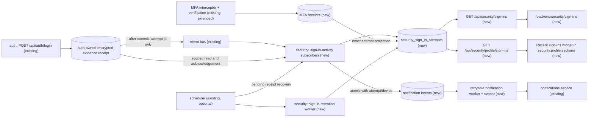
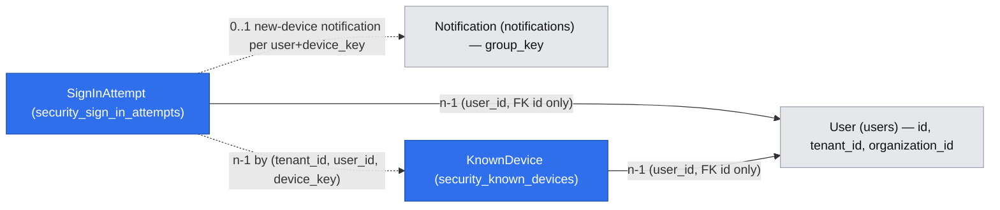

# Sign-in activity

## 📝 TLDR

Security administrators and individual users of Open Mercato Enterprise will be able to see who signed in, when, from which IP address and on which browser/OS, including resolved failed attempts. Auth keeps client evidence in a short-lived encrypted owner receipt. The internal `auth.login.attempted` event carries an opaque attempt id and canonical scope. The Enterprise `security` module reads the owner receipt to build sign-in history, an admin detail drawer, the user's **Recent sign-ins**, and optional new-device notices.

Refs #8106. Extends `implemented/SPEC-ENT-001-2026-02-17-security-module-enterprise-mfa.md`.

## 📝 Problem Statement

Issue #8106 (reported against `@open-mercato/core` 0.9.0, unchanged on `main`):

- `auth.login.failed` is emitted with `{ email, reason }` only and `auth.login.success` with `{ id, email, tenantId, organizationId }` (`packages/core/src/modules/auth/api/login.ts`). An audit requirement such as "who, when and from where" needs custom code.
- Failed attempts are not stored anywhere. The `reason` values (`invalid_password`, `invalid_credentials`, `account_deactivated`, `tenant_unavailable`) are already computed precisely so that the audit stream can tell credential stuffing from a disabled account, but no consumer persists them.
- Users have no way to notice a sign-in they did not make.

The command side already exposes request metadata through `CommandInterceptorContext.request`; only the login route is missing it.

## Resolved assumptions (autonomous defaults)

| # | Question | Applied default | Why | Confirm? |
|---|----------|-----------------|-----|----------|
| Q1 | Split the OSS seam and the enterprise feature into separate specs? | One spec, four phases. The OSS seam merges dormant until the Enterprise history consumer and both recovery and expiry workers pass the activation gate. | Separate merges keep the owner changes reviewable and avoid collecting client evidence where history is unavailable. G2's minimal failure receipt has an independent rollout. | reversible |
| Q2 | Where does the enterprise part live? | Inside the existing enterprise `security` module, not a new module. | Reuses its ACL namespace, `security.profile.sections` injection spot, notification category `auth`, Security admin menu group and integration fixtures. A new module would duplicate all of these and add a `modules.ts` enablement step for no isolation gain; operators who do not want the data use the kill switch (Q7). | reversible |
| Q3 | How is the client IP derived? | `getClientIp(req, rateLimiterService.trustProxyDepth)` from `@open-mercato/shared/lib/ratelimit/helpers`, with `rateLimiterService` resolved from the request container — exactly what `auth/lib/rateLimitCheck.ts` does (backed by `RATE_LIMIT_TRUST_PROXY_DEPTH`). Depth `0` (default) yields `ip: null`. | Never trusts spoofable `X-Forwarded-For` unless the operator configured proxies; one source of truth for "client IP". | reversible |
| Q4 | How is the user agent parsed? | Tiny local regex parser in `security/lib/user-agent.ts` (browser family + major version, OS family, device type). No new dependency. | `bowser` is in `yarn.lock` only transitively (AWS SDK); depending on it directly would add a production dependency (Ask-First). The UI needs families, not exhaustive detection. Fully offline. | reversible |
| Q5 | Failed attempts where no user resolves (unknown email, multi-tenant email) — which tenant? | The producer creates neither receipt nor wake-up. The existing rate limiter and structured logs remain the record of anonymous credential stuffing. Scope comes from the canonical account. | The receipt needs a tenant DEK. Unresolved credentials have no owner who can authorize or protect their evidence. | reversible (follow-up could store hash-only aggregate counters) |
| Q6 | How are resolved failed attempts scoped? | The event carries an independently generated opaque attempt id and uses trusted canonical tenant/organization metadata. The auth owner protects the original user id and bounded client evidence. Preserve the existing raw `auth.login.failed` contract. | The history consumer reads only the exact scoped receipt. Separate G2 failure facts contain the identity and closed reason, with no email, IP or UA. | reversible |
| Q7 | Retention and switches? | `OM_SECURITY_SIGN_IN_ACTIVITY` opts in (default `false`), `OM_SECURITY_SIGN_IN_RETENTION_DAYS` defaults to `90` (min `1`, max `730`), and `OM_SECURITY_SIGN_IN_NOTIFY_NEW_DEVICE` defaults to `true`. The auth receipt's delivery eligibility lasts at most 24 hours. | Auth collects only while the Enterprise sink and expiry loop are ready. The short eligibility window limits recovery data independently of history retention. | reversible |
| Q8 | What counts as a "new device"? | A successful sign-in whose `device_key` (browser family + OS family + device type) is not yet in `security_known_devices` for that user, inserted atomically (`INSERT … ON CONFLICT DO NOTHING`), and the user already has at least one known device. IP changes alone do not notify. | IP-only alerts are noisy (mobile networks, VPNs) and GeoIP is excluded. Skipping the very first sign-in avoids a pointless alert on onboarding. | reversible |
| Q9 | Should SSO and customer-portal sign-ins be recorded? | The carrier covers staff password sign-ins. "Success" means the primary password credential was accepted (MFA state per Q12). | SSO and portal would need their own verified owner evidence and activation rules. | reversible |
| Q10 | "This wasn't me" action? | Not in v1. The drawer and notification link to `/backend/profile/security` (change password, MFA). | Session revocation needs a separate design (sessions are owned by `auth`). | reversible |
| Q11 | Record the `requiredRoles` 403 and rate-limited 429 responses? | Record `role_denied` in the history owner receipt for the 403 after a correct password. Throttled 429 requests bypass capture. | The limiter stays before the evidence write. | reversible |
| Q12 | How do MFA-protected sign-ins look? | Success rows carry `mfa_status`: `unknown` until the interceptor records its decision, then `not_required`, `enrollment_required`, `bypassed`, `pending` or `verified`. The interceptor binds its challenge to this request's server-created `attemptId`; verification updates only that exact attempt through a durable MFA receipt. No latest-row or time-window matching is permitted. The new-device notification still fires on password success. | The MFA interceptor runs after the route (`security/api/interceptors.ts`), so the success event precedes MFA. A correct password from an unknown device is exactly what the user should hear about. | reversible |

## 📝 User Stories

- **US-A1** — As a security administrator, I want to list sign-in attempts in my tenant filtered by user, result, date range and IP, so I can investigate suspicious access. AC: default view = last 7 days, newest first; failed rows show an error badge and translated reason; empty and no-results states with a "Clear filters" action; users without `security.sign_ins.view` see no menu entry and get 403 from the API; organization-restricted admins see only their organizations.
- **US-A2** — As a security administrator, I want to open one attempt in a drawer, so I can see the raw user agent, MFA state, previous successful sign-in and jump to the user's security page. AC: Escape closes; the link is hidden for unknown users; an out-of-scope id shows the not-found state.
- **US-U1** — As a signed-in user, I want a "Recent sign-ins" section on my security profile, so I can spot sign-ins I did not make. AC: last 10 attempts in 30 days; failures and "New device" are visible; empty state for first sign-in; the hint links to change password and MFA settings.
- **US-U2** — As a user, I want an in-app notification when my password is used from a new device, so I can react quickly. AC: not on the very first sign-in; at most one per device; "Review" opens my security profile; no email is sent.

## 📝 Proposed Solution

1. **OSS seam (core `auth`)** — with admission open, capture the canonical resolved account, bounded client metadata, outcome and occurrence time in the encrypted owner receipt. Generate one independent UUID per attempt. After commit, emit `auth.login.attempted` as a scoped id-only wake-up. Legacy `auth.login.success` and `auth.login.failed` retain their names, fields, conditions, scope and delivery, including otherwise deliverable organization-scoped success.
2. **Enterprise persistence** — the exact persistent subscriber and the scheduled pending-receipt sweep share a scoped consumer. They read the receipt through the auth owner, write one `SignInAttempt`, parse the UA locally, upsert `KnownDevice` atomically and track `mfa_status`. The auth owner acknowledges only the committed history result.
3. **Admin list** — `/backend/security/sign-ins`: DataTable with filters (user, result, date range, IP), failed rows marked with status tokens, row click opens a detail drawer.
4. **Profile section** — a widget injected into the existing `security.profile.sections` spot on `/backend/profile/security`: the user's last 10 sign-ins (30 days), with failed attempts and a "New device" badge.
5. **New-device notification** — in-app only `security.sign_in.new_device`, requested by an intent committed atomically with the attempt and device, then delivered by a retryable worker using the existing notification service deduplication API.
6. **Retention** — a daily queue worker deletes rows older than the retention window, registered with the scheduler when present.

### Alternatives considered

- **Persist into the generic audit log (`audit_logs`) instead of a new table.** Rejected: audit logs are command/action-centric, have no IP/UA columns to filter on, and failed sign-ins have no actor. A dedicated, indexed, append-only table keeps filters cheap and retention independent.
- **Persist a browsable history in OSS core.** Issue #8106 assigns history to Enterprise. Auth owns transient delivery state needed to recover after handoff failure.
- **GeoIP / external UA API.** Excluded by requirement (offline-testable, no third-party data processor).

### Market check

Keycloak stores `LOGIN` / `LOGIN_ERROR` events with `ipAddress`, client and error code, with configurable expiration; Auth0 logs `s` / `f` events with `ip`, `user_agent` and plan-bound retention; Google and GitHub send "new sign-in" alerts keyed on device, not IP. This spec takes the same shape (typed result + reason, IP, UA, retention, device-keyed alerts) and skips geolocation and risk scoring, which those products build on external data.

## 📝 Architecture



Core auth owns the protected receipt and its wake-up. Enterprise owns the history, consumer and UI. Use server-only DI contracts and an exact event subscriber across the module boundary. `security` reads display names through auth's existing user lookup by id.

### History admission and event delivery

- Auth admits protected capture only when `OM_SECURITY_SIGN_IN_ACTIVITY=true`, its writer and expiry job are installed, and the optional Enterprise `securitySignInHistoryAdmission` reports ready. The Enterprise capability verifies its enabled consumer and deployed durable-events worker, plus enabled auth expiry and Enterprise recovery schedules with successful recent worker completions. Require scheduler-owned evidence of actual completion or the job owner's completion result if the scheduler records enqueue only. Both jobs run at most five minutes apart and can prove health before producers opt in. An empty recovery run verifies the scoped source and history write readiness without inserting a history row. Auth expiry keeps running while capture is off. A missing result, an unhealthy job or a last successful result older than ten minutes closes admission. Reads are scoped to operational status and bounded by the login evidence budget. The activation gate below must pass for every producer deployment.
- Emit `auth.login.attempted` after the auth receipt commits, using `{ persistent: true, skipPersistentSubscribersInline: true, tenantId, organizationId }`. The declaration sets `excludeFromTriggers: true` and disables client, portal and cross-process broadcast. The payload contains one opaque UUID. The subscriber validates it against the trusted bus scope before the owner read. Null organization is an exact scope and does not widen delivery. Queue failure can lose the wake-up, so the owner receipt and scheduled sweep recover independently. Report enqueue failure using `auth.login_event_enqueue_failed` with sanitized fields.
- Before activation, verify actual exact and wildcard routing in workflow discovery and dispatch, outbound webhook dispatch and `agent_orchestrator` process dispatch. Apply the private event exclusion at each dispatcher and preserve the routing of previously published event ids. The ingress event bus's global taps and the optional example QA capture can observe the `attemptId` and scoped envelope only. The queued payload, failed-job copy, tap arguments and QA JSONL must contain no account identity, email, IP, UA, outcome, failure reason or session id. Only the exact trusted history consumer reads raw client evidence. Event data and trigger metadata offer no access to the receipt API.
- For success, auth passes the attempt id to `security.auth.login.mfa-challenge` through request-scoped DI `authSignInAttemptContext` on the same request container. The accessor verifies the existing signed `sub`, `sid`, tenant and organization against the bound request context and returns only the attempt id. A missing or mismatched context leaves MFA tracking uncorrelated and preserves current authentication. The interceptor passes the id through `createChallenge(userId, { signInAttemptId })`. The correlation adds no JWT claim, HTTP field or queued session id.

### G2 handoff for protected failed-attempt alerts

For an alertable resolved staff failure below the rate limiter, the auth owner records a separate minimal alerting receipt through `authSignalReceiptSource` in [Security event alerting](GDPR/2026-11-16-security-event-alerting.md). Use the same independently generated `attemptId` when both G1 and G2 record the attempt. The G2 receipt contains canonical tenant, organization and user identities, occurrence time and a closed failure reason. It excludes email, IP and UA, and has its own acknowledgement and lifetime. G2 recovery must work with sign-in history switched off and with no `auth.login.attempted` jobs. An available G1 wake-up may accelerate the exact G2 owner read. Its content cannot create a G2 decision or substitute for a G2 receipt. With G1 off, report-mode G2 leaves the generic staff refusal path at its existing timing and reports staff attempt coverage unavailable until the separate protected lane is active.

For a generic staff 401 below the limiter, start one fixed 250 ms monotonic evidence window at the common refusal point when history is configured on or `OM_SECURITY_SIGNAL_RECEIPTS=require` is set. Select the window before branching on eligibility or history readiness. A resolved attempt uses the window for bounded auth owner work. The independent G1 and G2 owner writes can run concurrently, but a G1 wake-up starts only after its owner commit is proven. Where a failure also changes the owner state, retain G2's same-transaction rule. Unknown or ambiguous attempts do no receipt or wake-up work and wait through the same enabled window. Bound admission, statements, commit observation and wake-up enqueue to the same deadline, with no request retry or detached post-response publication. Release the original generic 401 on schedule even if owner work succeeded earlier or is unavailable. For each unproven capture or enqueue result, report a separate sanitized outcome and reconcile by the original occurrence id. The scheduled sweeps discover committed receipts missed by the request and settle each through its own owner. Keep legacy login emissions, credential checks and the 429 path intact.

## 📝 Data Model

### OSS: wake-up and protected owner receipt

```ts
type AuthLoginAttemptedPayload = {
  attemptId: string
}
```

Validate the exact UUID-only payload at emit and dispatch. The bus envelope supplies canonical `tenantId` and exact `organizationId`, including explicit null. Missing or malformed scope refuses the lookup. Use a new UUID even when the attempt creates a session.

Auth owns `auth_sign_in_evidence_receipts` and its generated migration and snapshot. The table has `id` UUID equal to `attemptId`, `tenant_id`, nullable `organization_id`, `user_id`, `occurred_at`, `expires_at`, closed `result` and nullable closed `reason`, and tenant-encrypted `email`, `ip_address` and `user_agent`. The closed reasons are `invalid_password`, `invalid_credentials`, `account_deactivated`, `tenant_unavailable` and `role_denied`. Use the resolved account's canonical email, a validated IP from the configured trusted-proxy helper, and UA bounded to 512 characters. Capture `occurred_at` when the route decides the login outcome. Validate the row before storage and the protected projection on read. The writer fails closed for this copy when key, scope or encryption is unavailable, independently of any compatibility mode for existing data. Only sanitized aggregate diagnostics leave the owner. The login response still follows the established authentication decision.

Use unique `(tenant_id, id)` and expiry and scoped user indexes. The owner sets an immutable `expires_at` 24 hours after occurrence. It removes a receipt after history acknowledgement or at expiry, whichever comes first. Every lookup and history admission checks expiry, so expired and missing evidence cannot materialize history. `auth:sign-in-evidence-expiry` runs on the scheduler-owned recurring path and uses fixed-cutoff, keyset-bounded batches of at most 100. It stays scheduled after feature disablement until all existing receipts age out or are drained. Reports expose counts, last successful execution and oldest overdue age. A worker outage can delay physical cleanup and closes capture admission when its evidence goes stale. The operator drains or purges overdue receipts through the auth owner before restoring capture.

Classify the table in auth's C5 declarations as `runtime_state`, with a note on the retry window and per-column reasons for the protected `email`, `ip_address` and `user_agent` fields. Declare C8 `exclude: { reason: 'runtime_state' }` for this transient handoff and contribute an auth-owned scoped count/scan reader for G6 without exporting receipt data. Exclusion is a handover rule. G6 must still check the owner store for presence/expiry and subject erasure. No user-facing CRUD, browsing, lookup indexes on client values or data-engine side effects apply to this transient table.

### Internal owner read and acknowledgement

`authSignInEvidenceSource` binds the trusted `security.signInHistory` consumer server-side. Its `getPending({ tenantId, organizationId, attemptId })` resolves and decrypts precisely that pending receipt via the auth owner. Reject foreign tenant, different organization, omitted organization, malformed evidence and unrecognized consumer context. This service has no HTTP, MCP, workflow, agent or client-facing resolver. The system recovery worker uses an opaque continuation to page tenant ids and then id-only references within an exact tenant, in fair batches up to 100. Event handling and recovery use the same authorized read, pass the owner occurrence time through to the Enterprise transaction and check receipt expiry again before inserting. Absent, stale or invalid evidence produces no record. The consumer cannot recover facts from a legacy raw event or from queue metadata.

`acknowledge({ tenantId, organizationId, attemptId })` conditionally deletes that pending owner row only after the matching `SignInAttempt` transaction commits. If the acknowledgement fails, another sweep sees the same receipt; the unique history key makes persistence idempotent and the consumer retries acknowledgement only. Expiry or retirement during settlement leaves no duplicate history. Disablement suspends capture, wake-ups and new history writes. The expiry worker remains responsible for the unread backlog. An expired or acknowledged id replay remains a no-op. A recovery outcome whose receipt expires before history commits is counted as incomplete instead of backfilling from logs.

### Enterprise: `SignInAttempt` → table `security_sign_in_attempts`

| Column | Type | Notes |
|---|---|---|
| `id` | uuid PK | |
| `source_attempt_id` | uuid | immutable owner receipt id, required for persisted attempts |
| `tenant_id` | uuid | always set (unresolved failures are not persisted, Q5) |
| `organization_id` | uuid, nullable | user's organization when known |
| `user_id` | uuid, nullable | FK id to `users.id`, no ORM relation |
| `email` | text | **encrypted**, `hashField: email_hash` |
| `email_hash` | text | deterministic lookup hash (`hashForLookup`) |
| `result` | text | `success` \| `failure` |
| `reason` | text, nullable | one of the five failure reasons; null on success |
| `ip_address` | text, nullable | **encrypted**, `hashField: ip_hash` |
| `ip_hash` | text, nullable | exact-match IP filter |
| `user_agent` | text, nullable | **encrypted**, max 512 chars |
| `browser_name` | text, nullable | e.g. `Chrome`, `Firefox`, `Safari`, `Edge`, `Opera`, `Samsung Internet` |
| `browser_major` | text, nullable | major version only |
| `os_name` | text, nullable | `Windows`, `macOS`, `iOS`, `iPadOS`, `Android`, `Linux`, `ChromeOS` |
| `device_type` | text | `desktop` \| `mobile` \| `tablet` \| `bot` \| `unknown` |
| `device_key` | text | `${browser_name}|${os_name}|${device_type}` (lowercase) |
| `is_new_device` | boolean | computed on success rows only; false on failures |
| `mfa_status` | text, nullable | success rows: `unknown` \| `not_required` \| `enrollment_required` \| `bypassed` \| `pending` \| `verified`; null on failures |
| `occurred_at` | timestamptz | required owner `occurredAt`; reject missing or invalid evidence before insert |
| `created_at` | timestamptz | |

Unique `(tenant_id, source_attempt_id)`. A duplicate insert returns the existing row without repeating device detection or resetting MFA status. Reject and report conflicting owner scope/user/result for the same key. Indexes are `(tenant_id, occurred_at desc)`, `(tenant_id, user_id, occurred_at desc)`, `(tenant_id, ip_hash)` and `(occurred_at)` for retention.

### Enterprise: `KnownDevice` → table `security_known_devices`

| Column | Type | Notes |
|---|---|---|
| `id` | uuid PK | |
| `tenant_id` | uuid | |
| `user_id` | uuid | FK id only |
| `device_key` | text | same value as on `SignInAttempt` |
| `first_seen_at` / `last_seen_at` | timestamptz | `last_seen_at` bumped on each success |

Unique `(tenant_id, user_id, device_key)`. The transaction serializes successes for the same tenant/user with a transaction advisory lock, then checks for an existing other device and inserts with `ON CONFLICT DO NOTHING RETURNING id`. A returned id plus an existing other row means new device. This also serializes concurrent first-ever sign-ins from different devices: exactly one establishes the baseline without an alert. Baseline order is processing order; history still sorts by `occurred_at`. Set `last_seen_at = greatest(existing, occurredAt)` so delayed delivery cannot move it backwards. Retention takes the same tenant/user lock before pruning. A pruned device can alert again on its next appearance, with a new device-row UUID identifying that generation.

### Enterprise: exact MFA correlation and durable receipts

Add nullable `sign_in_attempt_id` (uuid, unique with `tenant_id` when non-null) to existing `mfa_challenges`; it is independent of `provider_challenge`, whose value is overwritten during provider preparation. Old `createChallenge(userId)` callers remain supported and leave it null.

New `security_sign_in_mfa_receipts`: `id` uuid PK, `tenant_id`, `user_id`, `source_attempt_id` uuid, nullable `challenge_id` uuid, `status` (`not_required|enrollment_required|bypassed|pending|verified`), nullable `verified_at`, `created_at`. Unique `(tenant_id, source_attempt_id)` and partial unique `(tenant_id, challenge_id)` when present. No credentials, JWTs, IP or UA are stored here. This table is a reconciliation record, not a new authentication authority.

1. Challenge creation persists the attempt mapping and a `pending` receipt in the **same transaction** as the challenge, before returning its id. Validate the supplied identity against the signed login claims and canonical user/tenant; never trust request headers/body or use an unscoped challenge lookup. The discriminator is an additive optional trailing `code` on `MfaVerificationServiceError`; preserve existing constructor arguments, status codes and messages. Challenge creation must distinguish the effective policy from its filtered methods: resolve `getEffectivePolicyForUser(userId)` once and use that same policy snapshot for method filtering and classification. An empty eligible-method set with enforcement off throws `no_active_methods`; with enforcement on it throws `enrollment_required`. The interceptor catches by typed code, never message/status: the former writes/projects a scoped `not_required` receipt, the latter `enrollment_required`, without changing the current login/enrollment redirect behavior. Emergency bypass writes/projects `bypassed`, never `not_required`, even if methods exist. The UI translates these as "MFA not required", "MFA enrollment required" and "MFA bypassed". Provider-unavailable errors (including the other 400), database failures, invalid signed claims and missing/invalid DI services leave `unknown`; every unexpected swallowed failure/fallback must call `reportError` with a stable code (`security.sign_in_mfa_challenge_failed`, `security.sign_in_mfa_service_unavailable` or `security.sign_in_mfa_claims_invalid`). Expected no-method/enrollment outcomes are not operational failures; bypass retains its existing warning/notification. Receipt-write failures call `reportError` with `security.sign_in_mfa_receipt_failed` and leave `unknown`. Reporting uses sanitized errors and fixed attributes only, never raw error messages, email, IP, UA, JWTs, or challenge payloads. Preserve existing HTTP behavior on all these paths; this audit change does not fix the existing fail-open behavior on unexpected challenge failures, which remains a disclosed authentication risk. Absence of a receipt never proves MFA was unnecessary.
2. On successful verification, `MfaVerificationService` writes the challenge's existing `verifiedAt` and the matching receipt's `verified` state atomically, before emitting the existing `security.mfa.verified` event. The event retains its existing shape. Unmapped challenges from old/other callers never update a sign-in by inference. Expiry is checked at verification using the challenge's configured `expiresAt`; queue delay must not invalidate an already valid verification. There is no arbitrary 15-minute attribution window.
3. Receipt writes and attempt persistence take the same transaction advisory lock keyed by tenant + attempt. Each receipt writer also projects its current status onto an already-present matching attempt; insertion reads the receipt under that lock. Thus either processing order converges, including verification before attempt insertion. The verified-event subscriber re-reads the scoped challenge/receipt and idempotently reconciles the exact key. `verified` never regresses to `pending`, including on duplicate events. Validate tenant and user on every match. No match means no other row is changed.
4. Receipt retention follows the sign-in retention window; keep mappings until their related event retry/dead-letter replay window has elapsed. Events older than retention are ignored before any attempt/device/intent writes, preventing replay from recreating purged history. An uncorrelated legacy attempt displays `unknown`, never an inferred `verified`.

### Enterprise: atomic attempt and notification intent

New `security_sign_in_notification_intents`: `id` uuid PK, `tenant_id`, nullable `organization_id`, `user_id`, `source_attempt_id`, `known_device_id` (uuid, id only), `status` (`pending|delivered|suppressed`), `created_at`, nullable `delivered_at`. Unique `(tenant_id, known_device_id)`; the device-row UUID distinguishes reappearance after retention. Keep the attempt id as an id-only reference for encrypted display data, with no cross-module ORM relation.

Within one database transaction: acquire the tenant/user device lock (success only), then the tenant/attempt lock; insert the attempt with its unique source key; read the MFA receipt; compute/persist device state and `is_new_device`; insert a notification intent for a newly detected device when alerts are enabled. Any failure rolls back **all** these writes. Duplicate attempts do not recompute device state or erase an existing intent. No notification service call occurs inside this transaction: its current implementation forks its own EntityManager and owns its transaction.

A queue worker `security:sign-in-notification` drains pending intents; a recurring sweep re-enqueues pending work after a process crash, so correctness does not depend on an after-commit enqueue succeeding. Use `notificationService.createBatch({ recipientUserIds: [userId], ...content, groupKey }, scope, { skipExistingGroup: true })`, the existing advisory-lock-backed deduplication path, with `groupKey = sign_in_new_device:{tenantId}:{userId}:{knownDeviceId}`. Do not use ordinary `create`, which refreshes an existing notification and can repeat delivery side effects. Only mark the intent delivered after the call succeeds; retry after notification commit but before intent acknowledgement finds the existing notification and creates no duplicate. Respect notification preferences; an intentionally suppressed channel is not a transient error.

The guarantee is eventual one persisted in-app notification per eligible device generation while enabled and within retention, not exactly-once browser SSE delivery. The existing service can commit the notification then fail before emitting its bell event; retry finds the stored row and the user sees it on the next notification fetch. Intents carry no decrypted personal data. Retention skips pending intents and their device/notification deduplication records until delivery or terminal suppression; once the source attempt expires, suppress undelivered intents rather than sending stale alerts. The worker checks the kill switches again before delivery. Explicitly serialize delivery of each intent; test notification cleanup and device pruning against pending delivery so the deduplication record cannot disappear during retries.

- **System-written, append-only** (attempt updates only project correlated MFA receipt state; devices, receipts and intents are also system-maintained). No `updated_at`, no `deleted_at`, no edit/delete form or mutating API, so optimistic locking does not apply (AGENTS.md rule targets user-editable entities). Retention hard-deletes.
- Encryption map registered in `security/encryption.ts` (new file, same shape as `auth/encryption.ts`), read through `findWithDecryption`. Every row has a tenant, so the tenant DEK always applies.
- `email_hash` / `ip_hash` use `hashForLookup`, which is a keyed `v2:` HMAC with the installation pepper (`LOOKUP_HASH_PEPPER` → encryption keys). This is **pseudonymisation**, not anonymisation: the IPv4 space is small, so anyone holding both the DB and the pepper can reverse an `ip_hash`. Without any configured key the helper falls back to an unkeyed digest — the enterprise docs must state that a pepper is required for meaningful protection.
- Entity id `security:sign_in_attempt`. Not indexed for fulltext search.



## 📝 API Contracts

All routes GET-only, zod-validated query, `pageSize ≤ 100`, OpenAPI specs in `security/api/openapi.ts`.

### `GET /api/security/sign-ins` — admin list

- Guard: `requireAuth`, `requireFeatures: ['security.sign_ins.view']`.
- Query: `page`, `pageSize` (default 25, max 100), `userId?` (uuid), `email?` (exact, matched via `email_hash`), `result?` (`success|failure`), `from?` / `to?` (ISO datetime, `from ≤ to`, max span 366 days), `ip?` (exact, validated as IPv4/IPv6, matched via `ip_hash`), `sort` (`occurredAt` desc default).
- Scoping: `tenant_id = auth.tenantId` and `organization_id` within the caller's allowed organizations (or null-org rows of the tenant). No cross-tenant or unscoped mode.
- Response: `{ items: SignInAttemptDto[], total, page, pageSize, totalPages }` where `SignInAttemptDto = { id, occurredAt, result, reason, userId, email, userName, ipAddress, userAgent, browserName, browserMajor, osName, deviceType, isNewDevice, mfaStatus }`.

### `GET /api/security/sign-ins/[id]` — admin detail

Same guard and scoping; 404 when out of scope. Returns one `SignInAttemptDto` plus `previousSuccessAt` (the user's previous successful sign-in, for the drawer).

### `GET /api/security/profile/sign-ins` — own recent sign-ins

- Guard: `requireAuth`, `requireFeatures: ['security.profile.view']`.
- Always filtered to `user_id = auth.sub` and `tenant_id = auth.tenantId`; no user/ip filter accepted. Query: `limit` (default 10, max 50), `days` (default 30, max retention).
- Response: `{ items: Array<Omit<SignInAttemptDto, 'userId' | 'email' | 'userName'>> }`.

### ACL (additive, `security/acl.ts`)

- `security.sign_ins.view` — "View sign-in activity", `dependsOn: ['security.profile.view', 'auth.users.list']`. Granted to `admin` in `setup.ts` `defaultRoleFeatures`; superadmin via wildcard.

### Events, notifications, workers

- Consumes the exact id-only `auth.login.attempted` wake-up and the existing `security.mfa.verified` (`{ userId, challengeId, methodType }`). Register `security:sign-in-evidence-recovery` as a separate stable-UUID system schedule for the bounded receipt sweep. G1 activation requires observed healthy recovery and auth expiry, even with a working inline/event fast path.
- Notification type `security.sign_in.new_device`: `channels: ['in_app']`, `severity: 'warning'`, icon `monitor-smartphone`, `linkHref: '/backend/profile/security'`, `groupKey: sign_in_new_device:{tenantId}:{userId}:{knownDeviceId}`, `expiresAfterHours: 168`. Body interpolates only allowlisted parsed browser/OS families and time; no IP, raw UA, email or decrypted free text is copied into notification body or metadata. The authenticated security profile holds the details.
- Worker `security:sign-in-retention` on queue `security-sign-in-retention`, deletes in batches of 5,000 until no rows older than `now - retentionDays`. Retention observes the Enterprise MFA receipt/intent safety rules above and runs as one global system schedule, registered through `schedulerService` with a stable UUID derived from `security:sign-in-retention` (the `stableScheduleUuid` approach in `agent_orchestrator/setup.ts`), so repeated registration upserts the same row. Daily cron `15 3 * * *`. Also prunes known devices, MFA receipts and terminal intents with the same cutoff and lock protocol. The notification delivery recovery sweep is a separate stable-UUID recurring job. An installation without the required scheduler and verified jobs keeps history capture inactive. Operators use the documented owner cleanup for stale state after worker interruptions.

## 📝 UI/UX

Proposed-UI prototype (illustrative, low-fi, clickable; a proposal, not accepted): [`.ai/prototypes/sign-in-activity/index.html`](../../prototypes/sign-in-activity/index.html). Screenshots: [`assets/sign-in-activity/`](assets/sign-in-activity/).

### Admin — Security › Sign-in activity (`/backend/security/sign-ins`)

- Menu entry under the existing Security settings group, feature `security.sign_ins.view`.
- `DataTable` (table id `security.sign_ins.list`, registered as an extension host in `extension-points.ts`) columns: Time (relative + absolute tooltip), User (name + email; "Unknown account" for unresolved), Result (`Badge` success / error status tokens), Reason (translated), MFA (unknown / not required / enrollment required / bypassed / pending / verified), IP, Browser · OS, New device badge.
- Filters: User (async select over `/api/auth/users`), Result (all / success / failure), Date range (presets 24h, 7d, 30d, custom), IP (exact text). Filters reflect into the URL so the drawer's "All sign-ins for this user" link is a filtered view.
- Row click → detail drawer (`Sheet`): all fields, raw user agent in monospace, previous successful sign-in, link "Open user security" (`/backend/security/users/[id]`) when a user is known. `Escape` closes.
- Empty state, `LoadingMessage` / `ErrorMessage` per `ui:backend`. No row actions, no bulk actions.

### Own profile — Recent sign-ins (`/backend/profile/security`)

- Widget injected into `security.profile.sections` (`widgets/injection/profile-recent-sign-ins`), so the page file is not modified.
- Compact list of the last 10 attempts in 30 days: device icon, "Chrome 131 on macOS", IP, relative time, result badge; failed attempts show the translated reason; "New device" badge on flagged rows. Footer hint: "Don't recognise a sign-in? Change your password and review MFA" linking to the password form anchor and `/backend/profile/security/mfa`.
- When the feature is disabled (`OM_SECURITY_SIGN_IN_ACTIVITY=false`) the widget renders nothing.

### New-device notification

Standard in-app notification renderer: title "New sign-in to your account", body "Firefox on Windows at 14:02". Action "Review" → `/backend/profile/security`.

i18n keys under `security.signIns.*` and `security.notifications.signInNewDevice.*` in en/pl/de/es/ko. Status colors via DS status tokens only.

## 📝 Edge Cases & Failure Scenarios

- **Proxy not configured** (`RATE_LIMIT_TRUST_PROXY_DEPTH=0`): `ip` is null; UI shows "Unknown IP"; new-device logic does not use IP, so it still works.
- **Spoofed `X-Forwarded-For`**: ignored unless depth > 0; with depth N only the Nth-from-last hop is trusted (existing helper semantics).
- **Missing / garbage / huge UA**: stored truncated to 512 chars; parser returns `unknown` families; `device_key = unknown|unknown|unknown` (a new-device alert fires at most once for it per user via the group key).
- **Volume spike**: only resolved attempts admitted by the history gate can create encrypted receipts and id-only queue jobs. The existing rate limiter runs before capture. Check receipt backlog age, expiry success, failed jobs and worker throughput before activating and after an interruption. Closing admission or disabling Enterprise stops new history receipts and enqueues. Owner expiry continues for previously accepted receipts.
- **Receipt, enqueue or subscriber failure**: failed owner capture produces no wake-up and reports incomplete history. Failed or lost enqueue leaves the committed receipt visible to the sweep. If the consumer commits then loses acknowledgement, the next sweep settles the same receipt without duplicating history. Without a healthy consumer, overdue receipts age out and the operator sees the history gap.
- **Unresolved email failures**: not persisted (Q5); `POST /api/auth/login` behavior is unchanged.
- **Rate-limited (429) requests**: not recorded (Q11).
- **Concurrent sign-ins from one new device**: tenant/user serialization plus the unique `KnownDevice` key lets exactly one subscriber run win the insert, so at most one alert fires.
- **MFA delivery race**: durable receipt and attempt share a transaction lock; verification for A can only change A even when B is newer. No receipt displays unknown, and legacy unmatched challenges do not infer attribution.
- **MFA never completed**: row stays `mfa_status = pending`; UI shows "MFA not completed" so an abandoned or attacker sign-in is distinguishable.
- **User deleted later**: rows keep `user_id` and encrypted email; list shows "Deleted user". Retention eventually removes them. GDPR erasure integration is tracked explicitly by follow-up E1 below; until it ships, operators must erase these records through the documented scoped procedure rather than assuming automatic erasure.
- **Org visibility**: an admin limited to org A cannot see rows of users in org B in the same tenant.
- **Feature disabled or Enterprise unavailable**: auth leaves history capture and wake-ups inactive. History consumers refuse new writes and existing history remains subject to its retention policy. Auth expiry continues. G2 can process its separate minimal receipts.
- **Clock / ordering**: history uses the owner receipt's `occurred_at`, captured when the route decides the outcome. Queue delay does not reorder history.

## 📝 Risks & Impact Review

| Concrete failure scenario | Severity | Affected area | Mitigation | Residual risk |
|---|---|---|---|---|
| IP addresses and UAs require protection during history handoff and retention | Medium | Auth and Enterprise data stores | Tenant encryption, fail-closed transient receipt writes, 24-hour eligibility, verified expiry and configurable history retention | Physical cleanup can lag during a worker outage. Admission closes as operational proof expires. The deployment procedure reports overdue evidence and requires owner cleanup before restoration. |
| Event queue, dead letters or QA capture persist client evidence outside the owner store | High | Queue, taps and automation | Validate and serialize an opaque UUID only. Test real dispatch exclusions, global taps, the QA JSONL capture and durable jobs. Notifications retain their separate allowlist. | Minimal job identifiers and scope follow their queue lifecycle. Legacy event copies retain the existing routing and expiry. |
| MFA challenge fails unexpectedly and the existing interceptor returns the full login token | High | Authentication and audit accuracy | Preserve current HTTP behavior in this audit-only change, display unknown and report every fallback with stable non-PII codes; implementation must escalate the existing fail-open behavior for a separate security decision | Audit reporting does not enforce MFA or close the existing fail-open path |
| A scoped failure enters the tenant-wide webhook fan-out | High | Organization isolation | Leave raw login contracts and their routing unchanged. The internal event is excluded by declaration and actual dispatcher, with a two-organization null-scope fixture. | Authorized internal consumers still see their owned queue evidence. |
| Anonymous credential stuffing (unknown emails) is not visible in the UI | Low | Admin investigations | Rate limiter + structured logs still record it; Q5 follow-up can add hash-only counters | Admins see only attacks on real accounts |
| `ip_hash` reversible by someone with DB access and the lookup pepper | Medium | Pseudonymisation strength | Keyed HMAC, encrypted raw IP, docs require `LOOKUP_HASH_PEPPER` | Without a configured pepper the digest is unkeyed |
| Table growth under sustained attack | Low | Database size | Rate limits + daily retention + indexes on `occurred_at` | Short-term growth between retention runs |
| Verification of sign-in A incorrectly attributed to concurrent B | High | MFA audit accuracy | Stable attempt/challenge mapping and durable receipt with monotonic projection under a shared transaction lock; TC-SEC-021/022 | Unknown state when legacy correlation is absent |
| Crash between device registration and alert creation | High | Audit/alert delivery | Atomic attempt/device/intent transaction and retryable deduplicated delivery; recurring recovery sweep | Notification bell SSE may be missed after commit; stored notification remains fetchable |
| Local UA parser misclassifies a browser | Low | Display and new-device alerts | Table-driven unit tests; worst case is one extra notification per user per misclassified family | None material |

## 📝 Migration & Backward Compatibility

- OSS adds the internal id-only event from its first emission, the encrypted owner receipt table and approved internal DI services. Existing login events, route responses and JWTs retain their contracts. Record event/durability approval in the implementing PR. Document the protected capture bounds, the uniform generic refusal budget, the independent G2 compatibility gate, and receipt/worker retention in `UPGRADE_NOTES.md`. Test both single-delivery modes.
- Rolling deployment keeps `OM_SECURITY_SIGN_IN_ACTIVITY` off while any producer, history worker or automation dispatcher is on an incompatible revision. Activate only after PR-173 establishes the real enabled history consumer, verified schedules and TC-SEC-023. Confirm scopes, KMS/encryption readiness and owner retention before switching producers. Disable the feature on all producers before removing the Enterprise consumer. Stop new capture and wake-ups, let auth-owned expiry settle the backlog, and verify zero pending/overdue receipts before removing the auth expiry worker. Already queued wake-ups carry the opaque id and cannot reconstruct retired evidence. Legacy event handling follows existing policy.
- Enterprise: four new tables (`SignInAttempt`, `KnownDevice`, MFA receipt, notification intent) + migration and snapshot in `security/migrations`; new ACL feature, notification type, worker, routes and page are additive. The existing MFA challenge gains a nullable correlation column; `createChallenge` gains an optional trailing options argument. Existing callers, challenge ids, token format, verification event payload and HTTP behavior remain supported. Rollback = disable via env; additive tables/columns may remain until a reviewed follow-up migration removes them.
- New env vars must be mirrored to `apps/mercato/.env.example` and the create-app template (`yarn template:sync:fix`).

## 📋 Phasing

- **Phase 1 — Dormant OSS history seam** (PR-172): strict id-only `auth.login.attempted`, encrypted auth receipt, owner read/acknowledgement and expiry. The separately approved minimal G2 adapter can recover independently of history enablement.
- **Phase 2 — Persistence + retention** (PR-173): entity, migration, encryption map, UA parser, subscribers, recovery and retention workers. Activate G1 only after verified producer/consumer compatibility and TC-SEC-023.
- **Phase 3 — Admin Sign-in activity page + API**.
- **Phase 4 — Profile Recent sign-ins + new-device notification**.

## 📋 Implementation Plan

### Phase 1 — OSS seam

1. Add a `resolveLoginClientMeta(req, container)` helper in `packages/core/src/modules/auth/lib/` returning bounded `{ ip, userAgent }` via `getClientIp(req, rateLimiterService.trustProxyDepth)` and the 512-char truncated `user-agent`. Record `occurredAt` at the outcome before any hold or enqueue. Unit-test untrusted/trusted proxies and UA bounds.
2. Add the auth receipt migration, encryption map, C5 classification, C8/G6 scoped count/scan and expiry job, trusted read/acknowledgement and request-context DI. Unit-test protected writer refusal on missing key, scope or invalid ciphertext, expiry/acknowledgement, exact tenant and nullable organization, C8 exclusion with G6 scan, and observed health failure closing capture. Gate every write on the ready Enterprise consumer. With Enterprise absent, assert no G1 evidence and no enqueue even with the switch configured on.
3. Deliver the id-only internal declaration and validate exact post-commit publication, opaque correlation bound to the request, scope, queue-only persistent execution in both single-delivery modes, no external broadcasts and unchanged legacy events and route responses. An already deliverable scoped legacy success still arrives with its previous payload. Cover unresolved or ambiguous attempts, rate-limited requests, and receipt failure before commit. Wire actual dispatcher exclusions and run their negative tests before G1 activation. Obtain the delivery policy approval above. Document the uniform evidence window, worker prerequisites, receipts, queue/dead-letter lifecycle and purge/replay operations in `UPGRADE_NOTES.md`, the events reference and operator docs.
4. Deliver the independent G2 receipt source in the approved owner slice. At PR-172 use producer-local route and adapter fixtures to prove a committed pending receipt is discoverable after restart with history disabled and no event jobs. PR-179 runs TC-SEC-ALERT-004 through the real consumer. Fault each receipt before commit, the G1 enqueue after commit, and database wait through the deadline. Compare known, unknown and ambiguous failures with a controlled monotonic clock in history-only and G2 require modes. Require the original generic response, separate sanitized coverage results, exact late-outcome reconciliation by occurrence id and no persisted unresolved identity.

### Phase 2 — Persistence

4. `security/lib/user-agent.ts` parser + table-driven unit tests (Chrome/Edge/Firefox/Safari/Opera/Samsung, Windows/macOS/iOS/iPadOS/Android/Linux/ChromeOS, bots, empty).
5. `SignInAttempt`, `KnownDevice`, MFA receipt and notification intent entities, plus nullable `MfaChallenge.signInAttemptId`, `security/encryption.ts` map, `yarn db:generate` → keep only the intended tables/column migration + snapshot. `yarn generate`.
6. `security/lib/sign-in-activity-config.ts` reading the three env vars with `parseBooleanWithDefault` and clamped ints; mirror into `.env.example` + template.
7. `subscribers/sign-in-activity.ts` and `sign-in-activity-mfa-verified.ts` (`persistent: true`), shared `SignInActivityService` and `securitySignInHistoryAdmission` registered in `di.ts`. Route wake-ups and the recovery worker through the same receipt consumer. Unit-test exact scope, expired/missing/invalid owner evidence, duplicate/ambiguous acknowledgements, atomic new-device upsert, exact MFA correlation, reversed delivery and disabled writes. Extend the MFA interceptor and optional challenge-creation argument using the request-bound occurrence. Atomically persist/project MFA receipts during challenge creation and verification. Unit-test the policy snapshot and typed interceptor matrix: enforcement off + no methods → `not_required`; enforcement on + no compliant methods → `enrollment_required`; emergency bypass → `bypassed`; active compliant methods → `pending`. A provider-unavailable error (also 400), database failure, invalid claims and unavailable service leave `unknown` and each calls `reportError` with the specified stable code and no PII. Assert unchanged HTTP responses, enrollment redirects and receipt-write failure reporting. Exercise receipt-before-attempt and attempt-before-receipt order with independent signed session and occurrence identities.
8. Register retention and owner-receipt recovery jobs with stable global schedule IDs. Unit-test retention and recovery bounds, known-device pruning, window clamp and idempotent registration. Run TC-SEC-023 in the actual activation composition before allowing producers to emit. This test runs with history persistence and `mfa` correlation available. It makes no Phase 3 or 4 UI/notification assertion.

### Phase 3 — Admin page

9. ACL feature `security.sign_ins.view` + `defaultRoleFeatures` for admin; `yarn generate`.
10. `GET /api/security/sign-ins` and `/[id]` with zod query, scoping and OpenAPI. Unit tests for filter → hash mapping and scope clauses.
11. `/backend/security/sign-ins` page, filters, drawer, menu entry, `security.sign_ins.list` extension host, i18n (5 locales).
12. Integration tests TC-SEC-016/017/019 (admin assertions only), TC-SEC-020/021 and the persistence/MFA portion of TC-SEC-022. Profile assertions wait for Phase 4.

### Phase 4 — Profile + notification

13. `GET /api/security/profile/sign-ins` + unit tests.
14. `profile-recent-sign-ins` injection widget into `security.profile.sections`; i18n.
15. Notification type `security.sign_in.new_device` + atomic intent creation inside `recordSignInAttempt`, retryable delivery worker and recovery sweep using deduplicated `createBatch`; failure injection at every durable boundary, including notification commit before acknowledgement.
16. Integration tests TC-SEC-016/017/019 (profile assertions), TC-SEC-018 and the notification/recovery portion of TC-SEC-022; assert persisted notification body/metadata contain no IP, email or raw UA. Update enterprise README spec table.

### Explicit follow-up E1 — GDPR erasure registration

Tracked here against [the data-erasure design](2026-07-08-gdpr-data-erasure.md), owned by the auth and security/data-erasure implementers and required when that implementation lands. Include the auth-owned pending receipts, `security_sign_in_attempts`, known devices, MFA receipts, notification intents, generated notices and challenge correlation links. Serialize the auth retirement/pending purge with the history consumer under the owner-mediated replay fence so an already-read receipt cannot repopulate erased history. Queue/dead-letter copies of the new wake-up contain only an occurrence id and scope. Verify that an erased receipt makes its wake-up inert. Continue using the owning procedures for existing webhook/external copies. Acceptance: erase a fixture with both pending and persisted evidence and an in-flight read, verify the scoped stores and delayed login/MFA replay, and prove a second tenant is unchanged. Until E1 ships, Phase 2 publishes a manual scoped erasure and replay-suppression runbook that pauses capture and drains in-flight consumers before purging that subject's pending receipt and history through their owners.

## 🧪 Integration Coverage

Enterprise cases live in `packages/enterprise/src/modules/security/__integration__/`. The enterprise integration environment opts into history with healthy schedule fixtures and sets `RATE_LIMIT_TRUST_PROXY_DEPTH=1` so IP assertions are deterministic. Tests create their own tenant/users through `helpers/securityFixtures.ts`, use synthetic client values, poll the API for the persistent subscriber and clean up in `finally`, including receipt, queue, QA capture and scheduler fixtures. Use the local app and fake failure controls. Run `yarn test:integration --grep 'TC-SEC-(01[6-9]|02[0-3])'` against a local Enterprise app, with the separate OSS/no-consumer composition required by TC-SEC-023.

| ID | Path(s) | Scenario |
|---|---|---|
| TC-SEC-016 | `POST /api/auth/login`, `GET /api/security/sign-ins`, `GET /api/security/profile/sign-ins` | Wrong password with UA `Firefox/132 on Linux` and `X-Forwarded-For: 203.0.113.7` → admin list `?result=failure&userId=` returns one row, `reason=invalid_password`, `browserName=Firefox`, `osName=Linux`, `ipAddress=203.0.113.7`; `?ip=203.0.113.7` finds it, `?ip=198.51.100.1` does not. Login to an unknown email creates no row. Then log in successfully as a fixture user with enforcement disabled and no active MFA methods: response remains the normal token-returning 200 without an MFA challenge; poll the admin and own-profile lists and assert the exact success attempt has `mfaStatus=not_required`, never `unknown`. Repeat with enforcement enabled and no compliant methods: unchanged enrollment redirect behavior and `mfaStatus=enrollment_required`; with emergency bypass: unchanged login behavior and `mfaStatus=bypassed`. |
| TC-SEC-020 | `POST /api/auth/login` (`requiredRoles`), `GET /api/security/sign-ins` | Correct password with a required role the user lacks → 403 response unchanged, row with `reason=role_denied`. |
| TC-SEC-017 | `GET /api/security/sign-ins`, `GET /api/security/sign-ins/[id]`, `GET /api/security/profile/sign-ins` | Successful login appears in own profile list; a user without `security.sign_ins.view` gets 403 on the admin list; an admin of a second tenant cannot see the row (list empty, detail 404). |
| TC-SEC-018 | `POST /api/auth/login`, `GET /api/notifications` | First login (UA A) → no notification; login with UA B → one `security.sign_in.new_device`; second login with UA B → still one. Persisted notification body/metadata must contain neither source IP nor raw UA/email. |
| TC-SEC-021 | `POST /api/auth/login`, `POST /api/security/mfa/verify`, `GET /api/security/sign-ins` | Two concurrent successes A/B for the same MFA user; verify A's challenge after B is created: only A becomes verified, B stays pending. Reverse A/B verification order, duplicate event delivery and wrong-user/cross-tenant mapping are also covered. |
| TC-SEC-022 | Persistent login/MFA subscribers and notification worker; sign-in/profile/notification GET routes | Hold the history wake-up, complete MFA, then release it and check the exact row is verified. Redeliver wake-ups for success and failure receipts. Inject failures after each attempt/device/intent write and after notification commit before acknowledgement. Assert one history row, eventual one alert per eligible device generation, transaction rollback, crash recovery, two different first-ever devices, pending intent dedupe, replay outside retention, malformed or expired receipt rejection, legacy raw non-ingestion, kill switches and worker retry. Fixtures control delivery order privately. |
| TC-SEC-023 | PR-173 activation, real `POST /api/auth/login`, owner store, persistent jobs, real webhook/workflow/process dispatch, global taps and QA capture | Verify dormant OSS with feature unset and explicitly on without Enterprise, and no new evidence when the consumer is disabled or expiry/recovery is missing, failed or stale. In the enabled composition record real owned sign-ins and resolved failures, including a canonical null organization. Match the same occurrence across the encrypted owner row, the durable/failed job, a raw global tap, the QA JSONL capture and the Enterprise consumer. The event and copies contain only the opaque occurrence and trusted scope, even with queue sealing off. Exact and wildcard workflow, webhook and Enterprise process triggers receive no dispatch, and existing scoped legacy behavior is preserved. Verify no cross-tenant/org read or acknowledgement, no record without a receipt, expiry and cleanup after disablement, rejection when key/scope is unavailable, and C8 exclusion with scoped G6 count/scan. Fault commit, enqueue, recovery and acknowledgement boundaries, recover from a committed receipt with no job, deduplicate, and leave an expired wake-up inert. Exercise both delivery modes. |
| TC-SEC-019 | UI `/backend/security/sign-ins`, `/backend/profile/security` | Admin filters Result = Failed, sees error badge row, opens drawer showing raw UA, closes with Escape; user's profile shows "Recent sign-ins" with the attempt. |

Unit suites: `auth/lib/__tests__/login-client-meta.test.ts`, `auth/api/__tests__/login-events.test.ts`, `security/lib/__tests__/user-agent.test.ts`, `security/services/__tests__/SignInActivityService.test.ts`, `security/workers/__tests__/sign-in-retention.test.ts`, `security/api/sign-ins/__tests__/route.test.ts`.


## Final Compliance Report

Design revision only. Existing login event ids, response fields, JWT claims and verification event shape stay compatible. An independently generated attempt id crosses the event bus, and an exact server-side request binding links it to MFA. Internal readers check tenant and organization, and scope is established before owner capture. One auth table, four Enterprise tables and the challenge column ship with generated migrations and snapshots. TC-SEC-021–023 and failure-injection unit coverage are implementation gates. Prototype screenshots predate the revised MFA states and allowlisted notification copy. Delivery-semantics approval and deployed composition evidence precede activation.

## Changelog

### 2026-11-20

- Made history capture dormant until consumer and expiry readiness, moved client evidence to an encrypted short-lived auth receipt and kept the wake-up id-only across the actual queue, automation and tap paths. Preserved the separate G2 recovery contract and extended the bounded refusal window to history-only capture.
- Routed scoped sign-in evidence through a trigger-excluded internal event and bounded the additional protected receipt delay uniformly for resolved and unresolved generic refusals.

- **2026-11-19** — Specified the auth-owned durable failed-attempt handoff for protected G2 alerts.

- **2026-11-15** — Addressed all six requests in @haxiorz's latest review: explicit scoped durable emits and approval/rollout gate, policy-aware MFA outcomes, non-PII reporting for every unexpected fallback, queue/webhook privacy and retention disclosure, PII-free notifications, phase-correct tests and tracked GDPR follow-up E1.

- **2026-11-14** — Addressed @haxiorz's remaining re-review requests: defined the additive typed no-active-methods discriminator and explicit interceptor receipt branch, separated unexpected failures, added no-MFA success acceptance and unit coverage, and corrected login emission wording.

- **2026-11-13** — Addressed @haxiorz's MFA attribution review and the earlier specification review: exact session-attempt/challenge correlation, durable MFA reconciliation for reordered delivery, stable attempt idempotency keys, atomic device/notification intents, deduplicated retry delivery, retention interactions and concurrent/failure-injection acceptance tests. Corrected table count and four-phase wording.
