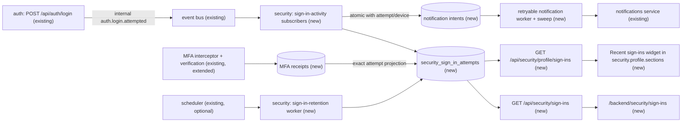
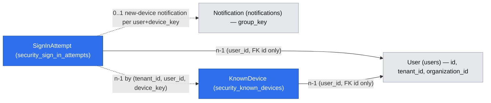

# Sign-in activity

## 📝 TLDR

Security administrators and individual users of Open Mercato Enterprise will be able to see who signed in, when, from which IP address and on which browser/OS, including failed attempts. Today `auth.login.success` and `auth.login.failed` carry no client information and nothing persists failed sign-ins. Proposed (future behavior): an additive OSS seam sends scoped client evidence on the internal `auth.login.attempted` event, and the enterprise `security` module persists every attempt, exposes an admin **Sign-in activity** list with a detail drawer, a **Recent sign-ins** section on the user's own security profile page, and an optional in-app notification when a user signs in from a new device.

Refs #8106. Extends `implemented/SPEC-ENT-001-2026-02-17-security-module-enterprise-mfa.md`.

## 📝 Problem Statement

Issue #8106 (reported against `@open-mercato/core` 0.9.0, unchanged on `main`):

- `auth.login.failed` is emitted with `{ email, reason }` only and `auth.login.success` with `{ id, email, tenantId, organizationId }` (`packages/core/src/modules/auth/api/login.ts`). An audit requirement such as "who, when and from where" needs custom code.
- Failed attempts are not stored anywhere. The `reason` values (`invalid_password`, `invalid_credentials`, `account_deactivated`, `tenant_unavailable`) are already computed precisely so that the audit stream can tell credential stuffing from a disabled account, but no consumer persists them.
- Users have no way to notice a sign-in they did not make.

The command side already exposes request metadata through `CommandInterceptorContext.request`; only the login route is missing it.

## Resolved assumptions (autonomous defaults)

| # | Question | Applied default | Why | Confirm? |
|---|----------|-----------------|-----|----------|
| Q1 | Split the OSS seam and the enterprise feature into separate specs? | No — one spec, four phases. Phase 1 (OSS seam) ships and is useful on its own; the enterprise phases depend on it. | The OSS seam is additive and has no persistence consumer without the enterprise phases; a separate spec would be overhead. Phases are independently mergeable. | reversible |
| Q2 | Where does the enterprise part live? | Inside the existing enterprise `security` module, not a new module. | Reuses its ACL namespace, `security.profile.sections` injection spot, notification category `auth`, Security admin menu group and integration fixtures. A new module would duplicate all of these and add a `modules.ts` enablement step for no isolation gain; operators who do not want the data use the kill switch (Q7). | reversible |
| Q3 | How is the client IP derived? | `getClientIp(req, rateLimiterService.trustProxyDepth)` from `@open-mercato/shared/lib/ratelimit/helpers`, with `rateLimiterService` resolved from the request container — exactly what `auth/lib/rateLimitCheck.ts` does (backed by `RATE_LIMIT_TRUST_PROXY_DEPTH`). Depth `0` (default) yields `ip: null`. | Never trusts spoofable `X-Forwarded-For` unless the operator configured proxies; one source of truth for "client IP". | reversible |
| Q4 | How is the user agent parsed? | Tiny local regex parser in `security/lib/user-agent.ts` (browser family + major version, OS family, device type). No new dependency. | `bowser` is in `yarn.lock` only transitively (AWS SDK); depending on it directly would add a production dependency (Ask-First). The UI needs families, not exhaustive detection. Fully offline. | reversible |
| Q5 | Failed attempts where no user resolves (unknown email, multi-tenant email) — which tenant? | Not persisted. The subscriber skips events without a resolved `tenantId`; the existing rate limiter and structured logs remain the record of anonymous credential stuffing. The caller-supplied `tenantId` form field is never used for scoping. | Rows without a tenant cannot be encrypted (no tenant DEK) and would hold attacker-typed raw input (sometimes a password pasted into the email field). A caller-supplied tenant id is unauthenticated, so using it would let anyone write into any tenant's log. Smallest, safest scope; failures against real accounts — the audit case in #8106 — are fully covered. | reversible (follow-up could store hash-only aggregate counters) |
| Q6 | How are resolved failed attempts scoped? | Canonical user, tenant and organization are carried by the internal `auth.login.attempted` event only. Preserve the existing raw `auth.login.failed` payload and dispatch scope. | The internal evidence supports durable history and alerts without adding organization webhook recipients. The protected receipt has a common refusal budget. | reversible |
| Q7 | Retention and switches? | `OM_SECURITY_SIGN_IN_ACTIVITY` (default `true`), `OM_SECURITY_SIGN_IN_RETENTION_DAYS` (default `90`, min `1`, max `730`), `OM_SECURITY_SIGN_IN_NOTIFY_NEW_DEVICE` (default `true`). Platform-level env, no per-tenant settings UI. | Matches existing `OM_SECURITY_*` env style; per-tenant settings can be added later without schema change. 90 days mirrors common SaaS defaults (Auth0, GitHub security log). | reversible |
| Q8 | What counts as a "new device"? | A successful sign-in whose `device_key` (browser family + OS family + device type) is not yet in `security_known_devices` for that user, inserted atomically (`INSERT … ON CONFLICT DO NOTHING`), and the user already has at least one known device. IP changes alone do not notify. | IP-only alerts are noisy (mobile networks, VPNs) and GeoIP is excluded. Skipping the very first sign-in avoids a pointless alert on onboarding. | reversible |
| Q9 | Should SSO and customer-portal sign-ins be recorded? | Not in this spec. "Success" means the primary password credential was accepted (MFA state per Q12). SSO and portal logins do not emit `auth.login.*` today. | Smallest working scope; each is a follow-up that only needs the same event fields emitted from its flow. | reversible |
| Q10 | "This wasn't me" action? | Not in v1. The drawer and notification link to `/backend/profile/security` (change password, MFA). | Session revocation needs a separate design (sessions are owned by `auth`). | reversible |
| Q11 | Record the `requiredRoles` 403 and rate-limited 429 responses? | Record `role_denied` on the internal event for the 403 after a correct password. Continue emitting nothing on a throttled 429. | No new legacy webhook or workflow occurrence. The limiter stays before the evidence write. | reversible |
| Q12 | How do MFA-protected sign-ins look? | Success rows carry `mfa_status`: `unknown` until the interceptor records its decision, then `not_required`, `enrollment_required`, `bypassed`, `pending` or `verified`. The interceptor binds its challenge to this request's server-created `attemptId`; verification updates only that exact attempt through a durable MFA receipt. No latest-row or time-window matching is permitted. The new-device notification still fires on password success. | The MFA interceptor runs after the route (`security/api/interceptors.ts`), so the success event precedes MFA. A correct password from an unknown device is exactly what the user should hear about. | reversible |

## 📝 User Stories

- **US-A1** — As a security administrator, I want to list sign-in attempts in my tenant filtered by user, result, date range and IP, so I can investigate suspicious access. AC: default view = last 7 days, newest first; failed rows show an error badge and translated reason; empty and no-results states with a "Clear filters" action; users without `security.sign_ins.view` see no menu entry and get 403 from the API; organization-restricted admins see only their organizations.
- **US-A2** — As a security administrator, I want to open one attempt in a drawer, so I can see the raw user agent, MFA state, previous successful sign-in and jump to the user's security page. AC: Escape closes; the link is hidden for unknown users; an out-of-scope id shows the not-found state.
- **US-U1** — As a signed-in user, I want a "Recent sign-ins" section on my security profile, so I can spot sign-ins I did not make. AC: last 10 attempts in 30 days; failures and "New device" are visible; empty state for first sign-in; the hint links to change password and MFA settings.
- **US-U2** — As a user, I want an in-app notification when my password is used from a new device, so I can react quickly. AC: not on the very first sign-in; at most one per device; "Review" opens my security profile; no email is sent.

## 📝 Proposed Solution

1. **OSS seam (core `auth`)** — `login.ts` computes client IP once and bounds the user agent to 512 characters. For a canonical resolved account, emit `auth.login.attempted`, a new `createModuleEvents` declaration with `excludeFromTriggers: true` and no client or portal broadcast. Its discriminated payload carries the server-created `attemptId`, occurrence time, result, optional closed reason, trusted tenant, nullable canonical organization, user id and bounded email/IP/user agent evidence. Success uses the existing new session UUID; resolved failure uses one fresh UUID. Keep existing `auth.login.success` and `auth.login.failed` names, payloads, emission conditions, scope and delivery behavior, including otherwise deliverable organization-scoped success. Never add resolved scope, IP, UA or correlation to the legacy failure projection or emit it for a new condition. Omit the protected event for unresolved and throttled attempts.
2. **Enterprise persistence** — persistent subscribers in `security/subscribers/` write one `SignInAttempt` row per tenant-resolved event, parse the UA locally, upsert `KnownDevice` atomically to compute `is_new_device`, and track `mfa_status`.
3. **Admin list** — `/backend/security/sign-ins`: DataTable with filters (user, result, date range, IP), failed rows marked with status tokens, row click opens a detail drawer.
4. **Profile section** — a widget injected into the existing `security.profile.sections` spot on `/backend/profile/security`: the user's last 10 sign-ins (30 days), with failed attempts and a "New device" badge.
5. **New-device notification** — in-app only `security.sign_in.new_device`, requested by an intent committed atomically with the attempt and device, then delivered by a retryable worker using the existing notification service deduplication API.
6. **Retention** — a daily queue worker deletes rows older than the retention window, registered with the scheduler when present.

### Alternatives considered

- **Persist into the generic audit log (`audit_logs`) instead of a new table.** Rejected: audit logs are command/action-centric, have no IP/UA columns to filter on, and failed sign-ins have no actor. A dedicated, indexed, append-only table keeps filters cheap and retention independent.
- **Persist in OSS core.** Rejected: issue #8106 is labelled `enterprise`; OSS only gets the payload seam, which is also useful to third-party subscribers.
- **GeoIP / external UA API.** Excluded by requirement (offline-testable, no third-party data processor).

### Market check

Keycloak stores `LOGIN` / `LOGIN_ERROR` events with `ipAddress`, client and error code, with configurable expiration; Auth0 logs `s` / `f` events with `ip`, `user_agent` and plan-bound retention; Google and GitHub send "new sign-in" alerts keyed on device, not IP. This spec takes the same shape (typed result + reason, IP, UA, retention, device-keyed alerts) and skips geolocation and risk scoring, which those products build on external data.

## 📝 Architecture



Core auth owns the internal evidence declaration, its route publication and the G2 receipt seam. Enterprise owns the history, consumers and UI. Existing public login events retain their own routing.

- Coupling: events only (no imports from `security` into `auth`). `security` reads user display names through the existing `auth` user lookup by id (FK id, no ORM relation).
- MFA interceptor (`security.auth.login.mfa-challenge`) now reads the existing verified JWT `sid` and passes it as an optional trailing `createChallenge(userId, { signInAttemptId })` argument. No new JWT claim or HTTP field is needed. The success event remains before the interceptor. The exact challenge/attempt mapping and delivery-order handling are specified below.
- Subscriber metadata alone does not queue an event. Emit only `auth.login.attempted` with `{ persistent: true, skipPersistentSubscribersInline: true, tenantId, organizationId }` from the canonical account. The history consumer checks the internal event and trusted context scope, rejects mismatches, and never uses the submitted tenant. The production webhook dispatcher and workflow discovery/dispatch must exclude this declaration for exact and wildcard triggers. No protected event or PII projection is forwarded, including when organization is null. The existing raw login emissions keep their scope and delivery options. Queue enqueue errors use `reportError` code `auth.login_event_enqueue_failed` with sanitized fields. A running durable events worker remains a history prerequisite.

### G2 handoff for protected failed-attempt alerts

For a resolved staff account below the rate limiter, the auth owner records an alertable failure through the auth-owned receipt and `authSignalReceiptSource` in [Security event alerting](GDPR/2026-11-16-security-event-alerting.md). Reuse the existing server-generated `attemptId` as the occurrence identity. The receipt carries only the canonical tenant, organization and user identities, the occurrence time and the closed failure reason. Exclude email, IP address and user agent from this receipt. Unresolved identities and throttled requests retain their existing exclusions.

For a generic staff 401 below the limiter in `OM_SECURITY_SIGNAL_RECEIPTS=require`, start one fixed 250 ms monotonic evidence window at the common credential-refusal point, before branching on eligibility. A resolved attempt uses that window for the bounded owner receipt transaction and the internal history enqueue under the same immutable occurrence id. Start both within the window and run them in parallel when independent. If the failure also mutates owner state, commit the receipt with that state and count its evidence work within this window. Unknown or ambiguous attempts perform neither evidence operation and wait through the same window. Keep the legacy raw emission behavior. Fast success, fast failure or absence of work cannot release the refusal early. Bound admission, statements, commit observation and enqueue wait to the same deadline, with no in-request retry or detached post-response publication. If either result is unproven, release the same generic refusal on schedule, record a separate sanitized incomplete coverage outcome for that operation and reconcile an ambiguous commit by the original occurrence id. A missing history enqueue acknowledgement is not durable history proof, and neither event success nor timeout establishes a receipt. The G2 sweep recovers committed attempts and acknowledges them once after the counting decision commits. The receipt retains the G2 owner's lifecycle. This equalizes the added evidence wait; it does not change the pre-existing credential checks or the 429 path.

## 📝 Data Model

### OSS: internal attempt payload

```ts
type AuthLoginAttemptedPayload = {
  attemptId: string
  occurredAt: string
  tenantId: string
  organizationId: string | null
  userId: string
  email: string
  ip: string | null
  userAgent: string | null
} & (
  | { result: 'success' }
  | { result: 'failure'; reason: 'invalid_password' | 'invalid_credentials' | 'account_deactivated' | 'tenant_unavailable' | 'role_denied' }
)
```

Validate the closed discriminant, UUIDs, ISO occurrence time and bounded client values before publishing and again before persisting. Capture `occurredAt` when the login outcome is decided, before any refusal hold or asynchronous publication, and preserve the attempt id through retries. The history subscriber reads only `auth.login.attempted`. It refuses malformed evidence, missing scope/occurrence or disagreement with the trusted event context using a sanitized diagnostic. It never assigns an id or timestamp at consumption. Deploy Phase 1 before enabling history. Legacy raw login events, including those already queued, do not synthesize history.

### Enterprise: `SignInAttempt` → table `security_sign_in_attempts`

| Column | Type | Notes |
|---|---|---|
| `id` | uuid PK | |
| `source_attempt_id` | uuid | stable payload `attemptId`, required for persisted events |
| `tenant_id` | uuid | always set (unresolved failures are not persisted, Q5) |
| `organization_id` | uuid, nullable | user's organization when known |
| `user_id` | uuid, nullable | FK id to `users.id`, no ORM relation |
| `email` | text | **encrypted**, `hashField: email_hash` |
| `email_hash` | text | deterministic lookup hash (`hashForLookup`) |
| `result` | text | `success` \| `failure` |
| `reason` | text, nullable | one of the five failure reasons; null on success |
| `ip_address` | text, nullable | **encrypted**, `hashField: ip_hash` |
| `ip_hash` | text, nullable | exact-match IP filter |
| `user_agent` | text, nullable | **encrypted**, max 512 chars |
| `browser_name` | text, nullable | e.g. `Chrome`, `Firefox`, `Safari`, `Edge`, `Opera`, `Samsung Internet` |
| `browser_major` | text, nullable | major version only |
| `os_name` | text, nullable | `Windows`, `macOS`, `iOS`, `iPadOS`, `Android`, `Linux`, `ChromeOS` |
| `device_type` | text | `desktop` \| `mobile` \| `tablet` \| `bot` \| `unknown` |
| `device_key` | text | `${browser_name}|${os_name}|${device_type}` (lowercase) |
| `is_new_device` | boolean | computed on success rows only; false on failures |
| `mfa_status` | text, nullable | success rows: `unknown` \| `not_required` \| `enrollment_required` \| `bypassed` \| `pending` \| `verified`; null on failures |
| `occurred_at` | timestamptz | required owner `occurredAt`; reject missing or invalid evidence before insert |
| `created_at` | timestamptz | |

Unique `(tenant_id, source_attempt_id)`. A duplicate insert returns the existing row without repeating device detection or resetting MFA status. Reject and report conflicting payload scope/user/result for the same key. Indexes: `(tenant_id, occurred_at desc)`, `(tenant_id, user_id, occurred_at desc)`, `(tenant_id, ip_hash)`, `(occurred_at)` for retention.

### Enterprise: `KnownDevice` → table `security_known_devices`

| Column | Type | Notes |
|---|---|---|
| `id` | uuid PK | |
| `tenant_id` | uuid | |
| `user_id` | uuid | FK id only |
| `device_key` | text | same value as on `SignInAttempt` |
| `first_seen_at` / `last_seen_at` | timestamptz | `last_seen_at` bumped on each success |

Unique `(tenant_id, user_id, device_key)`. The transaction serializes successes for the same tenant/user with a transaction advisory lock, then checks for an existing other device and inserts with `ON CONFLICT DO NOTHING RETURNING id`. A returned id plus an existing other row means new device. This also serializes concurrent first-ever sign-ins from different devices: exactly one establishes the baseline without an alert. Baseline order is processing order; history still sorts by `occurred_at`. Set `last_seen_at = greatest(existing, occurredAt)` so delayed delivery cannot move it backwards. Retention takes the same tenant/user lock before pruning. A pruned device can alert again on its next appearance, with a new device-row UUID identifying that generation.

### Enterprise: exact MFA correlation and durable receipts

Add nullable `sign_in_attempt_id` (uuid, unique with `tenant_id` when non-null) to existing `mfa_challenges`; it is independent of `provider_challenge`, whose value is overwritten during provider preparation. Old `createChallenge(userId)` callers remain supported and leave it null.

New `security_sign_in_mfa_receipts`: `id` uuid PK, `tenant_id`, `user_id`, `source_attempt_id` uuid, nullable `challenge_id` uuid, `status` (`not_required|enrollment_required|bypassed|pending|verified`), nullable `verified_at`, `created_at`. Unique `(tenant_id, source_attempt_id)` and partial unique `(tenant_id, challenge_id)` when present. No credentials, JWTs, IP or UA are stored here. This table is a reconciliation record, not a new authentication authority.

1. Challenge creation persists the attempt mapping and a `pending` receipt in the **same transaction** as the challenge, before returning its id. Validate the supplied identity against the signed login claims and canonical user/tenant; never trust request headers/body or use an unscoped challenge lookup. The discriminator is an additive optional trailing `code` on `MfaVerificationServiceError`; preserve existing constructor arguments, status codes and messages. Challenge creation must distinguish the effective policy from its filtered methods: resolve `getEffectivePolicyForUser(userId)` once and use that same policy snapshot for method filtering and classification. An empty eligible-method set with enforcement off throws `no_active_methods`; with enforcement on it throws `enrollment_required`. The interceptor catches by typed code, never message/status: the former writes/projects a scoped `not_required` receipt, the latter `enrollment_required`, without changing the current login/enrollment redirect behavior. Emergency bypass writes/projects `bypassed`, never `not_required`, even if methods exist. The UI translates these as "MFA not required", "MFA enrollment required" and "MFA bypassed". Provider-unavailable errors (including the other 400), database failures, invalid signed claims and missing/invalid DI services leave `unknown`; every unexpected swallowed failure/fallback must call `reportError` with a stable code (`security.sign_in_mfa_challenge_failed`, `security.sign_in_mfa_service_unavailable` or `security.sign_in_mfa_claims_invalid`). Expected no-method/enrollment outcomes are not operational failures; bypass retains its existing warning/notification. Receipt-write failures call `reportError` with `security.sign_in_mfa_receipt_failed` and leave `unknown`. Reporting uses sanitized errors and fixed attributes only, never raw error messages, email, IP, UA, JWTs, or challenge payloads. Preserve existing HTTP behavior on all these paths; this audit change does not fix the existing fail-open behavior on unexpected challenge failures, which remains a disclosed authentication risk. Absence of a receipt never proves MFA was unnecessary.
2. On successful verification, `MfaVerificationService` writes the challenge's existing `verifiedAt` and the matching receipt's `verified` state atomically, before emitting the existing `security.mfa.verified` event. The event retains its existing shape. Unmapped challenges from old/other callers never update a sign-in by inference. Expiry is checked at verification using the challenge's configured `expiresAt`; queue delay must not invalidate an already valid verification. There is no arbitrary 15-minute attribution window.
3. Receipt writes and attempt persistence take the same transaction advisory lock keyed by tenant + attempt. Each receipt writer also projects its current status onto an already-present matching attempt; insertion reads the receipt under that lock. Thus either processing order converges, including verification before attempt insertion. The verified-event subscriber re-reads the scoped challenge/receipt and idempotently reconciles the exact key. `verified` never regresses to `pending`, including on duplicate events. Validate tenant and user on every match. No match means no other row is changed.
4. Receipt retention follows the sign-in retention window; keep mappings until their related event retry/dead-letter replay window has elapsed. Events older than retention are ignored before any attempt/device/intent writes, preventing replay from recreating purged history. An uncorrelated legacy attempt displays `unknown`, never an inferred `verified`.

### Enterprise: atomic attempt and notification intent

New `security_sign_in_notification_intents`: `id` uuid PK, `tenant_id`, nullable `organization_id`, `user_id`, `source_attempt_id`, `known_device_id` (uuid, id only), `status` (`pending|delivered|suppressed`), `created_at`, nullable `delivered_at`. Unique `(tenant_id, known_device_id)`; the device-row UUID distinguishes reappearance after retention. Keep the attempt id as an id-only reference for encrypted display data, with no cross-module ORM relation.

Within one database transaction: acquire the tenant/user device lock (success only), then the tenant/attempt lock; insert the attempt with its unique source key; read the MFA receipt; compute/persist device state and `is_new_device`; insert a notification intent for a newly detected device when alerts are enabled. Any failure rolls back **all** these writes. Duplicate attempts do not recompute device state or erase an existing intent. No notification service call occurs inside this transaction: its current implementation forks its own EntityManager and owns its transaction.

A queue worker `security:sign-in-notification` drains pending intents; a recurring sweep re-enqueues pending work after a process crash, so correctness does not depend on an after-commit enqueue succeeding. Use `notificationService.createBatch({ recipientUserIds: [userId], ...content, groupKey }, scope, { skipExistingGroup: true })`, the existing advisory-lock-backed deduplication path, with `groupKey = sign_in_new_device:{tenantId}:{userId}:{knownDeviceId}`. Do not use ordinary `create`, which refreshes an existing notification and can repeat delivery side effects. Only mark the intent delivered after the call succeeds; retry after notification commit but before intent acknowledgement finds the existing notification and creates no duplicate. Respect notification preferences; an intentionally suppressed channel is not a transient error.

The guarantee is eventual one persisted in-app notification per eligible device generation while enabled and within retention, not exactly-once browser SSE delivery. The existing service can commit the notification then fail before emitting its bell event; retry finds the stored row and the user sees it on the next notification fetch. Intents carry no decrypted personal data. Retention skips pending intents and their device/notification deduplication records until delivery or terminal suppression; once the source attempt expires, suppress undelivered intents rather than sending stale alerts. The worker checks the kill switches again before delivery. Explicitly serialize delivery of each intent; test notification cleanup and device pruning against pending delivery so the deduplication record cannot disappear during retries.

- **System-written, append-only** (attempt updates only project correlated MFA receipt state; devices, receipts and intents are also system-maintained). No `updated_at`, no `deleted_at`, no edit/delete form or mutating API, so optimistic locking does not apply (AGENTS.md rule targets user-editable entities). Retention hard-deletes.
- Encryption map registered in `security/encryption.ts` (new file, same shape as `auth/encryption.ts`), read through `findWithDecryption`. Every row has a tenant, so the tenant DEK always applies.
- `email_hash` / `ip_hash` use `hashForLookup`, which is a keyed `v2:` HMAC with the installation pepper (`LOOKUP_HASH_PEPPER` → encryption keys). This is **pseudonymisation**, not anonymisation: the IPv4 space is small, so anyone holding both the DB and the pepper can reverse an `ip_hash`. Without any configured key the helper falls back to an unkeyed digest — the enterprise docs must state that a pepper is required for meaningful protection.
- Entity id `security:sign_in_attempt`. Not indexed for fulltext search.



## 📝 API Contracts

All routes GET-only, zod-validated query, `pageSize ≤ 100`, OpenAPI specs in `security/api/openapi.ts`.

### `GET /api/security/sign-ins` — admin list

- Guard: `requireAuth`, `requireFeatures: ['security.sign_ins.view']`.
- Query: `page`, `pageSize` (default 25, max 100), `userId?` (uuid), `email?` (exact, matched via `email_hash`), `result?` (`success|failure`), `from?` / `to?` (ISO datetime, `from ≤ to`, max span 366 days), `ip?` (exact, validated as IPv4/IPv6, matched via `ip_hash`), `sort` (`occurredAt` desc default).
- Scoping: `tenant_id = auth.tenantId` and `organization_id` within the caller's allowed organizations (or null-org rows of the tenant). No cross-tenant or unscoped mode.
- Response: `{ items: SignInAttemptDto[], total, page, pageSize, totalPages }` where `SignInAttemptDto = { id, occurredAt, result, reason, userId, email, userName, ipAddress, userAgent, browserName, browserMajor, osName, deviceType, isNewDevice, mfaStatus }`.

### `GET /api/security/sign-ins/[id]` — admin detail

Same guard and scoping; 404 when out of scope. Returns one `SignInAttemptDto` plus `previousSuccessAt` (the user's previous successful sign-in, for the drawer).

### `GET /api/security/profile/sign-ins` — own recent sign-ins

- Guard: `requireAuth`, `requireFeatures: ['security.profile.view']`.
- Always filtered to `user_id = auth.sub` and `tenant_id = auth.tenantId`; no user/ip filter accepted. Query: `limit` (default 10, max 50), `days` (default 30, max retention).
- Response: `{ items: Array<Omit<SignInAttemptDto, 'userId' | 'email' | 'userName'>> }`.

### ACL (additive, `security/acl.ts`)

- `security.sign_ins.view` — "View sign-in activity", `dependsOn: ['security.profile.view', 'auth.users.list']`. Granted to `admin` in `setup.ts` `defaultRoleFeatures`; superadmin via wildcard.

### Events, notifications, workers

- Consumes the new internal `auth.login.attempted` and the existing `security.mfa.verified` (`{ userId, challengeId, methodType }`).
- Notification type `security.sign_in.new_device`: `channels: ['in_app']`, `severity: 'warning'`, icon `monitor-smartphone`, `linkHref: '/backend/profile/security'`, `groupKey: sign_in_new_device:{tenantId}:{userId}:{knownDeviceId}`, `expiresAfterHours: 168`. Body interpolates only allowlisted parsed browser/OS families and time; no IP, raw UA, email or decrypted free text is copied into notification body or metadata. The authenticated security profile holds the details.
- Worker `security:sign-in-retention` on queue `security-sign-in-retention`, deletes in batches of 5,000 until no rows older than `now - retentionDays`. Retention observes the receipt/intent safety rules above and runs as **one global system schedule** (not per tenant/org), registered through the soft-optional `schedulerService` with a stable UUID derived from `security:sign-in-retention` (the `stableScheduleUuid` approach in `agent_orchestrator/setup.ts`), so repeated registration upserts the same row. Daily cron `15 3 * * *`. Also prunes known devices, receipts and terminal intents with the same cutoff and lock protocol. The delivery recovery sweep is registered as a separate stable-UUID recurring job; without the optional scheduler, operators must run the queue sweep periodically through the documented worker job, and the setup health warning must disclose that recovery is not automatic.

## 📝 UI/UX

Proposed-UI prototype (illustrative, low-fi, clickable; a proposal, not accepted): [`.ai/prototypes/sign-in-activity/index.html`](../../prototypes/sign-in-activity/index.html). Screenshots: [`assets/sign-in-activity/`](assets/sign-in-activity/).

### Admin — Security › Sign-in activity (`/backend/security/sign-ins`)

- Menu entry under the existing Security settings group, feature `security.sign_ins.view`.
- `DataTable` (table id `security.sign_ins.list`, registered as an extension host in `extension-points.ts`) columns: Time (relative + absolute tooltip), User (name + email; "Unknown account" for unresolved), Result (`Badge` success / error status tokens), Reason (translated), MFA (unknown / not required / enrollment required / bypassed / pending / verified), IP, Browser · OS, New device badge.
- Filters: User (async select over `/api/auth/users`), Result (all / success / failure), Date range (presets 24h, 7d, 30d, custom), IP (exact text). Filters reflect into the URL so the drawer's "All sign-ins for this user" link is a filtered view.
- Row click → detail drawer (`Sheet`): all fields, raw user agent in monospace, previous successful sign-in, link "Open user security" (`/backend/security/users/[id]`) when a user is known. `Escape` closes.
- Empty state, `LoadingMessage` / `ErrorMessage` per `ui:backend`. No row actions, no bulk actions.

### Own profile — Recent sign-ins (`/backend/profile/security`)

- Widget injected into `security.profile.sections` (`widgets/injection/profile-recent-sign-ins`), so the page file is not modified.
- Compact list of the last 10 attempts in 30 days: device icon, "Chrome 131 on macOS", IP, relative time, result badge; failed attempts show the translated reason; "New device" badge on flagged rows. Footer hint: "Don't recognise a sign-in? Change your password and review MFA" linking to the password form anchor and `/backend/profile/security/mfa`.
- When the feature is disabled (`OM_SECURITY_SIGN_IN_ACTIVITY=false`) the widget renders nothing.

### New-device notification

Standard in-app notification renderer: title "New sign-in to your account", body "Firefox on Windows at 14:02". Action "Review" → `/backend/profile/security`.

i18n keys under `security.signIns.*` and `security.notifications.signInNewDevice.*` in en/pl/de/es/ko. Status colors via DS status tokens only.

## 📝 Edge Cases & Failure Scenarios

- **Proxy not configured** (`RATE_LIMIT_TRUST_PROXY_DEPTH=0`): `ip` is null; UI shows "Unknown IP"; new-device logic does not use IP, so it still works.
- **Spoofed `X-Forwarded-For`**: ignored unless depth > 0; with depth N only the Nth-from-last hop is trusted (existing helper semantics).
- **Missing / garbage / huge UA**: stored truncated to 512 chars; parser returns `unknown` families; `device_key = unknown|unknown|unknown` (a new-device alert fires at most once for it per user via the group key).
- **Credential-stuffing flood**: each emitted attempt now creates durable queue work, including unresolved emails that the enterprise subscriber skips; rate-limited requests emit nothing. IP + compound login limits reduce but do not cap distributed attacks. Monitor queue depth, oldest-job age, failed jobs and worker throughput; provision capacity and an operator purge/replay procedure before enabling delivery. Table retention does not bound queue or dead-letter growth. The enterprise kill switch stops audit writes, not OSS event enqueueing.
- **Subscriber failure** (DB down): after successful enqueue, worker failures retry; login does not await audit persistence. Enqueue failure itself is reported and may lose the audit event; no exactly-once producer guarantee is claimed.
- **Unresolved email failures**: not persisted (Q5); `POST /api/auth/login` behavior is unchanged.
- **Rate-limited (429) requests**: not recorded (Q11).
- **Concurrent sign-ins from one new device**: tenant/user serialization plus the unique `KnownDevice` key lets exactly one subscriber run win the insert, so at most one alert fires.
- **MFA delivery race**: durable receipt and attempt share a transaction lock; verification for A can only change A even when B is newer. No receipt displays unknown, and legacy unmatched challenges do not infer attribution.
- **MFA never completed**: row stays `mfa_status = pending`; UI shows "MFA not completed" so an abandoned or attacker sign-in is distinguishable.
- **User deleted later**: rows keep `user_id` and encrypted email; list shows "Deleted user". Retention eventually removes them. GDPR erasure integration is tracked explicitly by follow-up E1 below; until it ships, operators must erase these records through the documented scoped procedure rather than assuming automatic erasure.
- **Org visibility**: an admin limited to org A cannot see rows of users in org B in the same tenant.
- **Feature disabled**: subscribers no-op; existing rows stay readable until retention removes them.
- **Clock / ordering**: `occurred_at` comes from the payload's `occurredAt` (set in the route), not from subscriber processing time, so queue delay does not reorder history.

## 📝 Risks & Impact Review

| Concrete failure scenario | Severity | Affected area | Mitigation | Residual risk |
|---|---|---|---|---|
| IP addresses and UAs in the audit table are personal data stored for 90 days | Medium | GDPR posture of deployments | Field-level encryption (tenant DEK), keyed lookup hashes, retention worker, kill switch, documented in enterprise docs | Internal event/queue copies and existing legacy webhook copies follow their owners’ separate retention. Operators set the corresponding policy. |
| Protected login client evidence is retained in event queue jobs or dead-letter copies | High | Queue storage | Route only the new evidence through the trigger-excluded internal declaration. Omit IP/raw UA/email from notification content. Verify exact and wildcard outbound exclusion, and apply B6 storage sealing or the documented operator queue controls. | Failed jobs and backups can outlive the history window. Legacy webhook copies retain their existing payload and retention policy. |
| MFA challenge fails unexpectedly and the existing interceptor returns the full login token | High | Authentication and audit accuracy | Preserve current HTTP behavior in this audit-only change, display unknown and report every fallback with stable non-PII codes; implementation must escalate the existing fail-open behavior for a separate security decision | Audit reporting does not enforce MFA or close the existing fail-open path |
| A scoped failure enters the tenant-wide webhook fan-out | High | Organization isolation | Leave raw login contracts and their routing unchanged. The internal event is excluded by declaration and actual dispatcher, with a two-organization null-scope fixture. | Authorized internal consumers still see their owned queue evidence. |
| Anonymous credential stuffing (unknown emails) is not visible in the UI | Low | Admin investigations | Rate limiter + structured logs still record it; Q5 follow-up can add hash-only counters | Admins see only attacks on real accounts |
| `ip_hash` reversible by someone with DB access and the lookup pepper | Medium | Pseudonymisation strength | Keyed HMAC, encrypted raw IP, docs require `LOOKUP_HASH_PEPPER` | Without a configured pepper the digest is unkeyed |
| Table growth under sustained attack | Low | Database size | Rate limits + daily retention + indexes on `occurred_at` | Short-term growth between retention runs |
| Verification of sign-in A incorrectly attributed to concurrent B | High | MFA audit accuracy | Stable attempt/challenge mapping and durable receipt with monotonic projection under a shared transaction lock; TC-SEC-021/022 | Unknown state when legacy correlation is absent |
| Crash between device registration and alert creation | High | Audit/alert delivery | Atomic attempt/device/intent transaction and retryable deduplicated delivery; recurring recovery sweep | Notification bell SSE may be missed after commit; stored notification remains fetchable |
| Local UA parser misclassifies a browser | Low | Display and new-device alerts | Table-driven unit tests; worst case is one extra notification per user per misclassified family | None material |

## 📝 Migration & Backward Compatibility

- OSS adds the internal durable event and preserves both existing login event contracts and delivery options. Route and response bodies remain stable. The G2 protected lane adds its auth-owned receipt and uniform bounded refusal wait under its approved release gate. Record event/durability approval in the implementing PR and document worker/queue retention in `UPGRADE_NOTES.md`. Test both single-delivery modes. If approval is withheld, return to design review.
- Rolling deployment: deploy idempotent compatible consumers and the events worker before switching producers. Rollback of producer options stops new enqueueing but does not cancel queued events or recall webhook copies; drain or explicitly purge the backlog under the operator privacy/replay policy.
- Enterprise: four new tables (`SignInAttempt`, `KnownDevice`, MFA receipt, notification intent) + migration and snapshot in `security/migrations`; new ACL feature, notification type, worker, routes and page are additive. The existing MFA challenge gains a nullable correlation column; `createChallenge` gains an optional trailing options argument. Existing callers, challenge ids, token format, verification event payload and HTTP behavior remain supported. Rollback = disable via env; additive tables/columns may remain until a reviewed follow-up migration removes them.
- New env vars must be mirrored to `apps/mercato/.env.example` and the create-app template (`yarn template:sync:fix`).

## 📋 Phasing

- **Phase 1 — OSS seam** (core `auth`, independently shippable): internal `auth.login.attempted` carrying scoped attempt/client evidence, preserving both legacy events. The separately approved G2 owner adapter adds the protected failed-attempt receipt before the repeated-failures rule is enabled.
- **Phase 2 — Persistence + retention** (enterprise `security`): entity, migration, encryption map, UA parser, subscribers, retention worker.
- **Phase 3 — Admin Sign-in activity page + API**.
- **Phase 4 — Profile Recent sign-ins + new-device notification**.

## 📋 Implementation Plan

### Phase 1 — OSS seam

1. Add a `resolveLoginClientMeta(req, container)` helper in `packages/core/src/modules/auth/lib/` returning `{ ip, userAgent, occurredAt }` (capture `occurredAt` when the login outcome is decided, before any hold or enqueue) via `getClientIp(req, rateLimiterService.trustProxyDepth)` (service resolved from the container, `null` ip when unavailable) and a 512-char truncated `user-agent`. Unit test: depth 0 → null ip; depth 1 with `X-Forwarded-For` → client ip; long UA truncated.
2. Deliver the internal declaration and emit the exact committed/session or server-created occurrence with canonical scope. Unit-test success, resolved `invalid_password`, `account_deactivated` and `role_denied`, and unresolved or ambiguous `invalid_credentials`, with exact comparison against legacy raw emission behavior and generic route responses. Verify shared scope mismatch rejection, queue-only persistent handler execution in both delivery modes, no client/portal broadcast, and sanitized enqueue failure. In a two-organization fixture drive the real dispatcher with exact and wildcard subscriptions for both existing events and the internal event. Use a canonical null-organization resolved failure and prove neither organization gets new evidence. An already deliverable scoped legacy success still arrives with its previous payload. Obtain the delivery policy approval above.
3. Document delivery timing/retry changes, worker prerequisites, queue/dead-letter/webhook PII retention and purge/replay operations in `UPGRADE_NOTES.md` and operator docs; audit exact/wildcard consumers and verify the deployment privacy gate. Document the internal declaration and its trigger exclusion in the events reference and auth guide.
4. Deliver the G2 auth receipt source in the approved Phase 1 owner slice. At PR-172 use producer-local route and adapter fixtures to prove a valid pending receipt remains after lost enqueue and restart. Assert unchanged generic refusal and no receipt for an unresolved or throttled attempt. PR-179 then uses TC-SEC-ALERT-004 against the real consumer to prove one alert-count decision. Fault the required receipt before commit and assert the original generic refusal, sanitized operator coverage failure and absence of a forged signal. Compare known, unknown and ambiguous failures at the common barrier using a controlled monotonic clock. A successful, fast-failing or stalled receipt, and a stalled/failed internal event enqueue, must not move the release point relative to no new evidence work. Pause the database through the deadline, cover late-outcome reconciliation, and assert no unresolved identity is persisted.

### Phase 2 — Persistence

4. `security/lib/user-agent.ts` parser + table-driven unit tests (Chrome/Edge/Firefox/Safari/Opera/Samsung, Windows/macOS/iOS/iPadOS/Android/Linux/ChromeOS, bots, empty).
5. `SignInAttempt`, `KnownDevice`, MFA receipt and notification intent entities, plus nullable `MfaChallenge.signInAttemptId`, `security/encryption.ts` map, `yarn db:generate` → keep only the intended tables/column migration + snapshot. `yarn generate`.
6. `security/lib/sign-in-activity-config.ts` reading the three env vars with `parseBooleanWithDefault` and clamped ints; mirror into `.env.example` + template.
7. `subscribers/sign-in-activity-success.ts`, `sign-in-activity-failed.ts` and `sign-in-activity-mfa-verified.ts` (`persistent: true`), shared `SignInActivityService` registered in `di.ts`. Unit tests: scoping, unresolved failure skipped, atomic new-device upsert (two concurrent calls → one new), exact MFA correlation, reversed delivery, duplicate events, missing identity handling and disabled switch no-op. Extend the MFA interceptor and optional challenge-creation argument; atomically persist/project MFA receipts during challenge creation and verification. Unit-test the policy snapshot and typed interceptor matrix: enforcement off + no methods → `not_required`; enforcement on + no compliant methods → `enrollment_required`; emergency bypass → `bypassed`; active compliant methods → `pending`. A provider-unavailable error (also 400), database failure, invalid claims and unavailable service leave `unknown` and each calls `reportError` with the specified stable code and no PII. Assert unchanged HTTP responses, enrollment redirects and receipt-write failure reporting; exercise receipt-before-attempt and attempt-before-receipt order. Never select latest pending attempts.
8. Retention worker + single global stable-UUID schedule (soft-optional scheduler); unit test batch deletion, known-device pruning, window clamp and idempotent registration.

### Phase 3 — Admin page

9. ACL feature `security.sign_ins.view` + `defaultRoleFeatures` for admin; `yarn generate`.
10. `GET /api/security/sign-ins` and `/[id]` with zod query, scoping and OpenAPI. Unit tests for filter → hash mapping and scope clauses.
11. `/backend/security/sign-ins` page, filters, drawer, menu entry, `security.sign_ins.list` extension host, i18n (5 locales).
12. Integration tests TC-SEC-016/017/019 (admin assertions only), TC-SEC-020/021 and the persistence/MFA portion of TC-SEC-022. Profile assertions wait for Phase 4.

### Phase 4 — Profile + notification

13. `GET /api/security/profile/sign-ins` + unit tests.
14. `profile-recent-sign-ins` injection widget into `security.profile.sections`; i18n.
15. Notification type `security.sign_in.new_device` + atomic intent creation inside `recordSignInAttempt`, retryable delivery worker and recovery sweep using deduplicated `createBatch`; failure injection at every durable boundary, including notification commit before acknowledgement.
16. Integration tests TC-SEC-016/017/019 (profile assertions), TC-SEC-018 and the notification/recovery portion of TC-SEC-022; assert persisted notification body/metadata contain no IP, email or raw UA. Update enterprise README spec table.

### Explicit follow-up E1 — GDPR erasure registration

Tracked here against [the data-erasure design](2026-07-08-gdpr-data-erasure.md), owned by the security/data-erasure integration implementer and required when that implementation lands. Register `security_sign_in_attempts`, known devices, MFA receipts and notification intents for tenant + user-scoped erasure, plus the corresponding generated notifications and challenge correlation links. Coordinate queue/dead-letter/webhook/external copies with their owners; purge or suppress replay for erased identities so delayed events cannot recreate data. Acceptance: erase a fixture user, verify all scoped copies are removed/redacted, a second tenant is unchanged, and delayed login/MFA retries do not recreate erased records. Until E1 is complete, Phase 2 must publish a manual scoped erasure and replay-suppression runbook; automatic GDPR coverage must not be claimed.

## 🧪 Integration Coverage

All tests live in `packages/enterprise/src/modules/security/__integration__/`. The enterprise integration environment sets `RATE_LIMIT_TRUST_PROXY_DEPTH=1` (added in step 12 alongside the existing integration env; rate limiting stays disabled by `OM_INTEGRATION_TEST`) so IP assertions are deterministic. Tests create their own tenant/users through existing `helpers/securityFixtures.ts`, set a custom `User-Agent` header on the login request, poll the API (≤10 s) for the persistent subscriber, and clean up in `finally`. No network access beyond the local app; no GeoIP or UA service. Run with `yarn test:integration --grep 'TC-SEC-(01[6-9]|02[0-2])'` against a local enterprise app.

| ID | Path(s) | Scenario |
|---|---|---|
| TC-SEC-016 | `POST /api/auth/login`, `GET /api/security/sign-ins`, `GET /api/security/profile/sign-ins` | Wrong password with UA `Firefox/132 on Linux` and `X-Forwarded-For: 203.0.113.7` → admin list `?result=failure&userId=` returns one row, `reason=invalid_password`, `browserName=Firefox`, `osName=Linux`, `ipAddress=203.0.113.7`; `?ip=203.0.113.7` finds it, `?ip=198.51.100.1` does not. Login to an unknown email creates no row. Then log in successfully as a fixture user with enforcement disabled and no active MFA methods: response remains the normal token-returning 200 without an MFA challenge; poll the admin and own-profile lists and assert the exact success attempt has `mfaStatus=not_required`, never `unknown`. Repeat with enforcement enabled and no compliant methods: unchanged enrollment redirect behavior and `mfaStatus=enrollment_required`; with emergency bypass: unchanged login behavior and `mfaStatus=bypassed`. |
| TC-SEC-020 | `POST /api/auth/login` (`requiredRoles`), `GET /api/security/sign-ins` | Correct password with a required role the user lacks → 403 response unchanged, row with `reason=role_denied`. |
| TC-SEC-017 | `GET /api/security/sign-ins`, `GET /api/security/sign-ins/[id]`, `GET /api/security/profile/sign-ins` | Successful login appears in own profile list; a user without `security.sign_ins.view` gets 403 on the admin list; an admin of a second tenant cannot see the row (list empty, detail 404). |
| TC-SEC-018 | `POST /api/auth/login`, `GET /api/notifications` | First login (UA A) → no notification; login with UA B → one `security.sign_in.new_device`; second login with UA B → still one. Persisted notification body/metadata must contain neither source IP nor raw UA/email. |
| TC-SEC-021 | `POST /api/auth/login`, `POST /api/security/mfa/verify`, `GET /api/security/sign-ins` | Two concurrent successes A/B for the same MFA user; verify A's challenge after B is created: only A becomes verified, B stays pending. Reverse A/B verification order, duplicate event delivery and wrong-user/cross-tenant mapping are also covered. |
| TC-SEC-022 | Persistent login/MFA subscribers and notification worker; sign-in/profile/notification GET routes | Hold login-event processing, complete MFA, then release it: exact row is verified. Re-deliver success/failure variants of the internal event and inject failures after each attempt/device/intent write and after notification commit before acknowledgement: one history row per source id and eventual one persisted alert per eligible device generation. Assert transaction rollback, process-crash sweep recovery, two different first-ever devices, retained pending intent dedupe, replay outside retention, malformed internal event with missing id/time, legacy raw non-ingestion and kill switches; real durable enqueue with canonical scope in both single-delivery modes, injected enqueue failure reporting, and worker retry after DB failure. Self-contained worker/service fixtures control delivery order without new production test endpoints. |
| TC-SEC-019 | UI `/backend/security/sign-ins`, `/backend/profile/security` | Admin filters Result = Failed, sees error badge row, opens drawer showing raw UA, closes with Escape; user's profile shows "Recent sign-ins" with the attempt. |

Unit suites: `auth/lib/__tests__/login-client-meta.test.ts`, `auth/api/__tests__/login-events.test.ts`, `security/lib/__tests__/user-agent.test.ts`, `security/services/__tests__/SignInActivityService.test.ts`, `security/workers/__tests__/sign-in-retention.test.ts`, `security/api/sign-ins/__tests__/route.test.ts`.


## Final Compliance Report

Design revision only; implementation remains in future phases. Existing login event ids, response fields, JWT claims and verification event shape are preserved. Correlation uses the already-issued session id, a nullable enterprise challenge column and an optional service argument. All persistence keys and reconciliation checks include tenant scope; failure history needs a resolved tenant. Persistent handlers have explicit unique keys, transaction boundaries and recovery behavior. Four new enterprise tables and the challenge column must ship with migrations/snapshots; no migration is applied by this PR. Planned TC-SEC-021/022 and failure-injection unit coverage are implementation acceptance gates, not tests claimed as run here. Prototype screenshots are illustrative and predate this revision; the implementation must add translated MFA unknown, enrollment-required and bypassed states and use the revised PII-free notification copy. Delivery-semantics approval is a prerequisite for the future implementation, not claimed by this revision.

## Changelog

### 2026-11-20

- Routed scoped sign-in evidence through a trigger-excluded internal event and bounded the additional protected receipt delay uniformly for resolved and unresolved generic refusals.

- **2026-11-19** — Specified the auth-owned durable failed-attempt handoff for protected G2 alerts.

- **2026-11-15** — Addressed all six requests in @haxiorz's latest review: explicit scoped durable emits and approval/rollout gate, policy-aware MFA outcomes, non-PII reporting for every unexpected fallback, queue/webhook privacy and retention disclosure, PII-free notifications, phase-correct tests and tracked GDPR follow-up E1.

- **2026-11-14** — Addressed @haxiorz's remaining re-review requests: defined the additive typed no-active-methods discriminator and explicit interceptor receipt branch, separated unexpected failures, added no-MFA success acceptance and unit coverage, and corrected login emission wording.

- **2026-11-13** — Addressed @haxiorz's MFA attribution review and the earlier specification review: exact session-attempt/challenge correlation, durable MFA reconciliation for reordered delivery, stable attempt idempotency keys, atomic device/notification intents, deduplicated retry delivery, retention interactions and concurrent/failure-injection acceptance tests. Corrected table count and four-phase wording.
