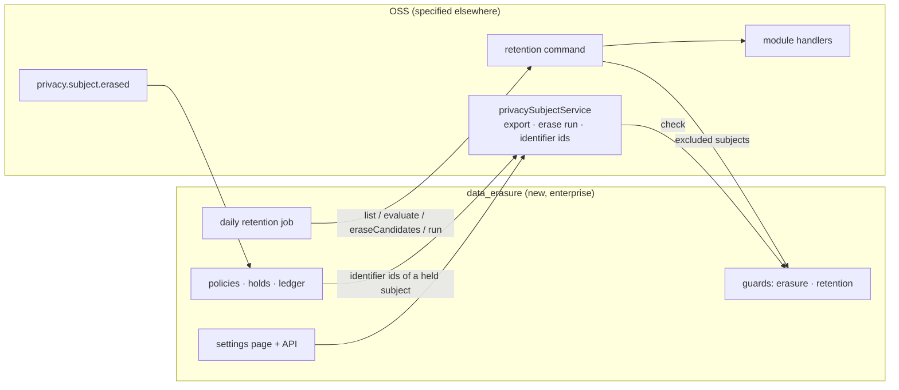

# Privacy governance engine: retention policies, legal holds, operations

> **Program:** packages C3 and D5 of [`../2026-11-15-gdpr-ready-deployments-program.md`](../2026-11-15-gdpr-ready-deployments-program.md) (tracker open-mercato/open-mercato#8593).
> **Builds on:** the OSS contract in [`../2026-11-16-privacy-data-class-contract.md`](../2026-11-16-privacy-data-class-contract.md) and the erase run in [`../2026-11-16-privacy-subject-erasure.md`](../2026-11-16-privacy-subject-erasure.md).
> **Reference only:** `packages/enterprise/src/modules/data_erasure` and its spec on `upstream/feat/security-readiness` (PR #5557).
> **Code baseline:** repository snapshot at the spec commit; current-code claims below were checked against that snapshot. Reference-branch designs are historical context, not implementation evidence.
> **Written autonomously.** No question was put to a person; the choices are listed under Resolved assumptions.

Extends: .ai/specs/2026-11-16-privacy-subject-erasure.md
Supersedes: .ai/specs/enterprise/2026-07-08-gdpr-data-erasure.md — governance provisions in Architecture, Data Model and API Contracts, Security Considerations and Failure Scenarios, Phasing & Implementation Plan; the successor-only carrier retains rationale, not an operative design

## 📝 TLDR

The OSS privacy contract gives an operator with shell access an export and an erase command. A tenant administrator has nothing: no screen to answer a request from, no way to say how long a retention set is kept, no way to stop an erasure while a dispute is open, and no record of what was done. **Proposed (future):** an enterprise module that adds tenant retention policies, legal holds, a bounded ledger of privacy operations with pseudonymous subject references, and one settings page from which an administrator exports and erases a known person — all by calling the OSS operations, never by touching another module's tables.

**Status.** Not approved. It depends on the OSS erase run, which waits for the program's decision DEC-2b, and its third phase depends on the retention sets in the OSS record-retention spec and, for erasing people by age, on the inactive-subject spec. If the erase run does not ship in OSS, it moves into this module and the design below is unchanged.

**Not in this spec:** the erase and export operations themselves; finding a person by email or phone from the page, which stays a command because the search can take minutes; restore replay ([`2026-11-16-erasure-restore-replay.md`](2026-11-16-erasure-restore-replay.md)); request-deadline tracking; sandbox sanitization, which is a separate capability.

## 📝 Overview

The engine separates a policy, an execution ledger and a hold. Each module decides what happens to its own records. The ledger stores subject references and counts, without names, addresses or exported values.

## 📝 Resolved assumptions (autonomous defaults)

| # | Question | Chosen | Rationale |
|---|---|---|---|
| 1 | Module id | `data_erasure`, an acknowledged exception to the plural module-id convention | Preserves the name used by the earlier enterprise design. |
| 2 | How retention runs | One module-registered daily job walks every active policy | One registered job avoids a separate manually scoped schedule for every policy. |
| 3 | What a retention policy does for person records | It targets a subject-retention set, enumerates through `privacyRetentionService.listFilteredCandidates`, rechecks explicit references through `evaluateCandidates` and executes through `eraseCandidates` | The inactive-subject spec owns required-source checks, floors, fresh activity checks and the R3-14 erase calls. Policy automation has no per-person human review. |
| 4 | Default policies | No domain or staff policies. The dedicated `privacy.export_evidence` daily policy is the C1 exception, at the effective tenant setting (365 days by default), in apply once its default is approved | ⚠ NEEDS HUMAN CONFIRMATION that staff users get no retention at all in this version; fallback: keep domain apply disabled pending an explicit tenant policy. C1 EVIDENCE-AGE separately gates export-evidence apply; fallback: require a controller-approved finite age. A default staff policy needs administrator/service-account rules beyond this packet. |
| 5 | A held subject | The whole subject is refused | A preservation decision applies before any class changes the held subject. |
| 6 | Scope of policies and holds | The tenant. No per-organization policies or holds in this version | A subject reference carries no organization, and a scope with none means all of them, so an organization-level hold could not be matched reliably. A hold that silently fails to match is the worst outcome here. |
| 7 | How a hold names its subject | Kind and id, stored in clear. A hold on a CRM person or portal user also stores, in clear, the derived identifier ids of that subject's current addresses and numbers. A hold may also name a `privacy:identifier` subject: the administrator types the address or number and the engine stores only its derived id | An encrypted id matched through a hash finds nothing for a tenant with no map row, with encryption off, or after a key change — and then a held person is erased. An id is a pseudonymous reference, not anonymous data. An erasure by `--email` offers an identifier subject beside the person and is guarded per subject, so a hold that knows only the person's id would let that person's address-keyed records go. A derived identifier id is a keyed digest that matches no column (contract spec, "A subject that is only an identifier"). |
| 8 | Subject identity in the ledger | Kind and id, in clear; never a raw address, number, label, lookup hash or exported value | The restore manifest must hold the same pair to repeat an erasure, so hashing it here hides nothing, and a hash needs a key that outlives every rotation. |
| 9 | Hold reasons | A closed list plus a short reference, encrypted | Free text about why a person's data is frozen is itself sensitive, and outlives the erasure. |
| 10 | Changing a hold | A hold can be extended or released, never edited | Otherwise the right to create holds would include the right to end one early, by shortening it or pointing it elsewhere. |
| 11 | A retention candidate with a related subject, such as a person with a portal account | `skip` by default; `exclude` may erase the listed candidate while leaving the related subject out | R3-13: only these two choices exist. A related subject is never added to the run. |
| 12 | Who can erase by default | Nobody new. The erase and release features are granted to the super-administrator role where one exists | A tenant set up without that role has no one who can erase until an administrator grants the feature; the page says so. |
| 13 | Who may use the engine at all | Only a principal whose organization scope is unrestricted: a super-administrator, or a staff user whose ACL has no organization list (`isUnrestrictedOrganizationScope`, `packages/shared/src/lib/auth/organizationAccess.ts`). A `data_erasure.*` feature alone is not enough | Subjects, policies, holds and operations are tenant-wide (assumption 6), and the contract reads an absent organization as every organization of the tenant (contract spec, Scope). Staff ACLs can be limited to some organizations (`organizations_json` on role and user ACLs, `packages/core/src/modules/auth/data/entities.ts`). Without this rule, an administrator limited to one organization could export or irreversibly erase a person in another, and read that organization's operations and holds. Matching each subject to an organization is not reliable, because a subject reference carries none. |
| 14 | A retention set that cannot leave a held subject out | The pass is skipped for the tenant and recorded with reason `hold_not_honourable`. A policy may set `allowUnmatchedHolds`, default `false`; it is the only opt-out | The first record sets declare no excludable kind, and change history cannot leave out a person mentioned inside another record's snapshot. Deleting by age while such a person is held is the miss this module exists to prevent; skipping only delays retention. |
| 15 | Daily erasure budget | Default 100, integer range 1–1000 per policy and UTC date; no unlimited value | ⚠ NEEDS HUMAN CONFIRMATION. Limits irreversible work and audit volume; fallback: keep apply disabled until a tenant explicitly chooses a value in that range. |
| 16 | Governance metadata lifetime | Completed operations: 365 days; unused previews: fifteen minutes; failure rows: thirty days since the last attempt | ⚠ NEEDS HUMAN CONFIRMATION. Keeps request evidence for one year without indefinite subject references; fallback: disable apply until the controller approves these windows. Incomplete accepted operations remain visible until reconciled. |
| 17 | Governance action-audit lifetime | Dedicated `data_erasure.audit_evidence` expiry: default 365 days after terminal state, floor 30, using `retention.data_erasure.auditEvidenceAgeDays`; active holds and unresolved dependencies defer | ⚠ NEEDS HUMAN CONFIRMATION. Implements the action-log-retention spec's assumption 9 handoff separately from metadata-row windows. Fallback: require an explicit finite controller-approved audit age before enabling evidence-producing mutations; never silently exempt the action entries forever. |

## 📝 Problem Statement

- **No administrator surface exists.** The OSS commands need a shell. Nothing in the backend resolves a person, exports or erases.
- **No tenant-level retention exists.** Operational tables get instance-wide windows from the pruner spec; a tenant cannot say that inactive contacts are removed after two years.
- **Nothing can stop an erasure.** The OSS run consults an optional guard (`privacyErasureGuard`) and finds none. The erasure spec defines its method and that a guard which cannot answer counts as a refusal.
- **A person and their address are two subjects.** An erasure given `--email` or `--phone` offers a `privacy:identifier` subject beside whatever person matches, and every class that declares that kind finds records by the address's hashes alone (contract spec, "A subject that is only an identifier"). The guard is called once per subject (erasure spec, guard seam).
- **Nothing stops retention for a held subject.** The OSS record-retention command takes subjects to leave out and consults an optional `privacyRetentionGuard`, and finds none. The first sets declare no excludable kind; change history cannot leave out what sits inside another record's snapshot.
- **No record of privacy operations exists outside the action log**, which is itself subject to retention and cannot be listed by operation.
- **The OSS confirmation token is bound to a command-line dry run.** Any process can check it: it is keyed by a key derived from the installation's lookup secret, as the erasure spec's "The confirmation token" section describes. But it covers the dry-run report that the command printed, and it expires within the hour. A page needs a preview stored for the user who saw it, and it needs a confirmation bound to that user, which is why the engine keeps its own stored preview.
- **Finding a person by identifier is slow.** For CRM people the contract resolves by a decrypting scan that can take minutes.
- **`makeCrudRoute` defaults `orm.orgField` to `organizationId`** (`packages/shared/src/lib/crud/factory.ts:1115`) and stamps the selected organization when that field is configured (`:2601-2606`). Tenant-only routes must explicitly pass `orm.orgField: null`. Its command-backed create returns before `beforeCreate` (`:2381-2571`); factory hooks cannot enforce the module-wide authorization boundary.
- **The earlier enterprise design is not the implementation baseline.** Its request ledger and endpoints are replaced by the bounded service-based design below.
- **Enterprise mechanics in the snapshot.** Existing optional enterprise modules use `OM_ENABLE_ENTERPRISE_MODULES` plus a per-module flag (`apps/mercato/src/modules.ts:244-270`). The new flag must be present when generating the registry. Settings-page metadata uses `page.meta.ts`. The scheduler command allowlist is extended through `registerSchedulerSafeCommands` (`packages/scheduler/src/modules/scheduler/lib/scheduler-safe-commands.ts:50-59`).

## 📝 Proposed Solution

### What the engine adds

| Capability | How |
|---|---|
| **Retention policy** | Per tenant and retention set, either record or subject mode: a window at the set's floor, a bounded daily limit, preview or apply, active or not. Subject sets also take a preference and `skip` or `exclude`; record sets may use `allowUnmatchedHolds` (default `false`) |
| **Legal hold** | On a data class or retention set, on a subject by kind and id, or on an address or number typed by the administrator and stored as its derived identifier id; a reason code, a reference, an optional expiry. Created, extended, released; never edited |
| **Guards** | Registers two OSS seams. `privacyErasureGuard`: a subject under an active hold, or belonging to a held class, is refused before the run changes anything. `privacyRetentionGuard`: returns the tenant's held subjects to the record-retention command, which refuses a set that cannot leave them out. If a guard cannot read its table, it refuses |
| **Operations ledger** | Engine-started exports, erasures and retention passes; externally announced erasures; explicit replay and acknowledgement operations. Stores subject kind and id, scope, intent and counts, with an encrypted reference. CLI/portal exports and unannounced no-op erasures stay in the action log |
| **Settings page** | Data classes, tenant retention settings, policies, holds, subject requests, operations |

### What it needs from the OSS side

| Need | Where it comes from | State |
|---|---|---|
| **Retention sets** — groups of a module's own records that can be deleted by age, with a `pruneRecords` method that takes a window, a position and the subjects to leave out | [`../2026-11-16-privacy-record-retention.md`](../2026-11-16-privacy-record-retention.md) | Specified; notifications and assistant conversations first |
| **Retention candidates** — a filtered list of people with no activity within a window, for the engine to erase through the erase run | [`../2026-11-16-inactive-subject-retention.md`](../2026-11-16-inactive-subject-retention.md), `listFilteredCandidates` | Specified; CRM people and portal users first |
| **Change-history retention** — two retention sets declared by this module over a routine in the audit module | [`2026-11-16-action-log-retention.md`](2026-11-16-action-log-retention.md) | Specified; needs a maintainer's yes for the OSS routine (#2980) |

A policy targets a declared record-retention set or subject-retention set only. `target_mode` selects the registry, `set_id` selects the set, and the floor is that declaration's `minimumDays` plus any stricter handler setting. The Data classes tab shows export/erasure coverage; the Policies tab selects retention sets and their age basis. Privacy settings used by a handler come from R3-3, "Tenant privacy settings live in `module_configs`", in the contract spec; this engine does not invent another settings store.

### How a hold matches

The derivation and aliases come from DEC-A, "Subjects known only by an identifier (`privacy:identifier`)", and the contract spec's "Aliases" and "A subject that is only an identifier" sections. The engine never derives a new identifier format or reads an owner's tables.

- **Creation and extension.** For a `customers:person` or `customer_accounts:user` hold, call `privacySubjectService.resolveAliases` in the tenant and append its `identifier_subject_ids`; never remove an id. Store the current tenant key check and `identifier_ids_computed_at` after the first successful computation, including a successful empty result. Later computations preserve that key epoch. A typed identifier is passed to `deriveIdentifierSubjectId` in memory, and only its derived id is persisted. The typed value reaches no command payload, audit snapshot or log.
- **R3-10 — One definition of a stale hold.** An active hold is stale exactly when it carries a derived id (its subject kind is `privacy:identifier`, or `identifier_subject_ids` is non-empty) and its `identifier_key_check` is missing or differs from the current tenant check. The check is the contract's derived id for `hold-check@privacy.invalid`. All routes, guards, responses and tests use this one predicate.
- **No lookup secret (R5-11).** Refuse a typed identifier hold with `identifier_key_unavailable`. A person or portal-user hold stores an empty list, `identifier_key_check = 'none'` and null computation time; it is not stale. The contract already refuses identifier erasure then. Its direct subject hold still works, and unrelated person erasures are not blocked merely because the secret is absent. Once a secret is configured, the hold remains non-stale and awaits its first computation by the next daily pass or extension. Until that succeeds, the erasure guard refuses every identifier-subject erasure in that tenant with the existing `hold_identifier_resolution_failed` code and a translated message saying identifier computation is pending.
- **First computation after a secret appears (R5-11).** The daily module job or next extension resolves the active person/portal-user hold's current ids through `privacySubjectService.resolveAliases` and atomically replaces `'none'` with the current tenant key check, stores the ids and advances `identifier_ids_computed_at` and `updated_at` under the own-row lock. No earlier key epoch or former-address ids exist to discard. A successful empty result still records the check and time, ending the pending state. A failed computation leaves the sentinel, empty ids and null computation time unchanged; extension refuses atomically, and the daily pass retries on its next run. This is first-key initialization only; it never replaces an established epoch.
- **Computation fails while a secret exists.** Refuse creation or extension atomically with `hold_identifier_resolution_failed`; do not persist a partly computed hold. A guard that cannot resolve an active hold's current aliases refuses with that code. An empty list from a successful resolution is a valid result, distinct from failure.
- **Refresh at the guard.** Before matching an erasure or answering retention, resolve current ids for each active person/portal-user hold with an established key check through the service, in batches of at most 100. A hold with `'none'` awaits the daily pass or extension under R5-11; guard refresh does not append ids while preserving that sentinel. For a non-stale initialized hold append new ids, preserving old ids and its key epoch. Refreshing uses a locked own-table write and advances `updated_at`. A contact added since initialization is therefore covered at the next guard check, without waiting for an extension. Failures refuse the run.
- **A changed key never clears itself.** Test staleness before refresh or extension. Do not replace a stale hold's check with the current check: former-address ids cannot be rederived without their values. Extension of a stale hold returns `hold_identifier_key_changed` and changes nothing. An authorized administrator must place replacement subject/identifier holds under the current key for all current and former identifiers from their case records, then release the old hold using the separate release feature. Until release, the stale hold continues to block. Typing only current addresses is not evidence of former-address coverage.

The erasure guard refuses before the run's first mutation:

1. A subject whose kind and id equal an active subject hold (`subject_held`).
2. A subject belonging to a held data class (`subject_held`).
3. An identifier whose id equals an active identifier hold or any held `identifier_subject_ids` (`subject_held`).
4. A person or portal user whose current derived ids match those held ids (`subject_held`).
5. Every identifier, CRM-person and portal-user subject in the tenant while any active hold is stale (`hold_identifier_key_changed`).
6. Every identifier subject in the tenant while a secret is configured and an active person/portal-user hold still has `identifier_key_check = 'none'` (R5-11; `hold_identifier_resolution_failed`, with a message naming the pending computation). This pending state alone does not make the hold stale or block unrelated CRM-person/portal-user erasures.

The retention guard, `excludedSubjects({ scope, setId })`, refuses a held set and any stale or unreadable hold. Otherwise it returns held subjects plus one identifier reference per held id. DEC-C, "Retention sets and holds", governs unsupported kinds and `hold_not_honourable`. Class holds whose subject kinds cannot be attributed to a set also fail closed. `allowUnmatchedHolds` never lifts a stale-key, guard-error or explicit set-hold refusal.

There remains a concurrency boundary: a contact committed after a guard's final read is not covered by that already-running erasure. A contact added and removed entirely between checks cannot be recovered from the present aliases. The holds page states this limit; operators extend the hold after changing contact points and preserve former identifiers in their case records.

### A subject request from the page

The page takes a known `kind:id`, pasted or supplied by a subject-page link. Identifier search remains the OSS command. After tenant-wide authorization, construct service scope as `{ tenantId }`; the operation stores its equivalent null `organization_id`, never forwards an `organizationId` member to C4 or drops a caller's organization restriction.

- **Export** records an engine-started operation, calls `privacySubjectService.exportSubjects` and returns the document. The ledger keeps subject kind/id, classes and counts, never the download or names.
- **Erase, step one** takes `{ subject, excludedRelated, prefer, reference }`. The server supplies scope and actor, calls the R3-14, "The `eraseSubjects` entry point", with `origin: 'engine:request'`, `mode: 'dry-run'`, and stores the immutable intent: scope including explicit `organization_id = null` for the tenant-wide page, subject, `prefer`, sorted/deduplicated `excluded_related`, actor, encrypted reference, digest and `preview_expires_at` fifteen minutes later. It returns the report and operation id.
- **Digest.** Store and compare the returned R3-14 `PrivacyErasureRunResult.reportDigest` directly. Consume C4's [**Canonical report projection**](../2026-11-16-privacy-subject-erasure.md#canonical-report-projection) verbatim through its sole implementation in `privacy/lib/erasureReport.ts`; the engine maintains no local projection or reduced field list. Changing any material field in that owner-defined projection requires a new preview.
- **Erase, step two** accepts only `{ operationId }`; zod rejects replacement subject, scope, preference or exclusions. Recheck the actor's feature and unrestricted scope. Load the row by tenant and requester, require an unexpired preview, recompute the dry run from its stored intent and compare the digest. Atomically claim `preview -> applying` under the row lock; a second request returns the existing status. Changed intent or report requires a new preview.
- **Apply and recovery.** Call R3-14 `eraseSubjects({ scope, subjects: [subject], excludedRelated, prefer, actor, reference, origin: 'engine:request', mode: 'apply' })` with only stored values. The audit-only reference is `privacy-operation:<operationId>`; the controller's case reference stays encrypted on the operation row. `PrivacyActor` is the erasure owner's validated attribution string; reconstruct it from the stored minimal actor reference rather than passing a new actor object. The origin enum stays unchanged. The operation id is correlated through that audit reference, never appended to origin or added to the event. Completion events carry no free-text reference (R3-14).
- **Completion after a crash.** The persistent subscriber handles `engine:request` too. It uses `actionLogService.list` to find the event's started/completed audit entries by tenant, resource and `runId`, validates the owner's `PrivacyErasureAuditContext`, requires `status: 'complete'` and matching immutable intent, reads the audit-only reference, and updates the existing operation rather than inserting a duplicate. Since the event precedes the completed entry, an event, started checkpoint or `status: 'incomplete'` never proves completion; otherwise queue reconciliation. A daily reconciliation and a retry of step two use the same lookup, including zero-change completions that emit nothing. An accepted `applying` row no longer expires; if a started run is incomplete, the recovery worker resumes only that stored intent through the normal guard. Inspect the matching entry in R3-14 `subjects[]`: `complete` is terminal only with zero `filesPending`; `not_found` is a separate terminal absence outcome, never a successful erasure. `incomplete` and `refused` stay visible with their codes. The aggregate `complete` flag is not a substitute for these per-subject outcomes. The user need not recreate a preview after committed changes. Store only the minimal typed actor reference (`actor_kind`, nullable `actor_id`), with no name/ACL snapshot; erased staff actor references are cleared by the module class, and server recovery uses an explicit system recovery actor while preserving the audit-only operation correlation.

C4's **Erasure-evidence expiry** has its own `privacy.erasure_evidence` set and `retention.privacy.erasureEvidenceAgeDays` (default 365 days, floor 30, assumption 20), separately from this ledger and C1 export evidence. R4-4 replaces the proof-contract handoff with C4's optional DI seam `privacyErasureEvidenceHold`, whose only method is `isPending({ scope, runId }): Promise<boolean>`. Expiry skips a run when any registered provider returns true or throws, counts it as `held_by_owner`, and retries on the next pass. With no providers, nothing is held through this seam; C4's terminal/hold/recovery rules still apply. Repair cannot assume indefinite completed audit availability. Missing or expired completed audit evidence leaves an unresolved operation visible for explicit recovery, never inferred complete. Open journals remain until reconciled. C4 specifies awaited capture in **The run**, step 10, **Optional completion capture — C9**, and per-attempt `PrivacyErasureAuditContext.verifiedAt` in **Audit entries**. Their implementation and C9's crash/restore-before-repair tests must still ship before protected completion is claimed; a specified handoff is not runtime protection.

**R4-4 — Engine owner signal.** Register this module's provider for `privacyErasureEvidenceHold` in `di.ts`. Its `isPending({ scope, runId })` returns true while that scoped run has an unresolved operation or reconciliation, and false only after a successful own-row check establishes neither remains. Answer only from this module's scoped operation/reconciliation rows; do not query audit tables, another owner's tables or replay files to answer it. A failed read throws and therefore keeps the run `held_by_owner` for this pass. R4-4 requires this signal through apply-before-ledger-update and event-before-completed-audit recovery, including zero-change completions; the missing own-row run correlation for that window is recorded under **Data Models** and blocks claiming complete provider coverage. Reconciliation of the existing operation clears its pending condition; terminal metadata expiry does not require a replacement proof checkpoint. The replay provider contributes its separate R4-4 signal under the same C4 seam.

### A retention pass

A policy targets a retention set only. All callers use the same module service: the scheduled job and `retention-run --apply` upsert one apply-pass operation for `(tenant_id, policy_id, pass_date)`, where `pass_date` is the UTC date. Preview operations are separate and consume no apply budget. The apply pass stores a snapshot of the validated settings and their digest; another call on that date resumes that row or returns its terminal result. It never starts a second daily allowance.

**Lease and budget.** Lease state belongs to the pass, never the editable policy: `lease_owner` is a random token, `lease_until` is five minutes ahead and is renewed at least every sixty seconds while work runs. Claim, renewal, item reservation, cursor, counters and finalization are conditional on the same owner token and an unexpired lease. Reserve work and its budget durably before calling the OSS operation; reservations count even if the process crashes. Subject mode reserves one subject; record mode reserves at most the batch limit handed to the handler. Unused reservations may be returned only after a proven terminal result. This deliberately prefers less work over exceeding the limit.

A pass has at most one in-flight subject or record batch, stored with its run correlation or batch reference. Losing the lease stops new calls and fences every subsequent pass write by that worker. An expired lease with in-flight work is not permission to start overlapping work: reconcile its completion first; if completion cannot be proved, leave the pass `recovery_required` until the old worker is confirmed stopped and the idempotent work is recovered. Other workers may report this state but cannot erase another candidate. This trades availability for a firm daily bound. A new date does not bypass unresolved in-flight work for the same policy.

1. Revalidate the policy and its set declaration. A removed set, a floor that now exceeds the window or changed policy settings stop new work. A policy-setting change returns the policy to preview; it does not grant another same-day budget.
2. Check holds. A held set records `held`. Subject mode reads bounded batches through `privacyRetentionService.listFilteredCandidates({ scope, setId, olderThanDays, limit, after })`; `required_source_missing` is a skipped pass, without failure back-off. The pass owns its cursor; the next date starts at the beginning. Preserve disabled-source warnings rather than reporting unavailable activity as clean.
3. **R3-13 — No `related_subjects: include` anywhere.** `related_subjects` accepts `skip` (default) or `exclude` only. Policy automation evaluates candidates without per-person human review; the manual command alone requires an operator-reviewed signed list. Before reserving work, call the inactive-subject spec's shared `evaluateCandidates` for these explicit references. Newly active, no-longer-qualifying and absent outcomes are counted separately; unknown/missing/duplicate outcomes refuse the batch. Never re-enumerate in place of that check.
4. In preview, stop at evaluation and read-only R3-14 dry runs (`origin: 'engine:retention'`), with each candidate alone and the same skip/exclude closure rules; never call the apply-only `eraseCandidates` wrapper or create reservations/failure rows. In apply, skip held subjects and candidates whose failure back-off is not due. Reserve one slot and call `privacyRetentionService.eraseCandidates({ scope: { tenantId }, setId, olderThanDays, subjects: [candidate], related: policy.related_subjects, prefer, actor, reference, origin: 'engine:retention' })`. That wrapper rechecks activity immediately before its R3-14 dry-run/apply calls and the OSS erasure guard rereads holds before mutation. It passes the candidate alone in `subjects`, uses the full reported closure only as `excludedRelated`, always excludes a portal account's CRM person, skips a related CRM candidate by default, and refuses a newly discovered closure until a fresh dry run. The engine adds no second erase loop. Consume `PrivacyRetentionExecutionReport` and its unmodified R3-14 results: complete, incomplete, refused, not-found, skipped, newly active and unknown remain distinct, including per-section outcomes and `filesPending`. Only verified completion removes failure rows; incomplete/refused outcomes back off. An absent candidate is not counted as an erasure.
5. Stop at the daily limit: default 100, integer 1–1000. No zero, negative, fractional, null-as-unlimited or unlimited value is accepted.

**Record mode** uses DEC-C, "Retention sets and holds", through the record-retention spec's sole batch driver `privacyRetentionService.run` and its exact `PrivacyRetentionRunInput` / `PrivacyRetentionRunResult`. Call `run({ scope: { tenantId }, setId, olderThanDays, target: policy.record_target, reference, max: batchSize, batchLimit: batchSize, after: savedNext, excludeSubjects, dryRun, enginePolicy: { policyId: policy.id, updatedAt: policy.updatedAt, allowUnmatchedHolds: policy.allowUnmatchedHolds } })`, where the validated target is `records` or `softDeleted`. Persist the returned `cutoff` and `next`; `cutoff` is the fixed UTC ISO eligibility timestamp, or null only when validation/refusal occurs before selection, and `next` remains the unchanged opaque continuation binding that cutoff, exclusions and policy identity. Resume with `after: savedNext`, never a caller-supplied cutoff, and never recompute it or call `pruneRecords` directly. Apply reserves one batch of 1–100 examined records within the remaining daily budget before this call; with `enginePolicy`, the service makes at most one handler call, even when it spends less than the reservation. Preview uses a bounded maximum with no apply reservation. The command exposes no such opt-out. The service rereads `privacyRetentionGuard` before every batch; a changed exclusion list yields `holds_changed`, stops further writes, preserves committed counts and requires a fresh preview. Guard errors, stale keys and explicit set holds always refuse. Unsupported held kinds skip as `hold_not_honourable`, unless that exact policy opts out; supported exclusions still apply. Both initial record sets, including `notifications.inbox`, declare `excludableSubjectKinds: []`: an `auth:user` hold also skips them because another user's text may mention that person.

Under **R3-8 — Retention drains its own pending file deletions**, the service drains origin `privacy:retention:<setId>` after each committed batch and retries its backlog at apply entry, even with no matching rows. The engine adds no drain. Persist returned `matched`, `deleted`, `filesPending`, `filesShared`, `next`, `done`, `complete`, `status` and `reason`; an incomplete result's `reason` becomes the pass's `incomplete_reason`. The owner calls a handler's post-commit failure `incompleteReason` and exposes run-level reasons through `PrivacyRetentionRunResult.reason`; the engine never reads an invented result member. Storage/drain failure or any remaining file makes the pass incomplete after committed row deletion. `done` alone is not completion while files or side effects remain. Keep the pass recoverable and retry through the same service. DEC-B, "The audit-history strip routine", and the action-log-retention spec own snapshot-only hold attribution and the three-record-pair matching rule; this engine supplies the narrow policy opt-out through the shared service context.

`matched`, `deleted` and `filesShared` are per-invocation counts from `PrivacyRetentionRunResult`; accumulate each reservation once, never recount prior batches. `filesPending` is the remaining post-drain backlog, not a count to sum across retries. For evidence-expiry policies, preserve the declaration's `runEvidence: 'aggregate'` selection and the record-retention owner's **Aggregate evidence for expiry runs** projection, `PrivacyRetentionAggregateSummary`. The driver writes that summary; the engine adds no second identifying `privacy.retention_run` entry and supplies no logging override in `PrivacyRetentionRunInput`.

**Preview and activation.** Preview counts without erasure, failure rows or an apply cursor. It stores `policy_settings_digest` and counts on its operation. The digest covers tenant, mode of set, set id, age/target, preference, related rule, daily limit, `allowUnmatchedHolds` and active state, excluding preview/apply mode and edit timestamps. Switching to apply requires that preview operation id and its count, and the digest must still match the locked current policy. Any execution-setting edit resets mode to preview and invalidates activation evidence. Preview cannot be used as a count-only confirmation.

### Design decisions

| Decision | Rationale |
|---|---|
| The engine calls only the OSS service and handlers | It must never read another module's tables. |
| Policy and hold tables have no organization column | Their routes pass `orm.orgField: null`; operation rows separately store the execution scope for recovery. |
| A pass restarts from the beginning each day | A subject that failed, or whose hold was released, is seen again. A cursor that only moves forward would lose both. |
| Failures are rows with a back-off, not a stop | One record that cannot be erased must not block the set, and must not be retried every day forever. |
| Ledger coverage has an explicit boundary | Engine operations and event-announced external erasures are recorded; other operations remain in the action log. Engine-request events reconcile existing rows. |
| Holds are append-only apart from extension and release | See assumption 10. |
| A person's hold carries the derived ids of their addresses | An erasure by address is a separate subject; see assumption 7. |
| Identifier ids are only added, never removed | A hold never narrows. An old address can still key a guest basket or a claim. |
| A stale hold refuses every subject it could miss | A changed lookup secret silently breaks matching by derived id; refusing until replacement coverage is placed and the stale hold released preserves former-address protection. |
| A set that cannot leave a held subject out is skipped | See assumption 14. |
| No policy can be shorter than its set's minimum | Floors and candidate handlers are declared on retention sets. |
| The module registers a data class for its own rows | Policies, holds and operations name the staff user who created them. |

### Alternatives considered

| Alternative | Why rejected |
|---|---|
| Deleting by SQL from the engine | Bypasses every module's rules. |
| Scheduler entries wired by hand | See assumption 2. |
| Free-text hold reasons | See assumption 9. |
| Encrypting or hashing the subject id in holds and the ledger | See assumptions 7 and 8. |
| Refuse every identifier subject while any subject hold exists in the tenant | Blocks every guest's erasure for one person's dispute; the derived ids make an exact match possible. |
| Store the held person's address hashes and compare them with the run's aliases | The guard sees one subject's kind and id, not the run's aliases; and a lookup hash is a pseudonym that matches columns, which a derived id does not. |
| Delete by age and ignore held subjects a set cannot attribute, unless a strict option is set | Held data goes by default. The opt-out, `allowUnmatchedHolds`, goes the other way. |
| Per-organization holds and policies | See assumption 6. |
| Resolving a person by identifier from the page | A request that runs for minutes; a queue and a place to keep names while it runs. |
| Bundling sandbox sanitization | A different capability with a different risk. |

## 📝 Delta

### Capability: privacy-governance

#### ADDED Requirement: Retention policy
The system SHALL let an administrator define a policy per retention set, record or subject mode, enforce that set's minimum window and run at most the daily budget through the owning service.

##### Scenario: Preview
- WHEN a policy is created
- THEN it is in preview mode, and the next run reports how many records it would affect and changes nothing

##### Scenario: Apply
- WHEN an active policy is in apply mode
- THEN records past the window are erased or anonymized as each module's rules decide, and the operation records the counts per outcome

##### Scenario: A record that cannot be erased
- WHEN one candidate fails
- THEN it is recorded, the pass continues with the next, and the candidate is tried again only after its back-off

##### Scenario: A candidate with a related subject
- WHEN a person past the window has a portal account and the policy keeps the default rule
- THEN the person is skipped and counted

##### Scenario: Daily limit
- WHEN more candidates exist than the policy's daily limit
- THEN the pass stops at the limit and the rest are handled on later days

##### Scenario: Related-subject inclusion is invalid
- WHEN a subject policy supplies `related_subjects: include`
- THEN validation refuses it, and neither preview nor apply adds an unlisted related subject to `subjects`

##### Scenario: Stale policy preview
- WHEN execution settings change after the preview
- THEN activation refuses the old preview digest, resets preview mode and requires fresh evidence

##### Scenario: Scheduled and manual apply on one date
- WHEN a scheduled pass ran and an operator applies the same policy that UTC date
- THEN both calls share one pass, lease and reserved daily budget; no second allowance exists

#### ADDED Requirement: Legal hold
The engine SHALL refuse a held subject through `privacyErasureGuard` on page, CLI, portal and replay erase runs, and SHALL honour holds on its own retention passes and on the OSS record-retention command through `privacyRetentionGuard` (DEC-C). SQL and modules' independent delete commands are outside these guarded paths; operational pruners are outside subject holds under R3-5, "Holds, honestly".

##### Scenario: Held subject
- WHEN an erasure is requested for a held subject, from the page or the command line
- THEN nothing is changed and the result says the subject is held

##### Scenario: Release
- WHEN a user without the release feature tries to release a hold
- THEN it is refused

##### Scenario: No early end by editing
- WHEN a user with only the manage feature tries to shorten a hold or change its subject
- THEN no route allows it

##### Scenario: The guard cannot answer
- WHEN the hold table cannot be read during an erasure
- THEN the erasure is refused

##### Scenario: A held person erased by their address
- WHEN a CRM person is held and an apply run with a valid token names the held person and an address captured by the hold or resolved at its final guard check
- THEN the identifier subject is refused as well as the person, and no record keyed by that address changes

##### Scenario: A hold on an address
- WHEN an administrator places a hold by typing an email address
- THEN the hold stores only the derived id, an erasure by that address is refused, and so is an erasure of a person who has that address

##### Scenario: The lookup secret changed
- WHEN an active hold carrying a derived id has a key check that no longer matches
- THEN every identifier, CRM-person and portal-user erasure in the tenant is refused until replacement holds cover the identifiers and an authorized user releases the stale hold; extension cannot clear its old key check

##### Scenario: A hold predates the lookup secret
- WHEN a person or portal-user hold is created without a lookup secret
- THEN it stores empty identifier ids, `identifier_key_check = 'none'` and no computation time, remains non-stale and still guards its direct subject (R5-11)

##### Scenario: First lookup secret configured
- WHEN a secret is configured while such an active hold still has `identifier_key_check = 'none'`
- THEN every identifier-subject erasure in that tenant refuses with a reason naming pending identifier computation until the next daily pass or extension atomically computes its ids, current key check and computation time; the sentinel is not a stale epoch, and an initialized epoch is never overwritten (R5-11)

##### Scenario: A retention set that cannot leave a held subject out
- WHEN a tenant has a hold on a CRM person and a policy on `notifications.inbox` keeps the default
- THEN the pass deletes nothing and is recorded as skipped with reason `hold_not_honourable`, in preview and in apply

##### Scenario: Holds allowed through
- WHEN that policy sets `allowUnmatchedHolds`
- THEN the pass runs, leaving out the held subjects of the kinds the set declares

##### Scenario: The manual retention command
- WHEN the OSS retention command runs on that set for that tenant
- THEN it refuses with `hold_not_honourable`, because the engine's `privacyRetentionGuard` returns the held person

#### ADDED Requirement: Operations ledger
The system SHALL record engine-started operations and externally event-announced erasures. Replay and acknowledgements explicitly write operations. Other CLI/portal exports and unannounced no-op erasures remain in the action log. Rows store pseudonymous subject references, without raw identifiers, labels, lookup hashes or exported values.

##### Scenario: Export
- WHEN an administrator exports a subject
- THEN the file is returned, and the ledger holds its type, subject kind/id, scope, class ids and counts, without any address, name, lookup hash, label or exported value

##### Scenario: Apply completed before a crash
- WHEN an accepted page erasure committed but its operation row was not completed
- THEN the event or audit reconciliation completes that same row from its stored intent, including a no-op with no event

##### Scenario: Erasure evidence while ledger reconciliation is unresolved
- WHEN erasure-evidence expiry checks a run whose scoped operation or reconciliation is unresolved
- THEN this module's `privacyErasureEvidenceHold.isPending` must return true, expiry counts the run as `held_by_owner`, and the next pass checks it again; a provider read failure has the same preservation result, and crash-window coverage requires the own-row correlation decision below

#### ADDED Requirement: Administrator requests
The system SHALL let an authorized administrator export and erase a known subject from the backend, with a preview before any erasure and a confirmation bound to that preview.

##### Scenario: Erase from the page
- WHEN an administrator runs an erasure
- THEN they first see the per-section preview, and applying needs the confirmation bound to that preview

##### Scenario: Stale or borrowed confirmation
- WHEN the confirmation is older than fifteen minutes, comes from another user, or the data changed since the preview
- THEN nothing is erased

##### Scenario: Administrator limited to some organizations
- WHEN a staff user who holds every `data_erasure.*` feature, but whose ACL is limited to one organization, calls any of the module's routes
- THEN the route returns 403 before reading or changing anything, and the page shows that the engine needs tenant-wide access

## 📝 Architecture

Takeaway: the engine decides *when* and *whether*; the OSS run and the modules decide *what happens to the data*.

- **Module** `packages/enterprise/src/modules/data_erasure`, `license: 'Proprietary'`, enabled by the umbrella flag and `OM_ENABLE_ENTERPRISE_MODULES_DATA_ERASURE`, requiring the OSS `privacy` module.
- **DI**: registers `privacyRetentionPolicyService` and `privacyRegisterPolicyService` as the read adapters below, consumes C1 `privacySettingsService`, and registers `privacyErasureGuard` and `privacyRetentionGuard`, both answered from one hold-matching function that the retention pass also uses. It also contributes the R4-4 `privacyErasureEvidenceHold` provider described above, alongside replay's provider. Factories with object parameters use the existing Awilix `.proxy()` registration convention.
- **Job**: a module-registered, system-scoped daily cron schedule on the module's own queue. Phase 1 delivers metadata housekeeping, accepted-operation reconciliation and R5-11 first-key computation for active person/portal-user holds carrying `'none'` once a secret exists, in tenant-scoped batches of at most 100 through the same hold service and locked update used by extension. Worker-start reconciliation and request-retry recovery are available before Phase 2 erasures. Phase 3 extends that same job to select active own-table policies across tenants. Existing installations get the schedule from `register-schedules`, introduced with the Phase 1 job; the upgrade-action list lives in core and cannot name enterprise code.
- **Subscriber** on `privacy.subject.erased` upserts externally announced erasures by `runId`, reconciles `engine:request` against the audit-only operation reference, and clears subject failure rows for every completed erasure origin. The replay spec explicitly writes replay/acknowledgement ledger rows. Events that precede a completed audit entry queue reconciliation rather than claiming completion.
- **Data class** `data_erasure.operators` for `auth:user`: exports its own policies, holds and operations naming the staff user as creator, requester or releaser. On erasure it keeps the rows and clears nullable `created_by`, `requested_by`, `released_by` and a matching staff `actor_id`; UI renders a translated erased-operator label. Its `historyRecords` includes every changed policy, hold and operation as required by R3-1, "The audit-history rule for every erasure"; internal blanking logs no cleared values.

| Touchpoint | Mechanism | Absent |
|---|---|---|
| Engine → OSS operations | `privacySubjectService` by DI key; `exportSubjects`, R3-14 `eraseSubjects`, `resolveAliases`, `deriveIdentifierSubjectId`. C4 **Components** extends C1's single registration in `privacy/di.ts` with `eraseSubjects` and `resumeErasureRun`, preserving the export/alias/identifier methods. Phase 1 requires this composed service, not portal Phase 2 | Refuse to load the engine if this required service or a required method is missing |
| OSS run → engine | `privacyErasureGuard`, resolved softly by OSS | No holds |
| OSS erasure-evidence expiry → engine | C4's optional `privacyErasureEvidenceHold.isPending({ scope, runId }): Promise<boolean>`; own-row unresolved operation/reconciliation check | No providers: nothing held by this seam. Any provider true/throw: `held_by_owner`, retry next pass |
| OSS retention command → engine | `privacyRetentionGuard`, resolved softly by OSS (record-retention spec) | Only the operator's `--exclude-subject` values are left out |
| Engine → identifier ids | DEC-A and the contract's `deriveIdentifierSubjectId({ tenantId, type, value })` and `resolveAliases({ scope, subject })` | No secret: identifier holds refuse, person/portal holds store `'none'` with no ids and are not stale. R5-11: after configuration, all tenant identifier erasures refuse pending the daily pass or extension's first computation. Service/computation failure with a key: refuse the mutation or guarded run |
| Engine → tenant settings | R3-3 `privacySettingsService`; declarations from `getPrivacySettings` | Missing/failed read refuses; no direct `module_configs` access |
| Coverage / register → policies | `privacyRetentionPolicyService.getActiveWindow` and `privacyRegisterPolicyService.list` | Null/empty only for successful absence; errors propagate |
| Engine → scheduler | `schedulerService`, guarded by `hasRegistration` | Policies never run; the page says so |
| Engine → retention registries | R3-2, "The registry carries the whole `privacy.ts` default export", and the validated record/subject-set collectors | No declaration: no applicable policy |

### Tenant settings and policy readers

**R3-3 — Tenant privacy settings live in `module_configs`.** The page reads declarations through `getPrivacySettings` and effective values through `privacySettingsService.get({ tenantId }, name)`, and writes through `privacySettingsService.set({ tenantId }, name, value, { expectedUpdatedAt })`. The tenant comes only from trusted auth after R3-9's unrestricted-scope check; reject replacement tenant/organization input. The contract owns the `module_id = 'privacy'`, `retention.<area>.<setting>` names, type/unit/minimum/default schemas and ignored instance fallback. This module adds no settings entity or direct configs-table access. Return declaration metadata and `{ name, value, source, updatedAt }`, with null version for a missing tenant row. Settings writes consume C1's `privacy.settings.set` audit/command boundary without a personal-data undo snapshot. Unknown/invalid values are field errors; unavailable settings never become defaults silently. GET/page reads require both `data_erasure.view` and `privacy.settings.view`; PUT/edit controls require both `data_erasure.settings.manage` and `privacy.settings.manage`. Setup grants the engine management feature alongside policy management and consumes C1's settings feature grants; all checks remain wildcard-aware.

C1's **Export-evidence expiry** owns `retention.privacy.exportEvidenceAgeDays` (integer days, minimum 30, default 365) and set `privacy.export_evidence`. Once C1 EVIDENCE-AGE is confirmed, setup and the existing-installation registration command ensure one daily active apply policy for that set, using the effective tenant age. Existing policy overrides are never overwritten. Before changing that age, lock the own policy row and set it to preview so no stale shorter window can run, then call C1's versioned settings service. On success revalidate the generated policy against the effective setting, update its version/window and restore apply only under the approved default; a crash/error leaves it in preview with an unenforced-expiry warning until reconciliation. A customized policy stays in preview if its age becomes invalid. This safe sequence needs no uncontracted transaction parameter on the configs service. Before confirmation or a configured runner, show expiry as unenforced and require a controller-approved finite age. Lifecycle entries cannot be attributed to a subject: any subject hold skips this set as `hold_not_honourable`, even if its declared root kinds are excludable, and the engine forbids `allowUnmatchedHolds` for this evidence policy. Guard failure refuses; the first pass after release uses the original age. C1's default is the single policy exception to assumption 4.

C1's **Settings-command evidence expiry** separately owns `privacy.settings_evidence` (`targets: ['records']`, `minimumDays: 30`, `excludableSubjectKinds: []`, `handlerService: 'privacySettingsEvidenceRetentionHandler'`) and `retention.privacy.settingsEvidenceAgeDays` (integer days, minimum 30, default 365, pending SETTINGS-EVIDENCE-AGE confirmation). Expose it as an ordinary explicit record policy, with no setup-created default. The C1 handler uses `actionLogService.expirePrivacySettingsEvidence` through the shared runner and preserves failed/conflicting operations, missing or invalid terminal completion and unresolved audit/config outcomes. Any explicit exclusion or Enterprise hold skips the whole set; failed guard reads refuse, and `allowUnmatchedHolds` cannot override the handler's preservation rule. Hold release retains the original successful terminal age. An unconfigured runner or unresolved work is reported as unenforced expiry.

Register `privacyRetentionPolicyService.getActiveWindow` exactly as the **Policy access** section of [`2026-11-16-privacy-coverage-enterprise.md`](2026-11-16-privacy-coverage-enterprise.md): input `{ scope: PrivacyScope, setId: string }`, result `Promise<{ policyId: string; updatedAt: string; olderThanDays: number; target: 'records' | 'softDeleted'; mode: 'preview' | 'apply'; allowUnmatchedHolds: boolean } | null>`. It reads only own live, active record policies for the exact tenant/set and maps `record_target` to `target`, validating `records` or `softDeleted`; absence is null, ambiguity or database failure throws. Policies are tenant-wide here, so an input organization is refused rather than presenting a broader tenant policy as organization-specific permission. Consumers revalidate the policy version, target and window at each batch. Implement in `lib/retention/policyService.ts` and register the DI key in `di.ts` before a consumer ships.

Register the optional read adapter `privacyRegisterPolicyService.list({ tenantId, organizationId })` with the exact result from the **Architecture** of [`../2026-11-16-privacy-ropa-generator.md`](../2026-11-16-privacy-ropa-generator.md): `Promise<Array<{ id: string; targetMode: 'records' | 'subjects'; setId: string; window: number; unit: 'days'; mode: 'preview' | 'apply'; active: boolean; source: 'enterprise_policy' }>>`. Map `target_mode`, `set_id`, `retention_days` and `is_active` from own tenant-filtered live rows, including inactive/preview rows with accurate flags; successful empty is `[]`, errors throw. Both record and subject policies target sets; no direct class target or policy-to-class mapping is fabricated from a setting. An organization draft may read the tenant's policies as labelled tenant-wide metadata; no subject, holds or references leave this adapter. Class-specific retention settings remain the register's separate R3-3 source. This read adapter grants no execution permission and does not widen `getActiveWindow`. Implement in `lib/register-policies.ts` and register the DI key in `di.ts`.

### Change-history integration

The action-log-retention spec owns `data_erasure.change_values` and `data_erasure.change_history`, each with a 90-day floor. Policy create/update/activation/deactivation/delete validates the pair atomically under a tenant/pair lock: active history requires active values, `historyDays >= valuesDays`, and apply history requires apply values. Reject disabling/deleting values while history is active; unknown/missing policy reads fail closed. Both API and form show the specified irreversible consequences, including the explicit acknowledgement before apply. Schedule values before history and consume the handler's values-preparation counts; incomplete preparation stops deletion. Every handler rereads `privacyRetentionPolicyService.getActiveWindow`, so a CLI age cannot bypass these checks.

The independently deployable installation cleanup is already split into the action-log-retention spec; it owns its design, implementation and gates. This engine only consumes its registration hook. Null-tenant entries use the separate `systemHistoryRetentionService.run({ dryRun, max, after })`, command `mercato data_erasure system-history-retention [--max <n>] [--after <cursor>] [--apply]` and daily job `data_erasure.system_history_retention` defined in the action-log-retention spec's **Installation pass for entries with no tenant**. `register-schedules [--apply-system-history]` registers this job independently, preview by default. Its paired settings `OM_ACTION_LOG_SYSTEM_VALUES_RETENTION_DAYS` / `OM_ACTION_LOG_SYSTEM_HISTORY_RETENTION_DAYS`, cutoffs, limits, locks and continuation stay owned there. No nullable-tenant policy or `privacy_operations` row is introduced; only aggregate `privacy.retention_run` audit evidence with null tenant/organization records that installation pass. Tenant holds cannot protect those snapshots; the command and schedule opt-in say so.

### Frontend architecture contract

| Route | Server root | Client islands | Data owner |
|---|---|---|---|
| `/backend/security/privacy` | `page.tsx` | `PrivacyTabs`, and inside it `DataClassesTab`, `RetentionSettingsTab`, `PoliciesTab`, `HoldsTab`, `SubjectRequestsTab`, `OperationsTab` | The module's API routes |

| File | Why it is a client file | Heavy deps | Alternative rejected |
|---|---|---|---|
| `PrivacyTabs` | Tab selection state | None | — |
| Each tab component | Table state, forms, guarded mutations, the confirm dialog | `DataTable` | One page-root client file: the reference page was 897 lines in a single file |
| `ErasePreviewDialog` | Shows the preview; holds the confirmation | None | — |

| Budget | Value |
|---|---|
| New page-root client files | 0 |
| Client files over 300 lines | 0 |
| Heavy browser libraries at the root | 0 |
| Hydration and interaction test | TC-PRIVACY-GOV-005 |
| Evidence | `yarn check:client-boundaries` |

Tenant settings, policies and holds use `CrudForm` and `DataTable`; actions use `useGuardedMutation`; destructive actions use the shared confirm dialog; dialogs submit on Cmd/Ctrl+Enter and cancel on Escape; statuses use the semantic status tokens; all strings are locale keys in the five enterprise locales.

## 📝 Data Models

All tables have a UUID `id`, required `tenant_id`, `created_at` and `updated_at`. Policies, failures and holds are tenant-wide and have no organization column. Operations store nullable `organization_id` as the immutable execution scope: null means all organizations, never an unknown scope.

| Table | Columns |
|---|---|
| `privacy_retention_policies` | `target_mode` (`records` \| `subjects`), `set_id`, `retention_days`, `record_target` (`records` \| `softDeleted`, required/default `records` in record mode, null in subject mode), `prefer?` (`delete` \| `anonymize`; subject mode), `related_subjects?` (`skip` \| `exclude`; subject mode, default `skip`), `daily_limit` (default 100, integer 1–1000), `mode` (`preview` \| `apply`), `allow_unmatched_holds` (default `false`; record mode only), `is_active`, `created_by?`, `deleted_at?`. Unique on tenant, target mode and set among live rows. No lease or cursor |
| `privacy_retention_failures` | `policy_id`, `subject_kind`, `subject_id`, `attempts`, `last_code`, `next_attempt_at`, `last_attempt_at`. Unique on tenant, policy and subject |
| `privacy_legal_holds` | `target_kind?`, `target_id?` (data class or retention set), `subject_kind?`, `subject_id?`, `identifier_subject_ids` (`jsonb`, default `[]`), `identifier_key_check?` (`'none'` for a person/portal-user hold created without a secret under R5-11; current tenant check after its first successful computation), `identifier_ids_computed_at?`, `reason_code`, `reference`, `expires_at?`, `released_at?`, `released_by?`, `release_reason_code?`, `created_by?`. Tenant/subject index and GIN index on identifier ids. Exactly one target or subject |
| `privacy_operations` | `type` (`export` \| `erase` \| `retention` \| `replay` \| `replay_acknowledgement`), `status`, `skip_reason?`, `incomplete_reason?`, `origin`, `run_id?` (tenant-scoped unique when set), `source_run_id?`, `verification_run_id?`, `verification_audit_id?`, `deployment_id?` (replay operations), `organization_id?`, `data_class_ids`, `subject_kind?`, `subject_id?`, `prefer?`, `excluded_related` (`jsonb`, default `[]`), `policy_id?`, `dry_run`, `report_digest?`, `preview_expires_at?`, `policy_settings_digest?`, `policy_settings_json?`, `pass_date?`, `daily_reserved` (default 0), `lease_owner?`, `lease_until?`, `inflight_json?`, `cursor?`, `files_pending` (default 0), `files_shared` (default 0), `counts_json`, `reference`, `requested_by?`, `actor_kind`, `actor_id?`, `completed_at?`. Partial unique on tenant, policy and pass date for apply retention passes; partial unique on deployment, tenant, source run and type for replay operations |

**OPEN_DESIGN — R4-4 run correlation before the ledger update.** This spec owns the missing own-row association between an accepted operation and C4's run id when apply completes before `privacy_operations.run_id` is saved. R3-14 dry run returns a null run id, apply creates its started-entry id inside the OSS run, and the current crash path recovers the association through the audit-only `privacy-operation:<operationId>` reference. The provider receives only `{ scope, runId }` and may read only its own rows, so a successful lookup with no matching `run_id` cannot establish that no unresolved operation exists. The retention pass's in-flight correlation does not define that association for page requests. R4-4 authorizes no new input member or correlation handoff here; this revision adds none, and complete provider coverage remains blocked until the owner resolves this gap.

- `reference` on holds and operations is in `defaultEncryptionMaps`; all entity reads use `findWithDecryption`/`findOneWithDecryption`. Guard keys stay clear deliberately. Derived `identifier_subject_ids` and computed `identifier_key_check` values are keyed pseudonyms, not anonymous data; `'none'` is only R5-11's no-secret sentinel. A typed identifier is never stored.
- Policies and holds return `updatedAt` in list/detail responses. Policy forms pass it in `initialValues`. Extend/release require the expected `updatedAt`, recheck under a row lock and return the standard 409 conflict for a loser. An extension permits only an equal/later expiry, or null meaning no expiry; an unbounded hold cannot acquire a finite expiry. Both actions refuse a released hold. Creator columns are nullable, and erased creators render the translated erased-operator label.
- `data_erasure.operators` covers staff-reference export/blanking, without separately listing these tables in the class's `tables`. The `privacy.ts.tables` declarations below provide exactly one coverage classification per table. Clear subject ids are deliberate evidence/configuration exceptions, with the reason and cleanup boundary named; none is declared `none` or anonymous.

| `privacy.ts.tables` entry | `personalData` | Reason / exemption for retained subject references |
|---|---|---|
| `privacy_retention_policies` | `{ kind: 'tenant_configuration', note: 'tenant policy configuration', reviewedColumns: { created_by: 'operator reference handled by data_erasure.operators' } }` | Policy configuration; nullable `created_by` is handled by `data_erasure.operators`. Active rows remain configured; deleted rows expire after 365 days |
| `privacy_legal_holds` | `{ kind: 'retention_bounded', boundedBy: 'data_erasure.governance_evidence' }` | Subject/id and derived ids are preservation instructions, exempt from subject erasure while active; terminal rows expire after 365 days. Staff references are cleared by `data_erasure.operators` |
| `privacy_operations` | `{ kind: 'retention_bounded', boundedBy: 'data_erasure.governance_evidence' }` | Subject/id and exclusions are request evidence, exempt from deleting their own proof; terminal rows expire after 365 days, unused previews after fifteen minutes. Accepted incomplete operations remain until reconciled; staff actor/requester references are cleared |
| `privacy_retention_failures` | `{ kind: 'retention_bounded', boundedBy: 'data_erasure.retention_failures' }` | Subject/id is retry state, not a retained subject profile; removed on subject completion, policy deletion or thirty-day age |

### Metadata retention and coverage

The classification objects use the exact `PrivacyTableClassification` from [`../2026-11-16-privacy-table-coverage.md`](../2026-11-16-privacy-table-coverage.md), **API Contracts**; bare `retention_bounded` labels are not declarations. Declare record sets `data_erasure.governance_evidence` (floor 365 days, `metadataEvidenceRetentionHandler`) and `data_erasure.retention_failures` (floor 30 days, `retentionFailureRetentionHandler`), both with `targets: ['records']` and `excludableSubjectKinds: []`. The daily own-table housekeeper invokes them through `privacyRetentionService.run` at those windows; their handlers retain active holds and accepted incomplete operations, and enforce the terminal/retry clocks below on every batch. Any active subject hold conservatively skips either set through DEC-C; guard failures refuse, and no unmatched-hold opt-out applies to these housekeeping calls. Expired previews and subject/policy cleanup may be removed earlier by the specified own-table lifecycle cleanup. Configuration policy rows remain `tenant_configuration` with per-column review reasons, not unbounded anonymous data.

Completed operations expire 365 days after `completed_at`. Unused previews expire after fifteen minutes and are removed on the next daily sweep. Accepted incomplete operations remain visible until a terminal result is reconciled; the page flags unresolved work rather than silently deleting it. Reference-only failure rows are removed after subject completion (all policies, via event and audit reconciliation), policy deletion, or thirty days after `last_attempt_at`, whichever comes first. Retry state is an optimization: aging it out does not prevent the next daily candidate scan.

Released or expired holds are removed 365 days after their terminal time; active holds never age out. Soft-deleted policy rows are removed after 365 days once no incomplete operation depends on them; active policy configuration stays until deleted. The daily module job performs these own-table deletes through the declared sets in batches of at most 100, with no subject payload in logs. Governance rows are excluded from generic history-retention sets unless the separate evidence-preservation rule permits deletion. Replay's applied rows/files have their own window and pending exception in the replay spec; ledger expiry never deletes replay evidence.

**Governance action entries.** The action-log-retention spec's **Evidence outside the generic sets**, assumption 9, also assigns this module expiry of its `data_erasure.*` audit entries. Declare the concrete resource kinds `data_erasure.policy`, `data_erasure.legal_hold`, `data_erasure.operation` and `data_erasure.retention_failure` for this module's policy lifecycle, hold actions, operation transitions (including replay/acknowledgement) and audited failure transitions. Their `resourceId` is the own-table row id; encrypted minimal context records the transition, operation correlation, lifecycle status and `terminalAt` when terminal, without raw identifiers or cleared values. This rule covers started and terminal entries together, rather than leaving the started entry or actor indefinitely. C1 settings commands keep `configs.module_config` / `privacy.settings.set` and do not acquire a `data_erasure.*` exemption; C1's **Settings-command evidence expiry** owns whole-operation expiry and excludes those exact groups from generic age-based history stripping/deletion.

Declare `retention.data_erasure.auditEvidenceAgeDays` in `privacy.ts.settings`: integer days, minimum 30, default 365 under assumption 17, read through R3-3. Declare `data_erasure.audit_evidence`, `targets: ['records']`, `minimumDays: 30`, `excludableSubjectKinds: []`, `handlerService: 'governanceAuditEvidenceRetentionHandler'`, `runEvidence: 'aggregate'`, with locale-key title/age basis. The daily maintenance job runs it through `privacyRetentionService.run` using the effective configured age; a shorter caller window refuses. These are audit-entry ages only: the existing 365-day metadata-row, thirty-day failure-row and fifteen-minute preview clocks above stay unchanged.

The handler lists those exact kinds through DI `actionLogService.list`; it never reads audit tables. It derives eligibility from trusted terminal transition evidence and rechecks its own resource/dependency state under the module's locks. Active policy configuration/holds, accepted incomplete operations, pending replay/file work, invalid or missing terminal proof and unresolved references defer deletion and are reported. If a metadata row has already expired, a validated terminal audit marker plus a successful own-module dependency check must still prove eligibility; a missing row alone does not. Any active subject hold or explicit exclusion skips the entire evidence set as `hold_not_honourable`; failed guard reads refuse, and `allowUnmatchedHolds` cannot override this. Release permits expiry at the original terminal age, without resetting it.

For eligible terminal resources, call the OSS-owned DEC-B `actionLogService.applyRetention` with the exact tenant, `mode: 'delete'`, fixed cutoff, bounded limit/cursor, `includeResourceKinds` restricted to the four named kinds and `includeRecords` naming only the eligible resource pairs. Delete whole entries, including actor, reference, context, snapshots and ids; never strip them into actor-only fragments. Keep aggregate counts/dates/set id only in the expiry summary, with no actor, reference or old operation/subject/run ids. This dedicated set supplies finite expiry for evidence excluded from generic history; C4 erasure journals and C9 manifests retain their separate owner windows and recovery gates.

## 📝 API Contracts

All routes are under `/api/data_erasure`, validate with zod, export `openApi`, and declare per-method features in `metadata`. Every list schema bounds `pageSize` to 100.

| Route | Feature | Notes |
|---|---|---|
| `settings` GET/PUT | GET: `data_erasure.view` and `privacy.settings.view`; PUT: `data_erasure.settings.manage` and `privacy.settings.manage` | R3-9 wrapper on both methods; GET lists declared settings/effective values/source/version with page size at most 100. PUT accepts `{ name, value }`, resolves null-on-create or expected update version from the optimistic-lock header, calls `privacySettingsService.set({ tenantId }, name, value, { expectedUpdatedAt })` and returns the new `updatedAt`. Mutation-guard registry and zod; missing/stale versions and concurrent insertion return the shared 409; no replacement tenant/org input |
| `GET data-classes` | `data_erasure.view` | Registry view with coverage per action |
| `policies` GET/POST/PUT/DELETE | `data_erasure.policies.manage` | `makeCrudRoute`, `orm.orgField: null`; set-only targets and floors; daily limit 100 by default, integer 1–1000; activation takes the matching preview operation id and count, and edits invalidate it. Subject-mode `allowUnmatchedHolds`, an opt-out on `privacy.export_evidence`, and any `include` value are field errors. Change-history pair validation covers every lifecycle action atomically. PUT/DELETE use optimistic locking; deletion clears failure rows atomically |
| `legal-holds` list and create | `data_erasure.holds.manage` | `makeCrudRoute` with `orm.orgField: null` and no update or delete export. Create takes a target, a subject as `kind:id`, or `identifier: { type: 'email' \| 'phone', value }`. The create action's `mapInput` derives the id and drops the value before the command runs, fills `identifier_subject_ids` for a person or portal-user subject, and stores `identifier_ids_computed_at` and the current `identifier_key_check` after successful resolution, even for empty ids. Every typed identifier hold also stores its key check. Computation errors refuse atomically; without a secret, person/portal holds store `'none'`, empty ids and null computation time under R5-11 and are not stale under R3-10. Responses carry the subject, the number of identifier ids, when they were computed and whether the hold is stale; never an address |
| `POST legal-holds/:id/extend` | `data_erasure.holds.manage` | Requires the optimistic-lock header and serializes with release. Extends expiry only forward, null means unbounded, released holds refuse. R5-11 permits first-key initialization from `'none'` once a secret exists, atomically with extension; without a secret the sentinel remains. Otherwise adds ids only within the same key epoch; a stale check refuses unchanged. Mutation-guard registry |
| `POST legal-holds/:id/release` | `data_erasure.holds.release` | Reason code and optimistic-lock header required; locked/versioned against extension. Mutation-guard registry |
| `POST subjects/export` | `data_erasure.subjects.export` | Takes `kind:id`. Returns the OSS export document as a download |
| `POST subjects/erase` | `data_erasure.subjects.erase` | Preview takes subject, exclusions, preference and case reference. Apply takes only `{ operationId }` and reconstructs the stored scope/intent. Repeated apply/recovery returns that operation's status |
| `GET operations` | `data_erasure.view` | Keyset pagination, page size at most 100 |

**R3-9 — Organization-scope guard on every DSR route.** Every route file wraps every exported handler (`GET`, `POST`, `PUT`, `DELETE`, and any future HTTP method) in `withTenantWideScope(handler)` from the module's new `api/withTenantWideScope.ts`. This includes factory results: construct `crud`, then export `GET = withTenantWideScope(crud.GET)` and likewise POST, PUT and DELETE only where supported. Never export a raw factory handler or depend on a factory hook.

The wrapper resolves authentication and effective tenant/organization ACL through the existing auth/RBAC and `resolveOrganizationScopeForRequest` service path (`packages/core/src/modules/directory/utils/organizationScope.ts`). Require the registered `em` and `rbacService`, and successfully load the effective ACL (`rbacService.loadAcl`) before treating a null allowed list as unrestricted; the scope resolver's missing-service fallback is never sufficient evidence of permission. The super-admin input is the trusted effective auth/ACL decision, never a request field. A missing tenant or unresolved/failed scope refuses; only `isUnrestrictedOrganizationScope({ isSuperAdmin, allowedOrganizationIds: scope.allowedIds })` may pass. Restricted scopes return 403 before calling the handler, so `mapInput`, aliases, commands, reads and policy deletion are all behind it. Per-method feature metadata remains required and wildcard-aware; the wrapper does not replace it. This rule includes replay's status route. A source-enumerating unit test scans every module API route and fails on any exported HTTP method not wrapped, including re-exports and destructured exports.

The menu/page gate uses the same effective ACL rule. Custom hold action commands enforce `enforceCommandOptimisticLock` using their locked current version before any mutation. Custom hold actions attach `buildOptimisticLockHeader(record.updatedAt)` with `withScopedApiRequestHeaders` inside `useGuardedMutation`; `surfaceRecordConflict(err, t)` presents 409 and `retryLastMutation` is in the injection context. CLI and daily operator jobs use explicit tenant scope and have no browser ACL delegation.

Settings writes attach `buildOptimisticLockHeader(setting.updatedAt)` with `withScopedApiRequestHeaders`, including null-on-create semantics supplied to the service, and call `surfaceRecordConflict(err, t)` on stale updates or concurrent insert. Their `useGuardedMutation` context includes `retryLastMutation`; refresh before retry. The own command uses `enforceCommandOptimisticLock` for an existing setting and the configs service enforces its expected version atomically.

Default role features: administrators get view, settings, policies, holds and export; erase and hold release go to the super-administrator role where it exists. A feature takes effect only for an administrator with tenant-wide organization access (assumption 13). CLI: `mercato data_erasure retention-run [--policy <id>] [--apply]`, preview by default, and `mercato data_erasure register-schedules [--apply-system-history]`; the separate installation command is specified above.

## 📝 Edge Cases & Failure Scenarios

| Case | Behaviour |
|---|---|
| Policy on a set whose declaration disappears | The policy is shown as inapplicable and skipped |
| Hold placed during a retention pass | Checked per candidate, so the subject is skipped from then on; one already erased is gone |
| Hold expires | It no longer blocks; expiry is evaluated at check time |
| Hold released, subject past the window | Erased by the next day's pass |
| The hold table cannot be read | The guard refuses; the erasure fails with the guard's code |
| Two administrators edit one policy | The second gets the standard conflict |
| Two workers start the same policy/date | One apply-pass row exists. Only its live lease owner may reserve work or commit progress |
| A pass is interrupted | Same-date calls resume its row and remaining budget. Unresolved in-flight work blocks overlap and a new day until reconciled; stale owners cannot commit progress |
| Event delivery fails for a command-line erasure | The ledger misses it until mandatory completed-audit reconciliation runs; configured C9 protection synchronously captures external evidence independently of delivery |
| The same event is delivered twice | The unique `run_id` makes the second a no-op |
| Scheduler absent | Policies never run; the page shows the last run as "never" with the reason |
| The `privacy` module is disabled | The engine does not load; its flag check fails at generate time |
| No user in the tenant holds the erase feature | The requests tab says so and names the feature |
| A caller holds the features but is limited to some organizations | Every route returns 403 and the page says tenant-wide access is needed; nothing is read |
| A caller is limited to an organization list that happens to include every current organization | Still restricted: the list does not grow with the tenant, so the rule looks at whether a list exists, not at what it contains |
| Policy changes after preview | Activation refuses a settings-digest mismatch and requires a new preview; the policy returns to preview on any execution-setting change |
| A staff user who created holds is erased | The module's own data class keeps the rows and clears the references |
| A captured/current held address is erased with `--email` | Token-confirmed apply with related-subject preflight satisfied reaches the guard and returns `subject_held`; no address-keyed data changes |
| An address added since hold placement | For an initialized hold, the next guard resolves current aliases and appends its id before matching. R5-11 holds carrying `'none'` first await the daily pass or extension and refuse tenant identifier erasures in the meantime. A change after the final guard read remains a concurrency limit |
| A held person changes an address | Old ids stay. Guard refresh/extension adds current ids in the same epoch. A key change never overwrites the former-address epoch |
| Two people share an address and one is held | An erasure by that address, and an erasure of the other person, are refused, naming the hold. Fail closed: records keyed by that address may be the held person's |
| A hold on an address, and an erasure of a person who has it | Refused: the guard compares the person's current derived ids with identifier holds |
| The lookup secret changes | Every active hold carrying an id is stale under R3-10. Guarded identifier/person/portal erasures and retention refuse until replacement coverage is placed and the stale hold released; extension cannot refresh the old epoch |
| Alias computation fails with a secret configured | Creation/extension rolls back with `hold_identifier_resolution_failed`; an active hold whose current aliases cannot be read makes the guard refuse |
| No lookup secret | Identifier holds refuse; person/portal holds store `'none'`, empty ids and null computation time and are not stale. If a secret is later configured, all identifier-subject erasures in that tenant refuse with a pending-computation reason until the next daily pass or extension computes ids and adopts the current check atomically (R5-11); a successful empty computation also ends the pending state. Failure preserves the sentinel; unrelated record-subject erasures remain usable |
| A hold on a CRM person, and a policy on a set that declares no person kind | The pass is skipped with `hold_not_honourable` every day until the hold ends, or until the policy sets `allowUnmatchedHolds` |
| A hold on a staff user, and a policy on `notifications.inbox` | The set declares no excludable kind, so the default pass skips with `hold_not_honourable`; a separate explicitly opted-out policy may proceed with the documented snapshot risk |
| The OSS retention command, for a tenant with a hold | Refused through `privacyRetentionGuard` when the set cannot leave the held subject out; nothing is deleted |
| A hold on a retention set | Its passes and the OSS command for it are refused with reason `held` |

## 📝 Migration & Backward Compatibility

- New enterprise module, tables, routes, features, flag and commands, plus a provider for C4's optional R4-4 `privacyErasureEvidenceHold` DI seam: additive to the code baseline. These are unreleased draft contracts: removed class-policy/related-include proposals have no deployed data to migrate. Published contracts keep their existing names; any later retirement follows `BACKWARD_COMPATIBILITY.md` with a minor-version bridge and `UPGRADE_NOTES.md`. Generate registry output through `yarn generate`; do not edit generated files.
- The flag is added to `apps/mercato/src/modules.ts`, `packages/create-app/template/src/modules.ts`, both `.env.example` files, the CLI module-configuration test, `packages/cli/src/lib/testing/integration.ts`, `scripts/test-create-app-integration.ts`, and the enterprise flags in the CI, snapshot and snapshot-preview workflows.
- **Prior spec.** `2026-07-08-gdpr-data-erasure.md` stays the source for why erasure is irreversible and why undo logging is suppressed. Its current Architecture, Data Model and API Contracts, Security Considerations and Failure Scenarios, and Phasing & Implementation Plan point to the three successors: this spec owns governance, the OSS erasure spec owns the operation and C9 owns replay. The old carrier is design history only.

## 📋 Phasing

| Phase | Outcome | Depends on |
|---|---|---|
| 1 | Module, flag, ledger, settings UI/service adapter, both guards with holds, identifier ids and identifier holds | OSS erasure spec, Phases 1–3 and its approval (Phase 4 before identifier CLI hold cases); the record-retention spec for its retention guard type and shared runner (metadata sets need it); the contract spec's Phase 6 identifier derivation and `resolveAliases`, Phase 7 R3-3 settings, plus `privacy/di.ts` registration of the complete `privacySubjectService` before this phase (not portal Phase 2) |
| 2 | Subject requests: export and erase a known subject from the page | OSS erasure spec, Phase 3 |
| 3 | Retention policies and the daily job | The record-retention spec for sets; the inactive-subject spec for people |

## 📋 Implementation Plan

### Phase 1
1. Scaffold the enterprise module, feature defaults and flag. Require the contract's complete `privacySubjectService` registration before enabling the module. Add `api/withTenantWideScope.ts`; unit suite `withTenantWideScope.test.ts` tests restricted, empty, unresolved and unrestricted ACLs and a denied command `mapInput` spy. `routeScopeCoverage.test.ts` enumerates every exported HTTP method, including policy DELETE and replay GET.
2. Add entities, snapshot, migration, encryption maps, zod schemas, table-coverage declarations and the own-table housekeeping service and named record-set declarations/handlers (coverage uses `boundedBy`, not bare labels). Unit suite `metadataRetention.test.ts` tests set declarations, holds/guard failure, completed-operation expiry, unused-preview removal, incomplete-operation preservation, failure cleanup by age/subject/policy, terminal-hold expiry and nullable actor references. Add the four concrete action resource kinds, terminal markers, R3-3 audit-age setting and `data_erasure.audit_evidence`; `governanceAuditEvidence.test.ts` tests default/custom finite age/floor, exact-kind selection, entire-entry/actor/reference removal, started/terminal pairing, active configuration/holds, unresolved/replay/file dependencies, missing terminal proof and no unmatched opt-out. TC-PRIVACY-GOV-012 exercises the real audit service without changing metadata-row windows.
3. Holds and guards: list/create/extend/release, DI registration and seam tests. `holdMatching.test.ts` pins the single R3-10 predicate for a direct identifier and every non-empty id list with missing/equal/changed checks; person/portal holds created without a secret carry `'none'`, no ids and null computation time and are not stale, including after a secret first appears; a previously derived non-empty hold remains stale if the secret disappears. Failure with a configured secret rolls back; successful empty aliases do not imply failure. Test class/set/subject holds, expired/released holds, typed-value redaction, shared addresses, and fail-closed query errors.
4. `holdRefresh.test.ts` tests successful computation time, append-only ids, current aliases resolved before guard matching, newly added addresses, and rotation after an old address was removed. R5-11 cases cover both person and portal-user holds created without a secret: after configuration, guard refresh leaves `'none'` unchanged and refuses every identifier subject in that tenant with `hold_identifier_resolution_failed` and a message naming pending computation, while unrelated record subjects and another tenant are not blocked by this state alone. The daily pass and extension each atomically adopt the current check, ids, computation time and new `updated_at`; a successful empty result also clears pending, failed computation preserves the sentinel, and a failed extension rolls back its expiry change. Later guard refresh appends ids within that first epoch. A subsequent key rotation still makes an id-carrying hold stale; extension cannot replace its established epoch, and re-placing only current addresses cannot silently recover it. `holdConcurrency.test.ts` runs two extensions of different length against one version and an extend/release race: one wins, the other gets 409, never shortening or resurrecting a hold. Null expiry is unbounded.
5. `retentionGuard.test.ts` tests direct/derived exclusions, held set, stale key, computation error, unsupported subject kind and `allowUnmatchedHolds`' narrow boundary. Errors cannot become empty exclusions.
6. Ledger subscriber, `services/operationReconciliation.ts`, worker-start recovery and the minimal daily maintenance worker/schedule, including `register-schedules` and missing-scheduler warning before any Phase 2 apply: `operationReconciliation.test.ts` covers redelivery, event before completed audit, `engine:request` correlation through validated `PrivacyErasureAuditContext` with `status: complete` and an audit-only reference, a crash after apply before ledger update, a no-op completed audit with no event, invalid/incomplete contexts and proof beyond C4's separate finite evidence window. Register the engine's R4-4 `privacyErasureEvidenceHold` provider; the same suite asserts true for correlated unresolved operations/reconciliation, false after resolution or established absence of unresolved work, tenant/run isolation, own-row-only reads and thrown-read preservation. Add the null-`run_id` apply-crash case once the **Data Models** correlation OPEN_DESIGN is resolved; a missed matching row cannot stand in for settled work. With the replay provider registered too, either pending signal must preserve the run as `held_by_owner`; all false permits the ordinary expiry checks on retry, and no providers adds no hold. Replay entries use explicit ledger writes; event-only external coverage stays honest.
7. `data_erasure.operators` exports and clears every nullable staff reference; `operatorPrivacy.test.ts` asserts the complete `historyRecords` set and that internal blanking records no cleared values. No other module's tables are read.
8. R3-3 settings GET/PUT, feature/setup, guarded command and retention-settings tab. `settingsRoutes.test.ts` covers schemas, source/version, trusted tenant-only scope, ignored instance fallback, mutation guards, both engine/C1 view/manage features and wildcard grants, denial when either required grant is missing, read-only viewer controls, restricted ACL refusal, stale writes and concurrent insert. TC-PRIVACY-GOV-009 covers API and UI conflicts with owned fixtures. Show C1's separate settings-evidence age and confirmation/runner state; its explicit policy waits for Phase 3. Add data classes/holds/operations tabs and translated labels. Run the hold/CLI parts of TC-PRIVACY-GOV-001 and external ledger TC-PRIVACY-GOV-002 now; the page erasure and accepted-operation portions run in Phase 2.
9. Show the C1 evidence-age setting and missing-runner warning; creation/activation of its default policy and TC-PRIVACY-GOV-010 wait for Phase 3. Do not claim enforced expiry in Phase 1.

### Phase 2
1. Subject routes over `exportSubjects` and R3-14 `eraseSubjects`. `subjectRequests.test.ts` covers stored preference/exclusions/scope, apply-body rejection of replacement fields, same-user/expiry checks, returned C4 canonical digest with no engine projection, unchanged volatile timestamps, changed origin/retained-row evidence/retainedUntil/retainedCopies policy and changed-count refusal, atomic apply claims, and repeated request recovery after accepted partial work.
2. Request tab and preview dialog with guarded mutations. Complete TC-PRIVACY-GOV-001/003/005/006 for the methods available now; Phase 3 adds policy methods/tab paths to those same cases when implemented.

### Phase 3
1. Set-only policies, `orm.orgField: null`, floors, daily-limit range, preview-bound activation, policies tab. `policyValidation.test.ts` rejects a class target, a missing set, below-floor age, unlimited budgets and `related_subjects: include`; C1's `privacy.settings_evidence` is an explicit record-policy choice using its declared setting/floor and preservation rules, never a setup default. `policyActivation.test.ts` changes age, preference, related rule, set/target, active state, daily limit and unmatched-hold opt-out after preview; each invalidates the evidence and forces preview.
2. Pass service. `retentionPass.test.ts` pins `listFilteredCandidates` → explicit `evaluateCandidates` → `eraseCandidates`, immediate source rechecks, skip/exclude only, complete closure exclusions, exact R3-14 origins/results, unknown refusal and separate absence/skip counters. Fake record sets assert only `privacyRetentionService.run` drives batches, saved returned `cutoff` and unchanged opaque `next` with fixed cutoff/policy identity, per-invocation counts accumulated once and remaining file backlog replaced, exact `enginePolicy` id/version/decision, `max <= 100` and one reserved handler call, `holds_changed` fresh-preview stop, persisted run `reason` including handler `incompleteReason`, `filesPending`/`filesShared`, storage failures incomplete, same-origin retries with no rows, unsupported holds on both first sets, the narrow opt-out and no engine drain. Evidence-expiry declarations preserve the driver's aggregate summary with no second identifying `privacy.retention_run` entry. Run TC-PRIVACY-GOV-008 on the actual scheduled path.
3. `retentionLease.test.ts` pins a five-minute lease and sixty-second renewal, same-date uniqueness, expiry/redelivery, stale-owner fencing of reservation/cursor/finalization, reserved-budget recovery and an unresolved in-flight step blocking takeover. Scheduled then manual apply consumes only the remaining budget; tomorrow cannot overlap unresolved work. Lease/renewal writes never change policy `updated_at`.
4. Extend the Phase 1 daily maintenance job/registration with tenant-policy execution and add the retention-run CLI; queue concurrency 1 initially, within the shared connection budget, using repository queue/scheduler contracts. Exercise TC-PRIVACY-GOV-004 and 007 with both queue strategies where configured. Keep Phase 1 metadata/reconciliation scheduling active; the separate system-history job remains independent. Run TC-PRIVACY-GOV-009/010/011 when their dependencies are present; system fixtures remain owned by the separate history carrier.
5. Register the two policy read adapters. Consume the separately owned action-log-retention implementation's `systemHistoryRetentionService` command/schedule registration; its independent design and delivery remain in that spec, not an additional tenant-engine capability. `policyReaders.test.ts` covers exact shapes including record `target`, both record/subject register policies, tenant isolation/foreign-tenant exclusion, organization execution refusal versus tenant-wide metadata in an organization draft, live/inactive/preview policies, successful null/empty versus ambiguity/read failure, no fabricated class targets or hold/subject payloads, and CLASSIC DI resolution. `historyPolicyPair.test.ts` tests create/update/activate/deactivate/delete pairing, floor, apply-mode prerequisite, stale versions and values-first scheduling. Installation service/command/schedule tests follow the action-log owner and assert no null-tenant policy/operation rows.
6. After EVIDENCE-AGE confirmation, create the default C1 evidence policy. TC-PRIVACY-GOV-010 tests default/custom finite age, non-overwriting setup, version/window synchronization and crash-to-preview safety, held lifecycle-evidence skip, guard errors and first post-release expiry.
7. Docs and prior-spec annotation. Archive the Delta only if the capabilities directory has been adopted.

### File manifest

| File | Action |
|---|---|
| `packages/enterprise/src/modules/data_erasure/**` (index, acl, setup, di, privacy, encryption, data, api, services, subscribers, workers, backend, i18n, migrations, tests) | Create |
| `packages/enterprise/src/modules/data_erasure/{api/withTenantWideScope.ts,services/operationReconciliation.ts,services/metadataRetention.ts,services/retentionPass.ts,__tests__/*,__integration__/TC-PRIVACY-GOV-*.spec.ts}` | Create — route wrapper, recovery, bounded own-table retention, fenced pass service and named tests; the existing daily worker and `holdRefresh.test.ts` also deliver R5-11 first-key computation and pending-guard coverage |
| `packages/enterprise/src/modules/data_erasure/{lib/retention/policyService.ts,lib/register-policies.ts,api/settings/route.ts,commands/settings.ts,backend/security/privacy/RetentionSettingsTab.tsx,di.ts,privacy.ts,setup.ts}` | Create / modify — exact provider contracts and DI registration, R3-3 settings, versions and C1 policy |
| `packages/enterprise/src/modules/data_erasure/{lib/retention/governanceAuditEvidence.ts,privacy.ts,di.ts,__tests__/governanceAuditEvidence.test.ts}` | Create — dedicated action-audit expiry, setting, handler registration and evidence tests |
| `packages/enterprise/src/modules/data_erasure/{services/systemHistoryRetentionService.ts,workers/system-history-retention.ts,cli.ts}` | Delivery owned by action-log-retention; integrate its separate registration without duplicating its design |
| `apps/mercato/src/modules.ts`, `packages/create-app/template/src/modules.ts`, both `.env.example` files, `packages/cli/src/lib/__tests__/modules-config.test.ts`, `packages/cli/src/lib/testing/integration.ts`, `scripts/test-create-app-integration.ts`, the CI, snapshot and snapshot-preview workflows | Modify |
| `.ai/specs/enterprise/2026-07-08-gdpr-data-erasure.md` | Modify — one annotation line |

## 🧪 Integration Coverage

In the enterprise environment, `dependsOnModules` names `privacy` and `data_erasure`, plus each test's fixture providers. Every case creates its own tenants, organizations, users/ACLs, people, holds, policies and records through API helpers; it removes all survivors in `finally`, including operation/failure rows and temporary files. Direct backdating and crash/lease fixtures use the module's test helpers with explicit tenant predicates. No seeded/demo records are assumed. All CLI apply cases first obtain a fresh dry-run token with exactly the same subject, exclusions and preference.

| Test | Paths | Covers |
|---|---|---|
| TC-PRIVACY-GOV-001 | GET/POST `legal-holds`, POST `legal-holds/:id/extend`, POST `legal-holds/:id/release`, POST `subjects/erase`, OSS erase CLI | Create a person with a unique address and a hold. Apply `erase --email E --exclude-related customers:person:<id>` with its token and assert `subject_held` on the identifier, rather than a preflight error. Separately dry-run/apply naming the person as well, asserting the hold refusal for each subject. Repeat both cases for an explicit identifier hold; an unrelated identifier succeeds. No affected address-keyed fixture changes. Update a held person's address and prove guard-time refresh covers the new id. Reject shortening, require release feature, and return 409 for stale-version extend/release. Cleanup releases holds and deletes surviving fixtures |
| TC-PRIVACY-GOV-002 | GET `operations`, OSS erase CLI | A token-confirmed external erasure appears once with its subject kind and id and counts; no raw address, name, lookup hash, label or exported value. Deliver the event again without duplicating the row. Unannounced no-op erasures and CLI exports are verified in the action log, outside the ledger promise |
| TC-PRIVACY-GOV-003 | GET `data-classes`, GET/POST/PUT/DELETE `policies`, GET/POST `legal-holds`, POST extend/release, POST `subjects/export`, POST both `subjects/erase` stages, GET `operations`, GET/PUT `settings` | Download, preview and apply from stored preference/exclusions/scope; another user's or tenant's operation refuses. An own fixture user with every engine feature but one-organization ACL gets 403 on every method, including policy delete, hold creation before `mapInput`, extension and release, and both subject-request stages; unrestricted reads prove no fixture changed. Empty or failed ACL resolution also refuses |
| TC-PRIVACY-GOV-004 | Policies CRUD, holds actions, operations, retention CLI and enqueued daily job, OSS retention CLI | Create independent old/inactive, deal-linked, portal-linked and held candidates. Preview changes nothing; apply erases/anonymizes only eligible candidates, skips the related pair by default, and with `exclude` leaves the related subject intact. An unsupported person hold skips `notifications.inbox` with `hold_not_honourable` in preview/apply and refuses the manual OSS retention command. Explicit policy opt-out is tested on a separate policy/pass fixture, preserving the daily identity; a fake set declaring staff exclusions proves selective preservation separately. Both real first sets skip for staff holds by default. Every policy edit invalidates old preview activation evidence |
| TC-PRIVACY-GOV-005 | `/backend/security/privacy` | Create own authorized and restricted staff users. Each tab renders; policy create/edit/delete sends the version; hold create/extend/release refreshes it and displays 409; stored erasure preview applies with only its operation id. Cmd/Ctrl+Enter submits, Escape cancels, erased creator has a translated label, restricted user sees no tenant-wide content |
| TC-PRIVACY-GOV-006 | POST `subjects/erase`, GET `operations`, audit reconciliation job, `privacy.erasure_evidence` expiry | Simulate an accepted operation whose apply completed but row update was lost. The event/reconciler closes the same row from its audit reference with stored exclusions/preference and no duplicate. Repeat for a completed no-op without an event. For a correlated unresolved operation, age its audit group past C4's cutoff: R4-4 preserves the whole group as `held_by_owner`, and the next pass may expire it after resolution and the other owner checks. A foreign tenant/run does not hold it. Repeat expiry during the null-`run_id` crash window after its own-row correlation OPEN_DESIGN is resolved. A pending accepted operation survives housekeeping; a used/expired preview cannot start another erasure |
| TC-PRIVACY-GOV-007 | Policy CRUD, retention-run CLI, retention queue, GET `operations` | A scheduled pass and manual apply share one UTC-date pass and combined budget; a second call after terminal completion adds no work. Expire a lease through an own-table fixture, prove redelivery resumes only settled work, and prove stale owner tokens cannot commit progress. Execution-setting changes reset preview; counts alone cannot activate. Cleanup checks failure removal after policy deletion, subject completion and age expiry |
| TC-PRIVACY-GOV-008 | Enqueued daily subject-policy job, GET `operations` | Own old, newly active, related CRM/portal and held fixtures run without a signed per-person list. The preview-mode scheduled path makes no apply call/reservation/failure row; Assert the shared wrapper's exact `engine:retention` R3-14 calls, skip/exclude closure, no added subject, unknown-source refusal, per-subject absence/incomplete/file outcomes and bounded reservation; cleanup every survivor |
| TC-PRIVACY-GOV-009 | GET/PUT `settings`, `/backend/security/privacy` | Own two tenants and restricted/authorized users, declared settings and a configs fixture. List shows effective source, unit and version; update validates type/minimum and sends the version. Two tabs race and one gets the shared 409, including concurrent first insert; conflict UI refresh/retry works. GET requires C1 view plus engine view, PUT requires C1 manage plus engine settings manage; missing either grant, one-organization scope and foreign tenant refuse. A view-only user can list but sees no edit control; guard rejection changes no setting. Remove settings/fixtures in finally |
| TC-PRIVACY-GOV-010 | Default export-evidence policy, explicit settings-evidence policy, settings update, daily record job | Own export request/per-subject audits aged through scoped helpers. Approved default is 365 days, configured finite age is honoured, setup preserves overrides; a crash during a settings change leaves the policy preview rather than applying a stale age; old entries are deleted whole while recent ones remain. A held subject conservatively skips lifecycle evidence; guard failure refuses and release permits expiry without resetting age. Settings evidence requires an explicit policy, honours its C1 setting/floor, preserves failed/conflicting/unresolved groups and refuses held evidence despite an unmatched-hold opt-out. Assert only declaration-selected aggregate retention evidence remains, with no second identifying runner entry, and cleanup all audits/policies |
| TC-PRIVACY-GOV-011 | Policies CRUD/activation, daily history job and system-history command | Own tenant history/value pair rejects inverted ages, disabling/deleting prerequisite and apply history over preview values; valid scheduling strips before deletion, policy version changes stop continuation, other tenant remains. Installation fixture is isolated via the owner test seam, asserts preview/default schedule and paired env validation, no tenant operations rows and aggregate-only system audit; restore environment and remove all fixtures |
| TC-PRIVACY-GOV-012 | Daily `data_erasure.audit_evidence` job, settings GET/PUT and audit service | Own terminal policy/hold/operation/failure action entries include paired starts, encrypted references and an actor. Default 365 days and configured finite ages delete whole eligible entries only, with floor 30; active holds/configuration, unresolved operations, pending replay/files and invalid terminal proof remain. Release permits original-age expiry, metadata-row windows stay unchanged, another tenant/unrelated audit kind remains, and only aggregate summary evidence survives. Cleanup every audit, setting and resource fixture |

Unit tests cover injected process failures, key rotation, concurrent extensions and lease renewal that the live API cannot reliably force. The spec changes are validated locally with `CHECK-TABLES.py`; no implementation or application test run is claimed.

## 📝 Risks & Impact Review

#### A policy erases records the tenant needed
- **Scenario**: An administrator sets a short window on contacts.
- **Severity**: High
- **Affected area**: any configured subject-retention set
- **Mitigation**: Preview operation and its settings digest must match before apply; edits return the policy to preview; set floors, skip/exclude only and the shared daily budget bound the run. Related subjects never enter the candidate list implicitly.
- **Residual risk**: An informed administrator's choice is irreversible.

#### A hold is missed
- **Scenario**: A hold exists and an erasure goes ahead.
- **Severity**: Critical
- **Affected area**: every erasure in the tenant
- **Mitigation**: The direct subject is stored and matched in clear, so its hold does not depend on a key, map or encryption setting. An initialized person/portal-user hold appends current derived ids at the guard, and an identifier may be held directly. R3-10 supplies one stale predicate, computation errors refuse, and rotation cannot discard former-address protection. R5-11's `'none'` sentinel blocks all tenant identifier erasures after a secret appears until the daily pass or extension atomically establishes the first key check; `holdRefresh.test.ts` covers success, empty results and failures without replacing an established epoch. The guard refuses when it cannot answer. The engine checks holds per candidate, and skips a retention set that cannot leave a held subject out; the OSS retention command does the same through `privacyRetentionGuard`. Unit tests, TC-PRIVACY-GOV-001 and TC-PRIVACY-GOV-004 cover the identifier and retention cases.
- **Residual risk**: SQL and modules' independent delete commands bypass the guard. Without the enterprise guard, the OSS retention command has only operator-supplied `--exclude-subject`; operational pruners have no subject holds (R3-5). An address added after a final guard read, or added and removed between reads, remains a timing gap. `allowUnmatchedHolds` deletes what a set cannot attribute; the OSS command offers no such opt-out.

#### Holds stop retention for a whole tenant
- **Scenario**: One person is held, and the tenant's notifications and change history are kept past their windows for as long as the hold lasts; the lookup secret changes and every identifier and person erasure is refused; or its first configuration leaves identifier erasures waiting on R5-11 computation.
- **Severity**: Medium
- **Affected area**: retention policies on sets; erasures after a secret change
- **Mitigation**: The skipped passes and their reasons are listed on the policies tab; `allowUnmatchedHolds` per policy; stale holds are listed with the replacement-and-release procedure; extension cannot clear an old key epoch. First-key pending refusals name the computation, which the next daily pass or extension performs without releasing the hold.
- **Residual risk**: Data is kept longer than a policy says while a hold is active, which is the direction a hold intends. A hold on an identifier must be retyped after a secret change. Without a running daily job, or while computation fails, R5-11 identifier refusals persist until a successful extension or later daily pass.

#### A hold is ended by someone who may only create them
- **Scenario**: A user with the manage feature shortens a hold or points it at another subject.
- **Severity**: High
- **Affected area**: holds
- **Mitigation**: No update route; extend/release require the version and serialize under the row lock. Expiry moves only forward, null is unbounded, released rows refuse, and identifier ids only accumulate within the same epoch. Two-contender tests pin this behavior.
- **Residual risk**: None through the API.

#### Retention floods the audit log
- **Scenario**: A first apply pass meets a hundred thousand candidates.
- **Severity**: Medium
- **Affected area**: action log, event queue, the tenant's database
- **Mitigation**: Default 100, range 1–1000; a unique policy/date pass shares durable reservations between scheduled/manual calls. Owner-token renewal fences progress; unresolved in-flight work prevents overlapping takeover.
- **Residual risk**: A long tail: at the default limit a large backlog takes months.

#### An expired lease leaves unknown work
- **Scenario**: A worker loses its lease while an erasure or record batch is still in flight and no terminal audit/result is visible.
- **Severity**: Medium
- **Affected area**: scheduled and manual retention for that policy
- **Mitigation**: Persist the reservation and one in-flight step, fence stale-owner progress, and require completion proof or a confirmed stopped worker before recovery; never grant another date's budget around it.
- **Residual risk**: Retention may wait for operator recovery; lease expiry alone cannot prove that a remote worker stopped writing.

#### The ledger identifies people
- **Scenario**: Operation rows are read by someone without access to the data.
- **Severity**: Medium
- **Affected area**: `privacy_operations`
- **Mitigation**: Subject kind/id and minimal intent metadata; encrypted reference, tenant-wide ACL, 365-day terminal evidence window and thirty-day failure window; completion and policy deletion remove retry rows.
- **Residual risk**: Subject ids remain pseudonymous personal data and may resolve to an exported/anonymized record. Identifier ids are keyed pseudonyms testable with secret material. Accepted incomplete operations remain beyond the terminal window until resolved; the page exposes that backlog.

#### Erasure evidence expires before ledger reconciliation
- **Scenario**: A completed erasure's audit group reaches its age while an accepted operation still needs it for crash recovery.
- **Severity**: High
- **Affected area**: operation recovery and erasure-evidence expiry
- **Mitigation**: R4-4 requires the `privacyErasureEvidenceHold` provider to return true from own scoped rows while the operation or reconciliation is unresolved; read failures throw. C4 counts either as `held_by_owner` and retries. `operationReconciliation.test.ts` and TC-PRIVACY-GOV-006 cover correlated rows; complete apply-crash coverage waits for the **Data Models** run-correlation decision.
- **Residual risk**: An unresolved applying row with no saved `run_id` cannot currently be matched by this provider, so full coverage remains blocked. Unresolved work or repeated read failures can also retain evidence beyond its age; successful reconciliation is needed before a later expiry pass can proceed.

#### Cross-tenant operation
- **Scenario**: A request body names another tenant's policy or subject.
- **Severity**: Critical
- **Affected area**: every route
- **Mitigation**: Scope comes from trusted auth, never the body; tenant predicates apply to every row and service call, with negative same- and cross-tenant tests.
- **Residual risk**: Low.

#### Cross-organization operation by a restricted administrator
- **Scenario**: An administrator whose ACL is limited to one organization holds the engine's features. The subject routes pass no organization, and the contract reads that as every organization of the tenant, so this administrator exports or erases a person in another organization. They could also read that organization's holds and operations.
- **Severity**: Critical
- **Affected area**: every route; irreversible erasure across organizations
- **Mitigation**: R3-9 wraps every exported handler before `mapInput` or any domain read/write; an enumerating unit test prevents new unwrapped methods. TC-PRIVACY-GOV-003 covers policy DELETE, hold command creation, extend/release and every subject/ledger method. Replay applies this rule to status and notifications.
- **Residual risk**: A tenant whose administrators are all organization-restricted cannot use the engine until one is given tenant-wide access. The page says so. Organization-level delegation is out of scope (see assumption 6).

## Final Compliance Report — 2026-11-16

- **Reviewed:** root and spec rules, `BACKWARD_COMPATIBILITY.md`, enterprise/shared guides, relevant core API/encryption/ACL and UI form/table sections, queue/event contracts and self-contained integration rules. Existing helpers and current-code citations were checked in the supplied read-only repository; application behavior is still proposed.

| Rule | Status | Notes |
|---|---|---|
| Enterprise scope in the enterprise specs directory | Compliant | — |
| No cross-module ORM relationships or table access | Compliant | OSS service and handlers only |
| CRUD through `makeCrudRoute`; custom writes through the mutation-guard registry | Compliant | Named per route |
| Optimistic locking on new editable entities | Designed | Policy forms include `updatedAt`; hold extend/release require the version and a row lock; pass leases are on operations, not policies |
| Sensitive columns in an encryption map | Compliant | The two reference columns. Subject ids and derived identifier ids are deliberately in clear; see assumptions 7 and 8. A typed address is never stored |
| Holds honoured on declared guarded paths | Designed | R3-10, current-id refresh, R5-11's `'none'` sentinel, pending identifier refusal and atomic daily/extension initialization without replacing established epochs; `holdRefresh.test.ts` covers both subject kinds, success/empty/failure and tenant isolation. DEC-C, explicit unmatched opt-out and independent-pruner/SQL limits remain |
| Set-only policy and bounded metadata | Designed | R3-13 skip/exclude; preview-bound settings; owner/date budget; own-table coverage and age/subject/policy cleanup |
| Recovery and ledger coverage | Designed | Stored intent and audit correlation; event and no-op reconciliation; external exports stay in the action log |
| R4-4 erasure-evidence owner signal | OPEN_DESIGN | Exact C4 `privacyErasureEvidenceHold.isPending` seam, own-row pending checks and true/throw/absence/retry rules are specified; run correlation before `privacy_operations.run_id` is saved still needs an owner decision |
| `CrudForm`, `DataTable`, `apiCall`, `useGuardedMutation`, design-system tokens, dialog keys | Compliant | Named in the contract |
| Feature-based guards, not role names | Compliant | Plus the organization-scope rule of assumption 13 |
| Never skip tenant or organization scoping | Designed | R3-9 wrapper on every method, tenant from auth, `orm.orgField: null` for tenant-only CRUD, immutable execution scope for recovery |
| Ask before changing pipeline automation | Needs approval | A flag in three workflows |
| Frontend architecture contract | Compliant | Included |

**Verdict:** not approved. Phases 1 and 2 wait for the OSS erasure spec's approval; Phase 1 also needs C1 Phases 6–7 and the record-retention runner for declared metadata sets. Phase 3 adds subject-set/activity and policy scheduling dependencies. Assumptions 16–17 retain their metadata/audit-age confirmation gates or explicit finite-age fallbacks; no generic-history exemption closes them. R4-4's provider also needs the own-row run-correlation decision above before complete crash-window coverage can be claimed.

## Changelog

### 2026-11-16
- Written autonomously with resolved assumptions.
- Revised after independent review. Holds and the ledger store the subject's kind and id in clear, and the guard refuses when it cannot answer: the earlier design could have erased a held person on a tenant with no map row, with encryption off, or after a key change. Holds can be extended or released, not edited. Scope is the tenant only. The page confirms an erasure with a stored preview bound to the user and a time limit, and no longer resolves people by identifier. The retention pass restarts each day, records failures with a back-off, has a lease, a daily limit and a rule for related subjects. The module registers a data class for its own rows. Approval withdrawn until the OSS erase run is approved.
- Council review (Opus, GPT-5.6 Sol, DeepSeek V4 Flash, Kimi K3.1 Pro), critical fix: the routes were scoped to the tenant only. The contract reads an absent organization as every organization, so an administrator limited to one organization could export or erase people in any organization of the tenant and read their holds and operations. Added assumption 13: every route refuses a principal whose organization scope is restricted (`isUnrestrictedOrganizationScope`), before any read, and the page is hidden for them. Added a scenario, edge cases, a same-tenant restricted-administrator case in TC-PRIVACY-GOV-003, a risk entry and a compliance row.
- Council review (Opus, GPT-5.6 Sol, DeepSeek V4 Flash, Kimi K3.1 Pro), high fixes: g4-04 — holds keyed on kind and id could not cover identifier subjects, so a held person's address-keyed records could be erased with `--email`; a hold on a CRM person or portal user now also stores the derived identifier ids of the subject's current addresses and numbers (computed at creation and on every extension, only ever added), a hold can be placed on a typed address stored as its derived id, the erasure guard refuses an identifier subject with a held id and a person whose address is held, and a key check makes holds fail closed after a lookup-secret change; the initial address-refresh gap is superseded by the guard-time refresh below. g4-05 — record-mode retention never skipped a set that could not honour a hold; a set pass now skips with `hold_not_honourable` when a held subject's kind is outside the set's `excludableSubjectKinds`, recorded in the ledger's new `skip_reason`, with `allowUnmatchedHolds` (default `false`) as the only per-policy opt-out, and the engine registers `privacyRetentionGuard` so the OSS command applies the same rule. Updated assumptions 7 and 14, the problem statement, capabilities, a new "How a hold matches" section, the pass, Delta, architecture, data models, routes, edge cases, plan, TC-PRIVACY-GOV-001 and 004, risks and compliance.
- Fix verification follow-up: identifier holds now store `identifier_key_check` too. Before, only person and portal-user holds did, so a hold on a typed address never went stale, and after a lookup-secret change that address would have derived a new id and been erased. A hold is stale when it carries any derived id and its key check is missing or differs. Unit test added.
- Council round two fixes (GPT-6.1 Sol workers): r7-01 — one stale predicate and atomic computation failure; r7-02 — every-method tenant-wide wrapper; r7-04 — related skip/exclude only; r7-05 — stored intent and crash reconciliation; r7-06 — honest ledger boundary; r7-07 — versioned atomic hold actions; r7-13 — bounded metadata and coverage; r7-19 — fenced policy/date budget; r7-24 — old identifier epochs stay stale; r7-25 — token-confirmed hold-code tests; r7-40 — current-id guard refresh; r7-41 — nullable creators; r7-42 — explicit OSS DI prerequisite; r7-43 — ledger subject-reference assertions; r7-44 — daily default/range; g4-26 — settings-bound activation; g4-27 — set-only targets; g4-39 — guarded-path limits; g4-42 — explicit null org field; g4-43 — leases off the policy row; nit R1 — module-name exception.
- Council round two fixes, pass two (GPT-6.1 Sol workers): align R3-14 audit attribution and per-subject outcomes; R3-3 settings APIs, ACL/version/UI conflicts and bounded C1 evidence policy; exact coverage classifications and named evidence sets; shared subject/record retention paths with durable cutoff, guard changes and file failures; exact policy readers, change-history pair/system pass, empty first-set exclusions and scheduled integration coverage.
- Council round two fixes, pass three (GPT-6.1 Sol workers): consume C4's sole report digest, typed complete audit context and separate erasure-evidence window; require C1 settings features alongside engine authorization; match current policy-reader/register adapter shapes and manifests; consume one bounded record batch and its opaque continuation/reason; add dedicated finite governance action-audit expiry with preservation tests. Existing shared subject execution, daily export-evidence policy, hold rules and history pair/system registration remain the owner designs.
- Council round two fixes, pass four alignment (GPT-6.1 Sol workers): cite C4's canonical digest, composed subject-service registration and specified capture/verifiedAt boundary; align its then-current expiry gate, replaced by R4-4 below; consume returned retention cutoff and per-invocation counts with declaration-selected aggregate evidence; expose C1's explicit settings-evidence policy and correct its generic-history classification without adding a default.
- Council round two fixes, pass five gap closing (GPT-6.1 Sol workers): specify R4-4's own-row operation/reconciliation provider for C4's optional `privacyErasureEvidenceHold` seam, replacing the proof-contract handoff with `held_by_owner` and next-pass retry; add registration, isolation/failure/recovery tests, risk and compliance coverage, and record the null-run-id crash-window correlation gap as OPEN_DESIGN without adding a handoff.
- Council round two fixes, pass six final fixes (GPT-6.1 Sol workers): implement R5-11's `'none'` sentinel for holds placed without a lookup secret, pending identifier-erasure refusal after configuration and atomic first-key computation by the daily pass or extension; align creation, guard refresh, API/model text, edge cases, tests, risks and compliance while preserving established key epochs.
