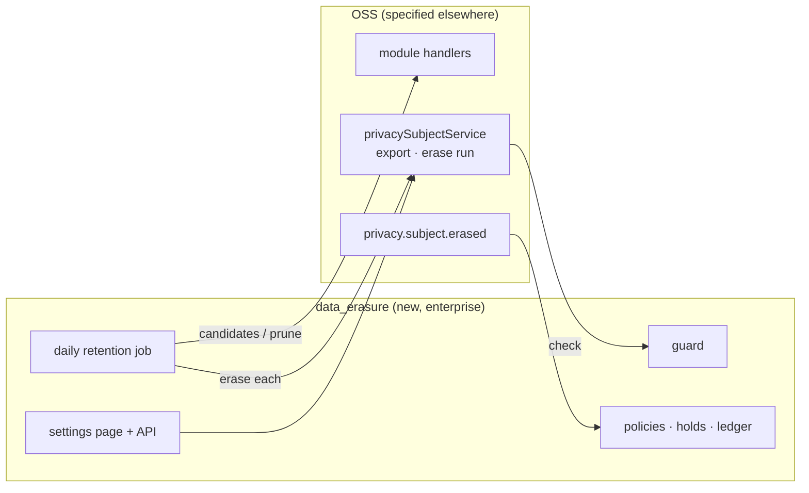

# Privacy governance engine: retention policies, legal holds, operations

> **Program:** packages C3 and D5 of [`../2026-11-15-gdpr-ready-deployments-program.md`](../2026-11-15-gdpr-ready-deployments-program.md) (tracker open-mercato/open-mercato#8593).
> **Builds on:** the OSS contract in [`../2026-11-16-privacy-data-class-contract.md`](../2026-11-16-privacy-data-class-contract.md) and the erase run in [`../2026-11-16-privacy-subject-erasure.md`](../2026-11-16-privacy-subject-erasure.md).
> **Reference only:** `packages/enterprise/src/modules/data_erasure` and its spec on `upstream/feat/security-readiness` (PR #5557).
> **Verified at** `main` @ `08dada9624` and against that branch by reading code; nothing was run.
> **Written autonomously.** No question was put to a person; the choices are listed under Resolved assumptions.

Extends: .ai/specs/2026-11-16-privacy-subject-erasure.md
Supersedes: .ai/specs/enterprise/2026-07-08-gdpr-data-erasure.md — sections: Architecture, Commands & Events, Data Model, API Contracts, Phasing & Implementation Plan

## 📝 TLDR

The OSS privacy contract gives an operator with shell access an export and an erase command. A tenant administrator has nothing: no screen to answer a request from, no way to say how long a class of data is kept, no way to stop an erasure while a dispute is open, and no record of what was done. **Proposed (future):** an enterprise module that adds tenant retention policies, legal holds, a ledger of privacy operations that holds no personal data, and one settings page from which an administrator exports and erases a known person — all by calling the OSS operations, never by touching another module's tables.

**Status.** Not approved. It depends on the OSS erase run, which waits for the program's decision DEC-2b, and its third phase depends on the retention sets in the OSS record-retention spec and, for erasing people by age, on the inactive-subject spec. If the erase run does not ship in OSS, it moves into this module and the design below is unchanged.

**Not in this spec:** the erase and export operations themselves; finding a person by email or phone from the page, which stays a command because the search can take minutes; restore replay ([`2026-11-16-erasure-restore-replay.md`](2026-11-16-erasure-restore-replay.md)); request-deadline tracking; sandbox sanitization, which the reference branch bundled into the same module.

## 📝 Overview

> **Market reference.** OneTrust and the open-source Fides separate three things this spec also separates: a *policy* per data category, an *execution* log that is itself free of personal data, and a *hold* that overrides both. Fides runs each erasure as a graph of per-system steps and reports per step. Adopted: per-class policies, per-step outcomes taken from the OSS run, a PII-free ledger, holds checked before any mutation. Rejected: Fides' connector model in which the engine holds credentials to, and queries, each system — here each module answers for itself.

## 📝 Resolved assumptions (autonomous defaults)

| # | Question | Chosen | Rationale |
|---|---|---|---|
| 1 | Module id | `data_erasure`, as on the reference branch | Converges with that work and with the 07-08 spec's name. |
| 2 | How retention runs | One module-registered daily job walks every active policy | The reference required an administrator to wire a scheduler entry per policy, with a payload and a scope that had to match. |
| 3 | What a retention policy does for person records | It asks the class for candidates and erases each through the OSS erase run | The reference deleted rows directly, ignoring linked deals and the rules the erasure spec gives each module, and one failing row blocked every later run. |
| 4 | Default policies | None. A policy exists only when an administrator creates it, and starts in preview | ⚠ NEEDS HUMAN CONFIRMATION that staff users get no retention at all in this version. The reference deleted staff accounts idle for a year, with no check for administrators or service accounts. |
| 5 | A held subject | The whole subject is refused | The reference let other classes proceed and reported "partial", which is hard to explain to anyone. |
| 6 | Scope of policies and holds | The tenant. No per-organization policies or holds in this version | A subject reference carries no organization, and a scope with none means all of them, so an organization-level hold could not be matched reliably. A hold that silently fails to match is the worst outcome here. |
| 7 | How a hold names its subject | Kind and id, stored in clear | An encrypted id matched through a hash finds nothing for a tenant with no map row, with encryption off, or after a key change — and then a held person is erased. An id alone names nobody. |
| 8 | Subject identity in the ledger | Kind and id, in clear; never an identifier, a label or data | The restore manifest must hold the same pair to repeat an erasure, so hashing it here hides nothing, and a hash needs a key that outlives every rotation. |
| 9 | Hold reasons | A closed list plus a short reference, encrypted | Free text about why a person's data is frozen is itself sensitive, and outlives the erasure. |
| 10 | Changing a hold | A hold can be extended or released, never edited | Otherwise the right to create holds would include the right to end one early, by shortening it or pointing it elsewhere. |
| 11 | A retention candidate with a related subject, such as a person with a portal account | Skipped and counted, unless the policy says otherwise | ⚠ NEEDS HUMAN CONFIRMATION. The erase run refuses a related subject nobody named. Erasing both, or the person alone, is a choice the administrator makes per policy. |
| 12 | Who can erase by default | Nobody new. The erase and release features are granted to the super-administrator role where one exists | A tenant set up without that role has no one who can erase until an administrator grants the feature; the page says so. |

## 📝 Problem Statement

- **No administrator surface exists.** The OSS commands need a shell. Nothing in the backend resolves a person, exports or erases.
- **No tenant-level retention exists.** Operational tables get instance-wide windows from the pruner spec; a tenant cannot say that inactive contacts are removed after two years.
- **Nothing can stop an erasure.** The OSS run consults an optional guard (`privacyErasureGuard`) and finds none. The erasure spec defines its method and that a guard which cannot answer counts as a refusal.
- **No record of privacy operations exists outside the action log**, which is itself subject to retention and cannot be listed by operation.
- **The OSS confirmation token cannot serve a web page.** It is keyed by a secret that lives in one process and is written to a local file, so a second request, or a second replica, cannot check it.
- **Finding a person by identifier is slow.** For CRM people the contract resolves by a decrypting scan that can take minutes.
- **`makeCrudRoute` stamps the selected organization on create and requires one on update** (`packages/shared/src/lib/crud/factory.ts:2603-2605, 2934`), so a row with an organization column cannot be made tenant-wide through it. Entities with no organization column are the existing way to be tenant-scoped.
- **The earlier enterprise design is partly unusable.** `.ai/specs/enterprise/2026-07-08-gdpr-data-erasure.md` specifies a request ledger and endpoints that the reference branch replaced; the branch's retention handlers have the defects listed under assumptions 3 and 4, and its access-log handler ignored held subjects.
- **Enterprise mechanics on `main`.** Modules are enabled by `OM_ENABLE_ENTERPRISE_MODULES` plus a per-module flag (`apps/mercato/src/modules.ts:244-270`); the flags must also be set in the CI workflow, because the build freezes the registry. A settings page is declared by its `page.meta.ts` alone. A command can be offered to the scheduler UI through `registerSchedulerSafeCommands` (`packages/scheduler/src/modules/scheduler/lib/scheduler-safe-commands.ts:50-59`).

## 📝 Proposed Solution

### What the engine adds

| Capability | How |
|---|---|
| **Retention policy** | Per tenant and retention set or data class: a window in days, a preference (delete or anonymize), a rule for related subjects, a daily limit, a mode (preview or apply), active or not |
| **Legal hold** | On a data class, or on a subject by kind and id; a reason code, a reference, an optional expiry. Created, extended, released; never edited |
| **Guard** | Registers the OSS seam. A subject under an active hold, or belonging to a held class, is refused before the run changes anything. If the guard cannot read its table, it refuses |
| **Operations ledger** | One row per export, erasure and retention pass: type, status, class ids, counts per outcome, the subject's kind and id, the origin, the reference. Never an identifier, a label or exported data |
| **Settings page** | Data classes, policies, holds, subject requests, operations |

### What it needs from the OSS side

| Need | Where it comes from | State |
|---|---|---|
| **Retention sets** — groups of a module's own records that can be deleted by age, with a `pruneRecords` method that takes a window, a position and the subjects to leave out | [`../2026-11-16-privacy-record-retention.md`](../2026-11-16-privacy-record-retention.md) | Specified; notifications and assistant conversations first |
| **Retention candidates** — a filtered list of people with no activity within a window, for the engine to erase through the erase run | [`../2026-11-16-inactive-subject-retention.md`](../2026-11-16-inactive-subject-retention.md), `listFilteredCandidates` | Specified; CRM people and portal users first |
| **Change-history retention** — two retention sets declared by this module over a routine in the audit module | [`2026-11-16-action-log-retention.md`](2026-11-16-action-log-retention.md) | Specified; needs a maintainer's yes for the OSS routine (#2980) |

A policy can exist only for a set or a class that offers one of these.

### A subject request from the page

The page works on a subject the administrator already knows: a reference of the form `kind:id`, arriving from a link on the person's, user's or portal user's own page, or pasted. Search by email or phone across classes stays the OSS command.

- **Export** calls the OSS export and returns the file.
- **Erase, step one** calls the erase run in dry-run mode, stores an operation row with the digest of the report, and returns the report and that row's id.
- **Erase, step two** takes the row id. It is accepted only from the same user, within fifteen minutes, and only if a fresh dry run still yields the same digest. Then it applies. The OSS command's token is not used.

### A retention pass

One pass per policy per day, under a lease on the policy row so that two workers cannot run it at once.

1. If a hold covers the class, record a skipped pass and stop.
2. Read candidates from the beginning, in batches. The cursor is kept on the pass, so an interrupted pass resumes; the next day's pass starts from the beginning again.
3. For each candidate: skip it if it is held; skip it if it failed recently and its next attempt is not due; apply the policy's rule for related subjects.
4. Erase through the OSS run with origin `engine:retention`. Record the per-section outcome counts on the pass.
5. On a failure or refusal, record it in the failures table with an attempt count and a next-attempt time that backs off, and continue.
6. Stop at the policy's daily limit. Each erasure writes two audit entries and a persistent event, so the limit bounds that volume.

In preview mode nothing is erased, no cursor or failure is stored, and the candidates are counted. For a record-mode class the engine calls `pruneRecords` in batches with the held subjects to leave out.

### Design decisions

| Decision | Rationale |
|---|---|
| The engine calls only the OSS service and handlers | It must never read another module's tables. |
| Tables have no organization column | Tenant scope is then the only scope, and `makeCrudRoute` handles it without stamping. |
| A pass restarts from the beginning each day | A subject that failed, or whose hold was released, is seen again. A cursor that only moves forward would lose both. |
| Failures are rows with a back-off, not a stop | One record that cannot be erased must not block the class, and must not be retried every day forever. |
| The ledger listens for the OSS completion event and uses its `runId` and `origin` | A run from the command line or the portal is recorded once; a run the engine started is not recorded twice. |
| Holds are append-only apart from extension and release | See assumption 10. |
| No policy can be shorter than a class's stated minimum | A class may have a legal floor. |
| The module registers a data class for its own rows | Policies, holds and operations name the staff user who created them. |

### Alternatives considered

| Alternative | Why rejected |
|---|---|
| Deleting by SQL from the engine | Bypasses every module's rules. |
| Scheduler entries wired by hand | See assumption 2. |
| Free-text hold reasons | See assumption 9. |
| Encrypting or hashing the subject id in holds and the ledger | See assumptions 7 and 8. |
| Per-organization holds and policies | See assumption 6. |
| Resolving a person by identifier from the page | A request that runs for minutes; a queue and a place to keep names while it runs. |
| Bundling sandbox sanitization | A different capability with a different risk. |

## 📝 Delta

### Capability: privacy-governance

#### ADDED Requirement: Retention policy
The system SHALL let an administrator define, per data class, how long records are kept, and SHALL apply active policies daily through the erase run.

##### Scenario: Preview
- WHEN a policy is created
- THEN it is in preview mode, and the next run reports how many records it would affect and changes nothing

##### Scenario: Apply
- WHEN an active policy is in apply mode
- THEN records past the window are erased or anonymized as each module's rules decide, and the operation records the counts per outcome

##### Scenario: A record that cannot be erased
- WHEN one candidate fails
- THEN it is recorded, the pass continues with the next, and the candidate is tried again only after its back-off

##### Scenario: A candidate with a related subject
- WHEN a person past the window has a portal account and the policy keeps the default rule
- THEN the person is skipped and counted

##### Scenario: Daily limit
- WHEN more candidates exist than the policy's daily limit
- THEN the pass stops at the limit and the rest are handled on later days

#### ADDED Requirement: Legal hold
The system SHALL refuse to erase a subject, and SHALL exclude it from retention, while a hold covers it.

##### Scenario: Held subject
- WHEN an erasure is requested for a held subject, from the page or the command line
- THEN nothing is changed and the result says the subject is held

##### Scenario: Release
- WHEN a user without the release feature tries to release a hold
- THEN it is refused

##### Scenario: No early end by editing
- WHEN a user with only the manage feature tries to shorten a hold or change its subject
- THEN no route allows it

##### Scenario: The guard cannot answer
- WHEN the hold table cannot be read during an erasure
- THEN the erasure is refused

#### ADDED Requirement: Operations ledger
The system SHALL record every privacy operation without storing an identifier, a label or exported data.

##### Scenario: Export
- WHEN an administrator exports a subject
- THEN the file is returned to them, and the ledger holds the type, the classes and the record counts only

#### ADDED Requirement: Administrator requests
The system SHALL let an authorized administrator export and erase a known subject from the backend, with a preview before any erasure and a confirmation bound to that preview.

##### Scenario: Erase from the page
- WHEN an administrator runs an erasure
- THEN they first see the per-section preview, and applying needs the confirmation bound to that preview

##### Scenario: Stale or borrowed confirmation
- WHEN the confirmation is older than fifteen minutes, comes from another user, or the data changed since the preview
- THEN nothing is erased

## 📝 Architecture

Takeaway: the engine decides *when* and *whether*; the OSS run and the modules decide *what happens to the data*.

- **Module** `packages/enterprise/src/modules/data_erasure`, `license: 'Proprietary'`, enabled by the umbrella flag and `OM_ENABLE_ENTERPRISE_MODULES_DATA_ERASURE`, requiring the OSS `privacy` module.
- **DI**: registers `privacyErasureGuard`. Factories with object parameters end in `.proxy()`; the reference module's registration style was the cause of a QA failure elsewhere on that branch.
- **Job**: a module-registered, system-scoped daily cron schedule on the module's own queue. It finds work by selecting active policies from its own table, across tenants. Existing installations get the schedule from the module's registration command, because the upgrade-action list lives in core and cannot name enterprise code.
- **Subscriber** on `privacy.subject.erased` writes the ledger row, keyed by the event's `runId`, for operations whose origin is not the engine's.
- **Data class** `data_erasure.operators` for `auth:user`: exports the policies, holds and operations a staff user created or requested; on erasure keeps the rows and clears the user references.

| Touchpoint | Mechanism | Absent |
|---|---|---|
| Engine → OSS operations | `privacySubjectService` by DI key, registered by the `privacy` module | The module declares `privacy` as required |
| OSS run → engine | `privacyErasureGuard`, resolved softly by OSS | No holds |
| Engine → scheduler | `schedulerService`, guarded by `hasRegistration` | Policies never run; the page says so |
| Engine → a class without retention methods | Checked from the registry | The class cannot have a policy |

### Frontend architecture contract

| Route | Server root | Client islands | Data owner |
|---|---|---|---|
| `/backend/security/privacy` | `page.tsx` | `PrivacyTabs`, and inside it `DataClassesTab`, `PoliciesTab`, `HoldsTab`, `SubjectRequestsTab`, `OperationsTab` | The module's API routes |

| File | Why it is a client file | Heavy deps | Alternative rejected |
|---|---|---|---|
| `PrivacyTabs` | Tab selection state | None | — |
| Each tab component | Table state, forms, guarded mutations, the confirm dialog | `DataTable` | One page-root client file: the reference page was 897 lines in a single file |
| `ErasePreviewDialog` | Shows the preview; holds the confirmation | None | — |

| Budget | Value |
|---|---|
| New page-root client files | 0 |
| Client files over 300 lines | 0 |
| Heavy browser libraries at the root | 0 |
| Hydration and interaction test | TC-PRIVACY-GOV-005 |
| Evidence | `yarn check:client-boundaries` |

Policies and holds use `CrudForm` and `DataTable`; actions use `useGuardedMutation`; destructive actions use the shared confirm dialog; dialogs submit on Cmd/Ctrl+Enter and cancel on Escape; statuses use the semantic status tokens; all strings are locale keys in the five enterprise locales.

## 📝 Data Models

All tables carry `tenant_id` (required), `created_at`, `updated_at`, and no organization column.

| Table | Columns |
|---|---|
| `privacy_retention_policies` | `target_kind` (`set` \| `class`), `target_id`, `retention_days`, `prefer` (`delete` \| `anonymize`), `related_subjects` (`skip` \| `exclude` \| `include`), `daily_limit`, `mode` (`preview` \| `apply`), `is_active`, `run_lease_until?`, `created_by`, `deleted_at?`. Unique on tenant and target among rows not deleted |
| `privacy_retention_failures` | `policy_id`, `subject_kind`, `subject_id`, `attempts`, `last_code`, `next_attempt_at`. Unique on policy and subject |
| `privacy_legal_holds` | `target_kind?`, `target_id?` (a data class or a retention set), `subject_kind?`, `subject_id?`, `reason_code`, `reference`, `expires_at?`, `released_at?`, `released_by?`, `release_reason_code?`, `created_by`. Indexed on tenant, subject kind and subject id. A check requires a target or a subject |
| `privacy_operations` | `type` (`export` \| `erase` \| `retention`), `status`, `origin`, `run_id?` (unique when set), `data_class_ids`, `subject_kind?`, `subject_id?`, `policy_id?`, `dry_run`, `report_digest?`, `cursor?`, `counts_json`, `reference`, `requested_by?`, `completed_at?` |

- Only `reference`, on holds and operations, is in the module's encryption map. Nothing the guard matches on is encrypted.
- Policies return `updatedAt` and are edited under optimistic locking. Holds have no edit form.
- The data-model graph follows this spec's Mermaid form at implementation time; one relation, failures to policies.

## 📝 API Contracts

All routes are under `/api/data_erasure`, validate with zod, export `openApi`, and declare per-method features in `metadata`.

| Route | Feature | Notes |
|---|---|---|
| `GET data-classes` | `data_erasure.view` | Registry view with coverage per action |
| `policies` CRUD | `data_erasure.policies.manage` | `makeCrudRoute`, tenant-scoped; a window below the class's minimum is a field error; switching to apply requires the count from the last preview pass |
| `legal-holds` list and create | `data_erasure.holds.manage` | `makeCrudRoute` with no update or delete export |
| `POST legal-holds/:id/extend` | `data_erasure.holds.manage` | A later expiry, or none. Never earlier. Mutation-guard registry |
| `POST legal-holds/:id/release` | `data_erasure.holds.release` | Reason code required. Mutation-guard registry |
| `POST subjects/export` | `data_erasure.subjects.export` | Takes `kind:id`. Returns the OSS export document as a download |
| `POST subjects/erase` | `data_erasure.subjects.erase` | Takes `kind:id`, the exclusions and a preference: returns the preview and an operation id. With the operation id: applies |
| `GET operations` | `data_erasure.view` | Keyset pagination, page size at most 100 |

Default role features: administrators get view, policies, holds and export; erase and hold release go to the super-administrator role where it exists. CLI: `mercato data_erasure retention-run [--policy <id>] [--apply]`, preview by default, and `mercato data_erasure register-schedules`.

## 📝 Edge Cases & Failure Scenarios

| Case | Behaviour |
|---|---|
| Policy on a class that drops its retention support | The policy is shown as inapplicable and skipped |
| Hold placed during a retention pass | Checked per candidate, so the subject is skipped from then on; one already erased is gone |
| Hold expires | It no longer blocks; expiry is evaluated at check time |
| Hold released, subject past the window | Erased by the next day's pass |
| The hold table cannot be read | The guard refuses; the erasure fails with the guard's code |
| Two administrators edit one policy | The second gets the standard conflict |
| Two workers start the same policy | The second finds the lease taken and stops |
| A pass is interrupted | It resumes from its stored cursor when the job next runs that day; otherwise the next day starts over |
| Event delivery fails for a command-line erasure | The ledger misses it until the replay spec's reconciliation runs |
| The same event is delivered twice | The unique `run_id` makes the second a no-op |
| Scheduler absent | Policies never run; the page shows the last run as "never" with the reason |
| The `privacy` module is disabled | The engine does not load; its flag check fails at generate time |
| No user in the tenant holds the erase feature | The requests tab says so and names the feature |
| Preview shows a very large count | The policy cannot be switched to apply without confirming the count; the daily limit still applies |
| A staff user who created holds is erased | The module's own data class keeps the rows and clears the references |

## 📝 Migration & Backward Compatibility

- New enterprise module, tables, routes, features, flag, command: additive.
- The flag is added to `apps/mercato/src/modules.ts`, `packages/create-app/template/src/modules.ts`, both `.env.example` files, the CLI module-configuration test, `packages/cli/src/lib/testing/integration.ts`, `scripts/test-create-app-integration.ts`, and the enterprise flags in the CI, snapshot and snapshot-preview workflows.
- **Prior spec.** `2026-07-08-gdpr-data-erasure.md` stays the source for why erasure is irreversible and why undo logging is suppressed. Its Architecture, Commands & Events, Data Model, API Contracts and Phasing sections are replaced by this spec and by the OSS erasure spec.

## 📋 Phasing

| Phase | Outcome | Depends on |
|---|---|---|
| 1 | Module, flag, ledger, guard with holds | OSS erasure spec, Phase 1, and its approval |
| 2 | Subject requests: export and erase a known subject from the page | OSS erasure spec, Phase 3 |
| 3 | Retention policies and the daily job | The record-retention spec for sets; the inactive-subject spec for people |

## 📋 Implementation Plan

### Phase 1
1. Scaffold the module, features, role defaults, the flag in every place listed under Migration.
2. Entities, migration, encryption map, validators.
3. Holds: list, create, extend, release; the guard and its DI registration with a seam test. Unit tests: class hold, subject hold, both, expired, released, extension to an earlier date refused, and the guard refusing when its query throws.
4. Ledger: the service, the event subscriber keyed by `runId`, the operations list route. Unit test for a redelivered event and for an engine-origin event.
5. The module's own data class, with export and erase unit tests.
6. The settings page with the data-classes, holds and operations tabs. Integration tests TC-PRIVACY-GOV-001 and 002.

### Phase 2
1. Export and erase routes over the OSS service, with the two-step confirmation. Unit tests: wrong user, expired, changed digest, and the ledger's contents.
2. The subject-requests tab and the preview dialog; a link to it from each subject's own page where that page offers an extension point. Integration tests TC-PRIVACY-GOV-003 and 005.

### Phase 3
1. Policies: CRUD, minimum-window validation, the policies tab.
2. The retention pass: lease, candidates, held subjects, related-subject rule, failures with back-off, daily limit, preview and apply. Unit tests with fake handlers for each rule.
3. The daily job, its registration, the registration command, the CLI command. Integration test TC-PRIVACY-GOV-004.
4. Docs; add the `Superseded by` line to the 07-08 spec.
5. Archive this Delta into `.ai/specs/capabilities/privacy-governance.md` if that directory has been adopted by then.

### File manifest

| File | Action |
|---|---|
| `packages/enterprise/src/modules/data_erasure/**` (index, acl, setup, di, encryption, data, api, services, subscribers, workers, backend, i18n, migrations, tests) | Create |
| `apps/mercato/src/modules.ts`, `packages/create-app/template/src/modules.ts`, both `.env.example` files, `packages/cli/src/lib/__tests__/modules-config.test.ts`, `packages/cli/src/lib/testing/integration.ts`, `scripts/test-create-app-integration.ts`, the CI, snapshot and snapshot-preview workflows | Modify |
| `.ai/specs/enterprise/2026-07-08-gdpr-data-erasure.md` | Modify — one annotation line |

## 🧪 Integration Coverage

In the enterprise test environment, with `dependsOnModules` naming `privacy` and `data_erasure`. Fixtures are created through the API and removed.

| Test | Paths | Covers |
|---|---|---|
| TC-PRIVACY-GOV-001 | `legal-holds`, `extend`, `release`, `subjects/erase` | A held person cannot be erased from the page route or the OSS command; a hold cannot be shortened; releasing needs the release feature |
| TC-PRIVACY-GOV-002 | `operations`, the OSS erase command | An erasure run from the command line appears in the ledger without an id, email or name |
| TC-PRIVACY-GOV-003 | `subjects/export`, `subjects/erase` | Download, preview, apply with the operation id; a confirmation from another user is refused; another tenant's person returns nothing |
| TC-PRIVACY-GOV-004 | `policies`, the retention job enqueued and drained through the integration queue helper | A preview-mode policy counts and changes nothing; in apply mode an old inactive person is erased, one linked to a deal is anonymized, one with a portal account is skipped, and a held one is skipped |
| TC-PRIVACY-GOV-005 | `/backend/security/privacy` | The page loads, each tab renders, the preview dialog opens, submits on Cmd/Ctrl+Enter and closes on Escape |

## 📝 Risks & Impact Review

#### A policy erases records the tenant needed
- **Scenario**: An administrator sets a short window on contacts.
- **Severity**: High
- **Affected area**: any class with retention
- **Mitigation**: Preview first; the count must be confirmed to switch to apply; each module's own rules still anonymize or retain what must survive; class minimums.
- **Residual risk**: An informed administrator's choice is irreversible.

#### A hold is missed
- **Scenario**: A hold exists and an erasure goes ahead.
- **Severity**: Critical
- **Affected area**: every erasure in the tenant
- **Mitigation**: The subject is stored and matched in clear, so no key, map or encryption setting is involved; the guard refuses when it cannot answer; the engine checks holds per candidate and passes held subjects to record-mode pruning instead of trusting the handler.
- **Residual risk**: An erasure done by SQL or by a module's own delete command does not pass through the guard. The erasure spec says which commands those are.

#### A hold is ended by someone who may only create them
- **Scenario**: A user with the manage feature shortens a hold or points it at another subject.
- **Severity**: High
- **Affected area**: holds
- **Mitigation**: No update route exists; extension only moves the expiry later.
- **Residual risk**: None through the API.

#### Retention floods the audit log
- **Scenario**: A first apply pass meets a hundred thousand candidates.
- **Severity**: Medium
- **Affected area**: action log, event queue, the tenant's database
- **Mitigation**: The daily limit per policy; one pass per day under a lease.
- **Residual risk**: A long tail: at the default limit a large backlog takes months.

#### The ledger identifies people
- **Scenario**: Operation rows are read by someone without access to the data.
- **Severity**: Medium
- **Affected area**: `privacy_operations`
- **Mitigation**: A kind and an id only; encrypted reference; no identifier, label or data.
- **Residual risk**: For a subject that still exists — after an export, or an anonymization — the id leads to their record for anyone who can also read that table.

#### Cross-tenant operation
- **Scenario**: A request body names another tenant's policy or subject.
- **Severity**: Critical
- **Affected area**: every route
- **Mitigation**: Scope comes from the session, never the body; the reference branch's review found this consistent, and the same pattern is kept; a negative test.
- **Residual risk**: Low.

## Final Compliance Report — 2026-11-16

- **Reviewed:** root `AGENTS.md`, `.ai/specs/AGENTS.md`, `packages/enterprise/AGENTS.md` (through the research), the frontend architecture contract. Not reviewed in full: `packages/ui/AGENTS.md`, `packages/scheduler` guide.

| Rule | Status | Notes |
|---|---|---|
| Enterprise scope in the enterprise specs directory | Compliant | — |
| No cross-module ORM relationships or table access | Compliant | OSS service and handlers only |
| CRUD through `makeCrudRoute`; custom writes through the mutation-guard registry | Compliant | Named per route |
| Optimistic locking on new editable entities | Compliant | Policies and holds |
| Sensitive columns in an encryption map | Compliant | The two reference columns. Subject ids are deliberately in clear; see assumptions 7 and 8 |
| `CrudForm`, `DataTable`, `apiCall`, `useGuardedMutation`, design-system tokens, dialog keys | Compliant | Named in the contract |
| Feature-based guards, not role names | Compliant | — |
| Ask before changing pipeline automation | Needs approval | A flag in three workflows |
| Frontend architecture contract | Compliant | Included |

**Verdict:** not approved. Phases 1 and 2 wait for the OSS erasure spec's approval; Phase 3 also waits for the record-retention spec.

## Changelog

### 2026-11-16
- Written autonomously with resolved assumptions.
- Revised after independent review. Holds and the ledger store the subject's kind and id in clear, and the guard refuses when it cannot answer: the earlier design could have erased a held person on a tenant with no map row, with encryption off, or after a key change. Holds can be extended or released, not edited. Scope is the tenant only. The page confirms an erasure with a stored preview bound to the user and a time limit, and no longer resolves people by identifier. The retention pass restarts each day, records failures with a back-off, has a lease, a daily limit and a rule for related subjects. The module registers a data class for its own rows. Approval withdrawn until the OSS erase run is approved.
