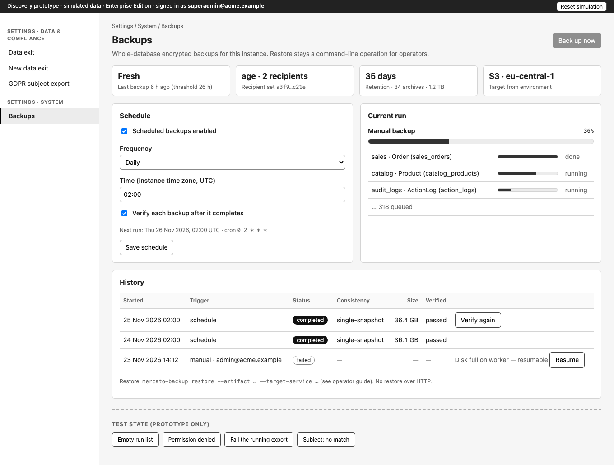

# Admin-panel backups: schedule and run now (Enterprise)

> **Tracker:** implementation issue linked from the spec PR · related to open-mercato/open-mercato#8593 (erasure vs backups) and #8910
> **Edition:** Enterprise only (`packages/enterprise/src/modules/backups/`)
> **Depends on:** the resumable encrypted backup engine and CLI from PR #9333 ([spec](2026-11-06-cli-backup-restore.md))
> **Companion:** [Data Exit Kit](2026-11-25-data-exit-kit.md) — a scoped export, not a backup

Extends: .ai/specs/enterprise/2026-11-06-cli-backup-restore.md
Extends: .ai/specs/enterprise/2026-07-08-automated-database-backups.md

## 📝 TLDR

**Proposal, not implementation.** PR #9333 delivers a resumable, age-encrypted, whole-database backup engine driven from the CLI (`mercato-backup create|verify|restore|exercise`); the [automated backups spec](2026-07-08-automated-database-backups.md) promised scheduling and a status page but was written for an older `pg_dump | AES-GCM` pipeline. **Proposed (future):** an instance-level **Backups** page in the admin panel where a superadmin can **run a backup now**, **create/edit/disable schedules**, watch **live per-entity progress**, **verify** an archive, **resume** an interrupted backup and see history and freshness — all executing the #9333 engine facade in a queue worker. Restore stays CLI-only.

## 📝 Problem Statement

- After #9333, backups need an operator shell; nothing runs unattended, and nobody sees freshness without logging into the host.
- The 07-08 spec's pipeline (`OM_BACKUP_ENCRYPTION_KEY`, single stream, `--force` restore) is replaced by the engine (age recipients, chunk journal, empty-target restore) — its 11-06 successor explicitly defers "scheduling, object storage, retention, status UI" back to 07-08, which must be reconciled before implementation (07-08 header note).
- The engine's per-entity progress view is CLI-only in v1 (11-06, *Progress display*).

## 📝 Prior spec drift

| Prior spec section | Says | Reality / this spec |
|---|---|---|
| 07-08 *Workers & Scheduling* | `pg_dump -Fc → AES-256-GCM` stream with `OM_BACKUP_ENCRYPTION_KEY`, uploaded as one object | Engine writes a chunked, age-encrypted artifact directory (`index.age`, `manifest.json`, chunk files) with a journal (#9333). This spec uploads the sealed artifact directory as objects under one prefix. |
| 07-08 *Data Model* `backup_run` | `checksum_sha256`, `encryption_key_fingerprint`, `pg_dump_version` | Replaced by `manifest_sha256`, `recipient_set_fingerprint`, `consistency`, `engine_version`; per-entity `progress` jsonb added. |
| 07-08 *CLI* `restore --force` | live-target restore | Removed; engine restore into empty isolated target only (11-06 Q6). |
| 11-06 *Progress* | per-entity view CLI-only | This spec surfaces it in the UI from the engine's NDJSON progress events. |

## 📝 Proposed Solution

- **Worker** `backups:run` (queue `backups-run`, concurrency 1, `schedulerSafe: true`) calls the engine facade `createBackup({ sourceService, output: workspace, recipients: OM_BACKUP_RECIPIENTS_FILE, signal, progressSink })` (`backups/lib/engine/index.ts` in #9333), then uploads the sealed artifact to the backup target and records the run. Plaintext is never offered from the UI (`OM_BACKUP_REQUIRE_ENCRYPTION` semantics are forced on for UI/scheduled runs).
- **Schedules** live in the existing scheduler (`schedulerService.register`, `scopeType: 'system'`, `targetType: 'queue'`, `targetQueue: 'backups-run'`, `sourceModule: 'backups'`), so cron parsing, enable/disable, BullMQ sync and local execution are reused. The Backups page edits them through a small module API instead of sending operators to the generic scheduler UI; the generic UI still shows them. Default schedule seeded disabled-until-configured: `0 2 * * *`, enabled only when a backup target and recipients are configured (otherwise the page shows setup steps).
- **Verify** worker `backups:verify` runs the engine's offline `verifyBackup` (no DB connection) on a stored artifact; optional "verify after every scheduled backup" flag on the schedule payload.
- **Resume**: a failed run whose engine status is `resumable` shows **Resume**, which enqueues `createBackup({ resume: backupId })` on the same workspace; when the workspace is gone (different worker host), resume is disabled with an explanation.
- **Retention** worker `backups:retention` (daily) deletes artifacts past `OM_BACKUP_RETENTION_DAYS` (default 35, the erasure-durability bound of 07-08), never the newest completed backup.
- **Target**: env-only (`OM_BACKUP_S3_*` or `OM_BACKUP_OUTPUT_DIR`), never editable in the UI — unchanged 07-08 decision; the page shows a read-only summary.

### Alternatives considered

- *Generic scheduler UI only* — no freshness, progress or verification; operators need one page. Rejected.
- *HTTP restore* — rejected (instance-wide blast radius), unchanged from both prior specs.

## 📝 Architecture

```mermaid
flowchart LR
  UI[Backups page] --> API[/api/backups/*]
  API -->|run now| Q[(backups-run)]
  SCH[scheduler · system schedule]:::existing --> Q
  Q --> W[backups:run worker]
  W --> E[#9333 engine facade createBackup]:::existing
  E -->|NDJSON progress| PS[progress sink → backup_runs.progress + ProgressJob]
  E --> WS[(worker workspace)]
  WS --> UP[artifact uploader → OM_BACKUP target]
  API -->|verify| QV[(backups-verify)] --> V[verifyBackup offline]
  classDef existing stroke-dasharray: 4 2
```

Takeaway: the UI only enqueues and observes; every backup byte goes through the reviewed engine, and restore never leaves the CLI.

Single-flight: a `backup_runs` row in `running` **with `last_heartbeat_at` younger than 10 min** blocks new runs (409) — scheduled jobs that find one no-op with a log line. The single-flight check itself marks an older `running` row `interrupted` (resumable) before admitting the new run, so a crashed worker never blocks backups longer than 10 min. Worker heartbeat every 5 s.

Workspace and upload: the worker requires a **persistent workspace volume** (`OM_BACKUP_WORKSPACE`, the private persistent recovery volume #9333 adds for Docker) and uploads each chunk as soon as the engine seals it (journal-driven uploader), mirroring the journal to the target. Free space needed is bounded by in-flight chunks, not database size; resume works on the same host from the local journal, and on a new host only after the local workspace is restored from the mirror (v1: same-host only; documented).

## 📝 Data Model

`backup_runs` (renames 07-08's `backup_run`; instance-scoped, no `tenant_id`/`organization_id` — deviation and compensating controls exactly as 07-08 *Data Model*): `id`, `status` (`pending` | `running` | `completed` | `failed` | `interrupted` | `expired` | `deleted`), `trigger` (`schedule` | `manual` | `cli`), `schedule_id` null, `triggered_by_user_id` null, `engine_backup_id`, `started_at`, `finished_at`, `size_bytes`, `chunk_count`, `manifest_sha256`, `recipient_set_fingerprint`, `consistency` (`single-snapshot` | `quiesced` | `multi-snapshot`), `engine_version`, `storage_prefix`, `progress` jsonb (overall + last N entity states, throttled to 1 write / 2 s), `last_heartbeat_at`, `resumable` bool, `verify_status` (`none` | `running` | `passed` | `failed`), `verified_at`, `retention_expires_at`, `error_code`, `created_at`, `updated_at`. System-managed rows — exempt from the optimistic-lock UI contract. Indexes per 07-08.

No schedule table: schedules are scheduler rows filtered by `sourceModule = 'backups'`.

## 📝 API Contracts

`/api/backups/*`, `requireAuth`, `requireFeatures`, zod, `openApi`, writes via `runMutationGuards`. Features (`acl.ts`): `backups.view`, `backups.manage` (run, resume, verify, delete), `backups.schedule`; `setup.ts` grants `backups.*` to **superadmin only**.

| Method & path | Feature | Contract |
|---|---|---|
| `GET /api/backups/status` | view | `{ freshnessState: 'ok'\|'stale'\|'never', lastCompletedAt, lastStatus, archiveCount, totalSizeBytes, recipientSetFingerprint, recipientCount, target: { kind: 's3'\|'directory', label }, configured: boolean, missing: string[] }` (unchanged shape + additive fields; uptime-monitor target) |
| `GET /api/backups/runs` | view | keyset list, `pageSize ≤ 100`, `status?` |
| `GET /api/backups/runs/:id` | view | run + `progress` (per-entity) |
| `POST /api/backups/runs` | manage | `{ label?: string }` → `202 { runId, progressJobId }`; 409 `backup_running`; 412 `backup_not_configured` |
| `POST /api/backups/runs/:id/resume` | manage | only when `resumable` and workspace present |
| `POST /api/backups/runs/:id/verify` | manage | → `202 { runId }` |
| `GET /api/backups/runs/:id/manifest` | view | the artifact's non-secret `manifest.json` (no recipients' private parts, no keys) |
| `DELETE /api/backups/runs/:id` | manage | deletes the artifact and marks the row `deleted`; refused for the newest completed backup |
| `GET/PUT /api/backups/schedules` | view / schedule | `{ schedules: [{ id, enabled, preset: 'daily'\|'twice_daily'\|'weekly'\|'custom', cron, timezone: 'UTC', verifyAfter: boolean, nextRunAt }] }` — validated cron (min interval 1 h), stored via `schedulerService` |

Events: `backups.run.started|completed|failed|interrupted`, `backups.verify.completed|failed` (ids, sizes, status only; `clientBroadcast: true`). Manual runs notify the triggering user; scheduled failures are surfaced by freshness (tenant-less notification limitation from 07-08 stands).

## 📝 UI/UX

**Settings → System → Backups** (instance-level, so not under the tenant-level "Data & compliance" section used by Data Exit) (`pageContext: 'settings'`, `requireFeatures: ['backups.view']`):

- KPI row: freshness (`ok`/`stale`/`never` with threshold `OM_BACKUP_FRESHNESS_HOURS`), encryption (age, recipient count, fingerprint), retention + archive count/size, target (read-only).
- **Back up now** primary action (confirmation dialog with expected duration from the last run; `Cmd/Ctrl+Enter`/`Escape`).
- **Schedule** card: enabled toggle, frequency preset or custom cron, time, "verify after each backup", next run preview, Save (`CrudForm`).
- **Current run** card: overall bar + per-entity bars (running entities, last 3 completed, "… N queued"), mirroring the CLI layout.
- **History** `DataTable`: started, trigger, status, consistency, size, verified, actions (verify, resume, download manifest). Restore hint shows the CLI command; no restore button.
- Not configured state: checklist of missing env (`OM_BACKUP_RECIPIENTS_FILE`, target) — values never shown.

| Screen | Image |
|---|---|
| Backups: status, schedule, live run, history |  |

Prototype: [`.ai/prototypes/discovery/data-exit-kit/revision-001/index.html#backups`](../../prototypes/discovery/data-exit-kit/revision-001/index.html) (proposal).

## 📝 Edge Cases & Failure Scenarios

| Scenario | Behavior |
|---|---|
| Not configured (no recipients/target) | Run now and schedule disabled; status `configured: false` with missing items. |
| Run already running | 409; button disabled with link to the current run. |
| Worker killed mid-backup | Row `interrupted`, `resumable`; Resume continues from the journal on the same host; on another host Resume disabled and a fresh run suggested. |
| Upload fails after engine success | Chunks not yet uploaded stay in the workspace; resume retries uploads only. |
| Disk full in workspace | Engine exit `refused/failed` mapped to `error_code: workspace_full`, resumable after cleanup. |
| Verification fails | Run keeps `completed`, `verify_status: failed`, freshness `stale` until a verified backup exists (configurable `OM_BACKUP_REQUIRE_VERIFIED_FOR_FRESHNESS`, default false). |
| Scheduler module absent | Schedule card shows "scheduler unavailable"; run now still works. |
| Two worker replicas | Single-flight by DB status + queue concurrency 1. |

## 📝 Risks & Impact Review

- **Heavy job on app workers (Medium):** recommend a dedicated worker deployment via queue routing; doc'd. Concurrency 1.
- **Exposure of backup metadata (Low):** superadmin only; fingerprints, never keys or recipients' private parts.
- **Erasure resurrection (known):** unchanged — bounded retention + erasure manifest from 07-08 / DSR engine.
- **Contracts:** additive routes, features, events; `backup_run` shape differs from unshipped 07-08 — no compatibility bridge needed (nothing shipped).
- **Dependency on #9333 (High for schedule):** cannot start before the engine and its age dependency are approved and merged.

## Resolved assumptions (autonomous defaults)

| # | Question | Applied default | Why | Confirm? |
|---|---|---|---|---|
| Q1 | Where do schedules live? | Scheduler package rows (`sourceModule: 'backups'`), edited from the Backups page. | Reuse; no new table. | reversible |
| Q2 | Restore in the UI? | No — CLI only. | Both prior specs forbid HTTP restore. | reversible |
| Q3 | Who can use the page? | Superadmin only by default. | Instance-wide, cross-tenant data. | reversible |
| Q4 | Plaintext backups from UI? | Never. | 11-06: automated pipeline never offers plaintext. | reversible |
| Q5 | Per-entity progress in UI? | Yes, from engine NDJSON progress, throttled. | Brief asks for visible progress; extends 11-06's CLI-only v1. | reversible |

## 📋 Phasing

1. Entities/migration, status + runs API, run-now worker using the engine, upload, ProgressJob.
2. Schedules API on scheduler + seeded default; retention worker.
3. Verify and resume.
4. Backups page + i18n + integration tests; docs update (`apps/docs/docs/deployment/enterprise-backup-recovery.mdx`).

## 📋 Implementation Plan

### Phase 1 — Run now
1. `backup_runs` entity + migration; status endpoint; unit tests for freshness.
2. Worker `backups:run`: engine facade, progress sink, uploader (S3 multipart / directory); failure-injection test (abort → `interrupted`, resumable).
3. `POST /runs` with single-flight 409 and 412 when unconfigured.

### Phase 2 — Schedules & retention
1. `GET/PUT /schedules` via `schedulerService` (soft-optional `hasRegistration`); cron validation tests.
2. Retention worker (never deletes newest completed); tests.

### Phase 3 — Verify & resume
1. Verify worker (offline engine verify) + endpoint; resume endpoint guarded by workspace presence.

### Phase 4 — UI
1. Page with KPI, run-now dialog, schedule form, live progress, history.
2. Integration tests: TC-BACKUPS-UI-001 superadmin runs a backup now and sees it complete (small fixture DB, test recipients); TC-BACKUPS-UI-002 admin without features gets 403/no menu; TC-BACKUPS-UI-003 schedule save + next-run preview; TC-BACKUPS-UI-004 unconfigured state.

## Final Compliance Report — 2026-11-25

- Instance-scoped entity deviation inherited from 07-08 with the same compensating controls. ✅
- No restore over HTTP; no secrets in API/UI. ✅
- Reuses scheduler, queue, progress, engine — no parallel mechanisms. ✅

## Changelog

### 2026-11-25
- Initial spec (autonomous, `om-auto-write-spec`).
- Scope review: heartbeat-based single-flight, persistent workspace + per-chunk upload, manifest/delete routes, naming.
