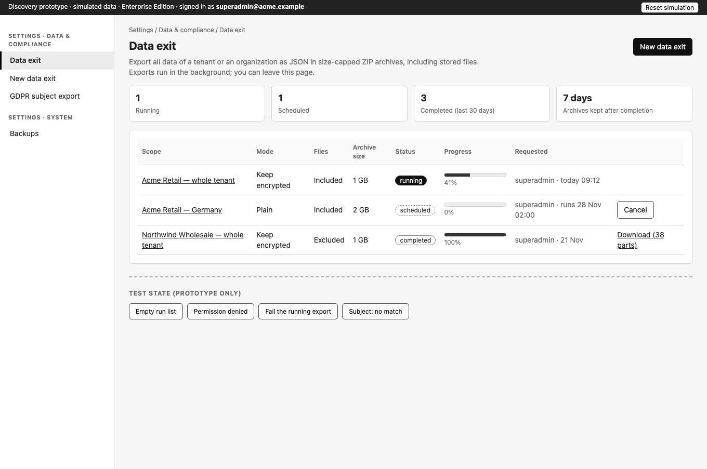
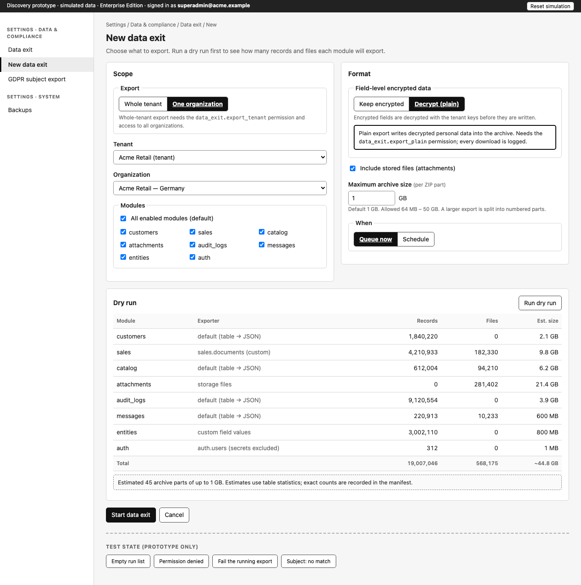
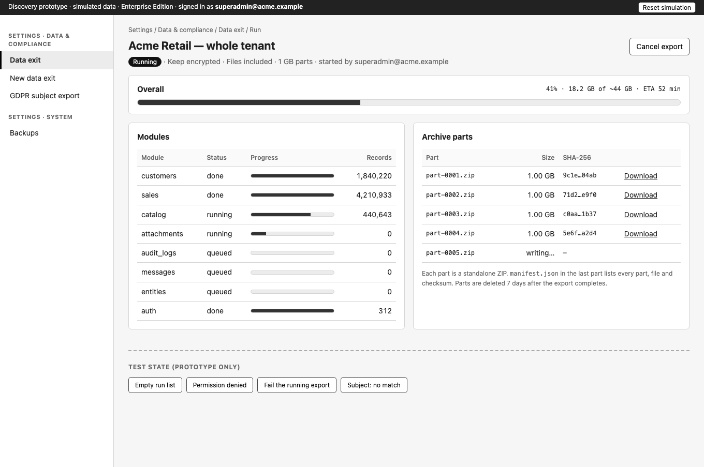

# Data Exit Kit (Enterprise)

> **Tracker:** open-mercato/open-mercato#8593 (GDPR umbrella) · implementation issue linked from the spec PR
> **Edition:** Enterprise only (`packages/enterprise/src/modules/data_exit/`); OSS modules ship only declarative, side-effect-free `data-exit.ts` files
> **Companions:** [GDPR subject export via Data Exit Kit](GDPR/2026-11-25-data-exit-gdpr-subject-export.md) · [Admin-panel backups](2026-11-25-admin-panel-backups.md)
> **GDPR basis:** Art. 20 portability, Art. 28(3)(g) return of data at end of service

Extends: .ai/specs/GDPR/2026-11-16-privacy-data-class-contract.md
Extends: .ai/specs/enterprise/2026-11-06-cli-backup-restore.md
Supersedes: .ai/specs/enterprise/GDPR/2026-11-16-privacy-dsr-engine.md — sections: Tenant export (`mercato privacy export-tenant`)

## 📝 TLDR

**Proposal, not implementation.** Today an operator who must hand a tenant its data (end of contract, migration, Art. 28(3)(g) return) has only a whole-database `pg_dump` — cross-tenant, ciphertext for every encrypted field, without files, and unusable for one organization. **Proposed (future):** a new Enterprise module `data_exit` lets a permitted user (superadmin only by default) queue or schedule a background export of **all data of one tenant or one organization**, module by module, as **JSON Lines inside size-capped ZIP parts** (default 1 GB per part), with a switch between **keep encrypted** (values as stored + encryption maps, no keys) and **plain** (decrypted), optionally including **every stored file**. A dry run shows per-module record/file/size estimates first; progress is shown live in the admin panel and the top bar; the run is resumable, streams end to end and is designed for 100 GB+ tenants.

Unlike a backup (whole database, one cluster snapshot, restorable), a data exit is **scoped (tenant/org), per module, and module-shaped**: each module may register its own **data exit strategy** in an auto-discovered `data-exit.ts`; modules that do not get the **default exporter** (every owned table → JSON in database column format).

## 📝 Problem Statement

- **No scoped export exists.** No tenant-exit code ships (`ANALYSIS-2026-11-20-gdpr-scope-minimization.md:45` only plans it). The planned `privacy export-tenant` ([DSR engine](GDPR/2026-11-16-privacy-dsr-engine.md#tenant-export)) is CLI-only, writes a directory on the operator's host, has no progress UI, no size-capped archives, no encrypted mode and no module-owned formats.
- **A backup is not an exit.** The [backup engine](2026-11-06-cli-backup-restore.md) is whole-database, cross-tenant and host-operator-only (its Q4), and its archive excludes stored files (`exclusions: ['external-files', …]`). Handing it to one tenant would leak every other tenant.
- **Field encryption is on by default** (`shared/lib/encryption/toggles.ts`); encrypted columns are ciphertext without the deployment's DEKs (`kms.ts`, Vault `tenant_key_<tenantId>` or derived fallback). Some receivers want plaintext (migration to another system), others must not get plaintext (archival escrow), so the operator needs both modes.
- **Scale.** Large tenants hold tens of millions of rows (action logs, custom field values, query index) and hundreds of GB of attachments. Every storage driver is buffer-based today (`attachments/lib/drivers/types.ts`, `storage-s3/.../s3-driver.ts:66`), so a naive implementation runs out of memory or disk.
- **Modules know their data best.** A raw table dump of `sales` or `entities` (EAV custom-field values) is hard to consume; modules need a way to export in their own shape while the platform provides a safe default.

## 📝 Proposed Solution

1. **Declare (OSS, optional, inert).** A module may add `data-exit.ts` default-exporting a `DataExitModuleDeclaration`: custom strategies for some of its entities, exclusions with reasons, and field denials. Types and zod schemas live in `@open-mercato/shared/modules/data-exit`. The generator collects it like `encryption.ts` into `Module.dataExit`. Nothing in OSS imports or runs it; with `data_exit` disabled the file is dead data and every module behaves exactly as today.
2. **Default exporter.** For every ORM entity owned by an enabled module and not covered by a strategy or exclusion, the runner uses the built-in `table-json` exporter: keyset pagination by primary key, scope filter, one JSON object per row with **database column names and DB-native values** (ISO timestamps, numeric strings for `numeric`/`bigint`, jsonb as JSON).
3. **Run (Enterprise).** `data_exit` plans a run (one item per module×strategy), streams batches into a ZIP part writer, seals a part when the next entry would exceed the cap, uploads it, checkpoints, and continues. Files stream from storage into `files/` entries. A final `manifest.json` (and `index.json`) lists every part, entry, row count and checksum.
4. **Operate.** Admin page `Settings → Data & compliance → Data exit`: list, new-export form with dry run, run detail with per-module progress and part downloads; `mercato data-exit` CLI for hosts; top-bar progress via `ProgressJob`.

### Alternatives considered

| Alternative | Why not |
|---|---|
| Reuse the backup engine with a tenant filter | Engine is `COPY`-based, whole-database, schema-carrying and age-encrypted to operator recipients; a tenant filter breaks its consistency/restore guarantees and still cannot decrypt fields or add files. Shared pieces are reused instead (chunk planner ideas, progress model, part hashing). |
| One JSON array per table | Not streamable for 100M-row tables; JSON Lines is JSON per line, parseable incrementally, and the manifest says so. |
| Owner-only reads (every module must write its own exporter first) | Blocks the feature on ~50 modules. The default exporter covers every module on day one; strategies are opt-in refinements. The read-every-table exception is the same one the DSR engine already accepts for tenant export. |
| Keep `privacy export-tenant` as a second exporter | Two tenant exporters with different field rules would diverge. `data_exit` supersedes that section and provides the same CLI entry (see Migration). |

## 📝 Delta

### Capability: data-exit-run
- **ADDED** WHEN a user with `data_exit.export_tenant` submits a tenant-scope export THEN a `data_exit_runs` row is created in `queued` (or `scheduled` when `scheduledFor` is in the future) and a background job is enqueued; the API returns `202 { runId, progressJobId }`.
- **ADDED** WHEN a run executes THEN every included module produces entries under `modules/<moduleId>/…` in ZIP parts no larger than `partSizeBytes` (except a single file larger than the cap, which gets a dedicated oversize part flagged in the manifest), and the last part carries `manifest.json`.
- **ADDED** WHEN `mode = 'encrypted'` THEN encrypted columns are exported exactly as stored and `encryption/maps.json` lists the active encryption maps; no key material is ever written.
- **ADDED** WHEN `mode = 'plain'` THEN rows are read through the decryption helpers and the caller must hold `data_exit.export_plain`.
- **ADDED** WHEN the worker dies mid-run THEN re-enqueueing resumes from the last sealed part's checkpoint; already uploaded parts are kept.
- **ADDED** WHEN `dryRun` is requested THEN per-module estimates `{ records, files, bytes, exact }` are returned and nothing is written.
- **ADDED** WHEN `data_exit` is not enabled THEN no route, page, worker, schedule or menu item exists and modules' `data-exit.ts` files are never executed. `Frozen by:` new unit test `module-decoupling.test.ts` case "modules boot without data_exit".

No existing behavior is MODIFIED or REMOVED (the superseded `export-tenant` has not shipped).

## 📝 Architecture

```mermaid
flowchart LR
  subgraph OSS[OSS modules — inert declarations]
    D1[customers/data-exit.ts]:::new
    D2[sales/data-exit.ts]:::new
    D3[module without file → default exporter]
  end
  subgraph ENT[Enterprise data_exit]:::new
    API[/api/data-exit/*] --> Q[(queue data-exit-run)]
    SCH[scheduler: dispatch-due every 5 min] --> Q
    Q --> W[worker data_exit:run]
    W --> P[planner → items]
    P --> X[strategy / table-json exporter]
    X --> Z[ZIP part writer · zip64 · streaming]
    W --> F[file streamer]
    F --> Z
    Z --> U[part uploader → storage namespace data_exit]
    W --> PJ[progressService · ProgressJob]
  end
  D1 & D2 & D3 --> P
  ENC[TenantDataEncryptionService]:::existing --> X
  ATT[attachments StorageDriver + additive readStream]:::existing --> F
  classDef new stroke-dasharray: 4 2
```

Takeaway: OSS modules contribute only data; all execution, I/O and authorization live in the enterprise module, so disabling it removes the feature completely.

### Module layout (`packages/enterprise/src/modules/data_exit/`)

`index.ts`, `acl.ts`, `setup.ts`, `di.ts`, `events.ts`, `cli.ts`, `data/{entities,validators}.ts`, `lib/{planner,tableJsonExporter,zipPartWriter,partUploader,fileStreamer,estimator,manifest,scope,secretsDenylist}.ts`, `workers/{run,dispatch-due,expire}.ts`, `api/…`, `backend/config/data-exit/{page,new,[id]}/…`, `i18n/*.json`, `migrations/`. Enabled by `OM_ENABLE_ENTERPRISE_MODULES` + `OM_ENABLE_ENTERPRISE_MODULES_DATA_EXIT` in `apps/mercato/src/modules.ts` (pattern at `:247-268`) and mirrored into the create-app template.

### Declaration contract — `@open-mercato/shared/modules/data-exit`

```ts
export type DataExitScope = { tenantId: string; organizationId: string | null }
export type DataExitMode = 'encrypted' | 'plain'
export type DataExitBatch = {
  file: string                         // relative path under modules/<moduleId>/, e.g. 'orders.jsonl'
  records: Record<string, unknown>[]   // JSON-serializable; ≤ 1000 per batch
  attachmentIds?: string[]             // files referenced by these records (deduplicated by the runner)
  cursor: unknown                      // JSON-serializable resume token after this batch
}
export type DataExitContext = {
  scope: DataExitScope; mode: DataExitMode; cursor: unknown | null
  em: EntityManager                    // read-only fork; strategies MUST NOT write
  container: AwilixContainer; signal: AbortSignal
  readRows(entityId: string, opts?: { where?: object; after?: unknown; limit?: number }): Promise<{ rows: Record<string, unknown>[]; cursor: unknown }> // the default exporter's scoped, mode-aware reader, reusable by strategies
}
export type DataExitStrategy = {
  id: string                           // '<moduleId>.<name>'
  entities: string[]                   // entity ids ('sales:sales_order') this strategy replaces the default for
  format?: string                      // free label shown in UI/manifest, default 'json'
  estimate(ctx: DataExitContext): Promise<{ records: number; bytes?: number; files?: number; exact: boolean }>
  export(ctx: DataExitContext): AsyncIterable<DataExitBatch>
}
export type DataExitModuleDeclaration = {
  strategies?: DataExitStrategy[]
  exclude?: Record<string, { reason: string }>        // entityId → reason (derived/index/cache tables)
  denyFields?: Record<string, string[]>                // entityId → columns never exported (secrets)
  includeTenantSharedRowsInOrgScope?: boolean          // default false
}
```

Zod schemas validate ids (`<moduleId>.<snake>`), that a strategy only claims entities of its own module, and that no entity is claimed twice; `getDataExitDeclarations(modules)` (registry collector next to `getDefaultEncryptionMaps`, `shared/modules/registry.ts:529`) throws on violations at boot of the enterprise module only. Strategy functions are plain async code importing only `@open-mercato/shared` and the module's own code, so the file is safe to discover in OSS.

### Default exporter (`table-json`)

- Inventory: `listEntityMetadataFromRegistry` (`shared/lib/db/entityMetadata.ts:39`) + `resolveEntityIdFromMetadata` (`shared/lib/encryption/entityIds.ts:80`), grouped by owning module. Tables without a mapped entity but with a `tenant_id` column (`information_schema`, e.g. pgvector) are exported by `tenant_id` under `modules/_unmapped/` and flagged in the manifest — **tenant scope only**; in organization scope such a table is exported only when it has an `organization_id` column or a parent rule, otherwise it is skipped and listed.
- Scope: rows with `tenant_id = :tenant`; organization scope adds `organization_id = :org` (tenant-shared `organization_id IS NULL` rows excluded unless the owning module opts in, and listed as `excludedTenantShared` counts). Child tables without scope columns are reached through their parent FK (same parent rules the DSR engine's tenant purge inventory defines). A unit test fails when a snapshot table resolves to no tenant rule, and when an exported table resolves to no **organization** rule (organization column, parent rule, or explicit tenant-only skip).
- Paging: keyset on primary key (`id > :last ORDER BY id LIMIT 1000`), one read-only repeatable-read transaction **per batch** (not per run — long snapshots would bloat vacuum on 100 GB databases); the manifest declares `consistency: 'per-batch'` and the run's `startedAt/finishedAt` window.
- Values: database column names; `plain` mode decrypts via `tenantEncryptionService.decryptEntityPayload(entityId, row, tenantId, orgId)` (`tenantDataEncryptionService.ts:642`), custom-field values via `decryptCustomFieldValue`, custom-entity documents via `decryptCustomEntityDocument`. `encrypted` mode reads raw rows and never calls the decryptor.
- Always denied (both modes, cannot be overridden by a declaration): password/secret/token hashes and encryption-map `hashField` lookup hashes, whole credential tables (`api_keys`, `integration_credentials`, sessions, password resets, email verifications, `user_mfa_methods`, `mfa_recovery_codes`, `sudo_sessions`, `scim_tokens`), plus every module's `denyFields`. The denylist lives in `lib/secretsDenylist.ts`; omitted column **names** (never values) are listed in the manifest.

### Archive format

```
part-0001.zip … part-NNNN.zip           (each a complete, standalone ZIP64 archive)
  README.txt                             (format description, mode, scope; part n of N)
  modules/<moduleId>/<file>.jsonl        (JSON Lines; a file may continue in the next part as <file>.0002.jsonl)
  files/<attachmentId>                   (raw bytes; name = validated UUID only)
  files/<attachmentId>.json              (attachment metadata row incl. original display name)
  encryption/maps.json                   (encrypted mode only: maps + key *identifiers/versions*, never keys)
last part additionally:
  manifest.json                          (schemaVersion 1, runId, scope, mode, generatedAt window, per module/strategy/file: rows, bytes, sha256, parts; omitted columns; excluded tables; files ok/failed; oversize parts; status complete|incomplete)
  index.json                             (every part: seq, size, sha256)
```

- **Part cap:** `partSizeBytes`, default `1073741824` (1 GiB), allowed 64 MiB – 50 GiB. The writer tracks compressed bytes written; before adding an entry it estimates (rows: flush at 8 MiB uncompressed per chunk; files: known `file_size`) and seals early when the next entry would exceed the cap. A JSONL file is chunked at batch boundaries so it can continue in the next part.
- **Oversize file:** a single stored file larger than the cap is written alone into its own part (`oversize: true` in `index.json`). Splitting a file across ZIPs would make parts non-standalone.
- **Compression:** DEFLATE for JSONL, STORE for already-compressed MIME types (images, PDFs, zip).
- **Archive-level encryption:** none in v1 — see Resolved assumptions Q4. Parts sit in private storage, are downloadable only through the ACL-gated route, and expire.

### Streaming and scale (100 GB+)

- Memory: one batch (≤ 1000 rows) + one ZIP deflate window + one file stream buffer; no full-file buffering. Target RSS < 512 MB regardless of tenant size.
- Disk: the part being written lives in `OM_DATA_EXIT_WORKSPACE` (default OS tmp) and is deleted after upload; required free space ≈ `partSizeBytes × 1.1`. Preflight refuses the run (`workspace_insufficient`) when free space is below `2 × partSizeBytes`.
- Storage I/O: **additive, optional** driver methods `readStream(partitionCode, storagePath): Promise<Readable>` and `storeStream({ partitionCode, stream, … })` on `StorageDriver` (`attachments/lib/drivers/types.ts`), implemented by the local driver and `storage-s3` (multipart upload); drivers lacking them fall back to `read()` buffer per file (bounded by file size) and the run logs a warning. This is the same additive streaming extension the [automated backups spec](2026-07-08-automated-database-backups.md) needs; whichever ships first owns it.
- Throughput: single writer per run (ZIP is sequential), files fetched with a prefetch of 4 concurrent streams. Worker concurrency 1 per process for queue `data-exit-run`; a DB status check enforces at most `OM_DATA_EXIT_MAX_PARALLEL_RUNS` (default 1) running runs per instance.
- Liveness: the worker heartbeats `progressService.updateProgress` at least every 5 s (`HEARTBEAT_INTERVAL_MS`; stale after 60 s) and checks `isCancellationRequested` between batches.

### Resume

- Checkpoint = at part seal: `data_exit_parts` row (seq, storage key, size, sha256) + each item's `cursor` and counters as of the seal, written in one transaction after the upload is confirmed.
- On restart (`attempts` > 1, or `POST …/resume`): delete the unsealed local part, reload item cursors from the last sealed checkpoint, continue with part `seq + 1`. The file-dedupe set is not separate state: it is rebuilt from `data_exit_part_files` (attachment ids written per sealed part), so resume neither duplicates nor misses files. At most one part of work (≤ `partSizeBytes`) is redone after a crash. Strategy cursors must be deterministic (a strategy that cannot resume returns `cursor: null` and restarts its item; the manifest records `restartedItems`).
- A run failing 3 times becomes `failed` with a resumable flag; operator resume is explicit.

### Scheduling

- `scheduledFor` (optional, future): run stored as `scheduled`. A system-scope schedule `data_exit:dispatch-due` (cron `*/5 * * * *`, registered soft-optionally in `setup.ts` via `hasRegistration('schedulerService')`, pattern `warranty_claims/setup.ts:79-110`) enqueues due runs. Without the scheduler module, due runs are dispatched by the `expire` sweep on next manual activity and the page shows "scheduler unavailable".
- Recurring exits are out of scope (Q6).

### Expiry

Completed/failed/cancelled runs get `retentionExpiresAt = finishedAt + OM_DATA_EXIT_RETENTION_DAYS` (default 7; **plain-mode runs use `OM_DATA_EXIT_PLAIN_RETENTION_HOURS`, default 48**). Worker `data_exit:expire` (daily) deletes parts from storage and marks the run `expired`; the row (no data) stays for audit.

### Access control (`acl.ts`)

| Feature | Grants |
|---|---|
| `data_exit.view` | See runs, dry-run estimates, progress |
| `data_exit.export_organization` | Start/schedule/cancel/resume an organization-scope run for an organization in the caller's organization access |
| `data_exit.export_tenant` | Start a tenant-scope run (requires access to all organizations of the tenant) |
| `data_exit.export_plain` | Choose `plain` mode |
| `data_exit.download` | Download parts |
| `data_exit.subject_export` | GDPR subject export ([companion spec](GDPR/2026-11-25-data-exit-gdpr-subject-export.md)) |

`setup.ts` `defaultRoleFeatures`: `{ superadmin: ['data_exit.*'] }` only — no `admin`/`employee` grants (first superadmin-only module; precedent shape `sso/setup.ts:7`). A tenant admin can be granted features explicitly. Tenant selection across tenants is allowed only for superadmin; everyone else is pinned to the auth context's tenant. Wildcards are resolved through the shared RBAC matcher.

## 📝 Data Model

All tables in the `data_exit` module; `id uuid PK`, `created_at`, `updated_at`, `deleted_at`. Runs are system-managed background-job rows (exempt from the optimistic-lock UI contract per `packages/core/AGENTS.md`; cancel/resume are idempotent state transitions guarded by `status`).

**`data_exit_runs`** — `tenant_id` (target tenant, not null), `organization_id` (null = whole tenant), `kind` (`scope` | `subject`), `mode` (`encrypted` | `plain`), `include_files` bool, `part_size_bytes` bigint, `module_ids` jsonb null (null = all enabled), `status` (`scheduled` | `queued` | `running` | `completed` | `incomplete` | `failed` | `cancelled` | `expired`), `scheduled_for`, `started_at`, `finished_at`, `retention_expires_at`, `requested_by_user_id`, `progress_job_id`, `totals` jsonb (`records`, `files`, `bytes`, `parts`), `estimate` jsonb (last dry run), `resumable` bool, `attempt` int, `last_heartbeat_at`, `error_code` text (no free-text echo of data). `kind` accepts only `scope` here; the companion subject-export spec adds `subject` and the encrypted `subject_request` column in its own migration. Indexes: `(tenant_id, created_at desc)`, `(status, scheduled_for)`.

**`data_exit_run_items`** — `run_id`, `module_id`, `strategy_id` (`table-json:<entityId>` for defaults), `status` (`queued`|`running`|`done`|`failed`|`skipped`), `records_done`, `records_estimated`, `bytes_done`, `files_done`, `cursor` jsonb (checkpointed), `restarted` bool, `error_code`. Index `(run_id, module_id)`.

**`data_exit_parts`** — `run_id`, `seq`, `storage_key`, `size_bytes`, `sha256`, `entries`, `oversize` bool, `sealed_at`, `deleted_at`. Unique `(run_id, seq)`.

**`data_exit_part_files`** — `run_id`, `part_seq`, `attachment_id`. Unique `(run_id, attachment_id)`; written in the seal transaction; source of the dedupe set on resume.

Sensitive data: parts in `plain` mode contain decrypted PII. They are stored in a dedicated storage partition `data_exit` (private, no public URL), never cached, never indexed. `data_exit` declares itself exempt in `privacy.ts` here (run rows hold ids and counts only); the companion spec adds `encryption.ts` for `subject_request` and the `data_exit.requests` class.

## 📝 API Contracts

All under `/api/data-exit`, `requireAuth`, per-method `requireFeatures`, zod-validated, `openApi` exported, writes through `runMutationGuards`. Tenant comes from the auth context except for superadmin-provided `tenantId`. **Record access:** every route that reads or acts on an existing run (list, detail, cancel, resume, download) filters by `run.tenant_id = auth.tenantId` and, for organization-scope runs, `run.organization_id ∈ caller's organization access`; tenant-scope runs additionally require access to all organizations. Only superadmin bypasses this filter. A run outside the caller's access returns 404.

| Method & path | Feature | Request → Response |
|---|---|---|
| `POST /api/data-exit/estimate` | `data_exit.view` + scope feature | `{ tenantId?, organizationId?, moduleIds?, includeFiles }` → `{ modules: [{ moduleId, strategyId, format, records, files, bytes, exact }], totals, estimatedParts }`. Uses `pg_class.reltuples` for default exporters when the tenant share is unknown (`exact: false`) and `count(*)` with a 5 s statement timeout per table otherwise; strategy `estimate()` for custom ones. |
| `POST /api/data-exit/runs` | scope feature (+ `export_plain` if `mode=plain`) | `{ tenantId?, organizationId?, moduleIds?, mode, includeFiles, partSizeBytes?, scheduledFor? }` → `202 { runId, progressJobId \| null }` (progress job created when the run starts). 409 `run_limit` when a run for the same scope is already `queued`/`running`. |
| `GET /api/data-exit/runs` | `data_exit.view` | `page`, `pageSize ≤ 100`, `status?` → list with totals/progress |
| `GET /api/data-exit/runs/:id` | `data_exit.view` | run + items + parts (no storage keys) |
| `POST /api/data-exit/runs/:id/cancel` | scope feature | → `{ status }`; sealed parts kept until expiry |
| `POST /api/data-exit/runs/:id/resume` | scope feature | only when `resumable` |
| `GET /api/data-exit/runs/:id/parts/:seq` | `data_exit.download` | streamed `application/zip` with `Content-Disposition`; every download writes an action-log entry `data_exit.part.downloaded` (run, seq, user — no data) |

Events (`events.ts`, `createModuleEvents`): `data_exit.run.queued`, `data_exit.run.started`, `data_exit.run.completed`, `data_exit.run.failed`, `data_exit.run.cancelled`, `data_exit.part.downloaded` — payloads carry ids and counts only; `clientBroadcast: true` on run state events so the page refreshes via the DOM Event Bridge. Notifications: requester gets `data_exit.run.completed|failed` in-app notification.

CLI (`cli.ts`): `mercato data-exit export --tenant <id> [--organization <id>] [--mode encrypted|plain] [--no-files] [--part-size 1GB] [--modules a,b] [--out <dir>|--store]`, `mercato data-exit estimate …`, `mercato data-exit status <runId>`, `mercato data-exit resume <runId>`. `--out` writes parts to a local directory using the DSR engine's export-destination rules (fresh private dir, no symlinks, exclusive create).

## 📝 UI/UX

Settings section **Data & compliance** (`pageContext: 'settings'`, `pageGroupKey: 'data_exit.settings.section'`), pages built with `DataTable`, `CrudForm`, `LoadingMessage`/`ErrorMessage`, `useGuardedMutation` for cancel/resume; all strings in `data_exit/i18n`; dialogs support `Cmd/Ctrl+Enter` / `Escape`.

1. **Data exit (list)** — KPI row (running, scheduled, completed 30 d, retention), `DataTable` of runs with scope, mode, files, part size, status pill, progress bar, requester; row actions: open, cancel, resume, download.
2. **New data exit** — scope segmented control (whole tenant / one organization; tenant option hidden without `export_tenant`), tenant select (superadmin only), organization select, modules (all by default, or pick), **field-level encrypted data: Keep encrypted / Decrypt (plain)** with a blocking warning for plain, include stored files toggle, **maximum archive size (default 1 GB)**, when (queue now / schedule at). **Dry run** card shows the per-module estimate table and estimated part count before **Start data exit**.
3. **Run detail** — overall bar with bytes and ETA, per-module progress table (status, bar, records), archive parts table (size, SHA-256, download), cancel/resume.
4. Top-bar progress through the standard `ProgressJob` (`jobType: 'data_exit.run.export'`).

Mockups (proposal, neutral wireframe, not an accepted design):

| Screen | Image |
|---|---|
| Runs list with live progress |  |
| New data exit + dry run |  |
| Run detail: per-module progress and parts |  |

Clickable prototype: [`.ai/prototypes/discovery/data-exit-kit/revision-001/index.html`](../../prototypes/discovery/data-exit-kit/revision-001/index.html) (context: `README.md` beside it).

## 📝 Edge Cases & Failure Scenarios

| Scenario | Behavior / what the user sees |
|---|---|
| Worker crash / deploy mid-run | Job retried; resumes from last sealed part. Detail shows `resumed` items. |
| Storage unavailable during upload | Batch retried 3× with backoff, then run `failed` + `resumable`; "Resume" button. |
| Workspace disk full | Preflight refusal, or mid-run `failed` (`workspace_insufficient`), resumable after the operator frees space. |
| An attachment object is missing/unreadable | Entry skipped, listed in manifest `files.failed`, run ends `incomplete` (not `failed`). |
| A strategy throws | That item `failed`, others continue, run `incomplete`; manifest names the strategy and error code. |
| DEK unavailable (Vault down) in plain mode | Run fails closed at the first encrypted row (`encryption_key_unavailable`); never writes ciphertext labelled as plain. |
| Tenant changes while exporting | Per-batch consistency documented; rows created after their table finished are not included (manifest time window). |
| Organization scope with tenant-shared rows | Excluded by default, counted in manifest `excludedTenantShared`. |
| User loses the feature mid-run | Run continues (already authorized); download requires the feature at download time. |
| Part cap smaller than a file | Oversize dedicated part, flagged. |
| Two runs for the same scope | 409 `run_limit`. |

## 📝 Risks & Impact Review

- **Plain archives are a data-breach target (High).** Mitigation: superadmin-only default, separate `export_plain` feature, private partition, audited downloads, 7-day expiry, warning in UI. Residual: anyone who downloads holds plaintext — documented as the controller's custody duty. Archive-level encryption is the first hardening follow-up (Q4).
- **Read-every-table exception (Medium).** The runner reads other modules' tables through ORM metadata, breaking owner-only access for a read-only, operator-run duty — the same exception the DSR engine already accepts. Writes never happen; strategies receive a read-only fork.
- **Secret leakage through the default exporter (High).** A new credential column would be exported by default. Mitigation: global denylist + per-module `denyFields` + a unit test that fails when a column name matching `/(password|secret|token|hash|private_key|credential)/` is neither denied nor explicitly allowed with a reason. Contrast with the DSR engine's deny-by-default field declarations: this spec chooses allow-by-default for completeness (Q3, ⚠).
- **Load on production DB (Medium).** Per-batch short transactions, keyset paging, a configurable `OM_DATA_EXIT_BATCH_DELAY_MS` throttle; runs recommended off-peak via scheduling.
- **Contract surface:** new convention file `data-exit.ts`, new `Module.dataExit` field, additive optional `StorageDriver` stream methods, new ACL ids, event ids, API routes — all additive (`BACKWARD_COMPATIBILITY.md` categories 1, 2, 7, 9, 10 ADDITIVE-ONLY). No existing surface changes.

## Resolved assumptions (autonomous defaults)

| # | Question | Applied default | Why | Confirm? |
|---|---|---|---|---|
| Q1 | One spec or split (data exit / backups UI / GDPR subject export)? | Three specs on one PR. This one depends on neither companion; subject-export columns, ACL use and the `data_exit.requests` privacy class arrive with the companion spec. The companion depends on this spec and on the privacy contract specs. | Brief bundles three deployable capabilities. | reversible |
| Q2 | Relation to the planned `privacy export-tenant` (DSR engine)? | `data_exit` supersedes that section; `privacy` keeps erasure, retention, purge. | Two tenant exporters would diverge; the user asked for UI, queue, modes and module strategies the CLI section lacks. | ⚠ NEEDS HUMAN CONFIRMATION (changes the GDPR program's module split, #8593) |
| Q3 | Field policy: allow-by-default (all data) or deny-by-default (DSR engine rule)? | Allow-by-default with a hard secrets denylist and a guard test. | Brief requires "ALL the data"; deny-by-default would export almost nothing until ~50 modules declare fields. | ⚠ NEEDS HUMAN CONFIRMATION (security trade-off) |
| Q4 | Encrypt the ZIP parts themselves? | No archive encryption in v1; private partition, record-scoped ACL-gated download, audit, 7-day expiry (48 h for plain). Follow-up: optional age recipients reusing the backup engine's adapter. Recommended gate: do not enable `plain` mode in production releases until this is decided. | Avoids a new production dependency before #9333's age dependency is approved. | ⚠ NEEDS HUMAN CONFIRMATION |
| Q5 | Output format? | JSON Lines (`.jsonl`) per entity, database column names, inside ZIP64 parts. | Streamable at 100 GB+; still JSON per record. | reversible |
| Q6 | Recurring scheduled exits? | No; one-off "queue now" or "at date/time". | Smallest scope; scheduler UI can add later. | reversible |
| Q7 | Who may use it by default? | Superadmin only (`defaultRoleFeatures: { superadmin: ['data_exit.*'] }`); others by explicit grant. | Brief requirement. | reversible |
| Q8 | Organization scope and tenant-shared (`organization_id IS NULL`) rows? | Excluded unless the owning module opts in; counted in manifest. | Tenant-shared rows may belong to other organizations' view. | reversible |
| Q9 | Where do parts live? | Attachments storage driver, dedicated private partition `data_exit`; CLI may write to a local dir instead. | Reuses existing drivers (local/S3). | reversible |

## 📋 Phasing

1. **Contract & generator (OSS):** `@open-mercato/shared/modules/data-exit` types/zod, generator collection of `data-exit.ts` → `Module.dataExit`, collector, decoupling test. Ships inert.
2. **Engine core (Enterprise):** module scaffold, entities + migration, planner, default exporter (both modes), secrets denylist + guard test, ZIP part writer, local-dir output, CLI `estimate`/`export`. 
3. **Background runs & storage:** queue worker, resume, additive streaming driver methods (local + S3), parts upload, expiry worker, scheduler dispatch, progress jobs, events, notifications.
4. **Admin UI & API:** routes, list/new/detail pages, dry run, download route with audit.
5. **Module strategies:** `entities` (custom fields as per-record objects), `sales` (documents with lines), `attachments` (metadata + files), `audit_logs` (exclude query-index/derived tables), `query_index`/`search` exclusions; docs page.

## 📋 Implementation Plan

### Phase 1 — Contract (OSS)
1. Add `packages/shared/src/modules/data-exit.ts` (types + zod) with unit tests for id/claim validation.
2. Generator: resolve `data-exit.ts` in the three emitters of `packages/cli/src/lib/generators/module-registry.ts` (next to `encryption.ts`), add to `STRUCTURAL_CONVENTION_FILES`; `Module.dataExit?`; `getDataExitDeclarations()`; generator snapshot tests.
3. Add a decoupling test: all OSS modules boot and `yarn generate` passes with `data_exit` absent.

### Phase 2 — Engine core
1. Scaffold `data_exit` (index, acl, setup with superadmin-only grants, di, i18n, modules.ts flag + template sync).
2. Entities `data_exit_runs`, `data_exit_run_items`, `data_exit_parts`, `data_exit_part_files` + migration and snapshot; record-access filter helper with tests (other tenant's run → 404, org outside access → 404).
3. `lib/scope.ts` + parent-rule resolution; unit tests per scope type, incl. org exclusion of tenant-shared rows.
4. `lib/tableJsonExporter.ts` (keyset, per-batch tx, encrypted/plain) — integration test on a seeded tenant: counts equal DB counts; encrypted values byte-equal to stored; plain values decrypted.
5. `lib/secretsDenylist.ts` + guard test over all ORM metadata.
6. `lib/zipPartWriter.ts` (ZIP64 streaming, cap, chunked JSONL continuation, oversize) — unit tests: no part exceeds cap except oversize; every part opens standalone; manifest/index checksums match.
7. CLI `estimate` and `export --out`.

### Phase 3 — Background runs
1. Additive `readStream`/`storeStream` on `StorageDriver` (local + `storage-s3` multipart) with fallback; unit tests.
2. Worker `data_exit:run` with checkpoint-at-seal and resume; failure-injection test (kill after part 2 → resume produces identical manifest totals).
3. Progress job + heartbeat + cancellation; events; notifications.
4. `dispatch-due` schedule and `expire` worker.

### Phase 4 — API & UI
1. Routes with zod/openApi/guards; download route with audit log.
2. Pages (list, new with dry run, detail) + i18n; Playwright integration tests: TC-DATAEXIT-001 superadmin creates org-scope encrypted run and downloads part; TC-DATAEXIT-002 admin without feature gets 403 and no menu; TC-DATAEXIT-003 dry run shows per-module counts; TC-DATAEXIT-004 plain mode requires `export_plain`; TC-DATAEXIT-005 cancel and resume. Fixtures created via API, cleaned up in teardown.

### Phase 5 — Module strategies & docs
1. `entities`, `sales`, `attachments`, `audit_logs`, `query_index` declarations with tests.
2. Docs: `apps/docs/docs/enterprise/data-exit.mdx` (format, modes, custody, scale tuning).
3. One-line `Superseded by` note in the DSR engine spec's Tenant export section (done in this PR).

## Final Compliance Report — 2026-11-25

- AGENTS.md reviewed: root, `.ai/specs/AGENTS.md`, `packages/core/AGENTS.md` (module, ACL, events, encryption), `progress`, `queue`, `ui` guidance via fact sheet.
- Tenant scoping: every read filtered by `tenant_id` (+ org); superadmin-only cross-tenant selection. ✅
- No direct cross-module ORM relations; runs reference tenants/users by id. ✅
- Encryption: decrypt only via shared helpers; stored identifiers encrypted. ✅
- Additive contracts only. ✅
- Open: Q2–Q4 need maintainer confirmation.

## Changelog

### 2026-11-25
- Initial spec (autonomous, `om-auto-write-spec`).
- Scope review: org-scope rules for unmapped/child tables, record-level access on run routes, dedupe state in checkpoints, 48 h plain retention, subject hooks moved to companion spec.
