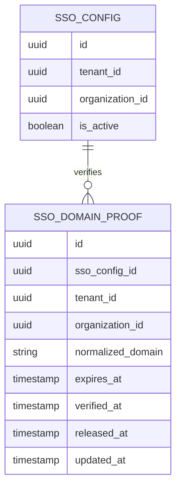

# Verify enterprise SSO email domains

Supersedes: .ai/specs/enterprise/implemented/SPEC-ENT-002-2026-02-19-sso-directory-sync.md — sections: domain ownership in API Surface, Key Behaviors, Frontend, and Risk Assessment

Supersedes: .ai/specs/enterprise/implemented/SPEC-ENT-004-2026-02-19-sso-directory-sync.md — sections: domain ownership in API Surface, Key Behaviors, Frontend, and Risk Assessment

Extends: .ai/specs/enterprise/2026-11-15-sso-authority-ceiling.md

Status: Proposed for acceptance

Refs [#10684](https://github.com/open-mercato/open-mercato/issues/10684)

## TLDR

An organization administrator proves control of an email domain with a DNS TXT record before the domain can route users to the organization's identity provider. Staff can select SSO when a verified provider is available. Password sign-in retains its current behavior. Operators verify existing configurations and test independent recovery before the first discovery cutover.

## Resolved assumptions (autonomous defaults)

| Decision | Proposed default | Acceptance |
| --- | --- | --- |
| Existing active domains and recovery | Ship additive proof management before changing discovery. Gate the first discovery and initiation cutover on verified domains, tested independent recovery and a documented legacy-client migration decision. Historical domains start unverified. | Human maintainer acceptance is required for the proposed compatibility exception and release scope. |
| Anonymous sign-in | Offer verified SSO as a separate action. Keep local controls available and preserve current password authentication. A tenant selection narrows candidates. It does not establish account membership or authorization. | Proposed for review. This avoids requiring an anonymous account-existence signal. |
| Outstanding claims | Pending challenges have no exclusivity. The first currently valid proof wins the verified claim. Handle disputes through an audited platform-operator process with fresh proof, rather than an organization-level override. | Proposed for review. A change in ownership requires a separately authorized, audited action. |

## Overview and scope

The feature covers Enterprise SSO configuration, domain ownership and staff sign-in discovery. The existing Domains tab remains the place to add and remove domains. An SSO configuration still belongs to one organization and still uses its established SSO administration permissions and activation checks. Customer portal domain management, SCIM provisioning, IdP setup, and SSO identity linking keep their existing contracts.

## Problem Statement

The current Domains tab records an allowed domain after normalization and availability checks. Activation tests the OIDC configuration. Discovery uses the configured domain, but the domain record carries no proof that the configuration's organization controls it. An administrator also cannot tell whether an existing domain is ready for the ownership enforcement rollout. The settings and sign-in experience need the same definition of a verified, routable domain.

## Prior spec drift

The original SSO specifications record DNS verification as future work and describe discovery and the Domains tab around an allowed-domain list. The current `SsoConfig.allowedDomains` field, `SsoConfigService` and `HrdService` implement that list without a verification state. The authority-ceiling specification remains applicable. This proposal adds ownership as an independent requirement alongside the current permission checks.

## Proposed Solution

- Add a per-configuration domain proof record. Existing configured domains start in `unverified`. New claims can generate an expiring TXT challenge.
- Verify on administrator request through the SSO service, using a configured resolver. A successful match establishes ownership for that exact normalized domain in the current deployment.
- Route discovery and initiation through a shared eligibility check that requires active configuration and verified ownership. Use an explicit SSO action separate from password submission.
- Surface ownership status and recovery on the existing Domains tab. Keep the configuration active when a new domain is pending. Continue to offer existing verified domains.

GitHub's organization verification demonstrates a practical DNS publication and retry flow. Keycloak's identity-first organization flow demonstrates domain-to-provider matching within an organization context. This design uses both patterns with an ownership check between matching and redirecting. [GitHub domain verification](https://docs.github.com/en/organizations/managing-organization-settings/verifying-or-approving-a-domain-for-your-organization) · [Keycloak organization identity providers](https://www.keycloak.org/docs/latest/server_admin/index.html)

## Delta

| Change | Requirement |
| --- | --- |
| ADDED | When an authorized administrator adds or revisits a configured domain, they can create a TXT challenge and view its DNS name, value and status. |
| ADDED | When the current challenge is present, unexpired and uncontested, verification records the claim atomically. When DNS is unavailable or the record is absent, the claim remains pending and retry stays available. |
| MODIFIED | When a configuration is activated under enforcement, it needs a working provider and at least one eligible domain. Adding a pending domain to an already active configuration does not interrupt existing verified domains. |
| MODIFIED | When anonymous discovery finds one eligible provider within the selected scope, it offers a separate SSO action. Missing, revoked, ambiguous or out-of-scope matches yield the same generic discovery outcome. |
| MODIFIED | When a discovery result changes before the user starts or completes login, the server rechecks eligibility and sends the user back to the ordinary sign-in entry point on failure. |
| ADDED | When a verified claim needs to be released during a dispute, an authorized platform operator follows an audited support procedure. An organization administrator can remove claims for their own configuration through the established Domains flow. |

## Architecture

1. The existing SSO administration routes establish staff scope. The service rechecks configuration authority against the selected tenant and organization and fails closed when required scope is missing. Scope is resolved through the existing runtime helpers.
2. A challenge is bound to deployment, configuration, tenant, organization, domain and current version. The configured DNS resolver queries a fixed TXT name derived from the normalized exact domain. Use a bounded deadline and result size. Permit one in-flight check per claim and use tenant and actor limits for mutations. Exact record matching must handle split TXT strings. Resolver errors never establish ownership. Keep the DNS await outside the commit transaction. Recheck challenge identity and scope within the commit transaction.
3. Enforce one verified, unreleased claim per normalized domain per deployment, regardless of duplicate pending entries. At cutover, replace the active `allowedDomains` exclusivity checks in `SsoConfigService.addDomain` and `activate` with verified ownership. Keep normalization and per-configuration duplicate validation. An active configuration can add a candidate that another configuration already lists. Activation requires at least one verified claim owned by the configuration, and pending overlaps do not affect activation. Deactivation stops routing and retains unreleased verified ownership. Reactivation reuses a retained claim after the normal provider and eligibility checks. Domain removal, configuration deletion and authorized revocation release ownership. A released domain requires fresh proof to route again. Keep these changes consistent across configuration update, domain removal, verification, revocation and retry. Reuse the existing serialized domain mutation pattern and use a database constraint as the final cross-process authority.
4. Anonymous home realm discovery narrows to the tenant selected for the current login when one is supplied. Resolve that selector through the existing login scope rules and reject conflict with any server-established context. The selector is not proof of identity. A shared login with no tenant scope may offer a provider only for an unambiguous verified claim. Neither path discloses user membership or ownership of another tenant's pending claim.
5. Initiation accepts a short-lived opaque or signed value bound to the eligible configuration, exact domain and resolved tenant context. It validates that binding and rechecks current eligibility before creating the existing OIDC state. Callback rechecks the same bound scope before applying existing account and identity checks. Expiry, changed tenant selection, revocation or stale browser responses cannot cause a redirect based on an old candidate.
6. Separate local and SSO actions on the login page. Reuse the existing login injection spot and avoid repurposing the password handler. If additive extension metadata is required to support the separate action, retain current consumers' behavior and document the optional field.

## Data Model

`SsoConfig` remains the configuration owner. Add a same-module domain-proof entity with a UUID ID, non-null configuration, tenant and organization IDs, normalized exact domain, challenge digest, expiry, verification and release timestamps, and `updatedAt`. If the UI needs to redisplay a public challenge value, persist it through the project encryption helpers or use deterministic reissue from a dedicated key. Keep raw challenges out of logging and general response objects. Use configuration-plus-domain uniqueness for the proof record and a partial constraint over unrevoked verified domains for exclusive routing.

## API Contracts

| Surface | Proposed contract |
| --- | --- |
| Configuration detail | Keep `allowedDomains` and add optional per-domain proof metadata. Return version and display state to the existing authenticated consumers. |
| Domain add/remove | Keep route paths and methods. Adding a domain creates an unverified candidate. Removing it releases ownership and invalidates pending proof atomically. Existing known domain strings keep their meaning as requested domains. |
| Challenge and verify | Add identifier-scoped mutations under the existing Domains route family. Reuse the existing SSO feature guard and configuration authority checks. Return current proof state and version. Use optimistic locking on operator edits and present a reload/retry message when the row changed. |
| Activation | Keep the endpoint. Return a localized, structured denial when no domain is eligible under enforcement. A working discovery document alone is insufficient. |
| `POST /api/sso/hrd` | Keep method and response shape for existing callers. Parse the optional tenant selector. Add the optional initiation value when there is an eligible match. All unavailable cases use `hasSso: false`. |
| `GET /api/sso/initiate` and callback | Keep paths and normal success redirects. Enforce eligibility and binding for new requests. Migrate configuration-ID-only callers to verified discovery and bound initiation. Disable configuration-ID-only initiation at cutover subject to the approved compatibility decision described below. |
| Claim release | Use an audited support procedure gated by the platform's authoritative super-admin check with a fresh ownership review. Treat the exact operator interface as part of the rollout decision. Preserve existing SCIM token and identity contracts. |

## UI/UX

Reuse SSO configuration's FormHeader and General, Domains, Roles, SCIM and Activity tabs. The Domains screen shows the status of each configured domain and provides challenge, verification and removal actions. The proof panel displays its record fields and expiry. A missing record or temporary failure leaves the administrator on that panel with a clear retry action. A verified row shows when proof was established. An active configuration with other pending domains keeps its currently eligible domains.

The sign-in page uses two distinct actions. Email edits and tenant changes clear a stale SSO result. Password, recovery and remember-me retain their current behavior. `POST /api/auth/login` continues to apply its existing credential and account checks. The stored `ssoRequired` setting does not enforce SSO-only access in that handler. Any deployment-specific restriction continues to apply at its existing enforcement point. Built-in SSO-only password enforcement is outside this proposal. Present generic unavailability to anonymous users. If a tenant relies on SSO and needs administrative help, direct the user to that tenant's support or documented operator recovery path without revealing an account lookup result.

### User stories and acceptance

| ID | Actor and goal | Acceptance |
| --- | --- | --- |
| SSO-D1 | An organization administrator wants to add a domain and get its proof instructions. | Empty state explains the first step. Invalid and duplicate entries keep focus and show actionable errors. A valid entry shows `Verification pending` and the DNS details. Choosing away and back preserves the pending state. |
| SSO-D2 | An organization administrator wants to complete verification after DNS publication. | Checking shows a pending status while the request runs. A missing record remains pending with Retry. Successful verification updates the row and enables activation when other prerequisites pass. A stale edit reloads the current state and offers retry. |
| SSO-D3 | An administrator needs to verify an existing active configuration before enforcement. | The Domains tab distinguishes proof status from configuration activation. The administrator can recover using the approved rollout path. Removing a verified domain is confirmed and immediately removes it from routing. |
| SSO-D3a | An operator needs to prepare existing active configurations that have no domains or use a tenant-directed entry point. | A domainless active configuration remains visible in settings with actionable readiness status and has no anonymous discovery result. A tenant-directed entry point may start SSO only for a currently eligible verified configuration within its resolved scope. Confirm a supported recovery route before enforcing the changed initiation contract for installations with no verified domain. |
| SSO-D4 | A staff user wants to choose the correct sign-in method. | Verified provider discovery offers an explicit SSO action with keyboard access. Pending, scope-mismatched or ambiguous results leave ordinary sign-in available to eligible users. Changing the identifier cannot leave an old provider action active. |
| SSO-D4a | A staff user submits a password directly. | For otherwise equivalent accounts, a valid password has the same result with `ssoRequired` enabled or disabled. Invalid credentials keep the existing failure behavior. Exercise `POST /api/auth/login` directly, including when verified discovery yields no provider. |
| SSO-D5 | A platform operator needs to recover a disputed domain. | The operator validates current ownership and records who released the earlier claim and why. The legitimate administrator completes the ordinary fresh verification flow after release. A scoped administrator cannot release another configuration's claim. |

The [acceptance prototype](../assets/sso-verified-email-domains/prototype/README.md) covers SSO-D1 and SSO-D2 in the organization settings. It includes an activation prerequisite, propagation delay and recovery. The public login and operator workflows are described for implementation and acceptance testing.

## Edge Cases & Failure Scenarios

- A domain has multiple TXT records, split TXT strings, a timeout, an expired challenge or an answer for a different claim. It remains pending and can be retried or reissued as appropriate.
- Two administrators verify the same domain concurrently. Exactly one durable verified claim can win. The other administrator sees a generic conflict without any organization identifiers.
- A DNS result lands after the challenge was rotated, revoked or deleted. Reject it during the versioned commit. A removed domain immediately loses eligibility, even if DNS still serves the old record.
- The selected login context changes between discovery and initiation. Clear the browser's earlier option and deny stale server handoffs. Maintain a generic recoverable sign-in failure.
- An existing installation uses SSO exclusively and has no reachable local operator. Treat that as a release-readiness blocker and require a verified domain and supported recovery route before exposure to enforcement.
- Ownership changes after proof. A platform operator can suspend the old claim and require a fresh TXT proof before reassignment. Periodic re-verification is deferred until its availability implications are reviewed.

## Migration & Backward Compatibility

Add proof records alongside the existing domain data. Preserve public paths, existing fields, feature IDs and widget spot IDs. Do not auto-verify historical domains. Provide a cutover checklist with an inventory of active configurations, a pre-upgrade verification window, a tested operator recovery path, and a readiness check per affected installation. Preparation adds proof management without changing existing discovery or initiation. Before enabling the first discovery cutover, the installation operator records at least one verified domain for each active configuration that must keep routing and demonstrates that an authorized operator can reach SSO settings and restore routing without the affected IdP or discovery path. Use an existing authorized local operator account where supported. Where local access is restricted, the installation owner must identify and exercise a supported independent recovery procedure. The release owner reviews the inventory, named recovery owner, exercise result and legacy-client migration for each rollout target. Missing evidence blocks cutover for that target. Once hardened routing is enabled, rollback uses the tested recovery path and retains verified routing. Enforcement requires verified ownership on every discovered and tenant-directed initiation. Existing active rows without a domain are visible as blocked for routing and need configuration or recovery. Do not fall back from a refused tenant-directed entry to global discovery. Local sign-in continues to apply the existing password authentication checks. Verification failures remain actionable in settings.

The proposed compatibility decision is to retire configuration-ID-only initiation and omit unverified domains from discovery at the same gated cutover. A legacy bridge accepting the configuration ID alone cannot validate the domain or tenant binding. The implementation PR must justify this treatment under the Emergency Security Exception, obtain named human maintainer sign-off, add the dated compatibility entry and publish client and operator upgrade instructions before cutover. If that approval is withheld, cutover stays blocked pending a compatible design that enforces the same ownership and scope checks. Release owners confirm equivalent behavior and compatibility separately for the v0.9 and v0.10 backport lines before scheduling rollout.

## Risks & Impact Review

| Risk | Impact | Mitigation and remaining risk |
| --- | --- | --- |
| Legacy SSO-only access loss | High | Verify configurations and supported recovery before enforcement. Release owner must approve cutover and contact path. |
| Scope ambiguity or forged discovery context | High | Resolve tenant selection using the existing login scope rules, bind the handoff, and recheck on initiation and callback. |
| Misissued or reused proof | High | Bind the current version to exact claim scope, require unexpired proof and commit uniqueness transactionally. |
| Resolver failure | Medium | Bound checks and permit retry. Previously verified domains are not invalidated by a transient verification lookup. |
| DNS changes | Medium | Provide audited release and proof renewal. Periodic checking remains an explicit future decision. |
| New authentication behavior affects downstream login extensions | Medium | Use additive metadata and existing paths, and ship migration examples and focused contract tests. |

## Phasing

1. Preparation, authority-scoped verification and recovery readiness.
2. Enforced discovery, initiation and cutover.
3. Acceptance and backport readiness.

## Implementation Plan

### Phase 1 — Prepare existing and new claims

1.1 Characterize current configuration details and domain mutations through the existing API integration suites, including enterprise scope checks and existing clients without proof fields.

1.2 Add the scoped proof record, database constraint and resolver abstraction. Cover exact normalized matching, stale proof rejection, duplicate verification, limits, concurrency, and soft-delete cleanup with synthetic records.

1.3 Add challenge and verification routes and the Domains acceptance flow. Use authorized API fixtures and cover validation, error recovery, first successful verification, release and revocation. Review the prototype before writing production UI.

1.4 Publish the rollout checklist and run the independent recovery exercise before approving the first discovery cutover. Record the installation operator, release owner, evidence and legacy-client migration decision for each target.

### Phase 2 — Enforce and migrate

2.1 Characterize existing anonymous HRD, IdP initiation and callback behavior, including stale responses and the explicit tenant login flow.

2.2 Add verified eligibility and bound initiation, retain independent password submission, and add integration coverage for scoped discovery, unverified denial, eligible redirects, stale handoffs, and callback binding. Use a local fake identity provider and disposable fixtures.

2.3 Replace configured-domain exclusivity at cutover in both add and activation paths. Through the active configuration API, show two configurations requesting proof for the same candidate while continuing to route on their own verified domains. Verify one wins and the other receives a generic conflict. Cover deactivation retaining ownership, reactivation reusing the retained claim, and release allowing a new claimant to verify.

2.4 Apply the Phase 1 readiness gate before the first discovery or initiation behavior change. Obtain the compatibility decision and publish upgrade and backport notes. Test both a ready installation and an installation blocked by missing verification or independent recovery.

### Phase 3 — Acceptance

3.1 Run the enterprise SSO API suite and browser-check the admin verification flow, activation errors, and local and SSO sign-in choices. Record evidence at the tested revision.

3.2 Record shipped version and verified release coverage in the issue and release records. Archive the spec only after the implementation is deployed and evidence is present.

## Final Compliance Report

Design review covers scoped reads and writes, repository compatibility, additive database and API surfaces, guard reuse, localization, accessible keyboard operation, migration and integration coverage. The cutover and legacy initiation decision still requires human acceptance. No production migrations or authentication changes are included in this PR.

## Changelog

- 2026-11-26 — Proposed DNS proof and safe login routing for Enterprise SSO email domains.

- 2026-11-26 — Defined pre-cutover recovery and compatibility gates, verified ownership across activation and deactivation, and password-login acceptance.
