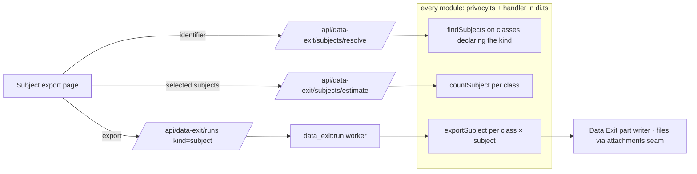
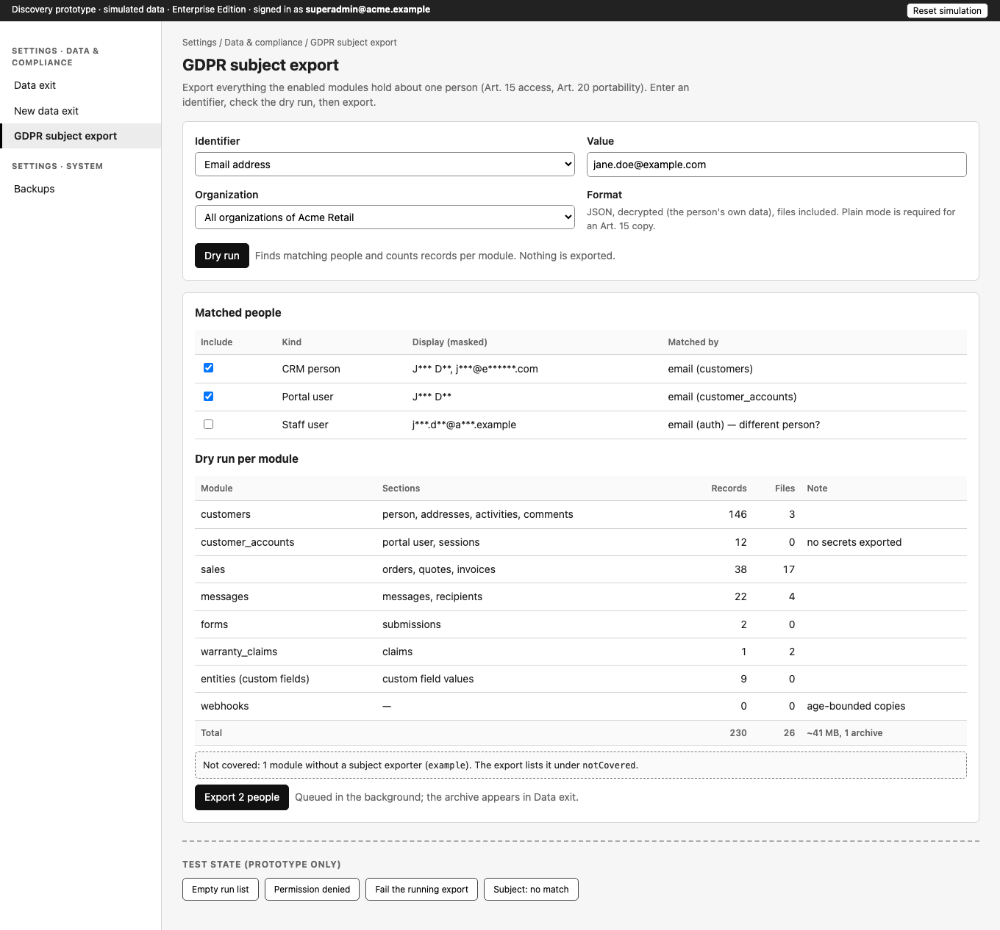

# GDPR subject export via Data Exit Kit (Enterprise)

> **Tracker:** open-mercato/open-mercato#8593 (GDPR umbrella) · implementation issue linked from the spec PR
> **Program:** [GDPR-ready deployments](../../GDPR/2026-11-15-gdpr-ready-deployments-program.md)
> **Edition:** Enterprise runner (`data_exit`); OSS modules ship only the declarative per-module exporters defined by the [privacy data-class contract](../../GDPR/2026-11-16-privacy-data-class-contract.md)
> **Depends on:** [Data Exit Kit](../2026-11-25-data-exit-kit.md) (runner, archive format, progress, ACL)
> **GDPR basis:** Art. 12(3), 15, 20

Extends: .ai/specs/GDPR/2026-11-16-privacy-data-class-contract.md
Extends: .ai/specs/GDPR/2026-11-16-privacy-coverage.md
Extends: .ai/specs/enterprise/GDPR/2026-11-16-privacy-coverage-enterprise.md
Supersedes: .ai/specs/enterprise/GDPR/2026-11-16-privacy-dsr-engine.md — sections: Export run, Export destinations (subject export only)

## 📝 TLDR

**Proposal, not implementation.** A controller answering an access or portability request must today find a person across ~50 modules by hand; only `forms` has a subject export (`forms/services/export-service.ts:148`). **Proposed (future):** with the Enterprise `data_exit` module enabled, a permitted user (superadmin by default, `data_exit.subject_export`) enters **an identifier — email, phone, national ID number, user/person/portal-user id or any module-declared kind** — runs a **dry run** that shows the matched people and **how many records and files each module will export**, then queues the export. Every module that holds personal data contributes its own **subject exporter** (the privacy contract's `exportSubject`, extended with identifier kinds and a cheap `countSubject` for dry runs); the result is a Data Exit archive (`subject.json` + per-module JSON + files). Without `data_exit` (or the privacy runner) enabled, the declarations are inert and modules work exactly as today.

## 📝 Problem Statement

- Art. 15/20 need a complete, machine-readable copy within one month (Art. 12(3)); the platform cannot produce it ([program](../../GDPR/2026-11-15-gdpr-ready-deployments-program.md#problem-statement)).
- The privacy contract already defines per-module `exportSubject` handlers and an email/phone `lookup`, but (a) has **no UI-oriented dry run for exports** (only `eraseSubject({ dryRun })`), (b) only knows **emails and phones** — not national ID numbers, tax ids, customer numbers or ids typed by a support agent, and (c) its planned export runner writes a single `subject.json` with no queue, progress, archive size limits or files packaging.
- The brief requires **every module** to register its exporter, conditional on the enterprise module being enabled.

## 📝 Proposed Solution

One per-module exporter, two callers. This spec does **not** add a second registry next to `privacy.ts`: a module's subject exporter **is** its `PrivacyHandler.exportSubject`. `data_exit` becomes the subject-export runner (UI, queue, dry run, archive); the `privacy` module keeps erasure, batch erasure, retention and purge and links its "Export" action to `data_exit` when both are enabled.

1. **Identifiers (contract, additive).** `PrivacyLookup` gains `identifiers?: Array<{ kind: string; value: string }>`. Kinds are declared: platform kinds `email`, `phone`, `national_id`, `tax_id`, `user_id` (`auth:user`), `person_id` (`customers:person`), `portal_user_id` (`customer_accounts:user`), `team_member_id` (`staff:team_member`); modules may declare more (`<moduleId>.<name>`, e.g. `sales.customer_number`). Each `PrivacyDataClass` gains `identifierKinds?: string[]` — the kinds its `findSubjects` / `exportSubject` can match.
2. **Custom-field identifiers.** A custom field definition may carry `privacyIdentifierKind` (e.g. `national_id`) — additive option in the `entities` module (`cf.*` DSL + definition JSON). The `entities` privacy handler resolves such identifiers by a decrypting scan of the tenant's values for those fields only and returns the owning records' subjects (e.g. a CRM person whose custom field "PESEL" equals the value).
3. **Dry-run counts.** `PrivacyHandler` gains optional `countSubject(request): Promise<{ sections: Array<{ key: string; records: number }>; files: number; bytes?: number }>`. Without it, the runner calls `exportSubject` with a 10 000-record guard and counts (exact but slower); the UI labels such modules "counted by full read".
4. **Run.** Resolve (identifiers → `findSubjects` on every class declaring the kind) → user confirms the matched people (masked labels, avoids exporting the wrong person) → dry run (`countSubject` per class) → queue a `data_exit_runs` row with `kind = 'subject'` → the worker calls `exportSubject` per class and subject in class-id order and streams sections and files into the Data Exit part writer (always `plain` mode — an Art. 15 copy must be intelligible; secrets never exported per contract).
5. **Every module registers.** Each module listed in [Module coverage](#module-coverage) ships its `privacy.ts` class(es) with `identifierKinds` and a handler (most handlers are already specified in the coverage specs; this spec adds identifier kinds and `countSubject`). Modules with no personal data declare `exemptTables` with a reason. The existing coverage test fails on an undeclared table.

### Gating: "only when `data_exit` is registered and turned on"

- `privacy.ts` / handler code lives in each module and is registered in its own `di.ts` as a plain DI value — cheap, no side effects, no enterprise import (OSS cannot import `@open-mercato/enterprise`).
- Nothing in OSS calls a handler. UI (menu, page, buttons), routes, workers and CLI are contributed **only** by `data_exit` (and `privacy`) and therefore disappear when the module is not in `modules.ts` or `OM_ENABLE_ENTERPRISE_MODULES_DATA_EXIT` is off.
- The `entities` custom-field option `privacyIdentifierKind` is stored but has no effect without a runner; the field editor shows it only when `data_exit` or `privacy` contributes the injection widget `crud-form:entities:custom_field_definition:fields` (widget injection, so OSS has no reference to the enterprise module).
- Test: `module-decoupling.test.ts` boots all OSS modules without enterprise modules; a unit test asserts no OSS module resolves `data_exit*` DI keys.

## 📝 Architecture



Takeaway: modules own reading and shaping their data; `data_exit` only resolves, counts, sequences and packages.

### Contract additions — `@open-mercato/shared/modules/privacy` (additive)

```ts
export type PrivacyIdentifier = { kind: string; value: string }
export type PrivacyLookup = { emails?: string[]; phones?: string[]; identifiers?: PrivacyIdentifier[] }
export type PrivacyCountResult = { sections: Array<{ key: string; records: number }>; files: number; bytes?: number }
export type PrivacyHandler = {
  /* existing: findSubjects?, exportSubject, eraseSubject, pruneExpired? */
  countSubject?(request: PrivacyRequest): Promise<PrivacyCountResult>
}
export type PrivacyDataClass = { /* existing fields */ identifierKinds?: string[] }
export type PrivacyIdentifierKindDeclaration = { kind: string; labelKey: string; normalize?: 'email' | 'phone_e164' | 'trim' | 'upper_alnum'; subjectKind?: string }
export type PrivacyModuleDeclaration = { /* existing */ identifierKinds?: PrivacyIdentifierKindDeclaration[] }
```

`emails`/`phones` stay valid and are treated as `identifiers` of kind `email`/`phone` (normalized). Identifier values are never logged, never put in events, and stored on the run only encrypted (`data_exit/encryption.ts`, field `subject_request`).

### Archive layout (subject run)

Same ZIP parts as Data Exit; content:

```
subject.json                  request (identifier kinds only, values masked), scope, generatedAt, subjects (kind, id, masked label), per class { classId, status, sections: [{ key, file, records }] }, files, related, notCovered, coverLetter (as defined by the DSR engine)
modules/<moduleId>/<section>.json   records of that section (JSON array; subject exports are small — the 10 000-record guard per class bounds them, larger sections switch to .jsonl)
files/<attachmentId>          attachment bytes via `attachmentService.readByIds(scope, ids)` (seam from the coverage spec) streamed
```

## 📝 Module coverage

Every module either registers a subject exporter (class + handler) or is exempt. "Handler spec" names where the export/erase behavior is already specified; this spec adds the **Identifier kinds** column and requires `countSubject` for modules marked ●. Subjects: S staff user, P CRM person, PU portal user, TM team member, R form respondent, X known only by an identifier.

| Module | Subjects | Identifier kinds matched | `countSubject` | Handler spec |
|---|---|---|---|---|
| auth | S | `email`, `user_id` | ● | contract (root) |
| customers | P, X | `email`, `phone`, `person_id`, `tax_id` (company/person tax fields) | ● | contract (root) |
| customer_accounts | PU | `email`, `portal_user_id` | ● | contract (root) |
| staff | TM | `email`, `phone`, `team_member_id`, `user_id` | ● | coverage |
| sales | P, PU, X | `person_id`, `portal_user_id`, `email`, `sales.customer_number` | ● | coverage (commercial-record rules) |
| checkout (`packages/checkout`) | P, X | `email`, `person_id` | ● | coverage |
| cart, ecommerce | PU, X | `portal_user_id`, `email` | ● | coverage |
| payment_gateways (+ gateway-* packages) | X | `email` (payer), `person_id` via sales link | ● | coverage |
| shipping_carriers (+ carrier-inpost) | X | `email`, `phone` (recipient) | ● | coverage |
| warranty_claims | P, PU | `person_id`, `portal_user_id`, `email` | ● | coverage |
| messages | S, P, X | `user_id`, `email` | ● | coverage |
| communication_channels (+ channel-* packages) | S, X | `user_id`, `email`, `phone` | ● | coverage |
| phone_calls | P, X | `phone`, `person_id` | ● | coverage |
| inbox_ops | X | `email` | ● | coverage |
| forms | R, X | `email`, `forms.respondent_id` | ● | coverage (reuses `ExportService`) |
| notifications, push_notifications, devices | S | `user_id` | ● | coverage |
| attachments | all (files of exported records) | via owning records | ● (files, bytes) | coverage + seam |
| entities (custom fields / custom entities) | any record subject | **`national_id` and any `privacyIdentifierKind`** custom field; values of exported records | ● | coverage + this spec |
| audit_logs | S (actor), P (resource) | `user_id`, `person_id` | ● | coverage (redacted snapshots) |
| api_keys | S | `user_id` (metadata only, never secrets) | ● | coverage |
| perspectives, dashboards, widgets | S | `user_id` | ● | coverage |
| planner, availability, resources | S, TM | `user_id`, `team_member_id` | ● | coverage |
| workflows, business_rules | S, P | `user_id`, `person_id` (instance context) | ● | coverage |
| integrations, data_sync, sync_excel | S | `user_id` (per-user credentials metadata, never secrets) | ● | coverage |
| directory | S | `user_id` (org membership) | ● | coverage |
| customer_groups, promotions | P, PU | `person_id`, `portal_user_id` | ● | coverage |
| ai-assistant (`packages/ai-assistant`) | S | `user_id` (chat transcripts) | ● | coverage |
| webhooks (`packages/webhooks`) | X | — (age-bounded delivery copies; reported under `notCovered` with retention window) | — | retention pruners |
| onboarding (`packages/onboarding`) | S, X | `email` | ● | coverage |
| search, query_index | derived | — exempt: derived indexes rebuilt from owners | — | contract |
| eudr, wms, catalog, currencies, dictionaries, translations, configs, feature_toggles, api_docs, design_system, seeds, progress, portal, core, content, documents, scheduler, cache/queue/events | none or staff ids only | — exempt with reason (configuration, reference data, or staff ids as references) | — | coverage exemptions |
| **Enterprise:** sso, security, record_locks, agent_orchestrator | S, P | `user_id`, `email` (sso identity), `person_id` (agent processes) | ● | enterprise coverage |
| **Enterprise:** system_status_overlays, backups | none | exempt | — | — |
| **Enterprise:** data_exit | S, P (requests about them) | `user_id` | ● | this spec |
| App / official modules | any | must declare `privacy.ts` or exempt; coverage test enforces in standalone apps | ● | contract |

Free-text mentions (a name inside someone else's note) remain a stated limit, as in the coverage spec.

## 📝 Data Model

No new table: a subject export is a `data_exit_runs` row with `kind = 'subject'`, `mode = 'plain'`, `subject_request` (encrypted jsonb: identifier kinds + values, selected subjects), and items per class (`strategy_id = privacy:<classId>`). Dry-run results are returned, not stored (only totals in `estimate`). DSR log: one action-log entry per resolve/estimate/export (`data_exit.subject.resolve|estimate|export`) with kinds and counts, never values — consistent with the DSR engine's request log.

`entities`: `CustomFieldDefinition` config gains optional `privacyIdentifierKind: string` (JSON config, no column) — additive.

## 📝 API Contracts

Under `/api/data-exit/subjects`, `requireFeatures: ['data_exit.subject_export']`, zod, `openApi`, `runMutationGuards` on writes. `organizationId` must be within the caller's organization access; tenant-wide only with access to all organizations.

| Method & path | Request → Response |
|---|---|
| `GET /api/data-exit/subjects/identifier-kinds` | → `[{ kind, label, subjectKind?, modules: string[] }]` (only kinds some enabled class declares) |
| `POST /api/data-exit/subjects/resolve` | `{ organizationId?, identifiers: [{ kind, value }] (1–10) }` → `{ subjects: [{ kind, id, maskedLabel, matchedBy: [{ kind, moduleId }] }], unmatchedKinds: string[] }` |
| `POST /api/data-exit/subjects/estimate` | `{ organizationId?, subjects: [{kind,id}] (1–20), identifiers? }` → `{ classes: [{ classId, moduleId, sections: [{key, records}], files, bytes?, method: 'count' \| 'full_read', status }], totals, notCovered }` |
| `POST /api/data-exit/runs` (`kind: 'subject'`) | `{ organizationId?, subjects, identifiers?, partSizeBytes? }` → `202 { runId }` |

Download, progress, cancel, expiry: as in [Data Exit Kit](../2026-11-25-data-exit-kit.md#api-contracts).

## 📝 UI/UX

Page **Settings → Data & compliance → GDPR subject export** (`/backend/config/data-exit/subject`, feature `data_exit.subject_export`):

1. Identifier kind select (from `identifier-kinds`), value input (validated per kind; email format, E.164 phone), organization select.
2. **Dry run** → matched-people table with checkboxes (masked labels, "matched by" per module; an unexpected match such as a staff user with the same email is unchecked by default) and per-module table (sections, records, files, method), totals and `notCovered` modules.
3. **Export N people** → queued run; progress and download on the Data exit list/detail.
4. Empty state "No enabled module holds data for this identifier" (the request is still logged so the controller can answer).

| Screen | Image |
|---|---|
| Subject export: identifier, matched people, per-module dry run |  |

Prototype: [`.ai/prototypes/discovery/data-exit-kit/revision-001/index.html#subject`](../../../prototypes/discovery/data-exit-kit/revision-001/index.html) (proposal).

## 📝 Edge Cases & Failure Scenarios

| Scenario | Behavior |
|---|---|
| Identifier matches several people | All listed, admin selects; nothing exported implicitly (`related` subjects stay separate requests). |
| Identifier kind declared by no enabled module | Kind not offered; API 422 `unknown_identifier_kind`. |
| A class's `exportSubject` throws | Class `failed`, run `incomplete`; `subject.json` names it; others continue. |
| `countSubject` missing and class exceeds 10 000 records | Estimate shows "≥ 10 000"; export streams `.jsonl` for that section. |
| Decrypting scan for `national_id` on a large tenant | Bounded to fields flagged `privacyIdentifierKind`, keyset batches, 30 s budget in resolve; beyond budget returns partial with `scanIncomplete: true` and suggests the CLI. |
| Open case (pending payment) | Export is read-only; open cases are exported normally. |
| `data_exit` disabled after declarations shipped | No effect on modules; handlers idle. |

## 📝 Risks & Impact Review

- **Wrong-person export (High):** mitigated by explicit subject confirmation with masked labels and per-module "matched by"; identity verification of the requester remains the controller's procedure ([deployment docs](../../GDPR/2026-11-16-gdpr-deployment-docs.md)).
- **Identifier values as new PII at rest (Medium):** encrypted on the run row, never logged/evented, run rows age out with archives.
- **Coverage drift (Medium):** the existing coverage test and baseline from the contract spec gate new tables; this spec adds a test that every enabled class with `subjectKinds` declares at least one `identifierKinds` entry.
- **Program split change (Direction):** moving subject export from `privacy` to `data_exit` changes the DSR engine's plan — ⚠ confirmation needed.
- Contracts: additive optional fields on unshipped types; new routes and features — additive.

## Resolved assumptions (autonomous defaults)

| # | Question | Applied default | Why | Confirm? |
|---|---|---|---|---|
| Q1 | New per-module "data exit tools for identity" registry, or reuse the privacy contract handlers? | Reuse `privacy.ts` + `PrivacyHandler.exportSubject`, extended additively (`identifierKinds`, `countSubject`, `identifiers`). | One exporter per module; the contract is already specified for every module. | ⚠ NEEDS HUMAN CONFIRMATION |
| Q2 | Which module runs subject exports — `privacy` (per DSR engine) or `data_exit`? | `data_exit` runs exports; `privacy` keeps erasure/retention/purge and links to it. | User asked for the panel in Data Exit; avoids two export runners. | ⚠ NEEDS HUMAN CONFIRMATION |
| Q3 | How are national ID and other non-email identifiers found? | Custom-field flag `privacyIdentifierKind` + module-declared kinds; decrypting scan limited to flagged fields. | No core column stores national IDs today; custom fields are where tenants keep them. | reversible |
| Q4 | Subject export mode? | Always plain (decrypted), secrets never exported. | Art. 15 copy must be intelligible. | reversible |
| Q5 | Max subjects per run? | 20 via UI; batch lists via CLI later. | Bounded dry-run cost. | reversible |

## 📋 Phasing

1. **Contract additions (OSS):** identifier types, `countSubject`, `identifierKinds`, normalization, zod; coverage-test rule for identifier kinds.
2. **Roots + entities (OSS):** `auth`, `customers`, `customer_accounts` identifier kinds and `countSubject`; `entities` custom-field `privacyIdentifierKind` + resolver.
3. **Runner (Enterprise):** resolve/estimate/run routes, subject run in the `data_exit` worker, `subject.json`, DSR log entries.
4. **UI:** subject export page, injection widget for the custom-field option.
5. **Module rollout:** remaining modules in the coverage table, grouped by package (sales/checkout/payments; communication; staff/planner; enterprise modules); each PR ships handler tests.

## 📋 Implementation Plan

### Phase 1 — Contract
1. Extend `packages/shared/src/modules/privacy.ts` types/zod; unit tests for normalization (`email` lowercase, `phone_e164`, `upper_alnum`).
2. Coverage test: class with `subjectKinds` must declare `identifierKinds`.

### Phase 2 — Roots and entities
1. Root handlers: `findSubjects` by kinds, `countSubject` (SQL counts scoped by tenant/org); unit + integration tests.
2. `entities`: `privacyIdentifierKind` in custom-field config schema; resolver with keyset decrypting scan; tests incl. encrypted values.

### Phase 3 — Runner
1. `POST /subjects/resolve|estimate`, `GET identifier-kinds`; masked labels helper; audit entries.
2. Worker branch `kind = 'subject'`: per class × subject `exportSubject`, sections into part writer, files via `attachmentService.readByIds`.
3. Integration tests: TC-DXGDPR-001 email resolves a CRM person and portal user, dry run per module equals exported counts; TC-DXGDPR-002 national_id custom field resolves a person; TC-DXGDPR-003 user without `data_exit.subject_export` gets 403; TC-DXGDPR-004 no-match path logs the request. Self-contained fixtures.

### Phase 4 — UI
1. Subject export page with dry run; injection widget for the custom-field editor; i18n.

### Phase 5 — Module rollout
1. One PR per module group adding `identifierKinds` + `countSubject` (and handlers where coverage specs have not landed), each with tests; close when the coverage table has no empty row.

## Final Compliance Report — 2026-11-25

- Reuses canonical primitives (privacy contract, DI handlers, `findWithDecryption`, widget injection); no OSS → enterprise import. ✅
- Tenant/org scoping on every handler per contract rules. ✅
- Identifier values encrypted at rest, never logged. ✅
- Open: Q1, Q2 need maintainer confirmation (#8593 program split).

## Changelog

### 2026-11-25
- Initial spec (autonomous, `om-auto-write-spec`).
