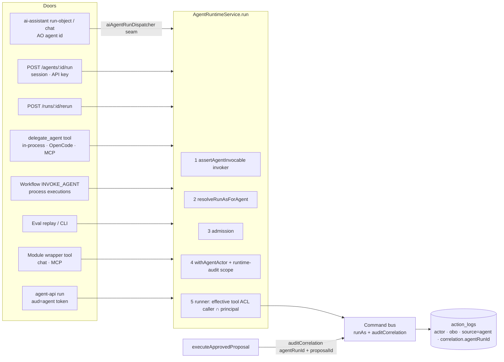

# Agent Invocation Access & Identity Binding

> **Status:** Draft · **Owner:** Patryk Lewczuk · **Created:** 2026-10-21
> **Module:** `agent_orchestrator` (`packages/enterprise/src/modules/agent_orchestrator/`) · **Touches (additive):** `@open-mercato/shared` (command runtime context), `audit_logs` (index only), `ai_assistant` (optional dispatcher seam), `cli` generator (file-agent frontmatter)
> **Extends:** [`next/2026-06-19-agent-identity-and-on-behalf-of.md`](./next/2026-06-19-agent-identity-and-on-behalf-of.md) (implemented P1–P4 per `next/IMPLEMENTATION-TRACE.md`). This spec does NOT redesign principals, grants, tokens or the no-bypass invariant; it closes the gaps between "the identity machinery exists" and "every entry point uses it".
> **Conventions:** [`2026-06-19-agent-orchestrator-conventions.md`](./2026-06-19-agent-orchestrator-conventions.md) is normative.
> **Motivation:** one agent core reached through a headless API, one MCP tool and the chat UI must have identical permissions, audit and traces, but today the same agent is governed differently depending on the door it is entered through. Everything here is generic.
> **Related specs (2026-10-21 set):** [`../../2026-10-21-mcp-tool-exposure-parity-and-audit.md`](../../2026-10-21-mcp-tool-exposure-parity-and-audit.md) (OSS; **owns** the `AiAgentRunDispatcher` port and `defineAgentTool`; this spec implements the port in AO), [`../../2026-10-21-chat-run-tracing-and-citations.md`](../../2026-10-21-chat-run-tracing-and-citations.md) (OSS; `AiAgentRunChannel`, `AiAgentCallSettings`), [`2026-10-21-agent-run-observability-full-fidelity.md`](./2026-10-21-agent-run-observability-full-fidelity.md) (records `invoker` / `entryPoint` / `correlationId` in the run manifest), [`2026-10-21-output-integrity-guardrails.md`](./2026-10-21-output-integrity-guardrails.md), [`2026-10-21-eval-reports-and-reproducible-regression.md`](./2026-10-21-eval-reports-and-reproducible-regression.md) (eval replay invoker), [`2026-10-21-otel-genai-trace-export.md`](./2026-10-21-otel-genai-trace-export.md). Umbrella: [`../../2026-10-21-agent-platform-capabilities-roadmap.md`](../../2026-10-21-agent-platform-capabilities-roadmap.md) (shared migration policy, dispatch seam, correlation vocabulary).

## TLDR

**Key points:**
- An agent today has an identity (`AgentPrincipal`: own `auth.User` `kind='agent'` + scoped `Role`), but nothing says **who may invoke it**, and the identity is only bound on two of the seven entry points. This spec makes *"who may use the agent"* and *"what the agent itself may do"* uniform across every way in.
- One declarative surface on the agent — `defineAgent({ requiredFeatures, principal })` (+ the same keys in file-agent frontmatter) — enforced at **one choke point** (`AgentRuntimeService.run()`), so the run route, rerun, `delegate_agent`, workflow `INVOKE_AGENT`, eval replay, chat/MCP wrapper tools and the ai-assistant bridge all behave the same.

**Scope:**
- (A) Per-agent invoke permission (`requiredFeatures`), enforced at every entry point; agent listing filtered.
- (B) Declarative principal provisioning for in-process agents (per org, idempotent, authoritative) and `runAs` binding at every entry point, resolved centrally.
- (C) Least-privilege tool ACL: effective tool features = caller ACL ∩ agent principal role, behind a mode flag with a BC-safe default.
- (D) Correlation: `agentRunId` / `proposalId` / workflow + process ids stamped on every `ActionLog` written during a run or by its proposal's effector; "Actions" panel in the trace inspector.
- (E) Optional: an agent-token (`aud=agent`) door to the run API for external agents.

**Concerns:**
- Binding `runAs` widely activates the fail-closed no-bypass subscriber on code paths that have never run under it (verified risk, Phase 0).
- (C) changes tool behaviour for agents with principals; it ships default-off.

## Open Questions

Each has a recommended default that the rest of the spec assumes; answer to override.

- **Q1** — Scope split: (A)+(B)+(D) are tightly coupled (one choke point), (C) and (E) are independently deployable. Keep one spec with phases (recommended), or split (C) and (E) into their own specs?
- **Q2** — For the generic AO surfaces (run route, rerun, `delegate_agent`), require `agent_orchestrator.agents.run` **and** the agent's `requiredFeatures` (recommended), or the agent's features only?
- **Q3** — ai-assistant bridge: when an AO-registered agent id is requested on `/api/ai_assistant/ai/run-object` or `/ai/chat`, **delegate** to `agentRuntime.run()` through the optional DI seam `aiAgentRunDispatcher` declared by the MCP spec, or **refuse** with `409 agent_runtime_owned`? **Resolved 2026-10-22: delegate, permanently.** No interim `409`. Phase 1 and the Phase 5 dispatcher ship together in one release, so the run-object side door is never open alone between them.
- **Q4** — Principal role naming: today the role is `agent:<agentId>` **per tenant** with `organizationsJson` pinned to one org. For declarative provisioning, qualify the role per organization (`agent:<agentId>@<orgId>`, recommended) or keep one tenant role whose org list is unioned?
- **Q5** — `onBehalfOfUserId` for API-key callers: the key's owning user when resolvable, else null + key id in correlation context (recommended)?
- **Q6** — Tool ACL mode default: ship `caller` (today) with `intersect` opt-in per agent and env, flip the default in the next minor (recommended)?
- **Q7** — (E) agent-token door: build it here as a dedicated route (recommended, Phase 5, flag-gated) or defer to the dispatch / A2A spec (`next/2026-06-19-agent-dispatch.md`)?

## Overview

The Agent Orchestrator (AO) runs propose-only agents through `agentRuntime.run(agentId, input, ctx)`. The identity overlay shipped `AgentPrincipal`, `AgentDelegationGrant`, client-credential and ID-JAG tokens, `CommandRuntimeContext.runAs` attribution (`actorUserId=agent`, `onBehalfOfUserId=human`, `sourceKey='agent'`), and a fail-closed flush-time guard. What is missing is **policy at the door** and **consistent binding**: the question "may this caller use this agent?" has no per-agent answer, and the answer to "as whom does the agent act?" depends on which caller happened to set `ctx.runAs`.

Audience: module authors who ship agents (they declare access and identity once), platform admins (one feature hides and blocks an agent everywhere), auditors (one query answers "what did this run change").

> **Market reference.** *AWS Bedrock Agents* (resource policy on the agent + execution role assumed by the agent, effective permission = intersection with session policy), *Google Vertex AI Agent Builder* (agent service account distinct from caller), and *Microsoft Entra Agent ID* (agent identities as first-class principals, on-behalf-of tokens carrying both subjects). Adopted: caller permission to invoke ≠ agent's own permission; effective = intersection; on-behalf-of chain recorded on every action. Rejected: cloud-style JSON resource policies — OM already has feature-based RBAC with wildcard matching, so a feature list is the native expression.

## Problem Statement

Verified against code on 2026-10-21:

| # | Fact | Where |
|---|------|-------|
| P1 | `DefineAgentInput` / `AgentRegistryEntry` have no `requiredFeatures`. `defineAgent` calls `defineAiAgent({...})` without `requiredFeatures`, so the ai-assistant policy check (`checkAgentPolicy`, `agent.requiredFeatures ?? []`) also lets every caller through. | `lib/sdk/defineAgent.ts`, `ai_assistant/lib/agent-policy.ts` |
| P2 | `POST /api/agent_orchestrator/agents/:id/run` only requires `agent_orchestrator.agents.run`; same for `POST /runs/:id/rerun` and the `delegate_agent` tool. Anyone with that feature runs any agent. `delegate_agent` is a registered AI tool, so it is also reachable from MCP clients. | `api/agents/[id]/run/route.ts`, `api/runs/[id]/rerun/route.ts`, `ai-tools.ts` |
| P3 | AO agents are exported as `AiAgentDefinition`s (`ai-agents.ts` → `aiAgents`), so `/api/ai_assistant/ai/run-object` (gated by `ai_assistant.view`) can execute them via `runAiAgentObject` **outside** `agentRuntime.run()`: no `AgentRun`, no guardrails, no trace, no principal. | `ai_assistant/api/ai/run-object/route.ts` |
| P4 | `ctx.runAs` is set only by the workflow bridge (`AgentWorkflowBridgeService.resolveRunAs`) and eval replay. The run route, rerun and `delegate_agent` never bind it. | `lib/runtime/invokeAgentForWorkflow.ts`, `lib/eval/evalReplayService.ts` |
| P5 | Principals are provisioned only by the external self-registration path (`registerAgentViaIdJag` → `provisionAgentPrincipal`). In-process agents have none unless someone calls the DI `agentPrincipalService.provision` by hand; so P4's `resolveRunAs` returns null for them in practice. | `lib/identity/agentAuthMdService.ts`, `di.ts` |
| P6 | `provisionAgentPrincipal` **merges** role features and can never narrow an over-granted principal; core's newer `provisionExecutionPrincipal` replaces the ACL and documents the migration knobs (`namePrefix:'agent', kind:'agent'`). Both create the role per tenant (`agent:<id>`) with `organizationsJson` pinned to a single org. | `lib/identity/agentPrincipalService.ts`, `core/modules/auth/lib/executionPrincipal.ts` |
| P7 | The native runner loads tool permissions from the caller only (`resolveCallerAcl(ctx.userId)`); the principal's role never narrows reads. Eval replay works around this by setting `userId = principal.userId`, so eval tool surface = principal only, production = caller only — the two configurations differ. | `lib/runtime/nativeAgentRunner.ts`, `lib/runtime/persistence.ts`, `lib/eval/evalReplayService.ts` |
| P8 | `AgentRuntimeService.run()` binds `withAgentActor` when `ctx.runAs` is set. Under that scope **every** flush outside `withAuditedCommand` throws `AgentWriteBypassError`. Only `createRun/completeRun/failRun/createProposal` (and one OpenCode write) are wrapped; `persistVerdict` (guardrail checks), context-bundle persistence and trace ingest flush on forked EMs without it. Forked EMs share the event manager by default, so these writes would likely throw under a principal. No test exercises a full native run under `runAs`. | `lib/identity/agentWriteScope.ts`, `agentNoBypassSubscriber.ts`, `lib/guardrails/guardrailService.ts` |
| P9 | `ActionLog` gets actor + on-behalf-of + `sourceKey='agent'`, but no run correlation. Proposal effector writes (`executeApprovedProposal`) run under the workflow's acting user with no `runAs` and no correlation, so "which domain changes did run X cause" is a join by actor + time. | `shared/lib/commands/command-bus.ts`, `lib/runtime/executeApprovedProposal.ts`, `api/audit/by-instigator/[humanUserId]/route.ts` |
| P10 | `agentTokenService.verify` (`verifyAgentToken`, `aud=agent`) is registered in DI but no route calls it; `getAuthFromRequest` does not accept agent tokens. Minted tokens cannot reach any API today. | `di.ts`, `lib/identity/agentTokenService.ts` |
| P11 | `GET /api/agent_orchestrator/agents` (`agents.view`) lists every registered agent regardless of invoke permission. | `api/agents/route.ts` |

Consequence: one agent reached through three doors (headless, MCP tool, chat) has three different access rules, two different identities and one audit trail that cannot be filtered by run.

## Proposed Solution

### A. Per-agent invoke permission

- `defineAgent({ requiredFeatures?: string[] })` — features the **invoker** must hold. Stored on `AgentRegistryEntry.requiredFeatures` and forwarded to `defineAiAgent({ requiredFeatures })`, which immediately closes the ai-assistant policy gap (P1, P3 access side).
- File agents: `requiredFeatures: [a.b, c.d]` frontmatter key in `AGENT.md` (OpenCode generator `packages/cli/src/lib/generators/extensions/agent-files.ts` → `FileAgentDescriptor`) and in the native markdown parser `lib/sdk/agentMarkdown.ts`. Additive to the manifest shape (Ask-First item in AO AGENTS.md — flagged in Risks).
- Enforcement lives in **one place**: `AgentRuntimeService.run()` calls `assertAgentInvocable(entry, invoker)` before admission. Entry points no longer need to remember it; new entry points inherit it.
- **Invoker** is a new explicit ctx field (see Data Models) — the identity whose ACL decides access, distinct from the execution identity:

| Entry point | Invoker checked |
|---|---|
| Run route, rerun, ai-assistant bridge, wrapper tools (chat/MCP) | the authenticated caller (session user or API key) |
| `delegate_agent` | the parent run's invoker (inherited via run context) — a parent cannot launder a child the caller may not use |
| Workflow `INVOKE_AGENT` / process execution | the workflow's acting identity (`resolveWorkflowPrincipalUserId`: the definition's grant principal, else the starter). Additionally, saving/publishing a workflow definition that invokes an agent whose features its grant does not cover returns a validation warning (authoring-time feedback, not a hard block). |
| Eval replay / eval CLI | the operator who started the suite run (who must also hold `eval.run`) |

- Deny surface: `AgentInvokeDeniedError` → HTTP `403 { code: 'agent_invoke_denied', agentId }` on routes; `{ ok:false, error:'agent_invoke_denied' }` as data from tools; a workflow step fails with a typed reason; an eval case run is recorded `error` with that reason. Feature names are not echoed to non-admin callers.
- Generic AO surfaces keep requiring `agent_orchestrator.agents.run` in route metadata (Q2) — it means "may use the generic engineering surface"; the agent's features decide *which* agents. A module-owned wrapper tool (`defineAgentTool`, see Architecture → "Wrapper tool for chat and MCP") needs only the agent's features, so one module feature gates one agent in API, chat and MCP.
- Listing: `GET /agents` returns only invocable agents for callers without `agent_orchestrator.agents.manage`; managers get every agent plus `invocable: boolean` and `requiredFeatures: string[]`. Playground picker, workflow `INVOKE_AGENT` picker and process forms consume the same list.

### B. Declarative principals and universal `runAs` binding

- `defineAgent({ principal?: { roleFeatures: string[]; displayName?: string; toolAcl?: 'caller' | 'intersect'; required?: boolean } })` (+ frontmatter `principal.roleFeatures`).
- **Provisioning**: `syncAgentPrincipals(em, { tenantId, organizationId })` runs in `setup.ts` `seedDefaults` (next to `syncGroundingSets`) and from a new CLI `mercato agent_orchestrator principals:sync [--tenant] [--org]` for existing orgs. Per declared agent, per org:
  - resolves an existing live `AgentPrincipal` by `(organizationId, agentDefinitionId)` first (keeps identities created by the external path stable);
  - otherwise provisions through core's `provisionExecutionPrincipal` with `{ kind: 'agent', namePrefix: 'agent', mergeFeatures: false }` so the declaration is **authoritative** (re-sync narrows), and an org-qualified principal key (Q4);
  - drops unknown feature ids (not in the ACL registry) with a warning and never grants `isSuperAdmin`;
  - is idempotent (content comparison; no write when unchanged) and emits the existing `agent_orchestrator.agent_principal.registered` only on creation.
  - An agent that removes its `principal` declaration gets its principal **disabled** (`enabled=false`), never deleted (audit rows keep pointing at the user).
- `lib/identity/agentPrincipalService.ts` `provisionAgentPrincipal` is migrated onto the core helper with `mergeFeatures: true` preserved for the external path (no behaviour change there).
- **Binding**: `AgentRuntimeService.run()` resolves the principal itself when `ctx.runAs` is absent: enabled principal for `(org, agentId)` → `runAs = { agentUserId, onBehalfOfUserId: invoker human id | null }`. `AgentWorkflowBridgeService.resolveRunAs` and the eval-replay lookup become thin callers of the same resolver (`resolveRunAsForAgent`). `principal.required: true` makes a missing/disabled principal a hard `409 agent_principal_missing` instead of the fail-open fallback.
- **Nested runs** (`delegate_agent`) resolve the child's own principal; `onBehalfOfUserId` stays the original human, never the parent agent (the chain is human → agent(s), recorded by correlation in D).
- **Prerequisite (Phase 0)**: the module's own append-only audit writes made during a run (`AgentGuardrailCheck`, `AgentContextBundle`, `AgentSpan` — including the observability spec's `run.manifest` span —, `AgentToolCall`, `AgentEvalResult`, run artifacts) must pass the no-bypass guard. Encrypted artifact uploads (observability content, integrity raw output) are storage writes, not EM flushes, and are unaffected. Add `withRuntimeAuditWrite(fn)` in `agentWriteScope.ts`; the subscriber admits a write under an agent actor iff the audited-command scope is active **or** the runtime-audit scope is active **and** the entity is one of an explicit allowlist of AO append-only classes. Domain entities stay fail-closed. This is narrower than wrapping those writes in `withAuditedCommand` (which would let any entity through).

### C. Least-privilege tool ACL

- New `resolveEffectiveToolAcl(container, ctx)` in `lib/runtime/persistence.ts` replaces the direct `resolveCallerAcl` call in `NativeAgentRunner.run`:
  - mode `caller` (today): caller ACL.
  - mode `intersect`: `intersectFeatureGrants(callerAcl, principalAcl)`; caller `isSuperAdmin` collapses to the principal's grants; the principal is never super-admin. Without a principal, `intersect` falls back to caller (or refuses when `principal.required`).
- `intersectFeatureGrants(a, b)` is added to `@open-mercato/shared/security/features` (wildcard-aware, built on the existing `hasFeature` matcher; a pattern from either side is kept iff it is covered by the other side). Unit-tested for exact, `module.*`, `*` and superadmin cases. No new matcher.
- Mode resolution: `principal.toolAcl` on the agent → env `OM_AGENT_TOOL_ACL_MODE` (`caller` | `intersect`) → default `caller` (Q6).
- Eval replay passes the operator as invoker and the agent principal via `runAs`, so replay and production use the **same** effective ACL (fixes P7's divergence once the mode is set).
- Error surface: a tool denied by the intersection returns the standard ai-assistant `tool_features_denied` to the model; the `AgentToolCall` row records `status='denied'` with `response_summary = { deniedBy: 'agent_principal' | 'caller', features: [...] }` (redacted, feature ids only); the trace inspector badges it. A run never fails solely because one tool was denied.

### D. Run correlation on audit

- `CommandRuntimeContext.auditCorrelation?: Record<string, string>` (additive, `@open-mercato/shared/lib/commands/types.ts`); `CommandBus` merges it into `ActionLog.context_json.correlation` exactly like `runAs.source` is merged today. Independent of `runAs` so it also covers effector writes.
- Keys (all optional, ids only; names follow the shared correlation vocabulary in the roadmap): `agentRunId`, `parentAgentRunId`, `proposalId`, `workflowInstanceId`, `processInstanceId`, `apiKeyId`, `grantId` (agent-token door), `correlationId` (the inbound request id passed by the run route header `x-correlation-id` or by the ai-assistant dispatcher).
- Set by `buildCommandContext` (every AO command written during a run) and by `executeApprovedProposal` (every effector command: `agentRunId = proposal.runId`, `proposalId`). Effector writes keep their current actor (the workflow acting user) — this spec adds *correlation*, not a new actor, so disposition semantics are unchanged.
- `audit_logs` migration: partial expression index `action_logs_corr_agent_run_idx` on `((context_json->'correlation'->>'agentRunId'))` `where context_json ? 'correlation'` (plus `tenant_id, organization_id`). Additive, home module, coordinated with its owner.
- Read: `GET /api/agent_orchestrator/runs/:id/actions` and an "Actions" card in `backend/traces/[id]/page.tsx` (run + proposal-execution writes, actor, on-behalf-of, resource, time, link to the audit entry). `by-instigator` rows gain `agentRunId` / `proposalId` (additive response fields).

### E. Agent-token door (optional, Q7)

- New route `POST /api/agent_orchestrator/agent-api/agents/:id/run` accepting only `Authorization: Bearer <aud=agent JWT>`, verified with `agentTokenService.verify` (per-request grant re-check → immediate revocation), rate-limited via `enforcePublicEndpointRateLimit` before verification (same as `/identity/*`).
- Execution: invoker = the agent token's subject's ACL (its principal role), `runAs = { agentUserId: claims.sub, onBehalfOfUserId: claims.obo }`; the target agent's `requiredFeatures` are checked against that role; grant scope must contain `agent_orchestrator.agents.run` or `agent:<targetAgentId>`.
- Staff auth (`getAuthFromRequest`) is untouched; no shared auth pipeline change.

### Design Decisions

| Decision | Rationale |
|---|---|
| Enforce in `AgentRuntimeService.run()`, not per route | P2/P3/P4 are all "an entry point forgot". A choke point makes new doors safe by default. Routes still map the typed error. |
| Invoker ≠ execution identity, both explicit on ctx | Today `ctx.userId` silently means "ACL source", "attribution" and "on-behalf-of" at once; eval replay had to overload it. Separating them is what makes intersection and parity testable. |
| Feature lists, not a new policy language | RBAC wildcard matching is mandatory and already shared by menus, guards and tools. |
| Authoritative (replace) provisioning for declared principals | Merge can never revoke; a declaration that cannot narrow is not least privilege. External principals keep merge semantics. |
| Correlation in `context_json` + expression index, not a new column | `ActionLog` is a contract surface owned by `audit_logs`; a JSON key + index is additive and generic (any producer can correlate). |
| `intersect` ships default-off | It is a behaviour change for any agent with a principal; opt-in first, flip next minor with UPGRADE_NOTES. |

### Alternatives Considered

| Alternative | Why rejected |
|---|---|
| Per-agent ACL feature ids generated automatically (`agent_orchestrator.agent.<id>.run`) | Explodes the frozen feature-id surface; modules already own meaningful features (e.g. `<module>.check`) and should reuse them. |
| Rely on module-owned routes only (each module wraps its agent) | Leaves the generic run route, rerun, `delegate_agent` and run-object as open side doors. |
| Run tools purely as the principal (drop caller ACL) | Lets a low-privilege caller read through an agent whose role is broader — a confused-deputy. Intersection is the safe composition. |
| Wrap overlay writes in `withAuditedCommand` | Disables the guard for every entity inside the scope; the allowlisted runtime-audit scope keeps domain writes fail-closed. |

## User Stories

- **Module author** declares `requiredFeatures: ['acme_compliance.check']` and `principal: { roleFeatures: ['acme_compliance.rules.view'] }` once; the agent is hidden and blocked for users without the feature in Playground, API, chat and MCP, and reads rules with at most the principal's rights.
- **Admin** removes `acme_compliance.check` from a role; that role can no longer list, run, rerun, delegate to, or chat-invoke the agent anywhere.
- **Auditor** opens a run trace and sees every domain change it caused, including the ones applied later by the proposal effector, with actor and on-behalf-of.
- **External integrator** (Phase 5) calls the run API with a short-lived agent token; revoking the grant stops the next call.

## Architecture



### Entry-point parity matrix

| Entry point | Invoke check (today → after) | `runAs` bound | Tool ACL | `AgentRun` + trace + guardrails | Audit correlation |
|---|---|---|---|---|---|
| `POST /agents/:id/run` | `agents.run` → `agents.run` + agent features | no → yes | caller → mode | yes | no → yes |
| `POST /runs/:id/rerun` | `agents.run` → + agent features | no → yes | caller → mode | yes | no → yes |
| `delegate_agent` | `agents.run` → + target features vs parent invoker | inherited scope only → child principal | caller → mode | yes (child run) | no → yes (`parentAgentRunId`) |
| Workflow `INVOKE_AGENT` | none → acting identity vs agent features | if principal → yes (central resolver) | caller → mode | yes | no → yes (`workflowInstanceId`, `processInstanceId`) |
| Eval replay | `eval.run` → + agent features (operator) | if principal → yes | principal only → mode (same as prod) | yes (`source='eval'`) | no → yes |
| ai-assistant `run-object` / `chat` with AO id | `ai_assistant.view` → + agent features | n/a → yes (via dispatcher) | caller → mode | **no → yes** (via dispatcher) | no → yes |
| Module wrapper tool (new) | — → agent features | yes | mode | yes | yes |
| Agent-token run (new, opt.) | — → token principal role vs agent features + grant scope | yes (token sub/obo) | principal | yes | yes (`grantId` in correlation) |
| Proposal effector | unchanged | unchanged (workflow actor) | n/a | span `proposal.execute` | no → yes (`agentRunId`, `proposalId`) |

### Wrapper tool for chat and MCP

There is **one** helper for exposing an agent as a tool: `defineAgentTool({ name, description, agentId, inputSchema, outputSchema?, requiredFeatures? })` from `@open-mercato/ai-assistant`, specified in the MCP spec §4 ([`../../2026-10-21-mcp-tool-exposure-parity-and-audit.md`](../../2026-10-21-mcp-tool-exposure-parity-and-audit.md)). AO does not add a second helper (an earlier draft of this spec named `defineAgentInvocationTool`; dropped). For an AO agent id the helper routes through the `aiAgentRunDispatcher` below with `via: 'tool'`, so the handler ends in `agentRuntime.run(agentId, input, { invoker: from caller, entryPoint: 'tool', channel, correlationId })` and returns the typed result. Its `requiredFeatures` default to the agent's `requiredFeatures` (forwarded to `defineAiAgent` by §A, so `tools/list` filtering and execution checks in ai-assistant/MCP apply the same gate), `isMutation: false`. Modules export it from their `ai-tools.ts`; this is the sanctioned way to expose an agent over MCP or to a chat agent (generalises the `delegate_agent` pattern without its research-only restriction for top-level calls). Exposure restrictions of the MCP server itself (allowlist, filtered `tools/list`, per-call audit) are specified in the MCP spec; trace fidelity (full prompt, params) in [`2026-10-21-agent-run-observability-full-fidelity.md`](./2026-10-21-agent-run-observability-full-fidelity.md).

### ai-assistant dispatcher seam (Q3)

The port (`AiAgentRunDispatcher`, DI key `aiAgentRunDispatcher`, `owns` / `isAvailable` / `runObject`) is **declared and owned by the MCP spec §4 "Agent run dispatcher"**; this spec does not redefine its shape. ai-assistant resolves it soft-optionally in `run-object/route.ts`, in the object branch of chat, and in `defineAgentTool` handlers (MCP, `/tools/execute`, chat tools). This spec owns the **AO implementation** (`lib/runtime/aiAgentRunDispatcher.ts`, registered in `di.ts`):

- `owns(agentId)` = the id is in the AO agent registry; `isAvailable` = registered and not disabled by an override.
- `runObject` maps `caller` → `ctx.invoker` (`{ kind: 'user' }` for a session, `{ kind: 'api_key', apiKeyId, ownerUserId }` per Q5), `via` → `ctx.entryPoint` (`'route'` → `'ai_assistant'`, `'tool'` → `'tool'`), and passes `channel`, `correlationId` and `callSettings` through `AgentRunCtx`. It calls `agentRuntime.run()` (so the invoke check, principal binding, guardrails and trace capture all apply), unwraps the result like `delegate_agent`, and returns `{ result, agentRunId }`.
- Typed errors (`AgentInvokeDeniedError`, `AgentPrincipalMissingError`) are mapped by the calling route/tool to its existing deny codes. Absent dispatcher (no enterprise) → today's behaviour.

### Commands & Events

- No new commands. Existing `agent_orchestrator.runs.create|complete|fail`, `proposals.create` gain correlation via `buildCommandContext`.
- No new events. `agent_orchestrator.agent_principal.registered` is reused for declarative provisioning (creation only).

## Data Models

No new entities and **no AO DDL**. Changes are code-level types plus one index in `audit_logs`.

**Migration policy (shared by all 2026-10-21 AO specs).** AO migrations are squash-only (`__tests__/helpers/squashMigration.ts` requires exactly one migration file; a re-squash forces existing databases to drop and re-initialise the module's tables). These specs therefore add no AO columns or tables: run-level facts go into the `run.manifest` system span (`agent_spans.attributes`, observability spec), content into the encrypted artifact offload (`lib/trace/artifactStore.ts`), and everything else into existing jsonb columns. Fields that deserve columns are listed once, in the roadmap's "next re-squash" list, and are promoted with a backfill from the manifest at the next planned re-squash.

### `DefineAgentInput` / `AgentRegistryEntry` (additive, `lib/sdk/defineAgent.ts`)

```typescript
export type AgentPrincipalDeclaration = {
  roleFeatures: string[]
  displayName?: string
  toolAcl?: 'caller' | 'intersect'
  required?: boolean
}

// DefineAgentInput
requiredFeatures?: string[]
principal?: AgentPrincipalDeclaration

// AgentRegistryEntry
requiredFeatures?: string[]
principal?: AgentPrincipalDeclaration
```

Validated by a zod schema in `data/validators.ts` (`agentPrincipalDeclarationSchema`); feature ids are normalised with `normalizeFeatureList`.

### `AgentRunCtx` (additive, `lib/runtime/persistence.ts`)

```typescript
export type AgentInvoker =
  | { kind: 'user'; userId: string }
  | { kind: 'api_key'; apiKeyId: string; ownerUserId: string | null }
  | { kind: 'workflow'; actingUserId: string }
  | { kind: 'agent_token'; agentUserId: string; onBehalfOfUserId: string | null; grantId: string }

export type AgentEntryPoint =
  | 'run_api' | 'rerun' | 'delegate' | 'workflow' | 'eval' | 'ai_assistant' | 'tool' | 'agent_api'

invoker?: AgentInvoker
entryPoint?: AgentEntryPoint
channel?: AiAgentRunChannel     // ai-assistant door when entryPoint is 'ai_assistant' | 'tool' (chat-tracing spec type)
correlationId?: string          // shared correlation vocabulary (roadmap)
callSettings?: AiAgentCallSettings  // chat-tracing spec §6; forwarded to runAiAgentObject
```

`invoker` absent ⇒ derived from `ctx.userId` as `{ kind: 'user' }` (BC for any third-party caller of `agentRuntime.run`). `entryPoint`, `channel` and `correlationId` are recorded for observability (see below).

### Entry point on the run (no column)

`entryPoint` is recorded in the run manifest span as `om.entry_point` (plus `om.channel`, `om.correlation_id`, `om.invoker`), built by the observability spec's `lib/trace/runManifest.ts`. Whichever of the two specs lands first creates that builder; this spec needs only those keys. An earlier draft added an `agent_runs.entry_point` column; dropped under the shared migration policy and added to the roadmap's "next re-squash" list. Historic runs have no manifest and render "not recorded". The Traces list filter by entry point is an `EXISTS` sub-query on the run's `run.manifest` span (`name = 'run.manifest' and attributes->>'om.entry_point' = ?`, scoped by `organization_id`, page size ≤ 100). Limitation: with the global span kill switch `OM_AGENT_TRACE_CAPTURE=off` no manifest is written, so the entry point is not recorded (the audit correlation in §D is unaffected).

### `CommandRuntimeContext.auditCorrelation` (additive, shared)

```typescript
auditCorrelation?: Record<string, string>
```

Persisted as `action_logs.context_json.correlation`. No schema change on `action_logs`; one partial expression index (audit_logs migration).

### `AgentToolCall.status` (value addition)

New status value `denied` (column is `varchar(20)`, no check constraint). Readers that switch on status must treat unknown values as non-ok (they do today: `(call.status ?? 'ok') === 'ok'`).

## API Contracts

| Route | Change |
|---|---|
| `POST /api/agent_orchestrator/agents/:id/run` | Unchanged request/200 response. New `403 { error, code: 'agent_invoke_denied' }`; new `409 { code: 'agent_principal_missing' }` when `principal.required`. Body gains nothing. `openApi` updated. |
| `POST /api/agent_orchestrator/runs/:id/rerun` | Same new errors. |
| `GET /api/agent_orchestrator/agents` | Filtered for non-managers. Items gain `requiredFeatures: string[]`, `invocable: boolean`, `principal: { provisioned: boolean; toolAcl: 'caller'\|'intersect' } \| null` (additive). |
| `GET /api/agent_orchestrator/runs/:id/actions` (new) | `requireFeatures: ['agent_orchestrator.trace.view', 'audit_logs.view_tenant']`. Query: `page`, `pageSize ≤ 100`. Response `{ items: [{ id, commandId, actionLabel, resourceKind, resourceId, actorUserId, onBehalfOfUserId, sourceKey, correlation, createdAt }], total }`. Org-scoped; 404 for a run outside the caller's org. `openApi` exported. |
| `GET /api/agent_orchestrator/audit/by-instigator/:humanUserId` | Items gain `agentRunId`, `proposalId` (nullable, additive). |
| `POST /api/agent_orchestrator/agent-api/agents/:id/run` (new, Phase 5, flag `OM_AGENT_API_ENABLED`) | Bearer agent token only; same request/response/error contract as the run route plus `401` minimal on any token failure, `429` rate limit. |
| `POST /api/ai_assistant/ai/run-object` | No contract change beyond the chat-tracing spec's additive `runId`; for AO-owned ids the response is produced via the dispatcher (same `{ object, finishReason, usage }` shape, `runId: null`, additive `agentRunId`) and `403 agent_features_denied` now fires when the agent declares features. |

Typed error classes added to `lib/runtime/errors.ts`: `AgentInvokeDeniedError`, `AgentPrincipalMissingError` (re-exported from `agentRuntime.ts` like the others).

## Configuration

| Env | Default | Meaning |
|---|---|---|
| `OM_AGENT_TOOL_ACL_MODE` | `caller` | Fallback tool-ACL mode when the agent does not declare `principal.toolAcl`. |
| `OM_AGENT_INVOKE_ENFORCEMENT` | `on` | Emergency kill-switch (`off` = log-only) for the invoke check; logs a warning at boot when off. |
| `OM_AGENT_API_ENABLED` | `false` | Enables the agent-token run route (Phase 5). |

All three mirrored into `apps/mercato/.env.example` and the create-app template (`yarn template:sync:fix`).

## Internationalization

`agent_orchestrator.errors.agentInvokeDenied`, `…errors.agentPrincipalMissing`, `…traces.actions.title|empty|columns.*`, `…traces.toolCall.deniedByPrincipal|deniedByCaller`, `…agents.list.notInvocable`, `…agents.detail.access.requiredFeatures|principal|toolAclMode`. All locales in `i18n/`.

## UI/UX

- **Agent detail → Access** section (existing detail page): required features, principal status (provisioned / disabled / none), tool-ACL mode, "Sync principal" button for `identity.manage` (calls the sync for the selected org; `useGuardedMutation`).
- **Trace inspector**: new "Actions" card (`DataTable`, read-only, `LoadingMessage`/`ErrorMessage`/`EmptyState`), tool-call rows show a `StatusBadge` (`warning` token) for `denied`.
- **Traces list**: `entryPoint` filter + column (read from the run manifest; see Data Models).
- Pure additions to existing pages; DS tokens only; no new client providers.

## Migration & Backward Compatibility

Per `BACKWARD_COMPATIBILITY.md`:

| Surface (category) | Change | Classification |
|---|---|---|
| `DefineAgentInput`, `AgentRegistryEntry`, `AgentRunCtx` (2 Types) | optional fields added | Additive |
| `CommandRuntimeContext` (2 Types, shared) | optional `auditCorrelation` | Additive |
| `agentRuntime.run` (3 Signatures) | unchanged; new optional ctx fields | Compatible |
| `defineAiAgent` call from `defineAgent` | now passes `requiredFeatures` | Additive; behaviour change only for agents that declare features |
| File-agent frontmatter / `FileAgentDescriptor` (1 Auto-discovery, 14 Generated) | new optional keys `requiredFeatures`, `principal` | Additive; generator tolerates absence |
| `action_logs` expression index (8 DB, `audit_logs` module) | new partial index; **no AO DDL** (entry point lives in the run manifest) | Additive-only |
| API routes (7) | new error codes, new optional response fields, two new routes | Additive |
| DI (9) | AO registers the optional `aiAgentRunDispatcher` key declared by ai-assistant (MCP spec) | Additive |
| ACL features (10) | none added or renamed | — |
| CLI (13) | new `agent_orchestrator principals:sync` | Additive |
| Behaviour | `GET /agents` filtered for non-managers; generic surfaces deny agents whose features the caller lacks | Only for agents that **opt in** via `requiredFeatures`; undeclared agents behave as today |
| Behaviour | `runAs` now bound on run route/rerun/delegate when a principal exists | Changes attribution of the run's own command writes from human to agent-on-behalf-of-human — the documented intent of the identity spec. Released with UPGRADE_NOTES. |
| Behaviour | tool ACL `intersect` | Default `caller`; flip planned for the next minor with deprecation note on `caller` as default. |

No deprecation of existing exports. `provisionAgentPrincipal` keeps its signature; its internals delegate to the core helper with merge semantics. No data backfill: historic runs have no manifest entry point and no correlation.

## Implementation Plan

### Phase 0 — De-risk the no-bypass guard under `runAs`
1. Add an integration-style unit test: full `NativeAgentRunner` run (scripted LLM, `withScriptedLlmContext`) under `runAs` with a grounding set and a context module. Assert the **rows**, not only the absence of a throw: guardrail checks, the context bundle, spans and tool calls, and eval results must exist. Three of the write sites swallow their errors, so a no-throw pass alone would hide the defect. Verified on `main` 2026-10-22: the pass/warn `persistVerdict` call after the output check is unconditional and not in a try, so a principal-bound run with output-check rows throws `AgentWriteBypassError`; the context bundle (`contextResolver`), trace capture (`captureNativeRunTrace` → `ingestTrace` + `evaluateRun`), OpenCode artifact collection and `AgentRunSessionStore` writes fail silently.
2. Add `withRuntimeAuditWrite` + `isRuntimeAuditWriteActive` in `agentWriteScope.ts` and an entity allowlist in `agentNoBypassSubscriber.ts`: `AgentGuardrailCheck`, `AgentContextBundle`, `AgentSpan`, `AgentToolCall`, `AgentEvalResult`, `AgentRunArtifact`, `AgentRunSession`, and `AgentRun` (trace ingest updates the run row; the allowlist applies only inside the runtime-audit scope, so domain writes in the same scope still throw). Test: allowlisted AO audit rows pass, a domain entity flush in the same scope still throws, behaviour outside the scope is unchanged.
3. Wrap the write sites: `persistVerdict` (inside the function, covering all three callers), context-bundle persistence, `captureNativeRunTrace`, OpenCode artifact collection, the run session store, and eval result writes (defensive; replay writes run after `runtime.run` returns). The step 1 test turns green.

### Phase 1 — Per-agent invoke permission (A)
1. Types + validators; `defineAgent` stores and forwards `requiredFeatures`; markdown + OpenCode frontmatter keys; regenerate (`yarn generate`).
2. `lib/access/agentInvokeAccess.ts`: `resolveInvoker(ctx)`, `assertAgentInvocable(entry, invokerAcl)`; called in `AgentRuntimeService.run()` before admission; `delegate_agent` propagates the parent invoker via run context.
3. Typed errors + route mappings (run, rerun) + tool data errors + workflow/eval failure reasons; `openApi` updates.
4. `GET /agents` filtering + `invocable`; Playground and pickers consume it.
5. Workflow definition save warning when the grant does not cover an invoked agent's features (core `workflows` validation hook via the existing `agentWorkflowBridge.listAgentOutcomeContracts` sibling: add optional `listAgentAccessRequirements?()` — additive, optional on the bridge interface).

### Phase 2 — Principals everywhere (B)
1. `AgentPrincipalDeclaration`; `syncAgentPrincipals` on core `provisionExecutionPrincipal`; `setup.ts` `seedDefaults`; CLI `principals:sync`; disable-on-undeclare.
2. `resolveRunAsForAgent` in `lib/identity/`; `AgentRuntimeService.run()` binds when absent; refactor workflow bridge + eval replay onto it; `principal.required`.
3. Agent detail Access section + sync action.

### Phase 3 — Least-privilege tool ACL (C)
1. `intersectFeatureGrants` in shared + unit tests (wildcards, superadmin).
2. `resolveEffectiveToolAcl`; mode resolution; eval replay switched to operator invoker + principal `runAs`.
3. `AgentToolCall.status='denied'` capture (native trace) + trace UI badge.

### Phase 4 — Correlation (D)
1. `auditCorrelation` in shared command types + `CommandBus` merge + unit test.
2. `buildCommandContext` and `executeApprovedProposal` set correlation; `om.entry_point` / `om.channel` / `om.correlation_id` / `om.invoker` written to the run manifest (reuse or create `lib/trace/runManifest.ts`, observability spec).
3. `audit_logs` expression-index migration (coordinated with owner).
4. `GET /runs/:id/actions`, trace "Actions" card, `by-instigator` additive fields.

### Phase 5 — Doors (A/B parity completion + E)
1. AO implementation of the `aiAgentRunDispatcher` port (port + ai-assistant call sites are MCP spec Phase 4; if this phase lands first, it adds the port exactly as specified there) + registration in `di.ts` (Q3).
2. Docs + example in `agent_examples` of exposing an AO agent with `defineAgentTool` (MCP spec helper; no AO-specific helper).
3. Agent-token run route behind `OM_AGENT_API_ENABLED` (Q7).

### File Manifest

| File | Action | Purpose |
|---|---|---|
| `lib/sdk/defineAgent.ts`, `lib/sdk/agentMarkdown.ts` | Modify | declaration keys |
| `packages/cli/src/lib/generators/extensions/agent-files.ts` | Modify | frontmatter keys into the manifest |
| `lib/access/agentInvokeAccess.ts` | Create | invoker resolution + check |
| `lib/runtime/agentRuntime.ts`, `errors.ts`, `persistence.ts`, `nativeAgentRunner.ts` | Modify | choke point, runAs, effective ACL, correlation |
| `lib/runtime/aiAgentRunDispatcher.ts`, `di.ts` | Create/Modify (P5) | AO implementation of the ai-assistant dispatcher port |
| `lib/identity/agentWriteScope.ts`, `agentNoBypassSubscriber.ts`, `agentPrincipalService.ts`, `syncAgentPrincipals.ts` (new) | Modify/Create | runtime-audit scope, declarative provisioning |
| `lib/runtime/invokeAgentForWorkflow.ts`, `lib/eval/evalReplayService.ts`, `lib/runtime/executeApprovedProposal.ts`, `ai-tools.ts` | Modify | central resolver, invoker, correlation |
| `api/agents/route.ts`, `api/agents/[id]/run/route.ts`, `api/runs/[id]/rerun/route.ts`, `api/runs/[id]/actions/route.ts` (new), `api/audit/by-instigator/...` | Modify/Create | contracts |
| `api/agent-api/agents/[id]/run/route.ts` | Create (P5) | agent-token door |
| `setup.ts`, `cli.ts`, `data/validators.ts` | Modify | sync, CLI, schemas (no AO entity or migration change) |
| `backend/traces/[id]/page.tsx`, agent detail page, `i18n/*` | Modify | UI |
| `packages/shared/src/lib/commands/{types,command-bus}.ts`, `packages/shared/src/security/features.ts` | Modify | correlation, intersection |
| `packages/core/src/modules/audit_logs/migrations/*` | Create | expression index |
| `packages/ai-assistant/src/modules/ai_assistant/api/ai/run-object/route.ts` (+ chat object branch) | Modify (P5) | dispatcher seam |

## Testing Strategy

### Unit
- `assertAgentInvocable`: no features → allowed; exact, wildcard, superadmin; API-key ACL; denied.
- `intersectFeatureGrants`: exact ∩ exact, `a.*` ∩ `a.b`, `*` ∩ list, superadmin caller, empty principal.
- `syncAgentPrincipals`: idempotent (second run writes nothing), narrowing on re-sync, unknown features dropped, disable-on-undeclare, existing external principal reused.
- `resolveRunAsForAgent`: principal enabled/disabled/missing/required; nested delegate keeps original human as `onBehalfOf`.
- No-bypass: allowlisted AO audit entity passes under runtime-audit scope; a domain entity throws.
- `CommandBus`: `auditCorrelation` merged with `runAs.source` without clobbering caller context.
- Parity: one table-driven test calling every entry-point adapter with a denied invoker and asserting the same typed error.

### Integration (Playwright, `packages/enterprise/src/modules/agent_orchestrator/__integration__/TC-AGENT-ACC-<NNN>.spec.ts`)

Fixtures via API in setup (role with/without the agent feature, user per role, API key per role, a test agent from `agent_examples` declaring `requiredFeatures` + `principal`, scripted LLM); cleanup in `finally`; no seeded data.

| Path / flow | Must-have assertions |
|---|---|
| `POST /agents/:id/run` | allowed role → 200 + `runId`; role lacking the agent feature → 403 `agent_invoke_denied`; API key with/without feature → same results; run manifest `om.entry_point='run_api'`. |
| `POST /runs/:id/rerun` | denied after the feature is revoked from the role. |
| `GET /agents` | agent absent for non-invoker, present with `invocable:true` for invoker, present with `invocable:false` for manager without the feature. |
| `delegate_agent` via a parent agent | parent invoked by a user lacking the child's feature → child returns `agent_invoke_denied` as data; parent run still completes. |
| `POST /api/ai_assistant/ai/run-object` with the AO agent id | denied without feature (403); with feature, an `AgentRun` row exists afterwards (dispatcher path), response carries `agentRunId`, manifest `om.entry_point='ai_assistant'`, `om.channel='run-object'`. |
| MCP / chat tool built with `defineAgentTool` for the AO agent id | denied as data without feature; with feature → `AgentRun` row, manifest `om.entry_point='tool'`, `om.correlation_id` = the MCP audit row's `correlationId`. |
| Process execution → `INVOKE_AGENT` | workflow grant lacking the agent feature → step fails with `agent_invoke_denied`; with it → run bound to the principal (`ActionLog.actor_user_id` = agent user, `on_behalf_of_user_id` = acting user, `source_key='agent'`). |
| `POST /agents/:id/run` with principal | `ActionLog` for the run's own commands has `actor_user_id` = agent user, `on_behalf_of_user_id` = caller. |
| Tool ACL `intersect` | caller has `x.view`, principal lacks it → tool call recorded `denied` with `deniedBy:'agent_principal'`; run completes; with `caller` mode the call succeeds. |
| `GET /runs/:id/actions` | after approving the run's proposal, the effector's domain write appears with `correlation.proposalId`; other org → 404; missing feature → 403. |
| Tenant isolation | org B user cannot see org A run actions, cannot run an org-A-only principal-bound agent under org A scope. |
| Agent-token door (P5) | valid token → 200; revoked grant → next call 401; token for principal lacking agent feature → 403. |

## Risks & Impact Review

#### No-bypass guard breaks principal-bound runs
- **Scenario**: once `runAs` is bound on the run route, overlay writes under `withAgentActor` throw `AgentWriteBypassError`, failing every run of an agent with a principal.
- **Severity**: High · **Affected area**: all AO entry points for agents with principals.
- **Mitigation**: Phase 0 is a hard prerequisite with a failing-then-passing test; runtime-audit scope admits only AO append-only classes.
- **Residual risk**: a future overlay write forgets the scope → caught by the Phase 0 end-to-end test pattern, which new overlays must extend.

#### Over-blocking after enabling invoke checks
- **Scenario**: an agent declares `requiredFeatures`, existing automations (process triggers, API keys) lack it and start failing.
- **Severity**: Medium · **Affected area**: workflows invoking the agent, integrations.
- **Mitigation**: opt-in per agent; authoring-time warning on workflow save; `OM_AGENT_INVOKE_ENFORCEMENT=off` log-only switch; typed reason on failed steps.
- **Residual risk**: event-triggered workflows without a grant run as no human → they need a grant; documented.

#### Confused deputy through delegation or tools
- **Scenario**: a caller uses an agent (or `delegate_agent`, or MCP) to run another agent or read data it may not.
- **Severity**: High · **Mitigation**: invoker propagated to nested runs; intersection mode; wrapper tools inherit agent features.
- **Residual risk**: `caller` mode remains default for one minor — principals do not narrow until opted in.

#### Principal role collisions across organizations
- **Scenario**: one tenant role `agent:<id>` shared by several orgs, `organizationsJson` pinned to one → ACL silently ineffective in other orgs, or re-sync flipping the pin.
- **Severity**: Medium · **Mitigation**: org-qualified key for declarative principals (Q4); test with two orgs in one tenant.
- **Residual risk**: externally registered principals keep legacy naming.

#### Audit index growth / jsonb query cost
- **Scenario**: expression index on a large `action_logs` table; migration lock time.
- **Severity**: Medium · **Mitigation**: partial index (only rows with correlation), `create index concurrently` guidance in UPGRADE_NOTES for large installs; pageSize ≤ 100.
- **Residual risk**: index build time on very large tenants.

#### Data integrity
- Provisioning runs in one transaction per agent/org (`em.transactional`, as today); interrupted sync is safe to re-run (idempotent). Runs and proposals are unchanged in lifecycle. Disabling a principal never deletes the user, so historical `actor_user_id` stays resolvable.

#### Tenant & data isolation
- Every new read (`/runs/:id/actions`, listing) is org-scoped through the run's `tenantId/organizationId`; correlation ids are UUIDs never used without the scope filter. Principal provisioning pins both ids. No shared caches added.

#### Operational
- New log lines: invoke denied (warn, no PII), principal sync summary (info). Blast radius of a bug in the choke point is all agent runs → kill-switch env + table-driven parity test. No new queues or events.

## Final Compliance Report — 2026-10-21

### AGENTS.md Files Reviewed
- `AGENTS.md` (root)
- `packages/enterprise/src/modules/agent_orchestrator/AGENTS.md`
- `packages/core/AGENTS.md` (Access Control, Module Setup, API Routes)
- `packages/shared/AGENTS.md`, `packages/ai-assistant/AGENTS.md`, `packages/ui/AGENTS.md` (referenced sections)
- `BACKWARD_COMPATIBILITY.md`

### Compliance Matrix

| Rule Source | Rule | Status | Notes |
|---|---|---|---|
| root | No direct ORM relationships between modules | Compliant | FK ids + JSON correlation only |
| root | Filter by `organization_id` | Compliant | all new reads/writes scoped |
| root | Feature-based guards, wildcard-aware helpers | Compliant | `hasFeature`-based intersection, no `requireRoles` |
| root | Never bypass mutation guards / command side effects | Compliant | correlation rides the command bus; run route keeps `validateCrudMutationGuard` |
| root | Ask before touching multiple modules / public contracts | Flagged | shared types, audit_logs index, ai-assistant seam — listed as Open Questions / owner coordination |
| root | Never hard-code user-facing strings | Compliant | i18n keys listed; errors prefixed `[internal]` where internal |
| AO AGENTS.md | Dispatch through DI | Compliant | all paths via `agentRuntime` |
| AO AGENTS.md | Ask before changing `FileAgentDescriptor` / identity credential modes | Flagged | frontmatter keys additive; credential modes unchanged |
| AO AGENTS.md | Append-only audit rows never mutated | Compliant | `denied` is a new insert value |
| AO AGENTS.md | Reuse `agents.run` for file-agent MCP tools | Compliant | generic surfaces still require it; wrapper tools are module-owned |
| core | API routes export `openApi` | Compliant | new routes declare it |
| ui | `apiCall`, `useGuardedMutation`, DS tokens, `LoadingMessage`/`ErrorMessage` | Compliant | UI section |
| BC | Additive-only DB, optional type fields | Compliant | see Migration table |

### Internal Consistency Check

| Check | Status | Notes |
|---|---|---|
| Data models match API contracts | Pass | manifest `om.entry_point`, `invocable`, correlation fields consistent |
| API contracts match UI | Pass | Access section, Actions card |
| Risks cover all write operations | Pass | provisioning, runs, correlation, index |
| Commands defined for all mutations | Pass | no new mutations outside existing commands; provisioning reuses core helper (setup-time) |
| Cache strategy | N/A | no new cached reads |

### Non-Compliant Items
None blocking; three Ask-First items (shared types, audit_logs index, ai-assistant seam) require owner sign-off.

### Verdict
Approved for implementation once Q1–Q7 are answered and Phase 0 lands first.

## Changelog
### 2026-10-21
- Initial specification, verified against code (facts P1–P11).
- 2026-10-21 — cross-spec consistency pass: dropped the `agent_runs.entry_point` column (squash-only migration policy now stated once and shared by all AO specs; entry point recorded as `om.entry_point` in the observability spec's run manifest, column moved to the roadmap's next-re-squash list); dropped `defineAgentInvocationTool` in favour of the single OSS helper `defineAgentTool`; the `aiAgentRunDispatcher` port is now defined only in the MCP spec §4 and this spec owns its AO implementation (`lib/runtime/aiAgentRunDispatcher.ts`, `via` → `entryPoint` mapping); `AgentRunCtx` gains `channel`, `correlationId`, `callSettings`; `auditCorrelation` keys gain `grantId` (was used by the parity matrix but missing from the list) and `correlationId`; run-object returns `agentRunId` for dispatched runs; linked sibling specs and the roadmap.

### 2026-10-22
- Q3 resolved: permanent delegation through `aiAgentRunDispatcher`, no interim `409 agent_runtime_owned`. Phase 1 and Phase 5 ship in the same release. `auditCorrelation` is also used by the MCP spec's approval mode (`pendingActionId`, `requestedByUserId`, `apiKeyId`).
- Upstream verification on `main` (Phase 0): P8 is worse than stated: the pass/warn `persistVerdict` call throws for principal-bound runs, and context bundles, native traces, artifacts and run sessions are lost silently. The allowlist now names `AgentRun` and `AgentRunSession`; Phase 0 has three steps (test, scope + allowlist, wrapping).

### 2026-10-26
- Review fix: the runtime-audit allowlist admits `AgentRun` only for an UPDATE whose changed properties are all trace/usage/eval fields (`model`, `inputTokens`, `outputTokens`, `costMinor`, `currency`, `latencyMs`, `evalScore`, `evalPassed`, `goldenCaseId`, `goldenPassed`, `updatedAt`). An `AgentRun` create, delete or any change to status, output, proposal link or identity under `withRuntimeAuditWrite` still throws `AgentWriteBypassError`; those writes stay on the audited Command path. Entity matching uses only `meta.class` or the constructor reference, never `className`.
