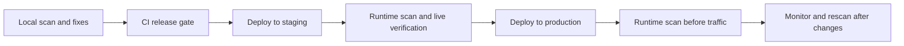

Use the [Open Mercato Readiness Scanner](https://github.com/open-mercato/mercato-readiness-scanner) before deployment **and again inside the deployed staging and production environments**. A local scan catches configuration and documentation gaps early; a server scan checks the release files and credentials visible in that environment. Use both alongside the [Production Readiness checklist](./production-readiness).

## Quick start

You need **Node.js 24 or newer** and a **standalone Open Mercato app**. Run from the generated app root, which contains `package.json` with an `@open-mercato/core` dependency and `src/modules.ts`:

```bash
cd /path/to/my-mercato-app
npx --yes mercato-readiness-scanner scan .
```

`npx --yes` accepts npm's package-install prompt; it does not approve scanner fixes. To refresh npm's cached package metadata, use `npx --yes --prefer-online mercato-readiness-scanner scan .`.

:::info Standalone apps only
The scanner rejects the Open Mercato framework monorepo, including its internal app directories. Run it against your generated standalone application. Scanning a public URL is not supported.
:::

`scan` is read-only with respect to the app. It does not execute application scripts, change configuration, or contact your database, KMS, or other services. `npx` may contact the npm registry to download the CLI. Reports are written only when requested.

## Use it throughout deployment

| When | Where to run | What to do with the findings |
| --- | --- | --- |
| 💻 Local development, before deployment | Standalone app checkout, with local configuration | Treat weak defaults and `.env` warnings as an early reminder. Fix configuration and prepare secret injection before releasing. |
| 🚦 CI, before deployment | Checkout of the exact release | Gate failed rules with `--fail-on high`. CI only checks files and environment variables available to that job. |
| 🧪 Staging, after deployment | Inside the staging workload, with its injected runtime environment | Check staging credentials and deployment files, then complete the live readiness checks and smoke tests. |
| 🚀 Production, before traffic and after changes | Inside the production workload, with its injected runtime environment | Verify production uses its own strong secrets and no stale plaintext environment files. Repeat after releases, configuration changes, and credential rotations. |



### Local findings versus production findings

Local development often has `.env` files or development defaults. The scanner deliberately draws attention to these: a local warning is not permission to deploy the same file or value. Resolve weak, empty, template, and fallback credentials before staging or production; exclude local secret files from release artifacts and images, and inject the deployed secrets through the hosting platform.

**A healthy production report can still contain warnings requiring operator review.** In particular, KMS configuration and secret injection remain review findings even when their configuration looks complete, because a static scan cannot prove KMS connectivity, access policy, rotation, recovery, or the origin of an injected value. No environment flag suppresses these checks. `--fail-on high` gates failed rules; it does not hide warnings or turn them into passes.

Record evidence and an owner for remaining review findings. Static checks cannot establish that HTTPS, backups, restore rehearsals, alerts, or provider credentials work in the deployed environment.

### Staging and production servers

Open a shell or an audit job **inside the application service/container**, using the same user, release files, and injected environment as the app. Then run:

```bash
cd /path/to/deployed-standalone-app
npx --yes mercato-readiness-scanner@0.2.2 scan . --fail-on high --no-color
```

Run this separately in staging and production. A scan over SSH on the host, or in a local shell with provider variables, does not automatically inspect a running container's environment. Likewise, a passing CI scan does not establish that the deployed service has the same secrets. If workers use different credentials, scan their workload context too.

The deployed scan still needs the standalone app markers described above. A slim runtime image without `src/modules.ts` or the relevant package metadata will be rejected, rather than treated as ready. Provide an appropriate audit workload with the exact release source/metadata mounted read-only and the environment it is authorized to inspect. Do not copy production secrets into a source checkout to make a scan work. Ensure Node.js 24+ and the pinned scanner are available in that workload before the release window.

Use `scan` on servers. Make fixes in the source checkout or deployment secret configuration, review them, deploy a new artifact, and scan again.

## Credential checks are always enabled

Every `scan` checks recognized credential values in memory and reports names and reasons, never secret values. You do not need `--check-secrets`; that flag remains accepted for compatibility. There is no CLI option to disable credential checks.

The scanner assesses JWT/signing and session secrets, database and Redis passwords, API keys/tokens, webhooks, encryption keys, and credentials in supported connection URLs and structured values. It detects known defaults, placeholders, copied template values, empty required credentials, short or predictable values, and unsafe encryption fallbacks. This is a strength heuristic, not proof of randomness or validity; it does not validate a JWT's signature, issuer, audience, or expiry, or attempt a database login.

### Configuration sources and limits

The credential checks inspect:

- Root `.env`, `.env.production`, `.env.local`, and `.env.production.local` files when present.
- Recognized credential variables visible in the scanner process's environment.
- Supported Compose configuration: `docker-compose.yml`, `docker-compose.yaml`, `docker-compose.fullapp.yml`, `compose.yml`, and `compose.yaml`, including service environment values and Redis password arguments.
- Sanitized `.env.example`, `.env.sample`, and `.env.template` files for comparison with published defaults.

Each supported live environment file is assessed independently. A strong runtime override does **not** hide a weak value left in a deployed file. Remove stale secret files from the artifact as well as correcting injected settings.

The scanner does not select `.env.staging`, follow external Compose `env_file` files, load an application's dotenv files into its own environment, resolve arbitrary variable references, read private-key/token-cache files, fetch a secret store, or inspect provider credentials stored in the database or admin UI. There is no `--env-file` or `--environment` flag. For staging, run with the actual staging environment injected by your platform. Unreadable or unresolved values require review; they are not evidence that a credential is strong. Never `source` an untrusted environment file or put secret values on the command line to run the scanner.

### KMS and secret delivery

| Finding | Required action |
| --- | --- |
| ❌ Weak/default JWT, database password, token, or API credential | Generate a unique strong value through the appropriate provider or secret-management process; update dependent services and rotate any exposed credential. |
| ❌ Weak/default encryption key or unsafe fallback | Replace the unsafe configuration using the application's supported key migration/rotation procedure. Preserve keys needed to decrypt existing data and test recovery. |
| ⚠️ No complete supported KMS configuration | Configure the supported Vault integration where appropriate, or document the key custody, injection, rotation, and recovery plan. This remains a warning requiring operator review. |
| ⚠️ Local secret files or unverified secret injection | Remove plaintext `.env*` files from deployment artifacts and deliver secrets through the runtime platform; verify access controls and the deployed configuration. |

Use mechanisms such as Railway service variables/secrets, Cloudflare secrets for workloads hosted there, or a managed secret store. GitHub Actions secrets can supply deployment credentials and deliver application secrets to the destination platform; storing a secret in CI alone does not inject it into your running app and does not provide KMS.

Do not ship encryption keys in a plain `.env` file, source archive, container image, or build log. Without KMS, secure runtime injection and a tested recovery plan are especially important. The scanner cannot prove these operational controls. Do not blindly regenerate existing encryption keys: that can make stored data unreadable.

## Scan commands and reports

```bash
# Current directory; scan is also the default command
npx --yes mercato-readiness-scanner scan .
npx --yes mercato-readiness-scanner .

# Another standalone app directory
npx --yes mercato-readiness-scanner scan /path/to/my-mercato-app

# Terminal output plus both report files
npx --yes mercato-readiness-scanner scan . --markdown /tmp/readiness.md --json /tmp/readiness.json

# One report file, with no terminal report
npx --yes mercato-readiness-scanner scan . --format markdown --output /tmp/readiness.md
npx --yes mercato-readiness-scanner scan . --format json --output /tmp/readiness.json

# JSON to stdout, suitable for a local report processor
npx --yes mercato-readiness-scanner scan . --format json --output -

# CLI reference and installed version
npx --yes mercato-readiness-scanner --help
npx --yes mercato-readiness-scanner --version
```

Reports contain remediation guidance and redacted evidence. Keep them in an access-controlled location and review them before sharing: they still describe the application's configuration and operational gaps. Keep reports outside the checkout when you want to use `apply`, which expects a clean Git working tree.

### CI gate and exit codes

Run this before deployment, after preparing the exact release checkout and installing Node.js 24+:

```bash
npx --yes mercato-readiness-scanner@0.2.2 scan . \
  --fail-on high --no-color \
  --markdown /tmp/readiness.md --json /tmp/readiness.json
```

Keep this version aligned with the scanner release validated for your deployment, and review rule changes before updating it.

Reports are saved before applying the severity exit code. Configure your CI to retain them on failure with appropriate access controls. Do not make this gate continue on error if it is intended to block deployment.

| Exit code | Meaning for `scan` |
| --- | --- |
| `0` | Scan completed without meeting the chosen failure threshold. With the default `--fail-on never`, findings do not change this code. |
| `1` | A failed rule meets or exceeds the chosen severity threshold. `high` includes both high and critical failures. |
| `2` | Invalid usage or unsupported target, including the framework monorepo. |
| `3` | Unexpected scanner or report-writing failure. |

| Scan option | Purpose |
| --- | --- |
| `--fail-on critical\|high\|medium\|low\|never` | Set the severity gate; default `never`. Review warnings do not trigger it. |
| `--format terminal\|markdown\|json` | Select output format; default `terminal`. |
| `--output PATH` | Save the selected format atomically; `.md`/`.json` infers the format when unspecified. Suppresses stdout. Use `-` for stdout. |
| `--markdown PATH`, `--json PATH` | Save additional reports while retaining normal output. |
| `--no-color` | Disable ANSI colors. |
| `--check-secrets` | Compatibility flag; credential checks are already enabled. |
| `--help`, `--version` | Print help or version and exit. |

## Preview and apply safe fixes locally

There is no `--fix` flag. Use **`apply`** in your local standalone app's Git checkout. Start with a clean working tree so the changes are easy to review:

```bash
# Preview only: writes nothing
npx --yes mercato-readiness-scanner apply . --dry-run

# Apply after an interactive scanner confirmation
npx --yes mercato-readiness-scanner apply .

# Alternatively, explicitly approve without the scanner prompt
npx --yes mercato-readiness-scanner apply . --yes

# Inspect changes, complete any TODOs, then scan again
git status --short
git diff
npx --yes mercato-readiness-scanner scan . --fail-on high
```

`apply` can append missing ignore patterns, add missing build/start script entries, and create missing backup/restore and rollback runbook stubs. It preserves existing content and does not execute application scripts. A generated runbook stub still needs an owner, real instructions, and a dated rehearsal; creating the file does not establish operational readiness. Preview markers show proposed changes, not successfully completed checks.

Direct fixes never read or write live `.env*` files or credentials. Secret rotation, KMS setup, deployment secret injection, and live infrastructure changes remain manual work. Re-run `scan` to include credential checks after fixing.

| Apply option | Purpose |
| --- | --- |
| `--mode direct\|agent` | Additive direct fixes by default; optional delegation described below. |
| `--dry-run` | Preview without writing or spawning an agent. A Git working tree is still required. |
| `--yes`, `--non-interactive` | Skip scanner confirmation. Required for a non-interactive apply; independent of `npx --yes`. |
| `--allow-dirty` | Explicitly allow existing uncommitted changes. Prefer committing or stashing first, then reviewing the fix diff. |

`apply` normally exits `0` when completed, `2` for a refused precondition or invalid usage, and `3` for an unexpected failure. It does not accept `--fail-on`; a successful apply does not mean the readiness scan passes. To check idempotency after reviewing the first diff, `apply . --yes --allow-dirty` should write zero further changes.

### Optional coding-agent delegation

Review the generated prompt before choosing to delegate remediation:

```bash
npx --yes mercato-readiness-scanner apply . --mode agent --print-prompt

# Preview delegation; requires an available cezar-run binary, but does not run it
npx --yes mercato-readiness-scanner apply . --mode agent --dry-run

# Explicitly delegate in a local development checkout
npx --yes mercato-readiness-scanner apply . --mode agent \
  --cezar-run /path/to/cezar-run --workflow readiness --yes
```

Choose an existing `cezar-run` workflow in place of `readiness`, or omit `--workflow`. The binary is resolved from `--cezar-run`, then `MERCATO_READINESS_CEZAR_RUN`, then `cezar-run` on `PATH`. `--print-prompt` prints the prompt and exits without executing an agent or saving reports. Agent mode returns the delegated process's exit code.

Agent mode gives an external coding agent a remediation prompt and access to the target repository. Its provider, permissions, data handling, and changes depend on your `cezar-run` setup; use it only in an authorized local development context, review the resulting diff, and rescan. The direct mode's additive-write restrictions do not constrain an external agent. Do not use agent remediation on a production server.
