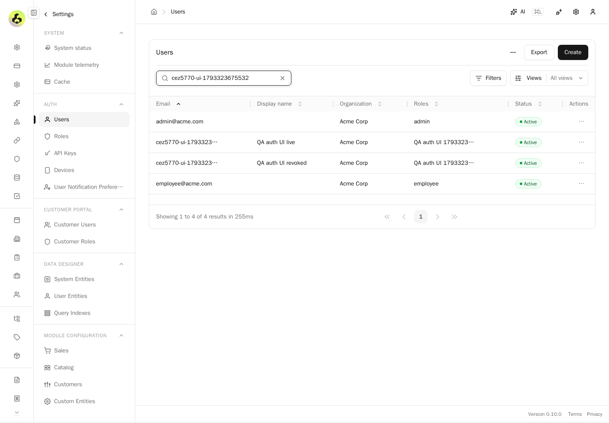
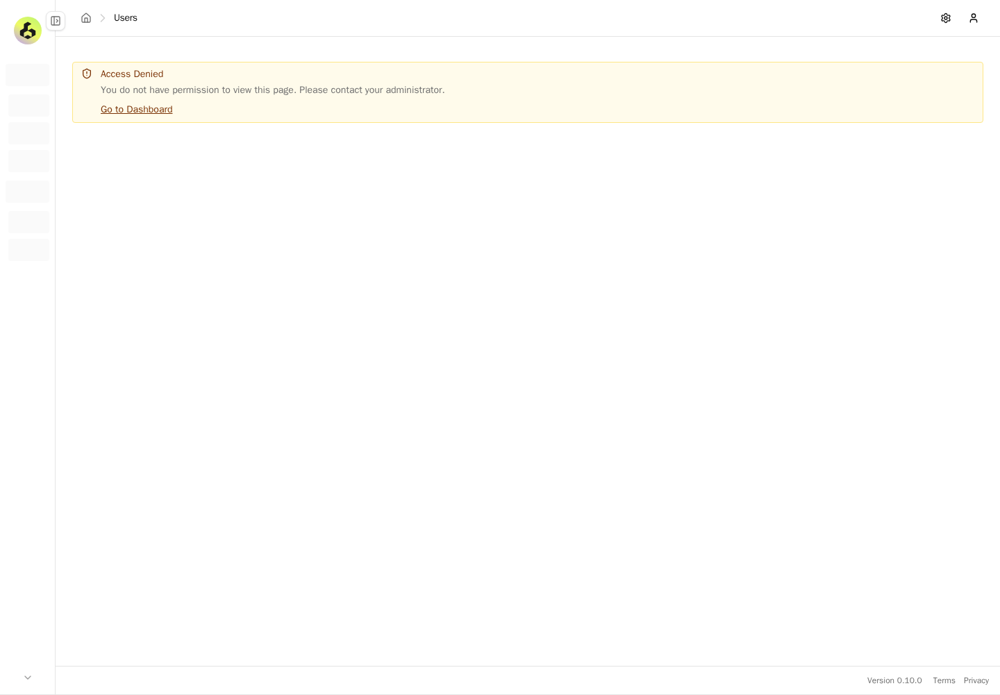
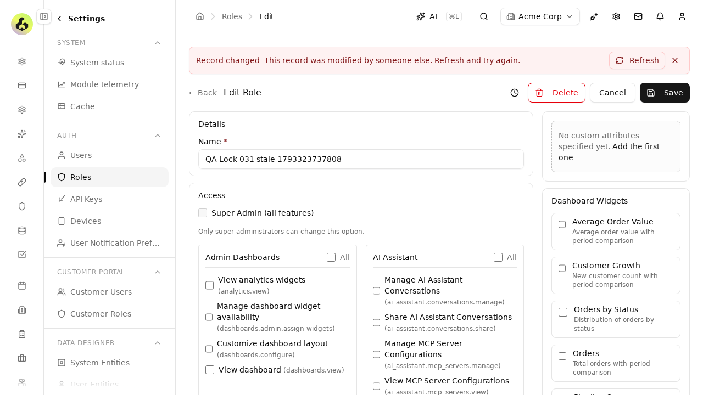
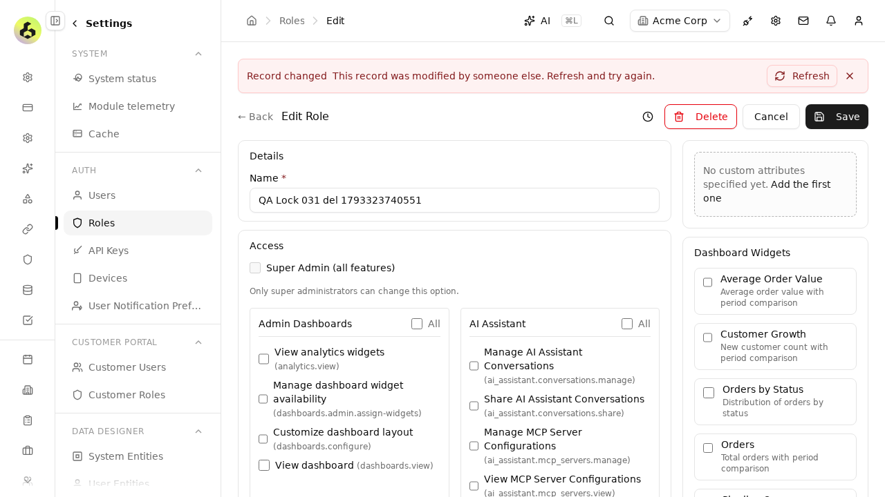
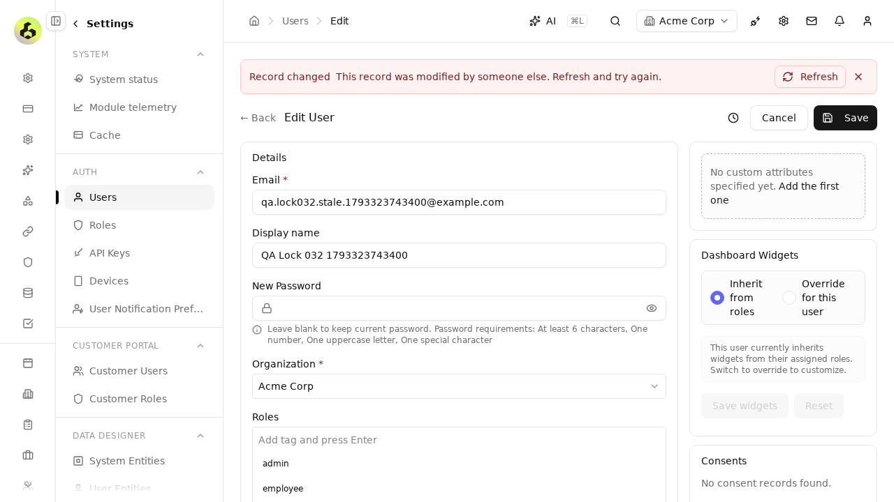

# Exact final-head QA — PR5770

PASS at `c40ce18e5c4de72572ca918c9d4f1929b5c71988`. Source captured before launch at2026-10-30T01:22:29.933Z; fresh runtime started at2026-10-30T01:27:15.493Z; production build completed at1793323625931. Authenticated cold readiness and warm reuse passed. Evidence only, no publication or independent QA approval.

Eight real security API cases,4browser checkpoints,11native cases and2actual PostgreSQL migration tests PASS at this exact final head.

## 1. Evaluate isolated user-live principal

PASS: {"loginStatus": 200, "featureGranted": true, "listStatus": 200}

## 2. Evaluate isolated role-live principal

PASS: {"loginStatus": 200, "featureGranted": true, "listStatus": 200}

## 3. Evaluate isolated user-revoked principal

PASS: {"loginStatus": 200, "featureGranted": false, "listStatus": 403}

## 4. Evaluate isolated role-revoked principal

PASS: {"loginStatus": 200, "featureGranted": false, "listStatus": 403}

## 5. Evaluate isolated membership-revoked principal

PASS: {"loginStatus": 200, "featureGranted": false, "listStatus": 403}

## 6. Evaluate isolated role-deleted principal

PASS: {"loginStatus": 200, "featureGranted": false, "listStatus": 403}

## 7. Evaluate isolated foreign-superadmin principal

PASS: {"loginStatus": 200, "featureGranted": false, "listStatus": 403}

## 8. Evaluate isolated tenantless-superadmin principal

PASS: {"loginStatus": 200, "featureGranted": false, "listStatus": 403}

## 9. Actual user edit and current access-control panel finish loading

PASS: Actual user edit and current access-control panel finish loading

## 10. User edit remains accessible at390px

PASS: User edit remains accessible at390px

## 11. User list displays self-created fixtures after loading

PASS: User list displays self-created fixtures after loading

## 12. A real principal with a revoked override cannot render the guarded user list

PASS: A real principal with a revoked override cannot render the guarded user list

## Native AUTH-01 stale role-name edit shows the conflict bar

## Native AUTH-05 stale role delete shows the conflict bar

## Native AUTH-03 stale user edit shows the conflict bar

