## 📸 UI QA evidence — PARTIAL

**Verdict: PARTIAL** — the current-head superadmin empty-tenant scenario and tenant-isolation controls passed. The ordinary static-empty branch and remaining complex checks below are unexercised; this is not QA approval.

QA head: 4ea4d19686b3c4c4dbf25040dcade232881a018b

**Environment:** fresh isolated production PostgreSQL/app at `http://127.0.0.1:44131`; configured Playwright1.61.1; native superadmin plus UI-created tenant-bound users A/B. Build, authenticated readiness and warm reuse passed.

| # / Priority | Action | Expected / observed | Result / evidence |
|---|---|---|---|
| 1 / P1 | Native OrganizationSwitcher regression | Focused regression suite passes. 5/5 tests, 1 suite; unmodified workspace command | PASS |
| 2 / P0 | Native directory API/scope and switcher cache/fallback | Scope/cache suites pass. 52/52 tests, 5 suites | PASS |
| 3 / P0 | Native TC-DIR-016 through mercato integration runner | Owned actors isolated; grant/revocation invalidates cache. 1/1 integration test passed, 2.3s test execution / 207.5s total including Chromium installer | PASS |
| 4 / P1 | App/template parity and translations | Both mirrors identical; keys in all supported locales. Both cmp checks passed; en/pl/es/de/ko existing keys present; no new keys | PASS |
| 5 / P1 | Create empty tenant through UI and select it | Tenant selector, All organizations and No organizations remain usable. Owned empty tenant created; all three observed; switch-away works | PASS — [PNG](https://raw.githubusercontent.com/open-mercato/open-mercato/qa-evidence-pr-7111/pr-7111-cd8dc1f2/step-02-empty-en.png) |
| 6 / P1 | Escape closes; Enter reopens; repeat settled switching | No static/blank trap after repeated switches. 10/10 populated↔empty round trips; 20 assertions; 10s idle; Escape hidden-dialog assertion and Enter reopen passed | PASS — [PNG](https://raw.githubusercontent.com/open-mercato/open-mercato/qa-evidence-pr-7111/pr-7111-cd8dc1f2/step-06-ten-rounds-pl.png) |
| 7 / P1 | Explicit Polish and 390×844 viewport | Localized empty menu readable and reachable. Wszystkie organizacje / Brak organizacji observed; menu inside viewport | PASS — [PNG](https://raw.githubusercontent.com/open-mercato/open-mercato/qa-evidence-pr-7111/pr-7111-cd8dc1f2/step-05-mobile-pl.png) |
| 8 / P1 | Long tenant name at 390px | Menu remains usable without page overflow. Long name selected; viewport and document width both390; selected text truncates | PASS — [PNG](https://raw.githubusercontent.com/open-mercato/open-mercato/qa-evidence-pr-7111/pr-7111-cd8dc1f2/step-07-long-mobile.png) |
| 9 / P1 | Delay switcher request8s on People consumer | Useful shell/loading state then usable menu. Inspected PNG shows Loading… while shell/table remain; request settles and menu works | PASS — [PNG](https://raw.githubusercontent.com/open-mercato/open-mercato/qa-evidence-pr-7111/pr-7111-cd8dc1f2/step-09-injected-loading.png) |
| 10 / P1 | Inject switcher503 and recover | Friendly error; recovery after injection removed. Failed to load shown; removing injection restores usable switcher on People route | PASS — [PNG](https://raw.githubusercontent.com/open-mercato/open-mercato/qa-evidence-pr-7111/pr-7111-cd8dc1f2/step-08-injected-error.png) |
| 11 / P0 | UI-create two tenant-bound users/roles/organizations | Ordinary users see only owned organization; no tenant selector. Own users A/B each have a restricted menu; neither has Tenant selector | PASS — [PNG](https://raw.githubusercontent.com/open-mercato/open-mercato/qa-evidence-pr-7111/pr-7111-cd8dc1f2/step-12-view-only-actor-b.png) |
| 12 / P0 | Positive own reads and valid foreign tenant IDs in both directions | Own records allowed; foreign records refused. A→A and B→B200 with expected IDs; A→B and B→A403; managing A foreign PUT404; B own PUT403 for missing manage feature | PASS |
| 13 / P0 | Hidden Manage action and direct URL/write | View-only actor cannot bypass UI restriction. Manage absent; direct create route Access Denied; PUT403; Enter/Escape menu usable after refusal | PASS — [PNG](https://raw.githubusercontent.com/open-mercato/open-mercato/qa-evidence-pr-7111/pr-7111-cd8dc1f2/step-13-view-only-direct-refusal.png) |
| 14 / P0 | Two-actor stale organization form; repeated refused saves | Concurrent slug preserved; stale name save refused. Conflict bar observed; two repeated stale Save clicks changed no returned field | PASS — [PNG](https://raw.githubusercontent.com/open-mercato/open-mercato/qa-evidence-pr-7111/pr-7111-cd8dc1f2/step-14-stale-write.png) |
| 15 / P0 | Refresh and retry; compare every returned field | Only intended fields/version/derived label change. Name saved, second actor slug retained; all returned fields compared; list/header clean after10s | PASS — [PNG](https://raw.githubusercontent.com/open-mercato/open-mercato/qa-evidence-pr-7111/pr-7111-cd8dc1f2/step-15-after-retry.png) |
| 16 / P0 | Revoke every organization from own role through UI | No accessible organization or tenant escape exposed. ACL organizations[]; real actor payload items[]/canManagefalse; switcher hidden | PASS — [PNG](https://raw.githubusercontent.com/open-mercato/open-mercato/qa-evidence-pr-7111/pr-7111-cd8dc1f2/step-16-empty-access-actor-a.png) |
| 17 / P1 | Ordinary tenant-bound static-empty branch in a literally empty tenant | Static No organizations label without switching controls. Not exercised: supported user creation requires an organization UUID. Real empty-access role hides the switcher, which does not prove the separate static-empty branch. No invalid database fixture or mocked PASS substituted. | NOT_EXERCISED |
| 18 / P1 | Measured cold-route performance, rapid unsynchronised race stress | Recorded cold timing and rapid race results. Functional cold navigation/loading observed, but no instrumented cold timing. Ten settled round trips do not establish rapid stress coverage. | NOT_EXERCISED |
| 19 / P1 | All-submit-button double-click and post-refusal focus matrix | No duplicate mutations; keyboard/focus stays correct for every write. Repeated stale saves and switcher keyboard recovery covered; true double-click of every create/edit submit and full focus matrix not exercised. | NOT_EXERCISED |
| 20 / P1 | Standalone scaffold browser and every boundary in Polish | Runtime template and localized error/permission/conflict states verified. Template parity only; no separately scaffolded app. Polish empty/menu/mobile verified; error, permission and conflict UI exercised in English. | NOT_EXERCISED |

### Native tests

- `timeout 60 yarn workspace @open-mercato/app test --runInBand --runTestsByPath src/components/__tests__/OrganizationSwitcher.tenantCookie.test.tsx` — **5/5**.
- Native core organization API/scope and switcher cache/fallback commands in `report.json` — **52/52** across5 suites.
- `OM_INTEGRATION_BUILD_CACHE_TTL_SECONDS=86400 timeout 300 yarn mercato test:integration TC-DIR-016` — **1/1**, own-fixture grant/revocation isolation. No runner/test overrides.

### Freshness and inherited observations

Exact two-tree comparison, not merge-base comparison: old82eea8a42c9ac3741ad8701cef528042cdd7b174 vs current2dcc26b6b868f1467e154b1279bc8494e0f2886c. Switcher blob unchanged; directory API/scope/branding, runtime manifests and lockfile changed;675 commits added. Prior screenshot freshness not retained as current runtime proof.

Prior Nov4/5 PARTIAL facts retained: missing toolchain/tokenizer and preparation timeout; later Nov5 actual images tested89c0ef2c959c7c37cdc02dc2ca7f8ac43aebfb94. Prior rapid-loop harness timed out; its later settled10 passed. This run proves only its own settled10.

Current preparation: native Next16.4.1 security advisory interrupted builds. Native unchanged receipt mechanism consumed on successful retry; no guard/config/dependency edits. One owned wrapper reset race caused ENOTEMPTY and was corrected. Production build and authenticated readiness then passed; warm reuse passed.

Native warning recommends a Next security upgrade; any dependency change is outside this evidence-only review.

Current inherited UI observation: authorized narrow organization editor briefly displays missing auth.roles.list permission from capability probe at packages/core/src/modules/directory/backend/directory/organizations/[id]/edit/page.tsx:68. File is byte-identical across the two evidence heads. The form loads/saves and the alert is absent from the post-save screen. No introduced defect attributed to this PR.

Observed English example navigation labels on Polish shell are outside the changed switcher. Changed empty/menu labels translated correctly.

Harness limitations retained: initial descriptor assumed wrong superadmin demo password; corrected to native ephemeral credential reference inside process. First API cookie-only read401 was a harness authentication error, then authenticated positive controls200 succeeded. One networkidle navigation timed out despite rendered page; subsequent navigation used DOMContentLoaded and explicit assertions. No development500 or fabricated product failure.

### Required coverage left

Rows17–20 remain unexercised. A real denied organization scope is hidden; it is not proof of the ordinary static-empty branch. Preserve `needs-qa`. No demonstrated defect introduced by this PR was established.

### Artifacts and cleanup

The complete `report.json`, authored `scenario.md` / `browser-driver.cts`, operation stdout, native test logs, exact-tree comparison, PNG hashes, whole-record integrity comparison and cleanup facts are retained in the scheduled parent’s `pr-7111` artifact directory. Selected11 PNGs were individually inspected; intermediate animation captures are excluded.

All fixtures were created through product UI and removed with the owned disposable database. Browser contexts closed; owned CLI/app processes, port44131 and container9be2b833f773 are absent. Only own runtime email-capture appends were restored; source is clean. The own exact-SHA claim lease is released as the final completion step; foreign state and existing pipeline/approval labels are preserved.

### Follow-up UI test

No browser-level test ships in this PR. Add a self-contained test that UI-creates an empty tenant, asserts all three empty menu controls, switches away and back ten settled rounds, verifies English/Polish/mobile and two tenant-bound permission/isolation controls with valid own-record positive controls, and cleans all fixtures. Separately establish a supported fixture for the ordinary static-empty branch; do not replace it with a hidden/no-permission result.

### Screenshots

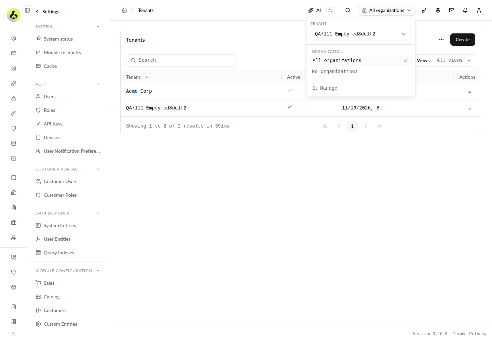

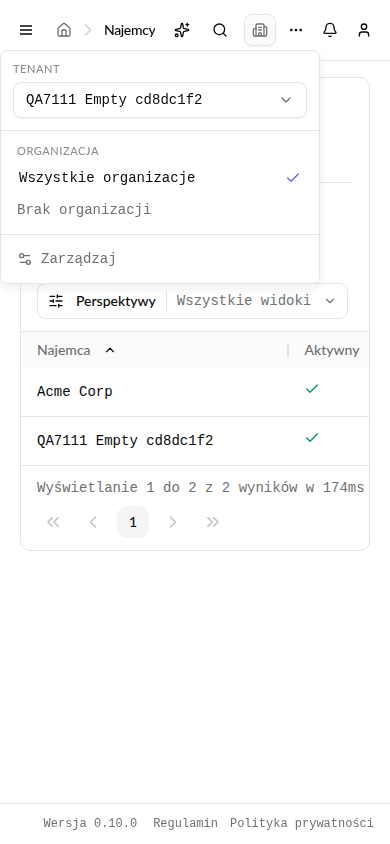

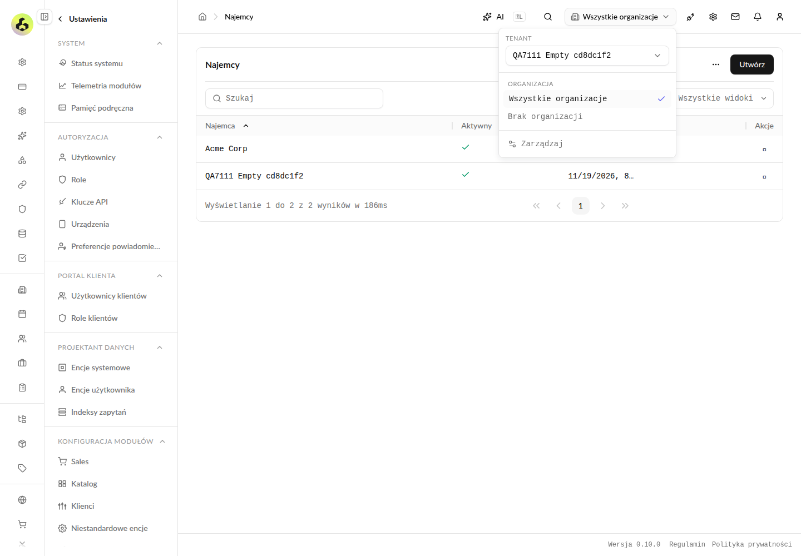

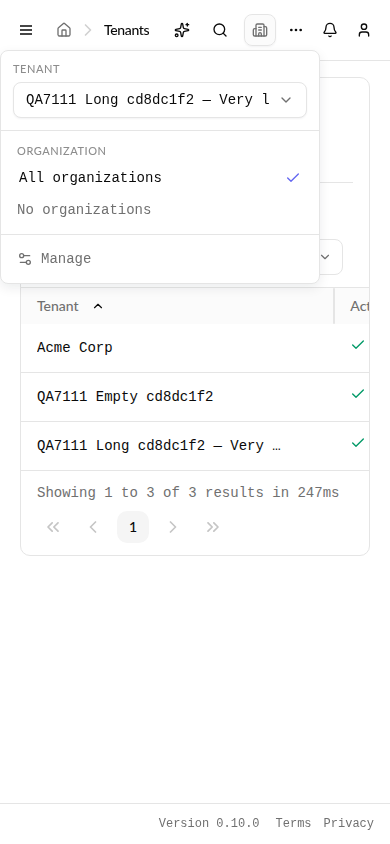

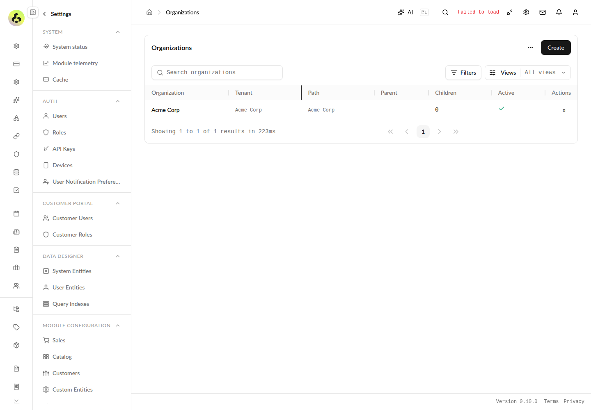

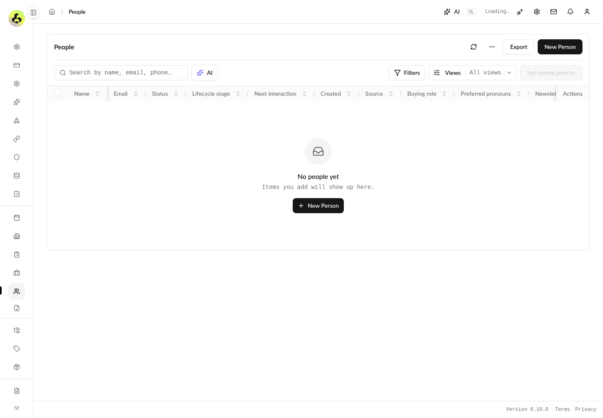

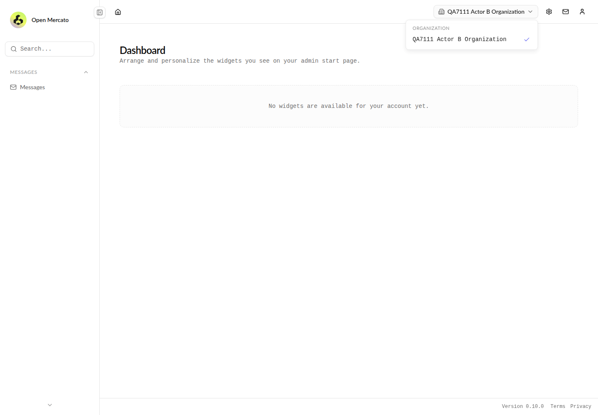

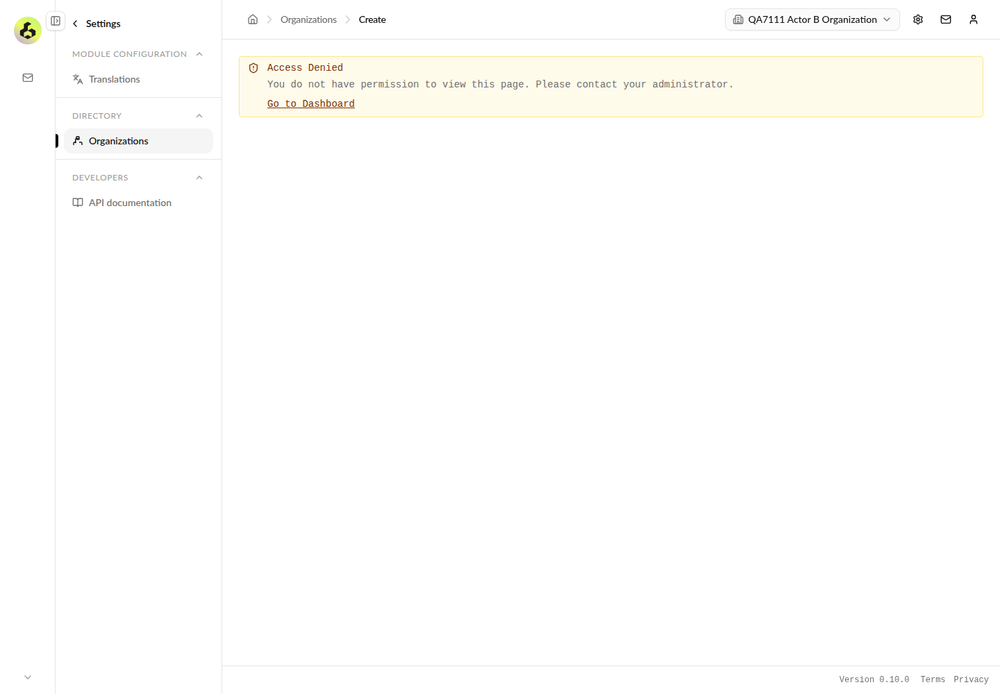

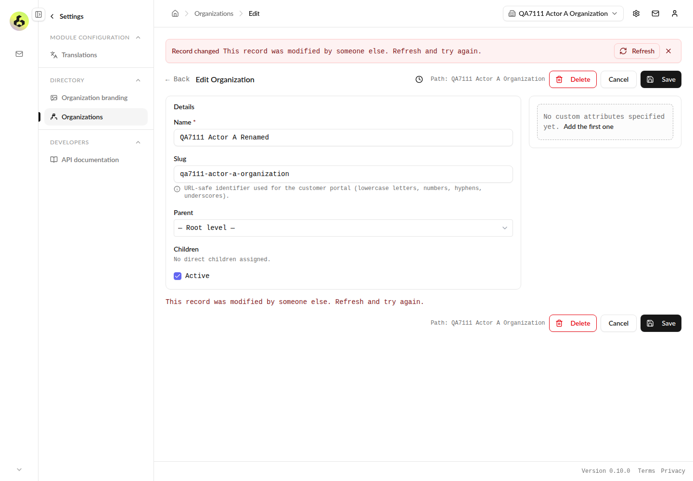

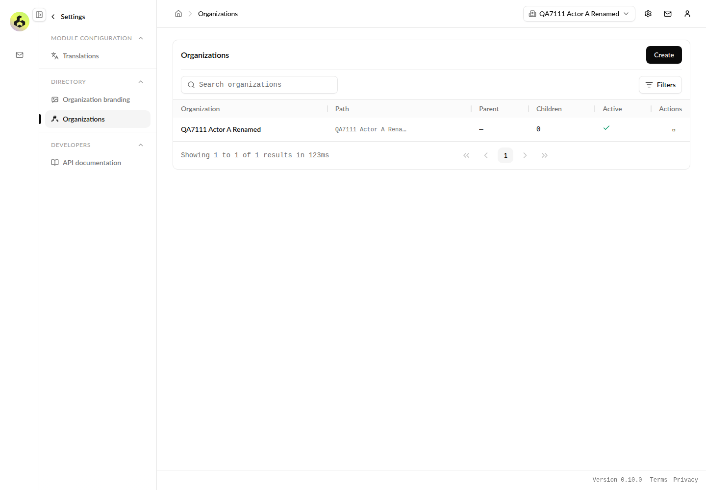

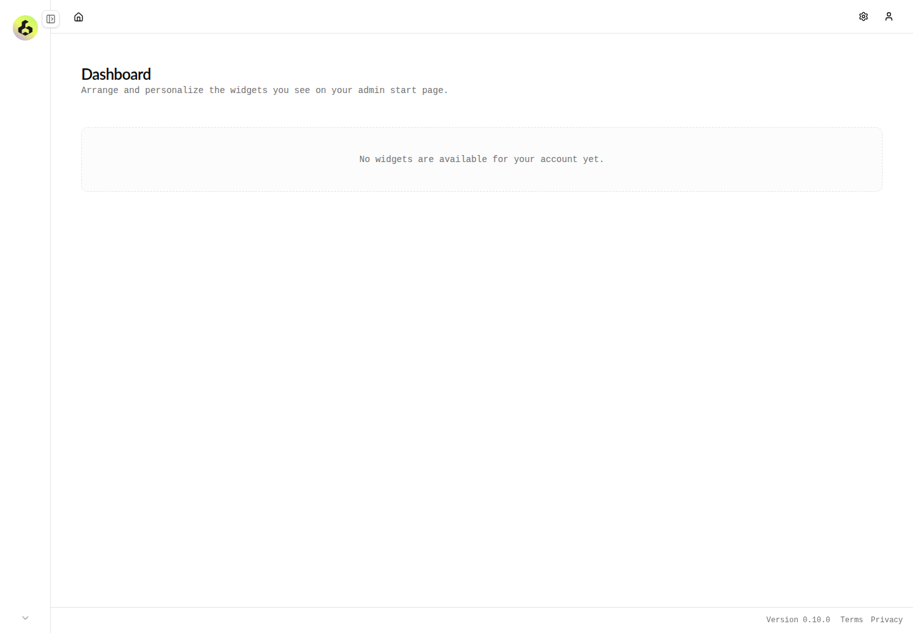
