# Exact final-head QA — PR8020

PASS at `2c8bc77da65e8727ea58d6bd47c2e968bbc8ff6a`. Source captured before launch at2026-10-30T01:40:43.583Z; fresh runtime started at2026-10-30T01:45:24.179Z; production build completed at2026-10-30T01:45:15.564Z. Authenticated cold readiness and warm reuse passed. Evidence only, no publication or independent QA approval.

Nine browser checkpoints and3native integration cases PASS at this exact final head. Limited principal also receives an auxiliary admin-only denial toast while public company tab remains usable.

## 1. Default People tab remains selected for a newly created company with no linked people

PASS: Default People tab remains selected for a newly created company with no linked people

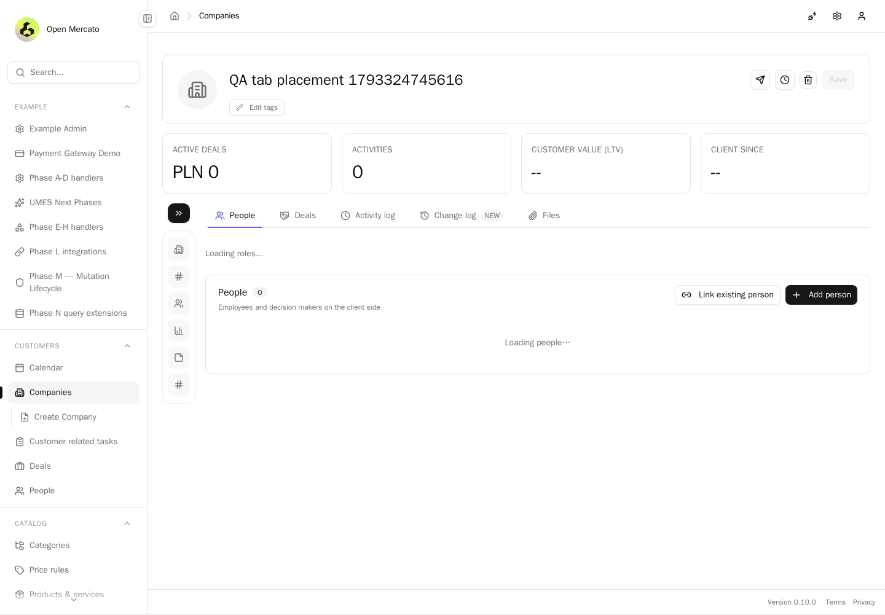

## 2. Held real company request displays the loading message

PASS: Held real company request displays the loading message

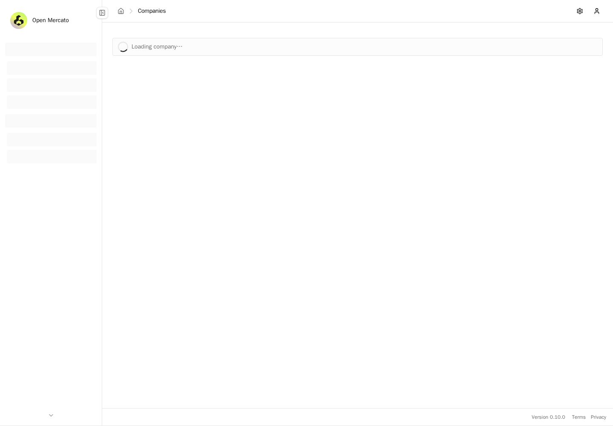

## 3. Controlled HTTP500 detail response renders its recovery state; simulation only

PASS: Controlled HTTP500 detail response renders its recovery state; simulation only

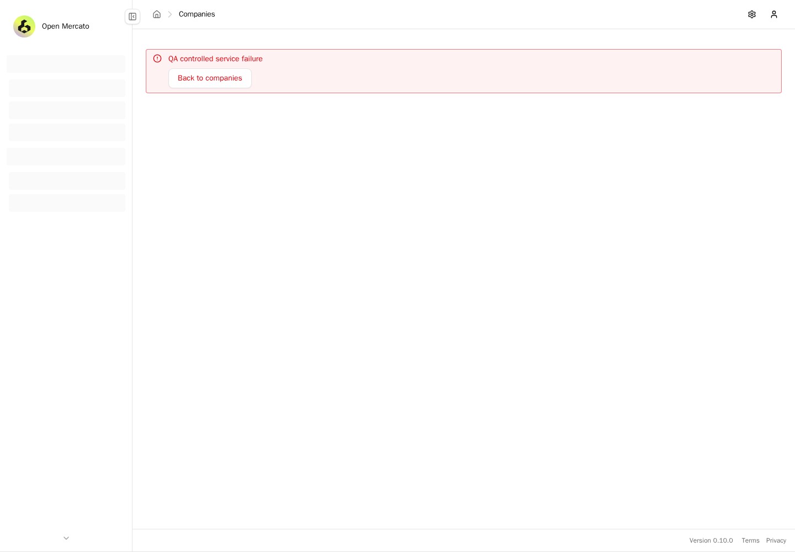

## 4. Controlled HTTP403 detail response renders its recovery state; simulation only

PASS: Controlled HTTP403 detail response renders its recovery state; simulation only

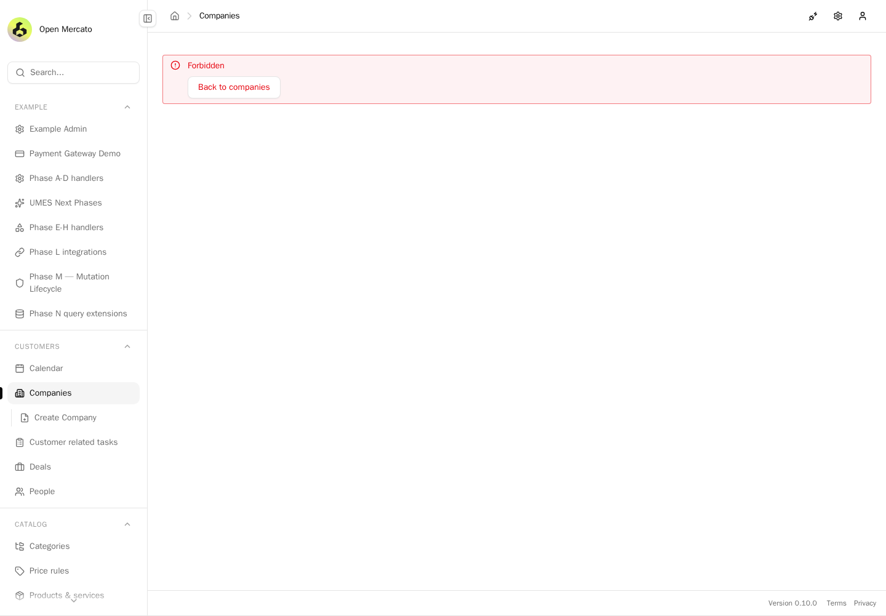

## 5. A real absent company UUID renders the safe not-found state

PASS: A real absent company UUID renders the safe not-found state

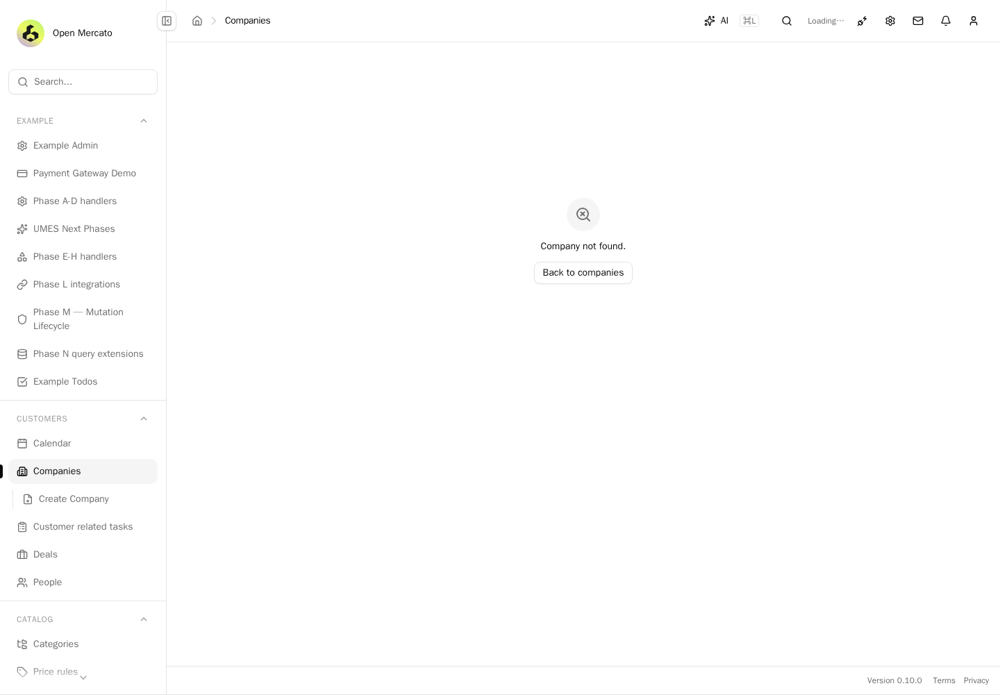

## 6. Injected positive priority precedes built-ins without changing the default; missing module and failed loader are isolated

PASS: Injected positive priority precedes built-ins without changing the default; missing module and failed loader are isolated

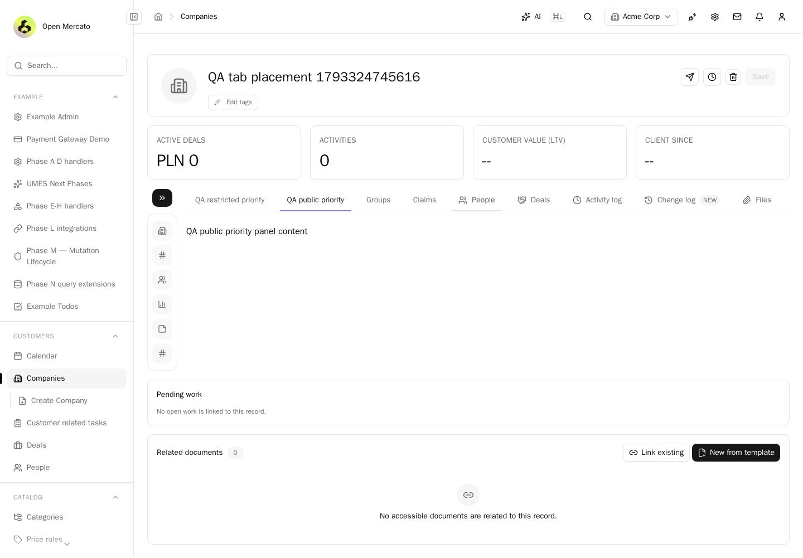

## 7. ArrowRight focuses and selects the next actual tab in sorted DOM order, including enabled-module contributions

PASS: ArrowRight focuses and selects the next actual tab in sorted DOM order, including enabled-module contributions

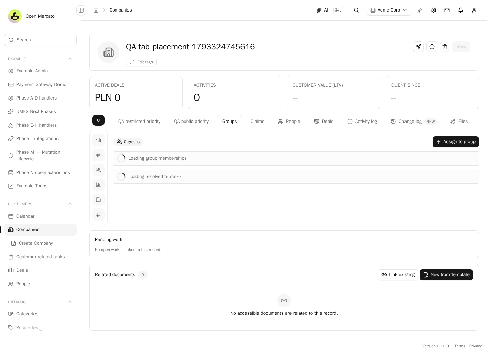

## 8. Long negative-priority contribution remains reachable by normal tab-strip scrolling at390px

PASS: Long negative-priority contribution remains reachable by normal tab-strip scrolling at390px

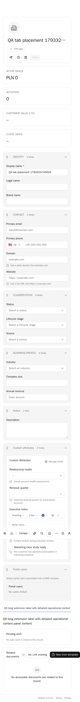

## 9. Real limited principal retains public contribution while feature-protected tab remains absent

PASS: Real limited principal retains public contribution while feature-protected tab remains absent

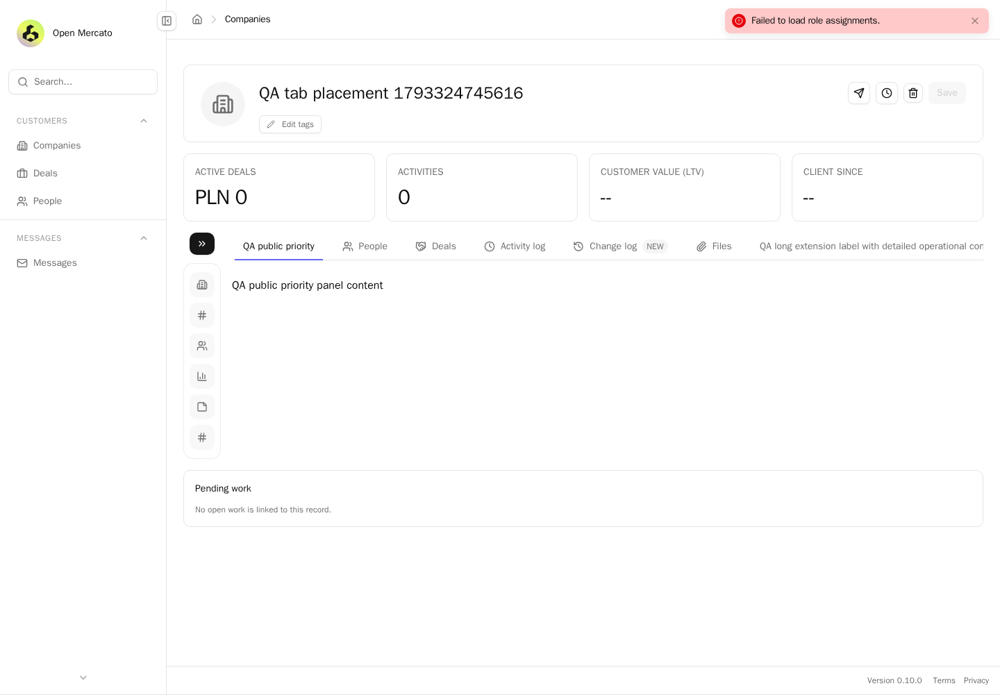

## Native company-tab-priority

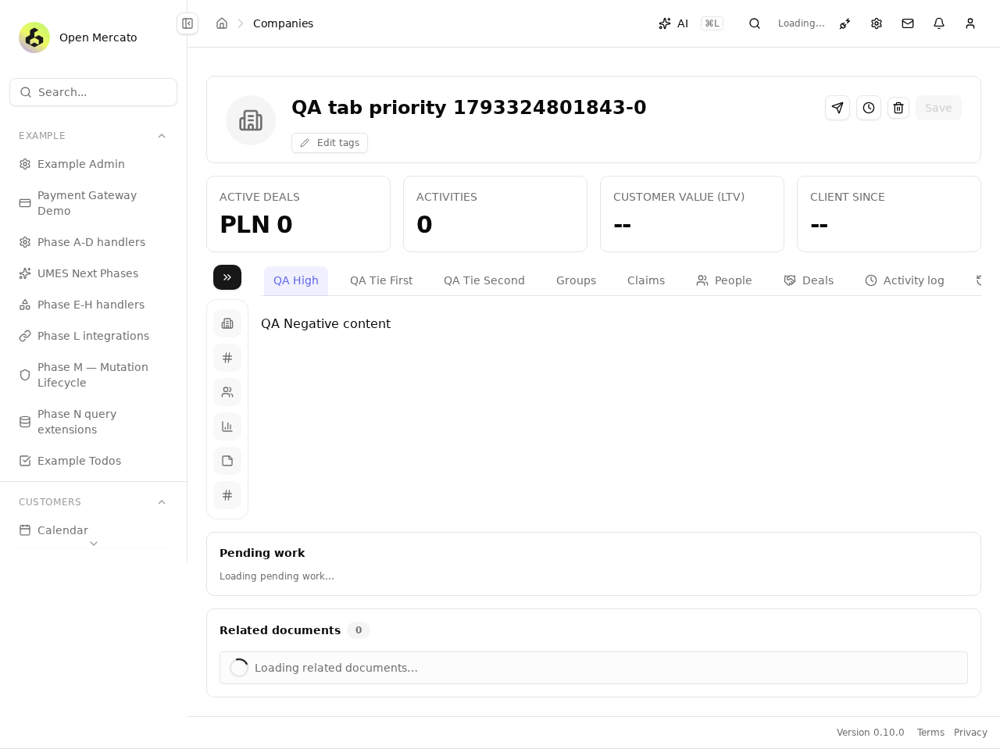

## Native company-tab-priority-mobile

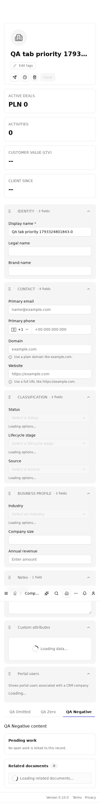

## Native person-tab-priority

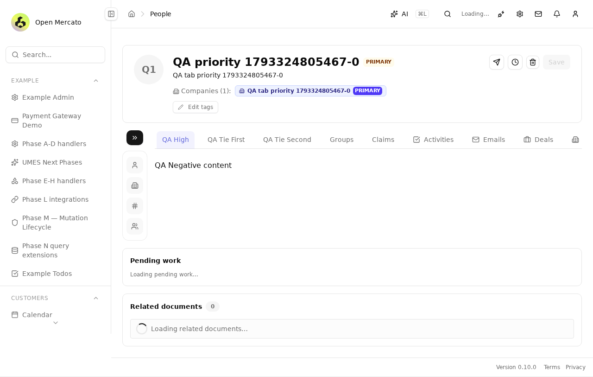

## Native person-tab-priority-mobile

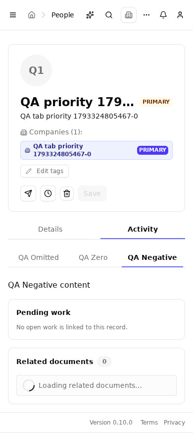

## Native deal-tab-priority

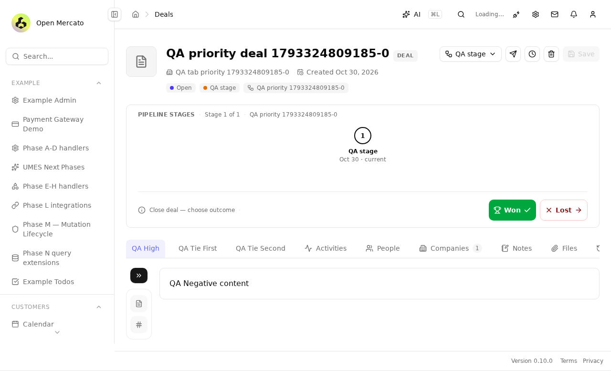

## Native deal-tab-priority-mobile

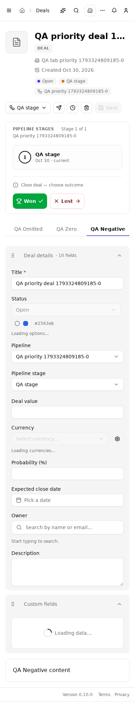
