# Customer list QA evidence

Verified local repair `8815b4405dc86bbc6039aa4e3b74717ed6627e7b`;15 required browser checkpoints PASS and3 committed integration cases PASS with no retry. Demo fixtures only; controlled500/403 are rendering checks. No QA approval is granted.

## 1. Load companies with isolated dated fixtures
PASS: Created column and own dated records render
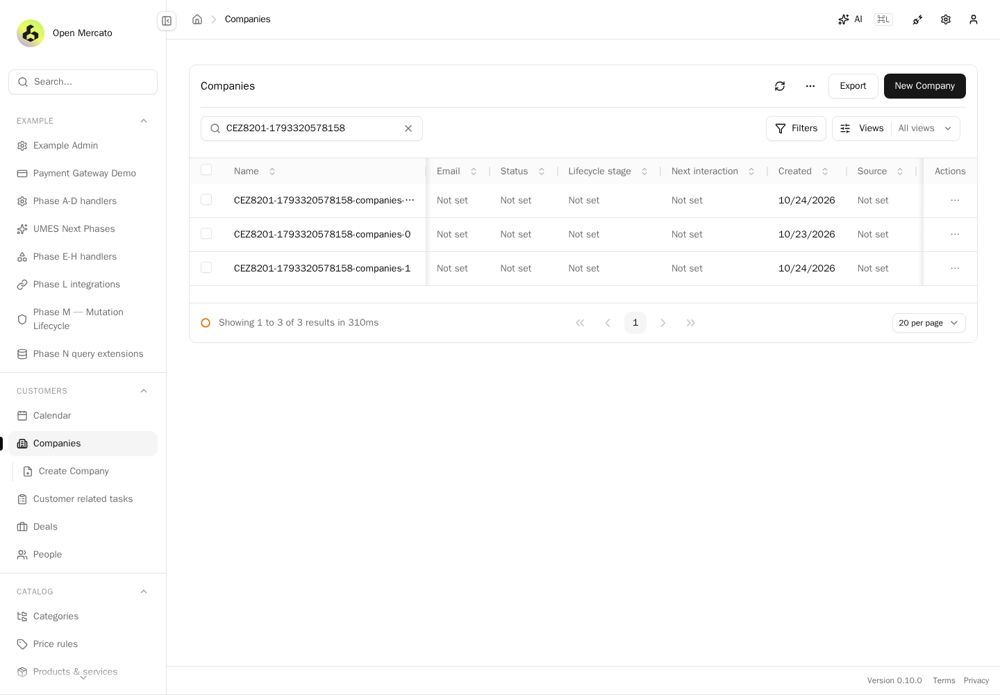

## 2. Sort companies by Created
PASS: Created sort is wired into the list URL
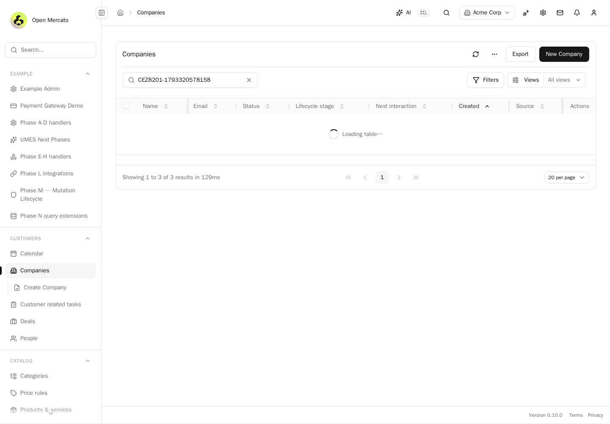

## 3. Filter companies by local calendar day
PASS: Local-midnight boundary included; previous local day excluded
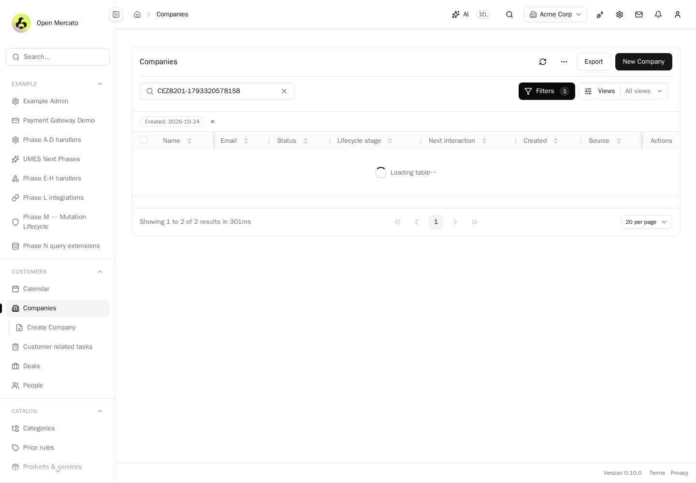

## 4. View companies with long content at 390px
PASS: Dated record and Created control remain accessible in narrow viewport
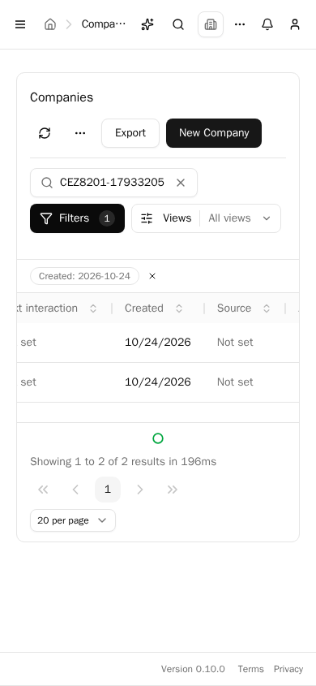

## 5. Load people with isolated dated fixtures
PASS: Created column and own dated records render
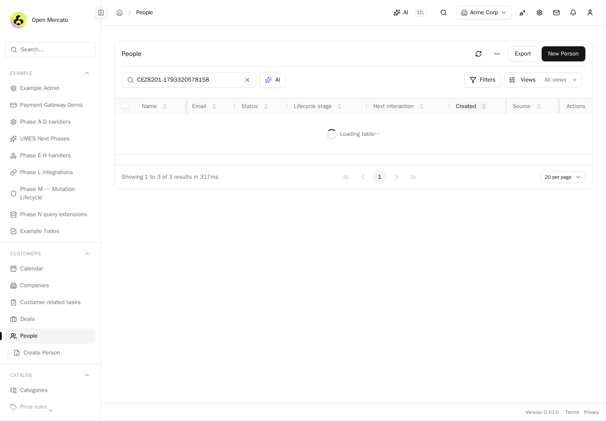

## 6. Sort people by Created
PASS: Created sort is wired into the list URL
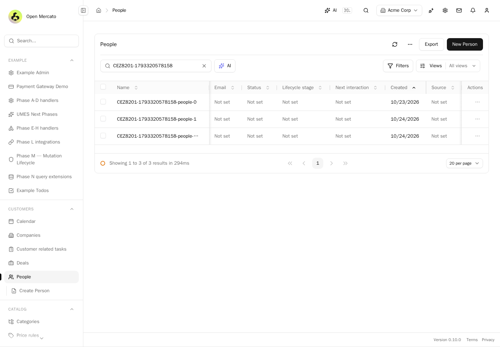

## 7. Filter people by local calendar day
PASS: Local-midnight boundary included; previous local day excluded
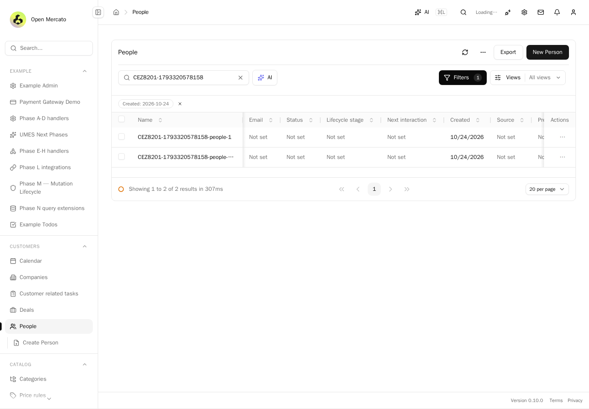

## 8. View people with long content at 390px
PASS: Dated record and Created control remain accessible in narrow viewport
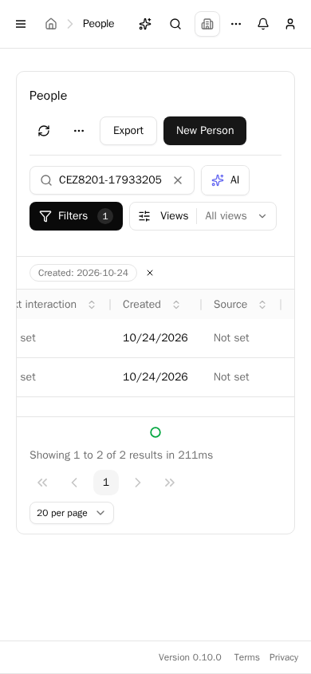

## 9. Apply Recently created across Warsaw DST transition
PASS: Calendar day 2026-10-24 is inclusive at 2026-10-23T22:00:00.000Z
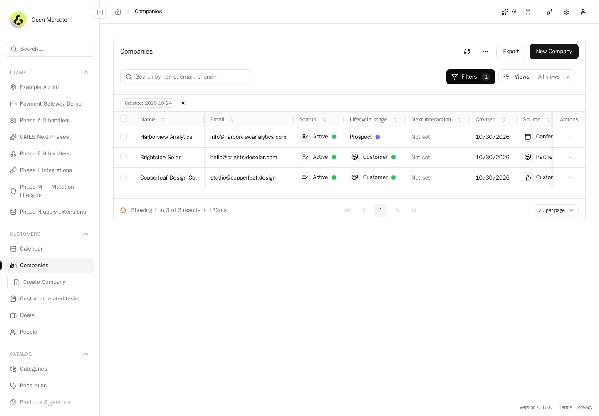

## 10. Apply Recently created across Warsaw DST transition
PASS: Calendar day 2026-03-25 is inclusive at 2026-03-24T23:00:00.000Z

## 11. Search an absent isolated fixture marker
PASS: No fixture or seeded record is rendered for the absent marker
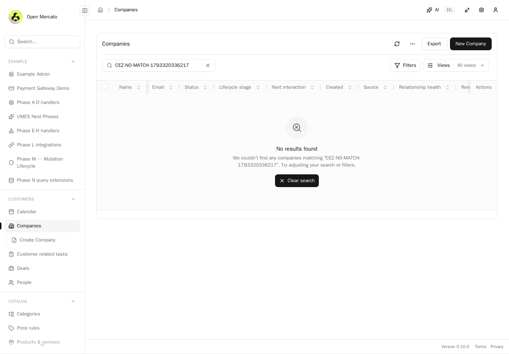

## 12. Render controlled list failure
PASS: HTTP 500 message is visible; rendering check, not server authorization proof
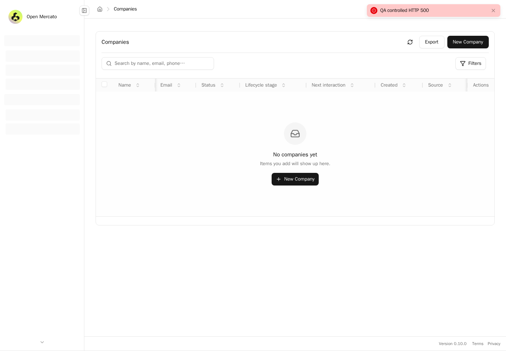

## 13. Render controlled list failure
PASS: HTTP 403 message is visible; rendering check, not server authorization proof

## 14. Cold-load companies while holding its data response
PASS: Useful heading and loading shell appear before data resolves
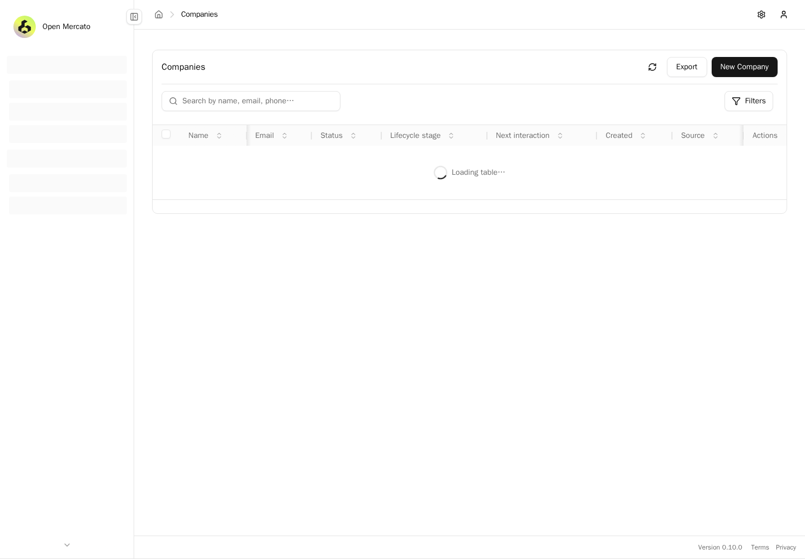

## 15. Open and cancel the advanced-filter dialog with Escape
PASS: The filter interaction responds and keyboard cancellation closes the dialog
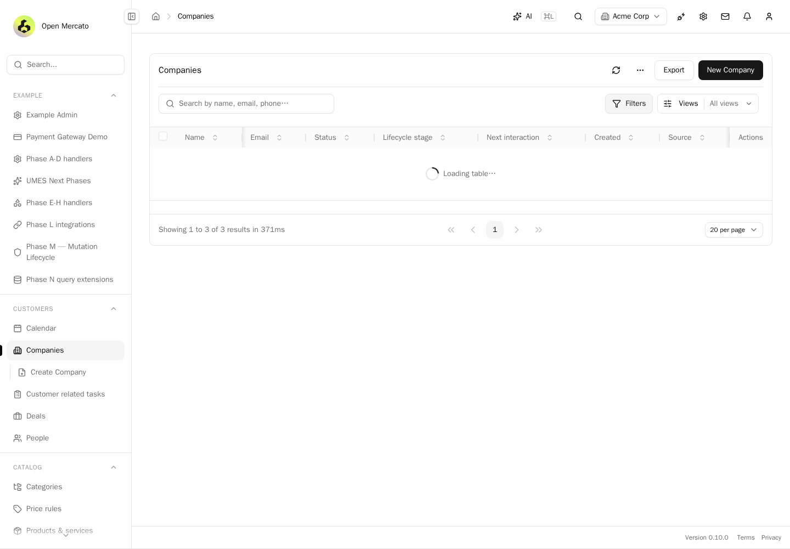
