## 📸 UI QA evidence — PASS

**QA head:** `c45f99c974fc15dc28e7cbe1a7ca0477759613d3`

**Verdict:** Fresh replacement-head expiry and translated network-failure checks pass. No actionable source finding observed. Evidence only: no QA approval, failure or pipeline label applied.

**Environment:** local runner; exact-head linked worktree, own production app `127.0.0.1:41173`, isolated disposable PostgreSQL; Playwright/Chromium1.61.1; admin and two own tenant-bound narrow-role users. Worktree-local install, forced package → generate → package builds, production build162s; authenticated cold/warm readiness passed. `RAYON_NUM_THREADS=2`,21GiB owned-tree RSS guard; observed peak10.81GiB.

[Machine report](https://raw.githubusercontent.com/open-mercato/open-mercato/qa-evidence-pr-9394-649a0623/pr-9394-649a0623/report.json) · [Human report](https://raw.githubusercontent.com/open-mercato/open-mercato/qa-evidence-pr-9394-649a0623/pr-9394-649a0623/report.md)

| # / Priority | Route and action | Expected | Observed | Result / evidence |
|---|---|---|---|---|
| 1 / P1 | /backend/api-keys: Cold EN login and list | Useful shell, English list and no unexpected500 | Login and changed list loaded in production; initial loading state observed | PASS — [step-01-default-en.png](https://raw.githubusercontent.com/open-mercato/open-mercato/qa-evidence-pr-9394-649a0623/pr-9394-649a0623/step-01-default-en.png) |
| 2 / P1 | /backend/api-keys: UI create picked expiry and double-submit | One key, selected Jan1 preserved, all fields intact | Single POST; Jan1 2027 stored UTC midnight and displayed Jan1 in New York; description/org/manager role preserved; secret screen closed | PASS — [step-03-picked-new-york.png](https://raw.githubusercontent.com/open-mercato/open-mercato/qa-evidence-pr-9394-649a0623/pr-9394-649a0623/step-03-picked-new-york.png) |
| 3 / P1 | /backend/api-keys: Explicit instant/null/offset/long/DST/leap UI | Picked days stay dates; real instants keep local clock; null em dash | NewYork timestamp10:30AM, offset11:30PM, leapFeb29, DSTMar14, null— andlong name present; supplementary fixtures API-only | PASS — [step-04-instant-null-long-en.png](https://raw.githubusercontent.com/open-mercato/open-mercato/qa-evidence-pr-9394-649a0623/pr-9394-649a0623/step-04-instant-null-long-en.png) |
| 4 / P1 | /backend/api-keys: Explicit Polish UI switch | Polish heading/columns/dates no raw changed-screen keys | Selected Polski via profile menu, heading Klucze API, picked1sty2027, localized clock values | PASS — [step-05-polish-new-york.png](https://raw.githubusercontent.com/open-mercato/open-mercato/qa-evidence-pr-9394-649a0623/pr-9394-649a0623/step-05-polish-new-york.png) |
| 5 / P1 | /backend/api-keys: Live timezone/locale expiry matrix | 4zones x2locales x6 values preserve calendar dates and local instants | 48 assertions passed including offset/DST/leap/null; fresh Chromium contexts | PASS — [step-06-kiritimati-polish.png](https://raw.githubusercontent.com/open-mercato/open-mercato/qa-evidence-pr-9394-649a0623/pr-9394-649a0623/step-06-kiritimati-polish.png) |
| 6 / P1 | /backend/api-keys: Polish empty search | Translated empty state | No matching records, translated Klucze API empty state | PASS — [step-07-empty-polish.png](https://raw.githubusercontent.com/open-mercato/open-mercato/qa-evidence-pr-9394-649a0623/pr-9394-649a0623/step-07-empty-polish.png) |
| 7 / P1 | /backend/api-keys: Polish loading and recovery | Translated useful loading then rows | Delayed real GET displays Polish loading, six rows recover | PASS — [step-08-loading-polish.png](https://raw.githubusercontent.com/open-mercato/open-mercato/qa-evidence-pr-9394-649a0623/pr-9394-649a0623/step-08-loading-polish.png) |
| 8 / P1 | /backend/api-keys: Polish network failure and same-page recovery | Translated error; search retries successfully without reload and no stale error after10s | Browser-aborted list GET shows Nie udało się wczytać kluczy API, never Failed to fetch; later successful search recovers all six rows and flash clears | PASS — [step-09-polish-network-error.png](https://raw.githubusercontent.com/open-mercato/open-mercato/qa-evidence-pr-9394-649a0623/pr-9394-649a0623/step-09-polish-network-error.png) |
| 9 / P1 | /backend/api-keys: 10reloads and whole-record integrity | 10/10 stable expiry with no mutation to other fields | 10 real reloads preserve picked day and entire API record unchanged | PASS — assertion logs |
| 10 / P1 | /backend/api-keys: 390px narrow long-content expiry | Picked day and actions reachable by table scroll | 390px viewport, expiry scrolled into view; essential selected day fits | PASS — [step-11-narrow-expiry.png](https://raw.githubusercontent.com/open-mercato/open-mercato/qa-evidence-pr-9394-649a0623/pr-9394-649a0623/step-11-narrow-expiry.png) |
| 11 / P1 | /backend/api-keys: Own no-feature tenant-bound actor | UI denies and direct list/create/delete403 with allowed control200 | Denied page hides table; three direct APIs403; own manager list200; no global superadmin used as negative actor | PASS — [step-12-no-permission.png](https://raw.githubusercontent.com/open-mercato/open-mercato/qa-evidence-pr-9394-649a0623/pr-9394-649a0623/step-12-no-permission.png) |
| 12 / P1 | /backend/api-keys: Delete/cancel/repeat and secret revocation | Escape preserves whole record; CtrlEnter deletes; repeated delete404; old secret401 | Whole record identical after cancel, dialog initial Cancel focused; keyboard delete succeeds; key auth now401/repeat404; LastUsed retained clock before deletion | PASS — [step-13-delete-confirm.png](https://raw.githubusercontent.com/open-mercato/open-mercato/qa-evidence-pr-9394-649a0623/pr-9394-649a0623/step-13-delete-confirm.png) |
| 13 / P1 | /backend/api-keys: Two actors stale delete and recovery | Second delete404, no unrelated mutations; keyboard/search/reload usable | Manager dialog opened before admin API deleted; stale double-confirm404 with Not found, no500; focused Search accepts keyboard input; reload removes stale row; picked whole record identical | PASS — [step-14-stale-refusal.png](https://raw.githubusercontent.com/open-mercato/open-mercato/qa-evidence-pr-9394-649a0623/pr-9394-649a0623/step-14-stale-refusal.png) |
| 14 / P1 | /backend/api-keys: Two actors live ACL revocation and keyboard retry | Revoked delete403 preserves record; restored ACL permits retry; no stale error after10s | Admin revoked own manager role while dialog open; manager CtrlEnter403, full record unchanged; after restore focused search/dialog keyboard retry succeeded and error cleared after10s | PASS — [step-15-acl-refusal.png](https://raw.githubusercontent.com/open-mercato/open-mercato/qa-evidence-pr-9394-649a0623/pr-9394-649a0623/step-15-acl-refusal.png) |
| 15 / P1 | /backend/api-keys: 10 repeated Polish network failures/recoveries | 10/10 localized failures and successful real retry | Ten browser abort/search-recovery cycles passed, dismissed localized flash, no raw English errors | PASS — assertion logs |
| 16 / P1 | /backend/api-keys: Expiry clock visual accessibility | Full explicit timestamp remains reachable | Expiry column resized through its semantic separator; clock remains full DOM text and can be revealed by column resize | PASS — [step-16-expanded-expiry-clock.png](https://raw.githubusercontent.com/open-mercato/open-mercato/qa-evidence-pr-9394-649a0623/pr-9394-649a0623/step-16-expanded-expiry-clock.png) |
| 17 / P1 | /backend/api-keys: Final exploratory after-success check | Narrow row action usable; no stale error or hidden record mutation | 390px action bound inside viewport,10s clean screen after repeated recovery, picked whole record unchanged | PASS — assertion logs |

### Independent validation

- `timeout 900 yarn install --immutable` — exit0; optional cpu-features native build warning.
- `yarn build:packages -> yarn generate -> yarn build:packages; authoritative ephemeral CLI with --force-rebuild --no-reuse-env and TURBO_FORCE=true` — fresh worktree-local forced package builds42/42 twice, fresh production app build162s, authenticated readiness and warm reuse passed.
- `timeout 180 yarn jest --config packages/core/jest.config.cjs <page.loadError.test.tsx> <expiryDisplay.test.ts> --runInBand` — 2 suites /7 tests passed.
- `timeout 180 yarn jest --config packages/core/jest.config.cjs packages/core/src/modules/api_keys --runInBand` — 15 suites /89 tests passed.
- `timeout 120 yarn jest --config packages/ui/jest.config.cjs date-format --runInBand` — 1 suite /31 tests passed.
- `timeout 90 yarn workspace @open-mercato/core typecheck` — exit0.
- `timeout 90 yarn eslint <four changed API-key files>` — exit0; existing Next pages-directory configuration warning.
- `timeout 480 yarn mercato test:integration TC-APIKEY` — 12 passed,215.8s; reused same exact-head production app, self-contained tenant/org/role/user fixtures.
- `TZ=<NewYork|Kiritimati|Warsaw|UTC> node oracle.mjs` — 220 independent Intl date/time/null/invalid assertions passed in all five locales.
- `configured Playwright1.61.1 Chromium provider open/snapshot/interact/assert/screenshot/close` — 17 browser checks,48 live expiry matrix assertions,10 reloads,10 Polish error/recovery cycles;15 published PNGs.

### Scope assessment and coverage limits

Read the complete replacement conversation, review and linked #8968, plus predecessor [comment6828105940](https://github.com/open-mercato/open-mercato/pull/9255#issuecomment-6828105940). The four-file diff preserves expiry rendering and replaces raw thrown list-load errors with the existing translated message. All results above were rerun on the replacement head; predecessor screenshots are supporting context only. The new test is mocked component coverage, so it does not replace browser regression coverage.

- Cross-tenant and foreign-organization reads/deletes, tenant-wide visibility and expiry validation were exercised through the native self-contained API tests, not a second tenant browser. Own tenant-bound allowed/denied users and two actor stale/ACL workflows were exercised in real browser sessions.
- Role/user/ACL setup and explicit timestamp/offset/DST/leap fixtures used product APIs. UI create/date picker, locale selection, empty/loading/error/search recovery, denied view, delete/cancel/keyboard/retry/narrow paths were exercised. Role-management UI itself is outside the changed screen.
- Automatic focus after refused deletion was observed on MAIN/BODY. Search was explicitly refocused and asserted, initial dialog Cancel focus was asserted, and keyboard retries worked. Detailed automatic return-target/tab-order behavior was not audited.
- Actual authentication across the selected-day UTC-midnight boundary was not awaited. Display behavior changes only; existing expiry semantics remain unchanged, as the linked issue distinguishes from its display fix. Future-key authentication and deletion revocation were exercised; native API tests reject past expiry.
- Only EN/PL were exercised in the live UI. All five existing loadFailed dictionary entries (en/pl/es/de/ko) are nonempty; no new locale keys are added. The independent helper oracle covers all five locales.
- Full repository global lint/typecheck/all-module tests were not run. Scoped lint/core typecheck/module and date tests/native API-key integration and forced production build passed. Evidence-only run grants no QA approval or merge readiness.
- Transient picker-closing screenshot step-02 was omitted from publication; saved create behavior is verified by actual UI request/whole-record assertions and step-03. Generated secret screens were never captured.

No editable key form, amount/money/stock/credit changes, workers/subscribers, migrations, shared formatting changes or external integrations are present in the diff. Their associated edit-field/reverse-financial/background checks are inapplicable. The expiry helper has one production consumer, this list. No `.uxproof/` contract is present.

### Cleanup and claim ownership

All9 own keys deleted or already404, both users and both narrow roles deleted (13 verified200/404 cleanup actions); own-key search returned zero. Browser/context/API sessions closed. Owned CLI/Next/workers/supervisor stopped; own PostgreSQL container removed; port41173 closed. Restored only the owned runtime email-capture additions; tracked credential-reference file preserved. `git status --porcelain` is empty. No source edits, commits, PR-branch pushes, merge or shared QA metadata writes.

Claim run `qa-649a0623-0644-4e30-a576-433cf1a57ecf`, comment6848376559, lock `c8efe669974da64a1c0d975cf6cda12e80b266a6` remain held during publication. The completion notice will release the owned secondary signals, then the exact-SHA lock last. Confirmed unassignable App exception; human assignments untouched. Existing `screenshots` is informational and was previously predecessor-only; these images provide fresh replacement-head evidence.

Application screenshots (15 PNGs)

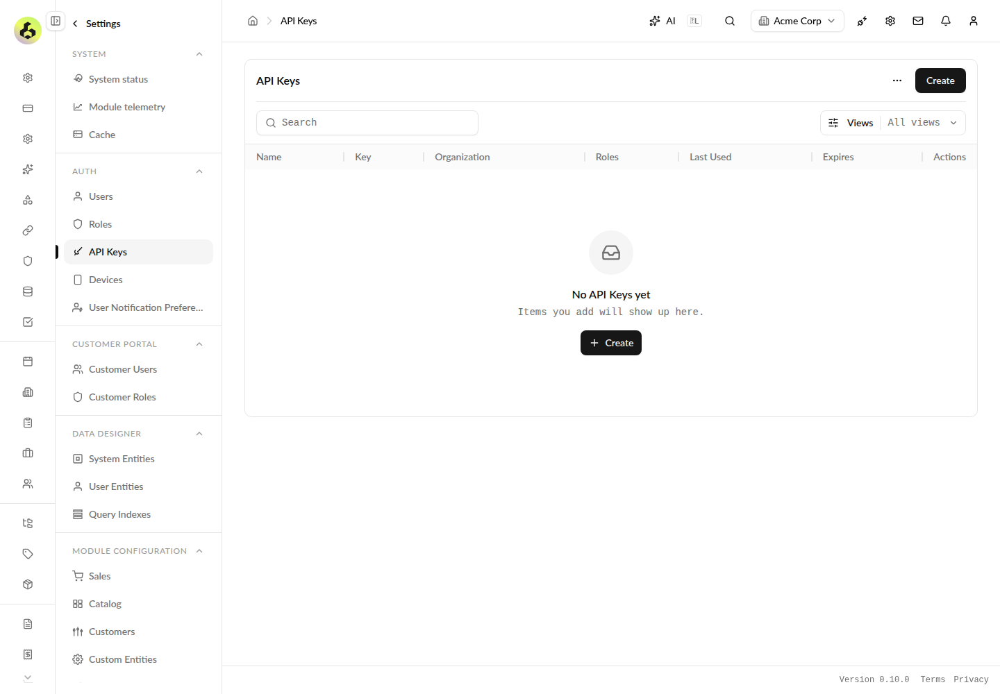

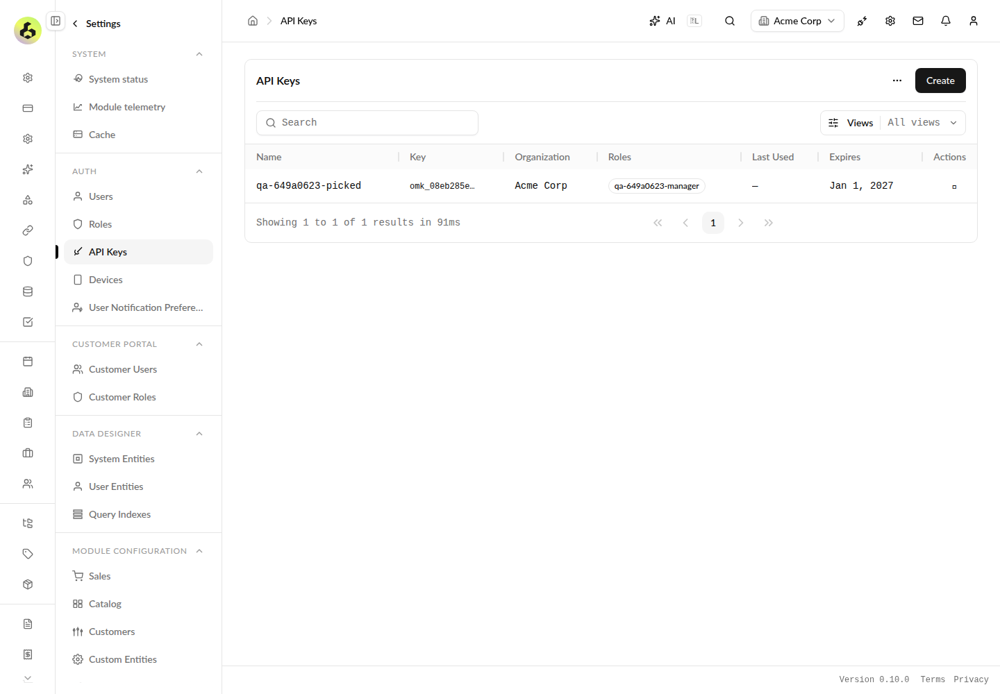

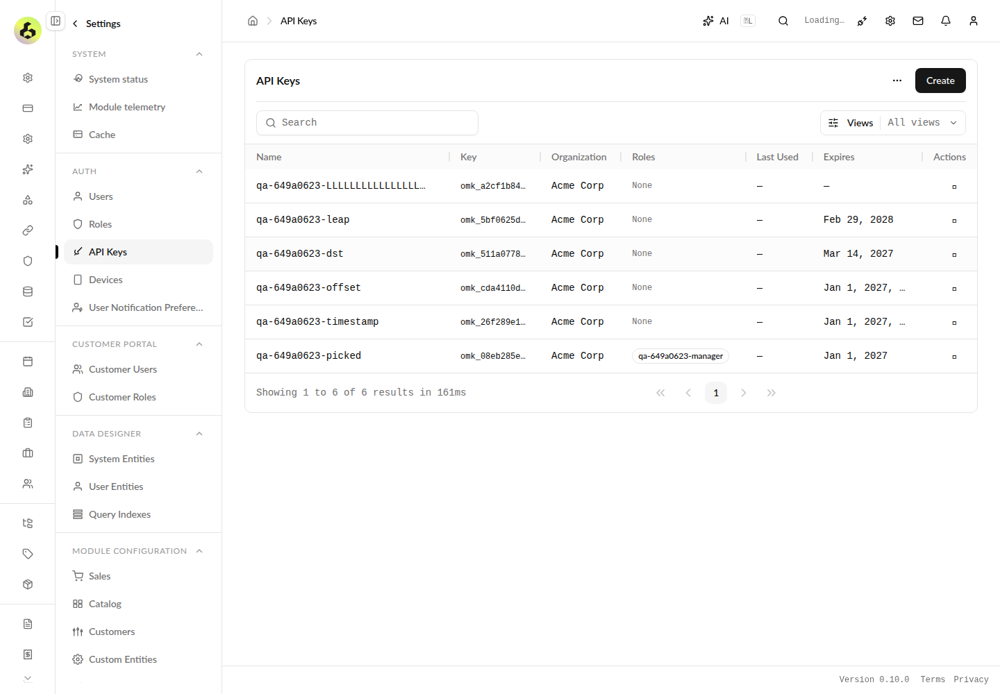

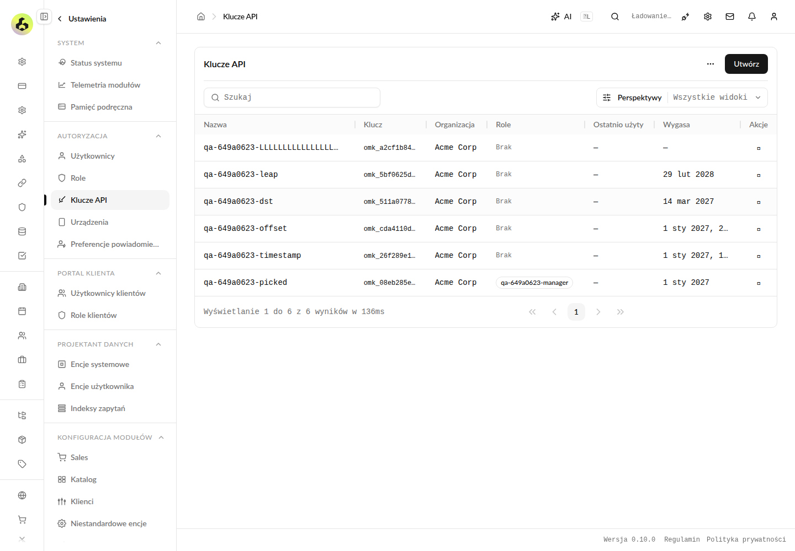

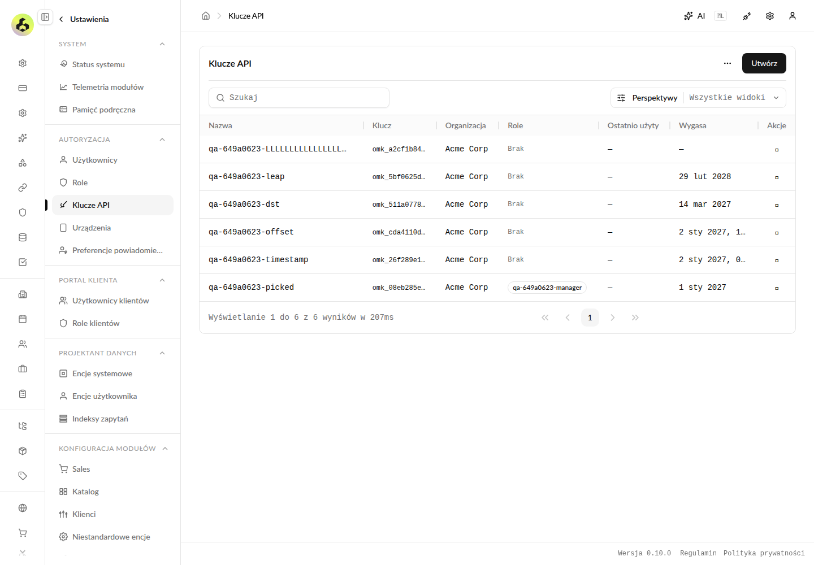

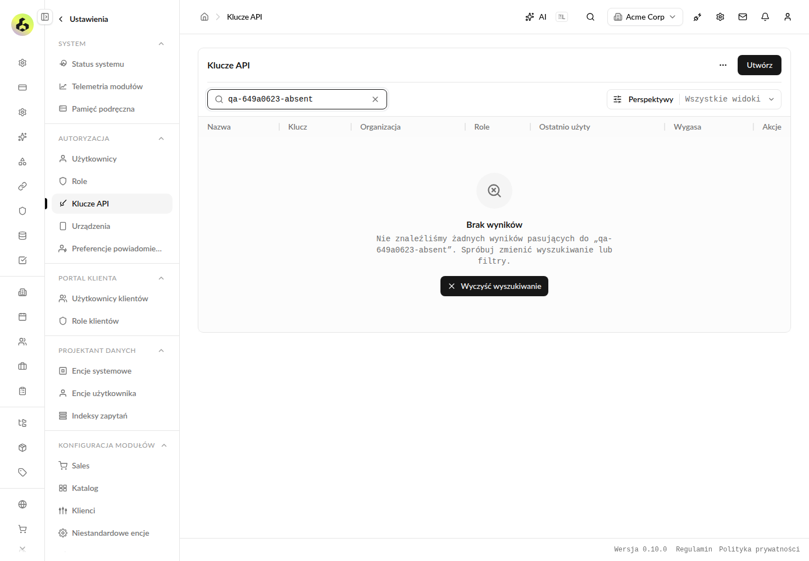

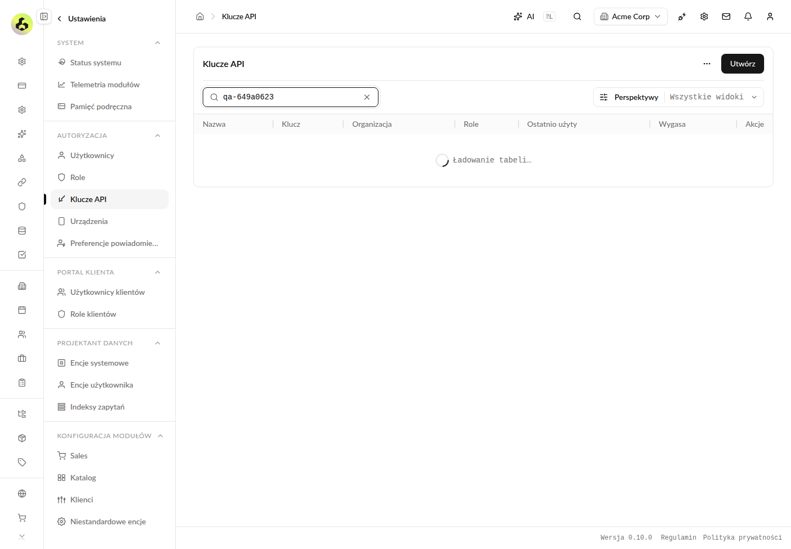

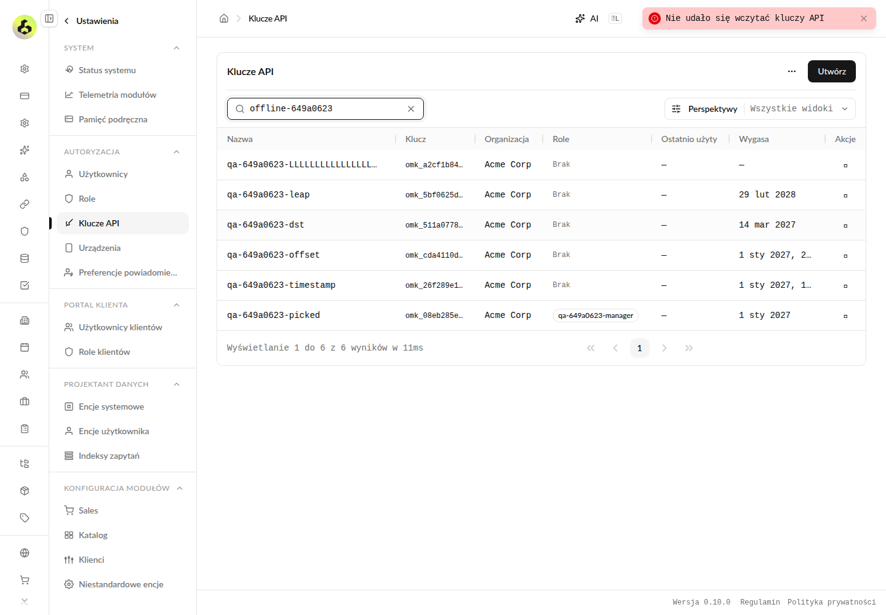

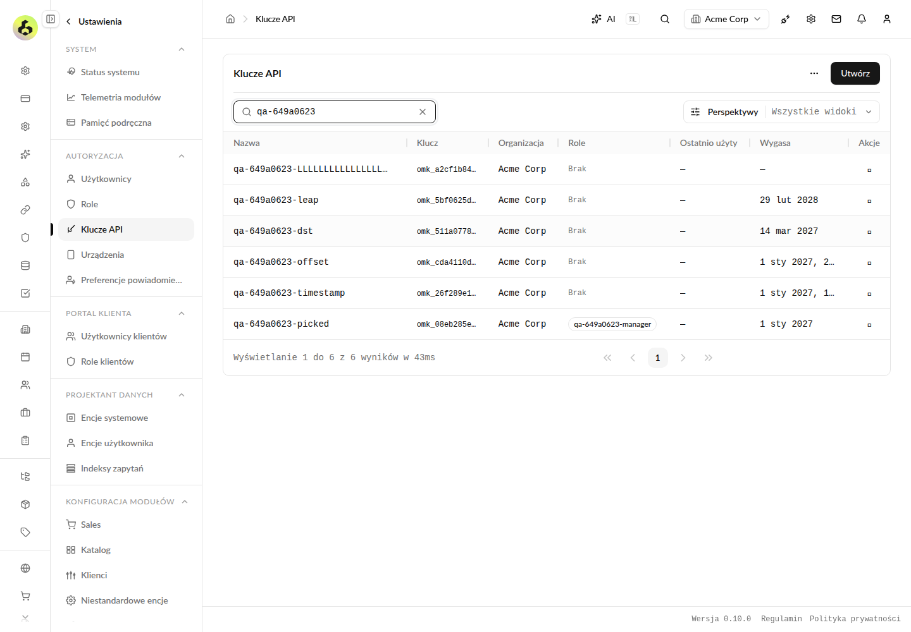

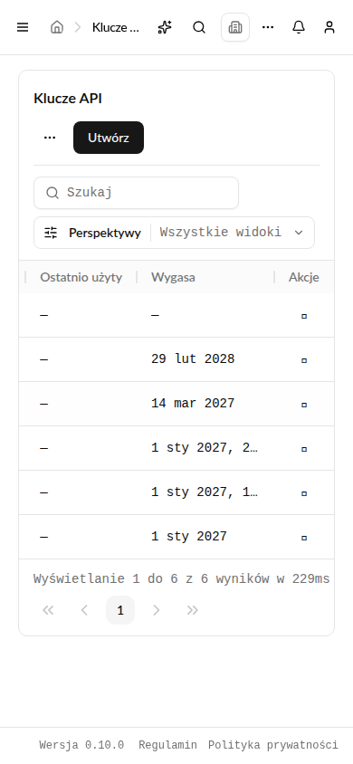

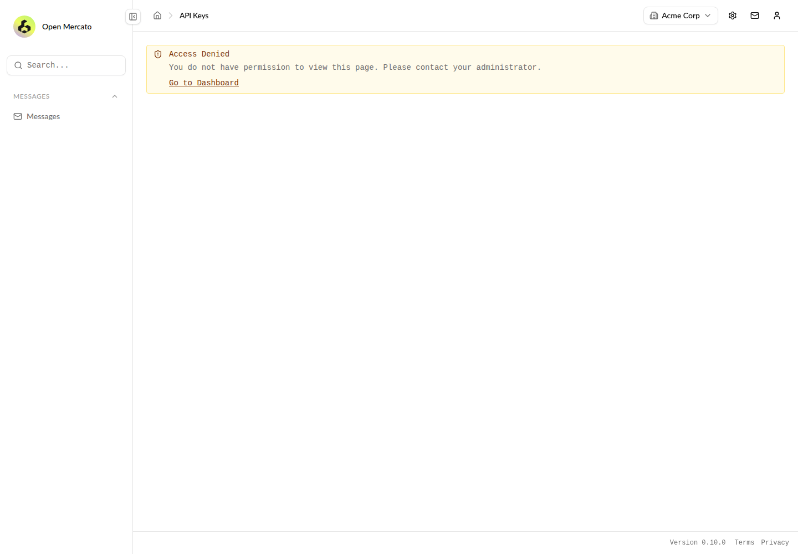

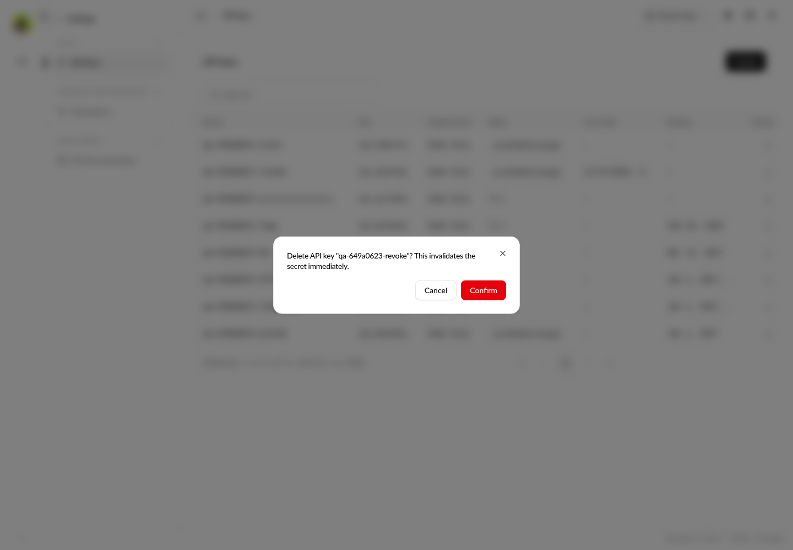

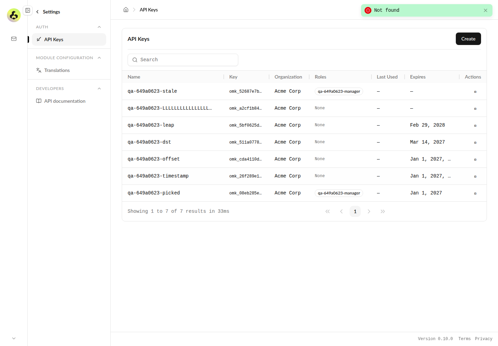

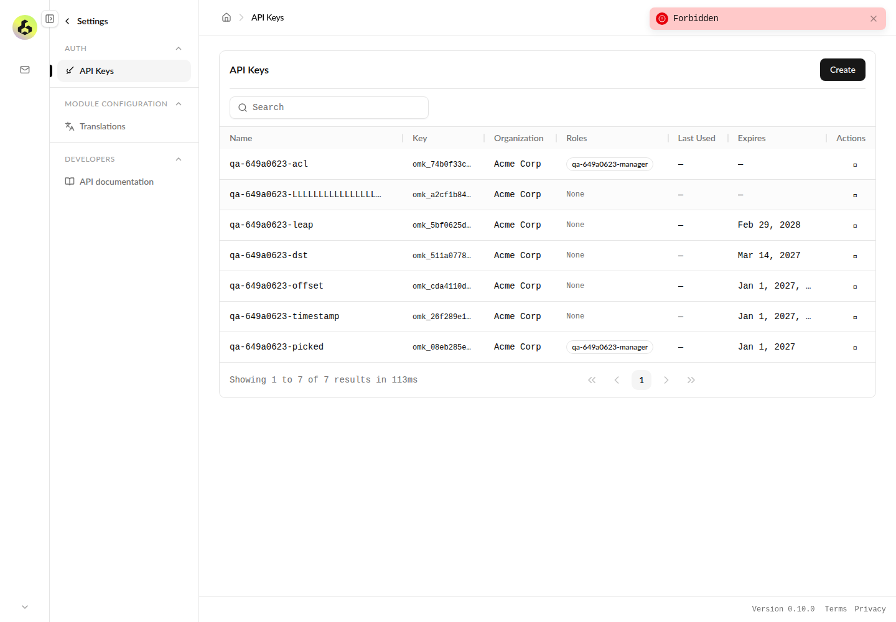

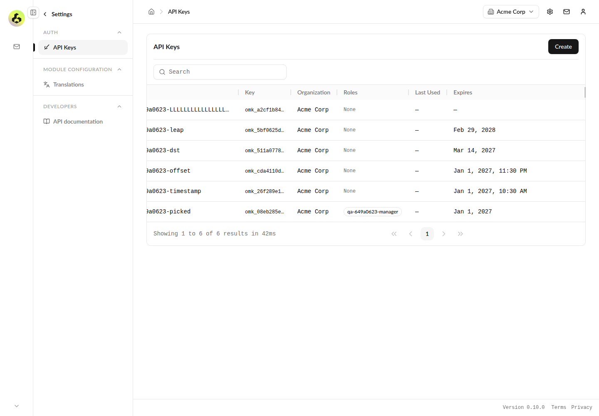

<!-- om-auto-qa-pr:evidence:649a0623-0644-4e30-a576-433cf1a57ecf -->
